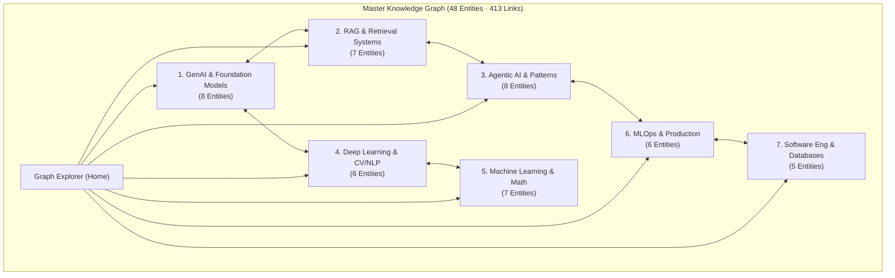

# ✦ AI Engineer Knowledge Wiki & Interactive Graph Explorer

> **Personal Knowledge Wiki & Interactive Graph Explorer dành cho AI Engineer** — Được xây dựng theo triết lý **LLM Wiki của Andrej Karpathy**, phương pháp sư phạm **Lecture Visualizer** ("Dành Cho Người Học Chậm"), và hệ thống thiết kế **Soft Clean Cards**.

[](https://nextjs.org/)
[](https://www.typescriptlang.org/)
[](https://tailwindcss.com/)
[](https://katex.org/)
[](wiki/index.md)
[](wiki/index.md)
[](resources/)

---

## 1. Triết Lý Cốt Lõi (Core Philosophies)

### 1.1 Triết lý Andrej Karpathy LLM Wiki: "Knowledge Compilation thay vì RAG thụ động"
> *"In a standard RAG system, adding a new document means it gets indexed and sits alongside your other documents... Nothing is synthesized. Nothing is connected.*  
> *In an LLM wiki, adding a new document triggers a **compilation step**... Over time, the wiki becomes a connected knowledge graph, not just a pile of documents. The answer lives in the **relationships** between pages."*  
> — **Andrej Karpathy**

- **Mỗi khái niệm là 1 trang thực thể độc lập (`Entity Page`)**: Không gộp dồn vào một file, giúp tạo thành đồ thị tri thức sống (Knowledge Graph).
- **Phát hiện và ghi nhận Mâu thuẫn (`Discrepancies & Nuances`)**: Luôn chỉ rõ các điểm vênh nhau giữa lý thuyết giáo trình kinh điển và thực tiễn kỹ nghệ công nghiệp.
- **Mạng lưới hai chiều**: Kết nối toàn diện qua cú pháp `[[wiki-links]]` và trỏ trực tiếp về tài liệu gốc trong `resources/`.

### 1.2 Phương Pháp Sư Phạm `lecture-visualizer`: "Dành Cho Người Học Chậm"
- **Trực giác đời thường trước — Ký hiệu toán học sau (Intuition Before Notation)**: Không đưa công thức toán trần trụi ngay đầu bài; luôn giải thích bản chất nguyên lý bằng lời văn mộc mạc và ví dụ đời sống.
- **Bảng Từ Điển Ký Hiệu 4 Cột**: Đối chiếu tức thời giữa Ký hiệu LaTeX | Tên tiếng Anh | Tên tiếng Việt | Nghĩa đời thường trực giác.
- **Hộp thoại Trực Giác 🌱 (`.callout-intuition`)**: Giải thích bản chất tại các điểm nghẽn tư duy.
- **Góc Phỏng Vấn Kỹ Sư & Phản Biện Accordion (Q&A)**: Bộ câu hỏi phỏng vấn Senior AI Engineer có nút mở/đóng xem đáp án và phân tích sâu.
- **Sidebar Notion-style**: Bám dính (sticky) có ScrollSpy (cuộn đến đâu sáng đèn mục đó) và thanh tiến trình đọc (0% - 100%).

### 1.3 Hệ Thống Thiết Kế "Soft Clean Cards"
- **Nền trang xám sáng thoáng** (`#F5F5F7` chuyển mờ sang `#EDEDF0`).
- **Thẻ Card trắng bo góc lớn** 28px (`rounded-[28px]`), đổ bóng mờ nhẹ (`shadow-card`), viền mờ 1px (`#E9E9EE`).
- **Màu sắc chỉ dùng cho dữ liệu**: 7 màu pastel đại diện cho 7 miền tri thức, màu xanh mầm `#22C55E` cho hộp trực giác 🌱, màu đỏ `#EF4444` cho hộp mâu thuẫn ⚖️.

---

## 2. Bản Đồ 7 Miền Tri Thức (48 Khái Niệm Cốt Lõi)



| Miền Tri Thức (Knowledge Domain) | Màu Nhận Diện | Số Bài | Các Khái Niệm Trọng Tâm |
| :--- | :---: | :---: | :--- |
| **1. GenAI & Foundation Models** | `Electric Blue` | 8 | [[large-language-models]], [[transformer-architecture]], [[llm-reasoning]], [[llm-fine-tuning]], [[llm-alignment]], [[prompt-engineering]], [[llm-evaluation]], [[quantization-and-compression]] |
| **2. RAG & Retrieval Systems** | `Vibrant Purple` | 7 | [[rag-architecture]], [[document-chunking]], [[vector-embeddings]], [[hybrid-search]], [[reranking]], [[query-transformation]], [[graph-rag]] |
| **3. Agentic AI & Design Patterns** | `Warm Orange` | 8 | [[agentic-ai-core]], [[react-pattern]], [[reflection-and-self-correction]], [[planning-and-decomposition]], [[tool-use-and-function-calling]], [[multi-agent-collaboration]], [[agent-memory-systems]], [[human-in-the-loop]] |
| **4. Deep Learning & CV/NLP** | `Emerald Green` | 6 | [[convolutional-neural-networks]], [[unet-architecture]], [[object-detection-yolo]], [[vision-transformers]], [[inference-optimization-tensorrt]], [[graph-neural-networks]] |
| **5. Machine Learning & Math** | `Cyan Sky` | 7 | [[linear-regression-mle]], [[bias-variance-tradeoff]], [[regularization-l1-l2]], [[gradient-vanishing-exploding]], [[optimization-algorithms]], [[principal-component-analysis]], [[model-selection-evaluation]] |
| **6. MLOps & Production Engineering** | `Pastel Rose` | 6 | [[mlops-lifecycle]], [[experiment-tracking-model-registry]], [[model-serving-api]], [[containerization-kubernetes-ml]], [[continuous-integration-cd-ml]], [[data-drift-model-monitoring]] |
| **7. Software Engineering & Databases** | `Steel Slate` | 5 | [[oop-core-principles]], [[solid-principles]], [[database-indexing-optimization]], [[acid-and-transactions]], [[sql-vs-nosql-data-architecture]] |

---

## 3. Kiến Trúc Thư Mục Dự Án

```
E:\MyProject\MyWiki\
├── wiki/                              # Kho tri thức Markdown (47 Entity Pages + 1 Index)
│   ├── index.md                       # Master Index & Bản đồ tri thức toàn cục
│   ├── large-language-models.md
│   ├── transformer-architecture.md
│   ├── rag-architecture.md
│   └── ...                            # 47 thực thể chuẩn Karpathy LLM Wiki
├── resources/                         # 114 tài liệu gốc (Ground Truth)
│   ├── genai/                         # Sách Encyclopedia of LLMs, Agentic Design Patterns...
│   ├── deep-learning/                 # Sách Deep Learning Theory, Deep Learning on Graphs...
│   ├── machine-learning/              # Sách Mathematics for Machine Learning...
│   ├── software/                      # Sách Fundamentals of Database Systems...
│   ├── data-sciense/                  # Bài giảng Cơ sở dữ liệu TS. Lê Thiện Hòa...
│   ├── ops/                           # Slide MLOps, Docker, Kubernetes...
│   └── images/                        # Infographic chuyên gia (Andrew Ng, HITL, Drift...)
├── view/                              # Ứng dụng Web Next.js (App Router)
│   ├── package.json                   # Next.js 14, React 18, KaTeX, ForceGraph2D
│   ├── tailwind.config.ts             # Hệ thống tokens Soft Clean Cards
│   └── src/
│       ├── app/
│       │   ├── page.tsx               # Graph-First Home: Đồ thị liên kết toàn cảnh
│       │   ├── wiki/[slug]/page.tsx   # Trang bài giảng chuyên sâu chuẩn lecture-visualizer
│       │   └── learn/[topic]/page.tsx # Khung mở rộng các bài học sau này
│       ├── components/
│       │   ├── graph/                 # Động cơ Canvas Force Graph & Quick View Drawer
│       │   ├── lecture/               # Bộ component sư phạm (Từ điển, Callouts, Sidebar, Q&A)
│       │   └── ui/                    # Thư viện Soft Clean Cards (Card, Badge, Button)
│       └── lib/
│           ├── wiki.ts                # Đọc và bóc tách metadata từ wiki/*.md
│           ├── graph.ts               # Xây dựng mạng lưới nodes & links
│           └── lecture-parser.ts      # Bóc tách cấu trúc sư phạm và KaTeX math
├── docs/
│   ├── ai/                            # Công cụ AI Agent (verify_links.py, inspect_resources.py)
│   ├── plan/                          # Hồ sơ kế hoạch kiến trúc chi tiết (00 - 05)
│   └── references/                    # Tài liệu chuẩn thiết kế (soft-clean-cards.md)
└── tasks/
    ├── todo.md                        # Tiến độ quản lý công việc
    └── lessons.md                     # Bài học kinh nghiệm kỹ thuật
```

---

## 4. Hướng Dẫn Cài Đặt & Khởi Chạy (Quick Start)

### 4.1 Khởi chạy Ứng dụng Web Next.js (`view/`)

Yêu cầu môi trường: **Node.js $\ge$ 18.x** (khuyến nghị Node 20+ hoặc 23.x).

```powershell
# 1. Di chuyển vào thư mục view
cd view

# 2. Cài đặt dependencies (nếu chưa cài)
npm install

# 3. Khởi chạy môi trường phát triển (Development Mode)
npm run dev
```

Mở trình duyệt tại: **`http://localhost:3000`**

- **Xem Đồ Thị Tri Thức**: Kéo thả, xoay, phóng to thu nhỏ, tìm kiếm nhanh và lọc 7 miền kiến thức.
- **Xem Nhanh 1-Click**: Click vào bất kỳ node nào để mở ngăn kéo bên phải (**Quick View Drawer**).
- **Đọc Bài Giảng Toàn Màn Hình**: Bấm *"Đọc Toàn Bộ Bài Giảng"* để chuyển sang giao diện bài học chuẩn `lecture-visualizer`.

#### Build bản Production
```powershell
npm run build
npm start
```
*Kết quả build: Tĩnh hóa thành công 100% (51/51 trang tĩnh SSG), First Load JS cực nhẹ ~87.3 kB.*

### 4.2 Kiểm Tra Toàn Vẹn Liên Kết Python (`docs/ai/`)

Yêu cầu môi trường: **Python $\ge$ 3.10** với công cụ `uv` hoặc môi trường ảo `.venv`.

```powershell
# Kiểm tra 100% liên kết [[wiki-links]] và file gốc trong resources/
uv run python docs/ai/verify_links.py
```

Kết quả kiểm tra tự động:
- **100%** liên kết tài liệu gốc (`142/142 links`) trỏ chính xác đến các file có thực trong `resources/`.
- **100%** liên kết chéo nội bộ (`413/413 [[wiki-links]]`) khớp hoàn hảo với các trang thực thể trong `wiki/`.

---

## 5. Quy Trình Biên Dịch Tri Thức Mới (Compilation Step)

Khi bổ sung thêm tài liệu mới vào `resources/` (sách PDF, slide hoặc bài báo mới):
1. **Quét tài liệu mới**: Chạy `uv run python docs/ai/inspect_resources.py`.
2. **Biên dịch hoặc Cập nhật**:
   - Nếu là góc nhìn/mâu thuẫn mới: Bổ sung vào mục *Discrepancies & Nuances* của trang thực thể tương ứng.
   - Nếu là khái niệm hoàn toàn mới: Tạo trang thực thể mới trong `wiki/` với đầy đủ cấu trúc chuẩn Karpathy.
3. **Thêm bài học mở rộng**: Truy cập route `/learn/[topic]` để tạo bài học chuyên sâu theo phương pháp sư phạm `lecture-visualizer`.
4. **Kiểm tra tính toàn vẹn**: Chạy `uv run python docs/ai/verify_links.py`. Ứng dụng Next.js sẽ tự động phát hiện và nối node mới vào Đồ thị Tri thức trên Trang Chủ!

---

## 6. Nguồn Chân Lý Học Thuật (Ground Truth Bibliography)

Toàn bộ các định nghĩa chính thống và công thức toán học được trích xuất từ các giáo trình đại học và sau đại học kinh điển:

1. **Large Language Models & Transformers**:
   - *Encyclopedia of LLMs and Foundation Models* — Hasi Hays (2026 Edition).
   - *Master All 20 Agentic AI Design Patterns* — (2026 Edition).
2. **Toán Học & Machine Learning Nền Tảng**:
   - *Mathematics for Machine Learning* — Marc Peter Deisenroth, A. Aldo Faisal, Cheng Soon Ong (Cambridge University Press).
   - *Understanding Machine Learning: From Theory to Algorithms* — Shai Shalev-Shwartz, Shai Ben-David (Cambridge University Press).
3. **Deep Learning & Computer Vision**:
   - *The Principles of Deep Learning Theory* — Daniel A. Roberts, Sho Yaida, Boris Hanin (Cambridge University Press).
   - *Deep Learning on Graphs* — Yao Ma, Jiliang Tang (Cambridge University Press).
4. **Cơ Sở Dữ Liệu & Kỹ Nghệ Phần Mềm**:
   - *Fundamentals of Database Systems* — Ramez Elmasri, Shamkant B. Navathe (Pearson).
   - *Hệ thống Cơ sở dữ liệu cho Data Scientist & Backend Engineering* — Bài giảng của Tiến sĩ Lê Thiện Hòa.
5. **Thực Chiến & Khắc Phục Lỗi (Failure Modes)**:
   - Bộ Infographic chuyên sâu từ các chuyên gia AI đầu ngành (Andrew Ng, Data Drift, Human-in-the-loop, Model Error Analysis).

---

## 7. Giấy Phép & Tác Quyền

Dự án được xây dựng dưới dạng **Personal Knowledge Wiki & Portfolio** mã nguồn mở phục vụ mục đích nghiên cứu, ôn tập phỏng vấn và phát triển chuyên môn cá nhân của AI Engineer.
