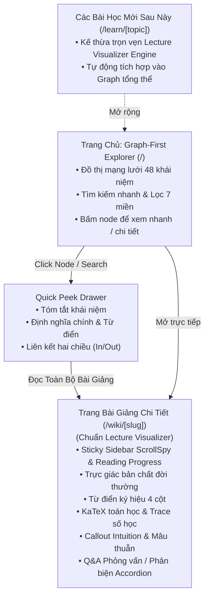

# Master Plan (Cập nhật): AI Engineer Wiki Web App — Graph-First View & Lecture Visualizer Pedagogical Reader

> **Tóm tắt tinh chỉnh theo yêu cầu của User**:
> 1. **Giao diện Mặc định là Đồ thị Tri thức (Graph-First Home)**: Khi vào trang web, hiển thị ngay đồ thị mạng lưới liên kết trực quan giữa các khái niệm — tinh gọn, đơn giản, không rườm rà.
> 2. **Trải nghiệm Đọc Tài liệu chuẩn `lecture-visualizer`**: Khi click vào một node trên đồ thị (hoặc tìm kiếm), người dùng có thể xem nhanh tài liệu (Quick View Drawer) hoặc mở toàn trang. Nội dung các file trong `wiki/` được trình bày theo phương pháp sư phạm *"Dành Cho Người Học Chậm"*: Trực giác trước ký hiệu sau, bảng từ điển ký hiệu 4 cột, hộp thoại `.callout.intuition` 🌱, KaTeX toán học sắc nét, trace số học từng bước, và bảng đối chiếu mâu thuẫn.
> 3. **Kiến trúc Mở rộng Bài học Tương lai (Future Learning Modules)**: Hệ thống sẵn sàng để sau này khi người dùng muốn học một chuyên đề mới, chỉ cần thêm bài học (hoặc yêu cầu AI tạo) vào hệ thống, bài học đó sẽ tự động được render chuẩn `lecture-visualizer` và kết nối ngay vào đồ thị.
> 4. **Design System Nhất quán**: Toàn bộ UI tuân thủ triệt để [soft-clean-cards.md](../../docs/references/soft-clean-cards.md) (Card trắng bo góc 28px, đổ bóng mờ nhẹ, khoảng trắng rộng rãi, màu sắc chỉ dùng cho dữ liệu).

---

## 1. Cấu trúc Trải nghiệm Người dùng (User Flow)



---

## 2. Các Trụ cột Kiến trúc

### Trụ cột 1: Graph-First Interface (Đơn giản, Trực quan, Tinh tế)
- **Mục tiêu**: Người dùng vào web là nhìn thấy ngay toàn cảnh mạng lưới tri thức, không bị che khuất bởi các bảng biểu phức tạp.
- **Tương tác cốt lõi**:
  - Xoay / Kéo / Phóng to thu nhỏ mượt mà.
  - Hover node: Làm nổi bật mạng lưới liên kết lân cận (Ego-network), làm mờ các node không liên quan.
  - Click node: Mở ngay **Quick View Drawer** bên phải màn hình để đọc nhanh nội dung, có nút chuyển sang trang bài giảng toàn màn hình.
  - Bộ lọc 7 miền kiến thức và ô tìm kiếm nhanh (gợi ý tức thì).

### Trụ cột 2: Phương pháp Sư phạm `lecture-visualizer`
Mọi tài liệu trong `wiki/` khi mở ra đọc sẽ được cấu trúc thành bài giảng chuẩn mực gồm:
1. **Trực Giác Trước — Ký Hiệu Sau**: Khởi đầu bằng ví dụ đời sống, ẩn dụ trực quan dễ hiểu.
2. **Từ Điển Ký Hiệu & Khái Niệm Đối Chiếu 4 Cột**: Ký hiệu toán học | Tên tiếng Anh | Tên tiếng Việt | Nghĩa đời thường cực dễ hiểu.
3. **Định Nghĩa Chính Thống & Công Thức Toán KaTeX**: Trích xuất từ sách giáo khoa kinh điển (Tier 1 Ground Truth), công thức toán học sắc nét.
4. **Hộp Thoại "Góc Dành Cho Người Học Chậm" (`.callout.intuition`)**: Giải thích bản chất tại các điểm nghẽn tư duy.
5. **Cơ Chế Kiến Trúc & Sơ Đồ Luồng (Mermaid)**: Luồng dữ liệu và giải thuật trực quan.
6. **Bảng Đối Chiếu Mâu Thuẫn & Sắc Thái**: Lý thuyết hàn lâm vs. Thực tiễn công nghiệp.
7. **Góc Nhìn Thực Chiến, Failure Modes & 15 Câu Hỏi Q&A (Accordion)**: Tình huống phỏng vấn và câu hỏi phản biện chuyên sâu.
8. **Mạng Lưới Liên Kết Hai Chiều**: Outgoing links và Backlinks kết nối bài giảng khác.

### Trụ cột 3: Khả năng Mở rộng Chuyên đề Học tập (Extensible Learning Modules)
- Thiết kế một layout chuẩn `LectureLayout` và thư viện parser module hóa trong `src/components/lecture/`.
- Khi người dùng sau này yêu cầu: *"Hãy tạo một bài học chi tiết về Thuật toán FP-Growth / Attention Is All You Need / Contrastive Learning cho tôi học"*, hệ thống có thể:
  - Sinh file markdown chuyên sâu vào thư mục bài học.
  - Hệ thống Next.js tự động nhận diện và hiển thị thành bài giảng chuẩn `lecture-visualizer` với đầy đủ widget tương tác, KaTeX và tự động liên kết vào Graph View.

---

## 3. Ngăn xếp Công nghệ (Technology Stack)

| Lớp | Công nghệ | Mục đích |
| :--- | :--- | :--- |
| **Framework** | **Next.js (App Router) + TypeScript** | Static Site Generation (SSG) kết hợp Client-Side Graph Animation, tốc độ tải tức thì. |
| **Styling** | **Tailwind CSS + Tokens Soft Clean Cards** | Triển khai triệt để chuẩn mực từ `soft-clean-cards.md` (bo góc 28px, bóng mờ, viền mờ 1px). |
| **Đồ thị** | **Force-Directed Graph (2D Canvas / 3D WebGL)** | Hiệu năng 60fps mượt mà, tải nhanh, trực quan hóa hơn 400 liên kết. |
| **Toán học** | **KaTeX (CSS & Engine)** | Hiển thị công thức toán học chuẩn LaTeX không giật lag. |
| **Icons** | **Lucide Icons** | Icon nét mảnh 1.5px tinh tế. |
| **Sư phạm** | **Lecture Visualizer Component Suite** | Bộ component: SymbolDictionary, IntuitionCallout, MathTrace, QAAccordion, ScrollSpySidebar. |

---

## 4. Cấu trúc Thư mục trong `view/`

```
view/
├── package.json
├── tsconfig.json
├── tailwind.config.ts
├── src/
│   ├── app/
│   │   ├── layout.tsx                   # Global layout (Font Inter, Soft background, Command Palette)
│   │   ├── page.tsx                     # Graph-First Home: Đồ thị toàn cảnh + Quick Drawer
│   │   ├── wiki/
│   │   │   └── [slug]/
│   │   │       └── page.tsx             # Bài giảng chuẩn Lecture Visualizer (Sidebar + Sư phạm + KaTeX)
│   │   ├── learn/
│   │   │   └── [topic]/
│   │   │       └── page.tsx             # Các chuyên đề học tập mở rộng sau này
│   │   └── api/
│   │       ├── graph/route.ts           # Dữ liệu đồ thị nodes & links
│   │       └── search/route.ts          # API tìm kiếm nhanh
│   ├── components/
│   │   ├── ui/                          # Soft Clean Cards UI Components (Card, Segmented, Button, Badge)
│   │   ├── graph/                       # Graph Explorer & Controls (ForceGraph, FilterBar, NodeQuickView)
│   │   ├── lecture/                     # Lecture Visualizer Components
│   │   │   ├── lecture-sidebar.tsx      # Sidebar Notion-style với ScrollSpy & Reading Progress
│   │   │   ├── intuition-callout.tsx    # Hộp thoại "Góc Cho Người Học Chậm" 🌱
│   │   │   ├── symbol-dictionary.tsx    # Bảng từ điển ký hiệu 4 cột
│   │   │   ├── math-block.tsx           # Khối toán học KaTeX
│   │   │   ├── discrepancy-callout.tsx  # Hộp thoại phân tích mâu thuẫn & sắc thái
│   │   │   ├── qa-accordion.tsx         # Bộ câu hỏi phản biện & phỏng vấn
│   │   │   └── backlinks-card.tsx       # Mạng lưới liên kết hai chiều
│   │   └── layout/                      # Navbar tối giản, Command Palette
│   └── lib/
│       ├── wiki.ts                      # Đọc và bóc tách tài liệu từ ../wiki/*.md
│       ├── graph.ts                     # Xây dựng cấu trúc đồ thị
│       └── lecture-parser.ts            # Chuyển đổi nội dung markdown thành cấu trúc sư phạm
```
