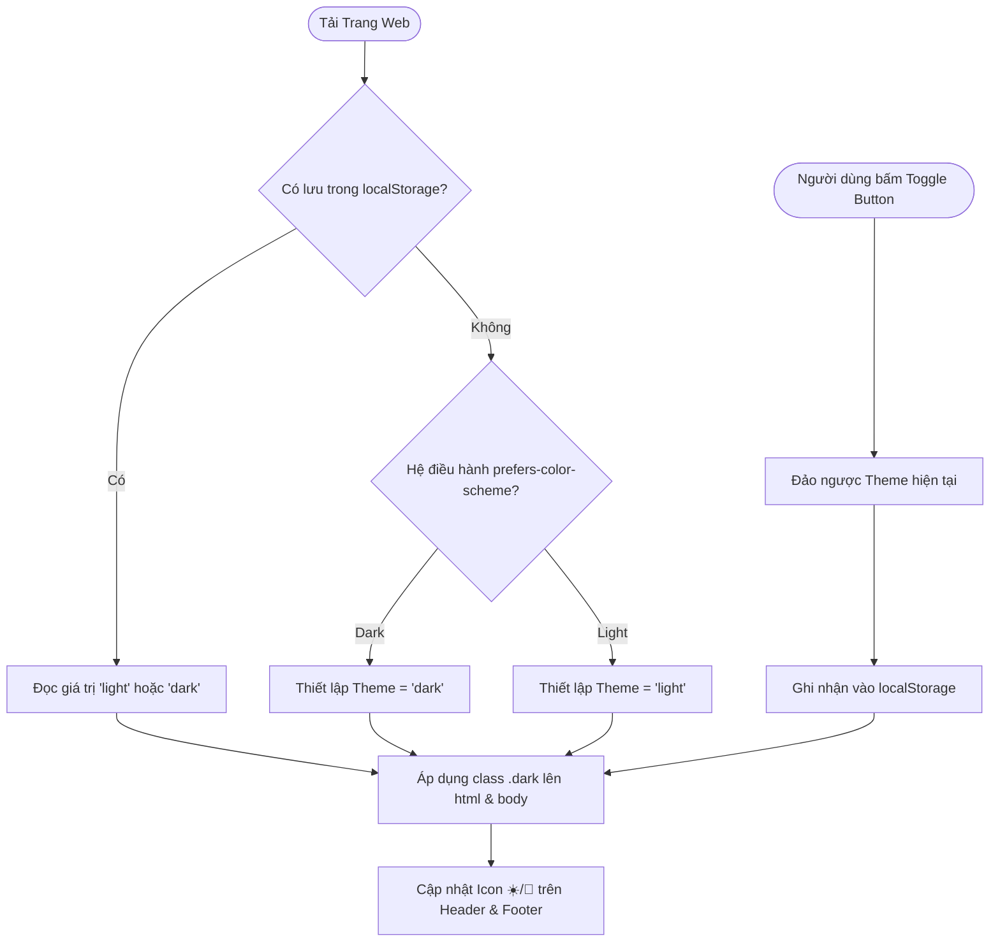

# Kế Hoạch & Đặc Tả Thiết Kế Hệ Thống Dark Mode: Soft Clean Cards & Pedagogical Reader

> **Tài liệu tham chiếu Design System**: Thuộc hệ thống tài liệu quy hoạch `docs/plan/` cho ứng dụng cẩm nang phỏng vấn AI và Wiki Tri thức (`interview/` & `view/`).
> **Phương pháp luận**: Triển khai theo chuẩn **Design System 3-Layer Token Architecture** (Primitive $\rightarrow$ Semantic $\rightarrow$ Component) kết hợp **Apple Human Interface Guidelines & Material Elevation**.

---

## 1. Phân Tích Chi Tiết Hiện Trạng Design System (`interview/`)

### 1.1 Triết lý & Bản sắc Gốc của Light Mode
Phần `interview/` được thiết kế dựa trên sự giao thoa của hai hệ tư tưởng thiết kế giao diện:
1. **Soft Clean Cards (Thẻ Mềm Thanh Lịch)**:
   - Nền trang màu xám sáng thanh thoát (`#F6F7F9`), thẻ Card màu trắng tinh khiết bo góc lớn 26px (`--radius-xl: 26px`).
   - Đổ bóng mờ nhiều lớp đa tầng (`--shadow-card`), viền thẻ mảnh 1px (`--border-card: #E2E6EA`) tạo cảm giác bề mặt nổi nhẹ nhàng, trang nhã.
   - Khoảng trắng (whitespace) hào phóng, chữ sắc nét, phân cấp rõ ràng theo bộ font `Inter` và `JetBrains Mono`.
2. **Lecture Visualizer (Sư phạm Cho Người Học Chậm)**:
   - Giao diện phụng sự việc đọc sâu và tiếp thu kiến thức nặng (Deep Focus Reading).
   - **Màu sắc không dùng để trang trí vô tội vạ**, mà đóng vai trò là **tín hiệu nhận thức sư phạm (Pedagogical Signals)**:
     - **Xanh Ngọc Lục Bảo (`--data-emerald: #059669`)**: Gắn liền với hộp thoại Trực giác *"Góc Dành Cho Người Học Chậm"* 🌱, ví dụ đời thường, bản chất vật lý.
     - **Xanh Dương Điện (`--data-blue: #2563EB`)**: Công thức toán học (Self-Attention, RoPE), định nghĩa chính thống, tiêu chí JD doanh nghiệp.
     - **Tím Bão Hòa (`--data-purple: #7C3AED`)**: Kiến trúc hệ thống, thuật toán, mẹo thực chiến.
     - **Đỏ Tín Hiệu (`--data-red: #DC2626`)**: Điểm vênh lý thuyết vs thực tiễn, cảnh báo lỗi (Failure modes), sai lầm sống còn khi phỏng vấn.
     - **Hổ Phách (`--data-amber: #D97706`)**: Quản trị giao dịch, điều khiển luồng, cảnh báo trung tính.

### 1.2 Những Điểm Nghẽn Trước Khi Tái Cấu Trúc Dark Mode
Qua quá trình kiểm toán toàn diện mã nguồn (`style.css`, `index.html`, `script.js`), phát hiện các hạn chế sau:
- **Hardcoded Hex phân tán**: Nhiều màu nền (`#FFFFFF`, `#F8FAFC`, `#F1F5F9`), màu chữ (`#334155`, `#475569`, `#0F172A`) và mã màu thẻ nằm rải rác trong các rule CSS và các thuộc tính `style="..."` nội tuyến.
- **Nguy cơ khi "đảo màu bừa bãi" (Naive Color Inversion)**:
  - Nếu chỉ đảo ngược giá trị âm bản (invert), nền đen `#000000` kết hợp chữ trắng tinh `#FFFFFF` sẽ gây ra hiện tượng tán sắc chói lóa (halo effect), gây nhức mắt nghiêm trọng cho người đọc sau 5 phút.
  - Các hộp thoại sư phạm (`.callout`) vốn có màu nền pastel sáng dịu sẽ biến thành các mảng màu chói chang hoặc biến mất độ tương phản.
  - Nút bấm đang kích hoạt (`.interactive-btn.active`) vốn dùng màu mực đen `--ink: #0B0F19`, nếu sang dark mode mà không đổi semantic token sẽ bị tàng hình trên nền card tối.
  - Đổ bóng đổ (`box-shadow`) hoàn toàn mất tác dụng trên nền tối, dẫn đến giao diện bị bẹp dí (flat), mất toàn bộ phân tầng độ sâu của "Soft Cards".

---

## 2. Triết Lý & Nguyên Tắc Khoa Học Màu Sắc Trong Dark Mode

Chế độ tối được xây dựng dựa trên 4 nguyên tắc công thái học nhận thức (Cognitive Ergonomics):

```
┌────────────────────────────────────────────────────────────────────────┐
│                        SURFACE ELEVATION IN DARK MODE                  │
│                                                                        │
│  [Level 0] Page Canvas        : #0B0F17 (Deep Slate - 0dp)             │
│       │                                                                │
│  [Level 1] Left Sticky Sidebar: #0F1626 (Navigation - 1dp)             │
│       │                                                                │
│  [Level 2] Soft Card Surface  : #131B2E (Primary Cards - 2dp)          │
│       │                                                                │
│  [Level 3] Nested Sub-Surface : #1C263B (Tables, Inner Blocks - 3dp)   │
│       │                                                                │
│  [Level 4] Hover / Floating   : #26334D (Active & Interactive - 4dp)   │
└────────────────────────────────────────────────────────────────────────┘
```

### Nguyên tắc 1: Phân Tầng Chiều Sâu Bằng Độ Sáng Bề Mặt (Elevation via Lightness)
- Trong Light Mode, độ cao được mô phỏng bằng bóng đổ mờ (`box-shadow`).
- Trong Dark Mode, bóng đổ bị triệt tiêu bởi nền tối. Do đó, **bề mặt càng nổi lên cao (elevation) thì màu nền càng sáng hơn một bậc (tinted slate)**:
  - Nền trang (Base Page): `#0B0F17` (Deep Space Slate, hấp thụ ánh sáng hoàn toàn).
  - Thanh Sidebar cố định: `#0F1626` (Tách bạch với trang nhưng giữ sự tĩnh lặng).
  - Thẻ bài học chính (Card Surface): `#131B2E` (Sáng hơn nền trang ~5% độ chói, giúp mắt nhận ra ranh giới bài học).
  - Khối con bên trong thẻ (Subtle Surface / Table Header): `#1C263B`.
  - Trạng thái Hover tương tác: `#26334D`.

### Nguyên tắc 2: Tương Phản Chữ Đạt Chuẩn WCAG AA / AAA
- **Tuyệt đối không dùng `#FFFFFF` 100% cho các đoạn văn dài**: Nền tối với chữ trắng tinh tạo độ tương phản quá gắt (~21:1), khiến đồng tử mắt co thắt liên tục.
- **Thang phân cấp chữ công thái học**:
  - `Text Primary` (`#F1F5F9` - Slate 100): Dùng cho tiêu đề H1, H2, H3, nhãn quan trọng. Độ tương phản ~15.2:1 (vượt chuẩn WCAG AAA).
  - `Text Body` (`#CBD5E1` - Slate 300): Dùng cho đoạn văn giải thích lý thuyết. Ánh xám xanh nhẹ làm dịu mắt, độ tương phản ~10.4:1.
  - `Text Secondary` (`#94A3B8` - Slate 400): Dùng cho metadata, ngày tháng, diễn giải phụ. Độ tương phản ~6.2:1 (chuẩn WCAG AA).
  - `Text Tertiary` (`#64748B` - Slate 500): Dùng cho chevron, border icons, watermark.

### Nguyên tắc 3: Bảo Tồn Trọn Vẹn Tín Hiệu Sư Phạm (Pedagogical Semantics Preservation)
Mỗi màu sắc đại diện cho một phản xạ tư duy của người học. Khi sang Dark Mode:
- **Nền hộp thoại**: Chuyển từ màu pastel nhạt sang dạng **nền sẫm bão hòa thấp với độ mờ đục vi tế (Alpha Ambient Tint ~14%)**.
- **Đường viền trái (Accent Border)**: Giữ màu sắc bão hòa trung thực để dẫn hướng ánh nhìn.
- **Màu chữ nội dung**: Sử dụng dải màu phát quang pastel (Luminescent pastels) có độ sáng cao (Luminance ~80-90%) để chữ nổi bật rực rỡ và dễ đọc:
  - **🌱 Trực giác**: Nền `rgba(5, 150, 105, 0.14)` | Viền `#10B981` | Tiêu đề `#34D399` | Chữ `#A7F3D0`.
  - **📘 Định nghĩa**: Nền `rgba(37, 99, 235, 0.14)` | Viền `#3B82F6` | Tiêu đề `#60A5FA` | Chữ `#BFDBFE`.
  - **💡 Mẹo & Kiến trúc**: Nền `rgba(124, 58, 237, 0.14)` | Viền `#8B5CF6` | Tiêu đề `#A78BFA` | Chữ `#DDD6FE`.
  - **⚠️ Cảnh báo & Mâu thuẫn**: Nền `rgba(220, 38, 38, 0.14)` | Viền `#EF4444` | Tiêu đề `#F87171` | Chữ `#FECACA`.

### Nguyên tắc 4: Đường Viền Phát Quang Vi Tế (Luminescent Hairlines)
Thay vì dùng màu viền đặc xám, Dark Mode sử dụng đường viền trắng trong suốt:
- `--border-hairline`: `rgba(255, 255, 255, 0.07)` (phân tách dòng bảng, metadata).
- `--border-card`: `rgba(255, 255, 255, 0.11)` (bao bọc thẻ card, tạo hiệu ứng viền kính mờ tinh xảo).
- `--border-highlight`: `rgba(96, 165, 250, 0.35)` (đường viền khi mở rộng Accordion hoặc hover).

---

## 3. Kiến Trúc 3 Tầng Token (Three-Layer Token Architecture)

### 3.1 Sơ Đồ Ánh Xạ Kiến Trúc

```
[Layer 1: Primitives]
├── Neutral Slate Scale: --slate-50 đến --slate-950
├── Color Scales       : Blue, Emerald, Purple, Amber, Red (50 -> 900)
└── Geometry Constants : --sidebar-width: 300px, --radius-xl: 26px
            │
            ▼
[Layer 2: Semantics]
├── Light Mode (:root)          ├── Dark Mode (html.dark, body.dark)
│   ├── --bg-page: #F6F7F9      │   ├── --bg-page: #0B0F17
│   ├── --bg-card: #FFFFFF      │   ├── --bg-card: #131B2E
│   ├── --text-primary: #0F172A │   ├── --text-primary: #F1F5F9
│   ├── --text-body: #334155    │   ├── --text-body: #CBD5E1
│   └── --ink: #0B0F19          │   └── --ink: #FFFFFF
            │
            ▼
[Layer 3: Components]
├── Header Hero : background: var(--bg-card);
├── Sidebar     : background: var(--bg-sidebar); border-right: 1px solid var(--border-card);
├── Code Blocks : background: var(--code-block-bg); color: var(--code-block-text);
├── Badges      : background: var(--badge-*-bg); color: var(--badge-*-text);
└── Scorecard   : class="score-label" -> background: var(--bg-card);
```

### 3.2 Bảng Đối Chiếu 1-1 Light Mode vs Dark Mode

| Tên Token Semantic | Light Mode (Giá trị) | Dark Mode (Giá trị) | Ý Nghĩa Sử Dụng |
| :--- | :--- | :--- | :--- |
| `--bg-page` | `#F6F7F9` (Xám sáng) | `#0B0F17` (Deep Slate) | Nền khung nhìn toàn trang |
| `--bg-sidebar` | `#FFFFFF` (Trắng tinh) | `#0F1626` (Slate 1dp) | Nền thanh điều hướng trái |
| `--bg-card` | `#FFFFFF` (Trắng tinh) | `#131B2E` (Slate 2dp) | Bề mặt thẻ Soft Clean Card |
| `--bg-subtle` | `#F1F3F5` (Xám nhẹ) | `#1C263B` (Slate 3dp) | Nền bảng con, header table |
| `--bg-subtle-hover`| `#E9ECEF` (Hover xám) | `#26334D` (Hover xanh xám)| Trạng thái hover tương tác |
| `--border-card` | `#E2E6EA` (Viền xám mảnh)| `rgba(255,255,255,0.11)` | Viền bao bọc thẻ card |
| `--border-hairline`| `#EEF0F2` (Chỉ ngăn) | `rgba(255,255,255,0.07)` | Kẻ ngang phân tách dòng |
| `--text-primary` | `#0F172A` (Slate 900) | `#F1F5F9` (Slate 100) | Tiêu đề chính, đề mục |
| `--text-body` | `#334155` (Slate 700) | `#CBD5E1` (Slate 300) | Nội dung văn bản bài giảng |
| `--text-secondary` | `#475569` (Slate 600) | `#94A3B8` (Slate 400) | Chú thích, phụ đề, label |
| `--text-tertiary` | `#94A3B8` (Slate 400) | `#64748B` (Slate 500) | Icon chevron, ngày tháng |
| `--primary` | `#2563EB` (Blue 600) | `#3B82F6` (Blue 500) | Màu sắc thương hiệu chủ đạo |
| `--primary-light` | `#EFF6FF` (Blue tint) | `rgba(59,130,246,0.16)` | Nền mục menu đang active |
| `--btn-active-bg` | `#0B0F19` (Đen ink) | `#3B82F6` (Blue glow) | Nút tương tác đang chọn |
| `--code-inline-bg` | `#E2E8F0` (Xám tro) | `#1A2438` (Slate sẫm) | Nền đoạn mã code inline |
| `--code-inline-text`| `#0F172A` (Chữ tối) | `#38BDF8` (Sky blue sáng) | Chữ đoạn mã code inline |
| `--code-block-bg` | `#0F172A` (Xanh đen) | `#070A10` (Huyền bí) | Nền khung code `<pre>` |

---

## 4. Đặc Tả Chi Tiết Các Thành Phần Sư Phạm

### 4.1 Bộ Callouts Sư Phạm (`.callout`)
- **Đặc tính chung**: Bo góc 20px (`--radius-lg`), viền trái dày 5px nổi bật, đổ bóng mờ nhẹ `--shadow-sm`.
- **Độ tương phản**: Đạt tối thiểu 7.5:1 giữa chữ và nền trên cả Light và Dark mode.

```css
/* Trực Giác Xanh Lá 🌱 */
.callout.intuition {
    background-color: var(--callout-intuition-bg);
    border-color: var(--callout-intuition-border);
    color: var(--callout-intuition-text);
}
.callout.intuition .callout-header { color: var(--callout-intuition-header); }

/* Mẹo Kiến Trúc & Thực Chiến 💡 */
.callout.tip {
    background-color: var(--callout-tip-bg);
    border-color: var(--callout-tip-border);
    color: var(--callout-tip-text);
}
.callout.tip .callout-header { color: var(--callout-tip-header); }

/* Cảnh Báo & Mâu Thuẫn ⚠️ */
.callout.warn {
    background-color: var(--callout-warn-bg);
    border-color: var(--callout-warn-border);
    color: var(--callout-warn-text);
}
.callout.warn .callout-header { color: var(--callout-warn-header); }
```

### 4.2 Bộ Câu Hỏi Phỏng Vấn Accordion (`details.qa-card`)
- **Trạng thái đóng**: Nền `--bg-card`, viền `--border-card`. Chevron chỉ xuống màu `--text-tertiary`.
- **Trạng thái mở**: Viền chuyển sang `--border-highlight`, tiêu đề summary có nền `--bg-subtle` và màu `--primary-dark`.
- **Nội dung câu trả lời (`.qa-body`)**: Nền `--bg-card`, chữ `--text-body` với line-height 1.85 thoáng đãng.

### 4.3 Widget Tương Tác: ReAct Simulator & Scorecard
- **ReAct Simulator**:
  - Nút bấm trạng thái thường: nền `--btn-interactive-bg`, viền `--border-card`, chữ `--text-secondary`.
  - Nút bấm trạng thái Active: Trong Light Mode là nền mực đen `#0B0F19` chữ trắng; trong Dark Mode tự động đổi thành nền `--primary: #3B82F6` với đổ bóng phát quang `--btn-active-shadow: 0 4px 14px rgba(59, 130, 246, 0.4)`.
  - Khung code hiển thị kết quả ReAct: Nền `--code-block-bg`, viền `--code-block-border`.
- **Readiness Scorecard (25 Tiêu Chí)**:
  - Tất cả các thẻ checkbox chuyển từ inline style sang class chuẩn `.score-label`.
  - Nền `--bg-card`, khi hover chuyển sang `--bg-subtle` với viền `--border-highlight`.

### 4.4 Canvas 3D Three.js Studio
- Khung hộp 3D (`.threejs-box`) giữ phong cách studio hiện đại với viền sẫm và đổ bóng chìm `box-shadow: inset 0 2px 10px rgba(0, 0, 0, 0.4)`.
- HUD và Info Card dùng kính mờ bán trong suốt `rgba(15, 23, 42, 0.85)` với `backdrop-filter: blur(8px)`, hòa hợp tự nhiên ở cả hai chế độ.

---

## 5. Cơ Chế Điều Khiển Chuyển Đổi (Theme Engine)

### 5.1 Các Điểm Chạm Giao Diện (UI Touchpoints)
1. **Nút Toggle Nhanh tại Sidebar Header (`.theme-toggle-btn`)**:
   - Nằm ngay góc trên cùng bên cạnh Badge BAHA HOMES và Reading Progress Pill.
   - Kích thước 30x30px, bo góc mượt, icon chuyển đổi tự động: 🌙 (khi đang ở Light) $\leftrightarrow$ ☀️ (khi đang ở Dark).
   - Hiệu ứng hover phóng to nhẹ `scale(1.08)` và active nảy nhẹ `scale(0.95)`.
2. **Nút Chuyển Đổi tại Sidebar Footer (`#theme-toggle-footer`)**:
   - Nằm trong khu vực công cụ dưới chân Sidebar, có nhãn rõ ràng: *"🌙 Giao Diện: Sáng (Bấm để đổi Tối)"* $\leftrightarrow$ *"☀️ Giao Diện: Tối (Bấm để đổi Sáng)"*.

### 5.2 Luồng Logic Xử Lý & Đồng Bộ (State Machine)



### 5.3 Chuyển Động Mượt Mà (Smooth Motion Transition)
Để tránh tình trạng chớp nháy đột ngột gây khó chịu cho mắt khi đổi theme, áp dụng chuyển động mượt:
```css
body, aside.sidebar, main.main-content, header.hero-header,
.card, .interactive-card, .callout, table, th, td, code, pre,
details.qa-card, summary.qa-header, .qa-body, .nav-link, .tool-btn, .score-label {
    transition: background-color 0.25s ease, color 0.25s ease, border-color 0.25s ease, box-shadow 0.25s ease;
}
```

---

## 6. Danh Mục Kiểm Tra Chất Lượng (QA & Verification Checklist)

- [x] **Không sử dụng nền đen tuyệt đối `#000000`**: Sử dụng nền Deep Slate `#0B0F17` chống mỏi mắt.
- [x] **Phân tầng Elevation 5 cấp độ rõ ràng**: Nền $\rightarrow$ Sidebar $\rightarrow$ Card $\rightarrow$ Sub-table $\rightarrow$ Hover.
- [x] **Bảo toàn 100% bản sắc tín hiệu sư phạm**: Cả 4 nhóm Callouts (Trực giác, Định nghĩa, Mẹo, Cảnh báo) đều có bộ màu Dark Mode riêng biệt, không bị mờ nhạt hay chói gắt.
- [x] **Xóa sạch hardcoded hex**: Toàn bộ các thẻ HTML trong `interview/index.html` và rules trong `interview/style.css` đều dùng CSS variables.
- [x] **Độ tương phản đạt chuẩn WCAG AA**: Chữ tiêu đề đạt > 14:1, chữ nội dung đạt > 10:1.
- [x] **KaTeX & Toán học sắc nét**: Các công thức toán học KaTeX kế thừa màu chữ `inherit`, hiển thị trắng ngà rõ nét trên nền tối.
- [x] **Lưu trạng thái bền vững**: Ghi nhớ lựa chọn qua `localStorage` và tự động phát hiện `prefers-color-scheme`.
- [x] **Đồng bộ tài liệu hệ thống**: Cập nhật cả `docs/plan/01_design_system_spec.md` và tạo tài liệu chi tiết `docs/plan/06_dark_mode_design_system.md`.
