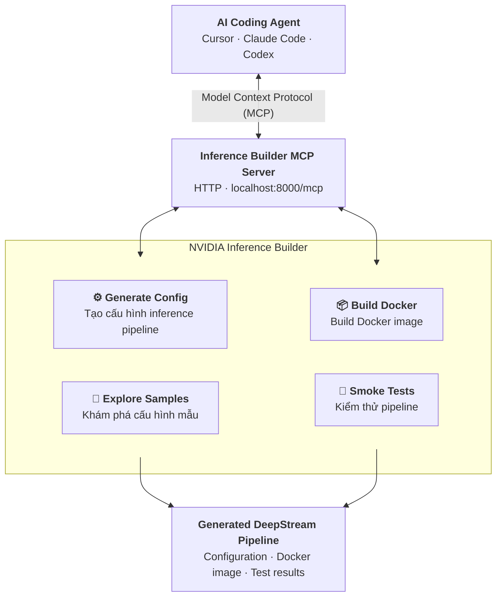

Với một hệ thống quản lý hơn 50 camera IP/RTSP Stream, mình khuyên bạn không nên chỉ học NVIDIA DeepStream theo hướng sử dụng các GStreamer pipeline hoặc chạy inference trên GPU. Bạn cần tiếp cận vấn đề ở cấp độ Large-scale Video Analytics System / Multi-camera Video Streaming Infrastructure.

Đây là một bài toán hệ thống tương đối lớn, trong đó DeepStream chỉ là một thành phần. Những vấn đề bạn sẽ phải giải quyết bao gồm:

**1. Camera & Network:** RTSP, ONVIF, codec H.264/H.265, bitrate, FPS, packet loss, network congestion.

**2. Video Ingestion:** Nhận đồng thời hàng chục luồng RTSP, reconnect, timeout, jitter, buffering.

**3. Video Processing:** GStreamer, NVIDIA DeepStream, NVDEC, NVENC, CUDA, TensorRT.

**4. GPU Infrastructure:** GPU utilization, VRAM, decoder capacity, inference throughput, batching, multi-GPU.

**5. Backend & I/O:** Truyền metadata, kết quả inference, event, snapshot, video clip giữa GPU server và backend.

**6. Distributed Architecture:** Quản lý camera, phân phối workload, nhiều GPU server, message broker, database.

**7. Reliability & Monitoring:** Giám sát camera offline, stream lỗi, pipeline bị treo, GPU quá tải, tự động phục hồi.

**8. Optimization:** Giảm latency, tối ưu throughput, giảm chi phí GPU và băng thông mạng.

Mình sẽ chia tài liệu thành các nhóm từ nền tảng đến triển khai production, ưu tiên tài liệu chính thức của NVIDIA, GStreamer, các paper nghiên cứu và những nguồn thực chiến từ cộng đồng kỹ thuật quốc tế. Phạm vi tài liệu tập trung vào giai đoạn 2020–2026; một số tài liệu nền tảng cũ hơn vẫn được giữ lại nếu chúng là tài liệu gốc cần thiết.

# 1. NVIDIA DeepStream – tài liệu chính thức

`Ưu tiên số 1`

&#x20;NVIDIA Developer Documentation · cập nhật đến 2026

[DeepStream SDK | NVIDIA Developer | NVIDIA Developer](https://images.openai.com/static-rsc-4/WTuWujlyiesFGZag410TUjjovz9615-6WmEoRkLUcBhA9DmGb6AmA_JqOg_v5cY3ome90h0RLk70l1cgFjNQKta6HS-aR87R246Skv-1OM-y5kA8-N-WGlsajYULcYmZnzI18PjD9j3j6Bh_tbzQWXHAu1vjxFiY8tynf_tr8ps?purpose=inline)

NVIDIA DeepStream SDK

Framework xây dựng hệ thống phân tích video nhiều luồng, sử dụng GStreamer, NVIDIA GPU, TensorRT và các thành phần tăng tốc phần cứng.

Tài liệu phiên bản 9.2 · 2026

[DeepStream SDK Developer Guide](https://docs.nvidia.com/deepstream?utm_source=chatgpt.com)

Đây là tài liệu quan trọng nhất. Bạn nên bookmark toàn bộ documentation thay vì chỉ đọc Getting Started.

## 1.1. Các tài liệu cần đọc

| Chủ đề              | Tài liệu chính thức                                                                                                                         | Mức ưu tiên |
| ------------------- | ------------------------------------------------------------------------------------------------------------------------------------------- | ----------- |
| Tổng quan kiến trúc | [DeepStream Overview](https://docs.nvidia.com/metropolis/deepstream/dev-guide/text/DS_Overview.html?utm_source=chatgpt.com)                 | Rất cao     |
| Cài đặt GPU Server  | [Installation Guide](https://docs.nvidia.com/metropolis/deepstream/dev-guide/text/DS_Installation.html?utm_source=chatgpt.com)              | Rất cao     |
| GStreamer Plugins   | [nvstreammux](https://docs.nvidia.com/metropolis/deepstream/dev-guide/text/DS_plugin_gst-nvstreammux.html?utm_source=chatgpt.com)           | Rất cao     |
| RTSP Input          | [nvurisrcbin](https://docs.nvidia.com/metropolis/deepstream/dev-guide/text/DS_plugin_gst-nvurisrcbin.html?utm_source=chatgpt.com)           | Rất cao     |
| Multi-camera        | [nvmultiurisrcbin](https://docs.nvidia.com/metropolis/deepstream/dev-guide/text/DS_plugin_gst-nvmultiurisrcbin.html?utm_source=chatgpt.com) | Rất cao     |
| Inference           | [nvinfer](https://docs.nvidia.com/metropolis/deepstream/dev-guide/text/DS_plugin_gst-nvinfer.html?utm_source=chatgpt.com)                   | Rất cao     |
| Tracking            | [nvtracker](https://docs.nvidia.com/metropolis/deepstream/dev-guide/text/DS_plugin_gst-nvtracker.html?utm_source=chatgpt.com)               | Cao         |
| Metadata            | [Metadata](https://docs.nvidia.com/metropolis/deepstream/dev-guide/text/DS_plugin_metadata.html?utm_source=chatgpt.com)                     | Rất cao     |
| Performance         | [DeepStream Performance](https://docs.nvidia.com/deepstream/text/DS_Performance?utm_source=chatgpt.com)                                     | Rất cao     |
| Troubleshooting     | [Troubleshooting](https://docs.nvidia.com/metropolis/deepstream/dev-guide/text/DS_troubleshooting.html?utm_source=chatgpt.com)              | Rất cao     |

Lưu ý: NVIDIA có thể điều chỉnh cấu trúc URL giữa các phiên bản. Bạn nên chọn đúng version trong documentation index khi tra cứu.

## 1.2. Những thành phần DeepStream phải thực sự hiểu

Một pipeline xử lý video cơ bản

```Mermaid
flowchart TD
    subgraph Title ["Một pipeline xử lý video cơ bản"]
        direction TB

        A["<b>IP Cameras</b><br><small>RTSP / H.264 / H.265</small>"]
        B["<b>nvurisrcbin / GStreamer</b><br><small>RTSP connection · Decode · Buffering</small>"]
        C["<b>nvstreammux</b><br><small>Batching nhiều camera thành batch frames</small>"]
        D["<b>nvinfer / TensorRT</b><br><small>Preprocessing · GPU inference</small>"]
        E["<b>nvtracker / Custom Plugins</b><br><small>Tracking · Analytics · Custom logic</small>"]

        subgraph Outputs [" "]
            direction LR
            F1["<b>Metadata Output</b><br><small>Kafka · MQTT · REST</small>"]
            F2["<b>Video Output</b><br><small>RTSP · Recording · Snapshot</small>"]
        end

        A --> B
        B --> C
        C --> D
        D --> E
        E --> F1
        E --> F2


    end

    style Title fill:none,stroke:none
    style Outputs fill:none,stroke:none
    style Note fill:none,stroke:none
```

> Pipeline minh họa để hiểu luồng dữ liệu, không phải cấu hình production bắt buộc.

Đặc biệt, hãy phân biệt ba thành phần:

- `nvurisrcbin`: tạo và quản lý nguồn video, phù hợp với RTSP.
- `nvstreammux`: gom frame từ nhiều nguồn thành batch để xử lý.
- `nvinfer`: thực hiện inference thông qua TensorRT.

Không nên hiểu rằng 50 camera sẽ cần 50 model inference riêng biệt. Một trong những mục tiêu của DeepStream là tận dụng batching để chia sẻ tài nguyên inference giữa các luồng.

## 1.3. Reference Applications – rất đáng học

NVIDIA cung cấp các ứng dụng mẫu gần với hệ thống thực tế hơn nhiều so với các ví dụ Hello World.

[NVIDIA/DeepStream – GitHub chính thức](https://github.com/NVIDIA/DeepStream?utm_source=chatgpt.com)

Tập trung vào:

| Sample             | Bạn học được gì                                      |
| ------------------ | ---------------------------------------------------- |
| `deepstream-test1` | Pipeline inference cơ bản                            |
| `deepstream-test2` | Detection và tracking                                |
| `deepstream-test3` | Multiple streams                                     |
| `deepstream-test4` | Message broker integration                           |
| `deepstream-test5` | RTSP, IoT messaging, smart recording, quản lý sensor |
| `deepstream-app`   | Cấu hình và vận hành pipeline                        |
| `deepstream-nmos`  | Quản lý luồng video theo chuẩn NMOS                  |

Đặc biệt nên nghiên cứu `deepstream-test5`. Đây là một ví dụ hữu ích để hiểu cách kết hợp video analytics với hệ thống IoT/backend thay vì chỉ xử lý hình ảnh trên GPU.

NVIDIA cũng có tài liệu riêng về [DeepStream Reference Application – test5](https://docs.nvidia.com/metropolis/deepstream/dev-guide/text/DS_ref_app_test5.html?utm_source=chatgpt.com).

## 1.4. Những thay đổi mới cần chú ý trong DeepStream 9.x

Tại thời điểm tháng 11/2026, documentation mặc định đã là DeepStream 9.2. Bạn nên đọc Release Notes trước khi triển khai.

[DeepStream 9.2 Release Notes](https://docs.nvidia.com/deepstream/text/DS_Release_notes?utm_source=chatgpt.com)

Một số điểm đáng chú ý:

- Unified NVIDIA DeepStream GitHub monorepo.
- Hỗ trợ các nền tảng GPU mới.
- Hỗ trợ REST API cho một số thành phần và thao tác thêm/xóa stream.
- OpenTelemetry support.
- Những giới hạn khi chạy số lượng stream lớn.
- Các known issues liên quan đến long-duration pipeline, reconnect và quản lý bộ nhớ.

Đáng chú ý, Release Notes 9.2 có đề cập vấn đề kernel crash có thể xảy ra ngẫu nhiên khi chạy khoảng 200+ streams đồng thời. Điều này cho thấy bạn không nên suy luận khả năng production chỉ từ benchmark FPS ngắn hạn.

# 2. GStreamer – nền tảng không thể bỏ qua

`Ưu tiên số 1`

DeepStream được xây dựng trên nền tảng GStreamer. Nếu gặp sự cố như RTSP timeout, pipeline deadlock, buffer bị tồn đọng hoặc camera mất kết nối, bạn thường phải debug ở tầng GStreamer chứ không chỉ ở tầng DeepStream.

[GStreamer | Open-source multimedia technology - Fluendo](https://images.openai.com/static-rsc-4/s0niRzacs8q3NNqIrmlarV9697LptXGV9EjBCIn5Trmst5vTEqSsksyQt4lp5Df-uMKiug0oRc8XeY-BTCzdm_M6IiLoFekFnOpqfbr19ELADxD7x3396H5rsIon976XG4BC7qcGSOkYtwQBOj51rSnZUcLUwte3NcFo1NyJUGs?purpose=inline)

GStreamer

Framework multimedia mã nguồn mở, xử lý media bằng các element được kết nối thành pipeline.

[Official Documentation](https://gstreamer.freedesktop.org/documentation/?utm_source=chatgpt.com)

## 2.1. Các tài liệu quan trọng

| Thành phần   | Tài liệu                                                                                                                                    | Nội dung                                |
| ------------ | ------------------------------------------------------------------------------------------------------------------------------------------- | --------------------------------------- |
| Architecture | [GStreamer Basics](https://gstreamer.freedesktop.org/documentation/application-development/introduction/basics.html?utm_source=chatgpt.com) | Pipeline, Element, Pad, Bus             |
| RTSP         | [rtspsrc](https://gstreamer.freedesktop.org/documentation/rtsp/rtspsrc.html?utm_source=chatgpt.com)                                         | RTSP connection, TCP/UDP, jitter        |
| RTP          | [RTP Plugins](https://gstreamer.freedesktop.org/documentation/rtp/?utm_source=chatgpt.com)                                                  | RTP packet handling                     |
| Queue        | [queue](https://gstreamer.freedesktop.org/documentation/coreelements/queue.html?utm_source=chatgpt.com)                                     | Buffering, threading, backpressure      |
| Appsink      | [appsink](https://gstreamer.freedesktop.org/documentation/app/appsink.html?utm_source=chatgpt.com)                                          | Lấy frame từ pipeline vào application   |
| Appsrc       | [appsrc](https://gstreamer.freedesktop.org/documentation/app/appsrc.html?utm_source=chatgpt.com)                                            | Đưa dữ liệu từ application vào pipeline |
| Debugging    | [Debugging Tools](https://gstreamer.freedesktop.org/documentation/tutorials/basic/debugging-tools.html?utm_source=chatgpt.com)              | Debug pipeline, logging, graph          |

## 2.2. Các kiến thức phải hiểu sâu

A. RTSP/RTP

- RTSP hoạt động như thế nào?
- RTSP over TCP so với UDP.
- RTP packet, RTCP.
- Jitter buffer.
- Packet loss.
- Timeout và session management.
- Latency và synchronization.

B. Pipeline

- Source → Demux → Depay → Parse → Decode.
- Element, Pad, Caps.
- Dynamic Pad.
- Pipeline state: NULL, READY, PAUSED, PLAYING.
- Bus message và Error handling.
- EOS và reconnect.

C. Buffer & Threading

- Queue element.
- Buffer pool.
- Backpressure.
- Blocking và non-blocking.
- Buffer overflow.
- Frame dropping.
- Memory ownership.

D. Application Integration

- `appsink`: lấy frame hoặc dữ liệu từ pipeline ra Python/C++.
- `appsrc`: đẩy dữ liệu từ ứng dụng vào pipeline.
- Pad Probe: can thiệp và quan sát dữ liệu trên pipeline.
- Bus Watch: xử lý các thông báo, lỗi và trạng thái.

Một điểm quan trọng: đừng mặc định lấy toàn bộ frame về CPU để xử lý bằng OpenCV. Điều này có thể tạo thêm memory copy, tiêu tốn băng thông PCIe và làm mất lợi thế của GPU pipeline. Hãy tìm hiểu NVMM, CUDA memory và zero-copy.

# 3. GPU Server, NVIDIA Video Codec và TensorRT

Đây là nhóm tài liệu giúp bạn hiểu tại sao một GPU server có thể xử lý được hàng chục luồng video, và đâu là giới hạn thật sự của hệ thống.

[Hon Hai Technology Group (Foxconn) Showcases AI Solutions for Servers, EV Driving at NVIDIA GTC - Hon Hai Technology Group](https://images.openai.com/static-rsc-4/kU8PTkl1g9_Q3a8mEURzevzFQeSzo9u-wfegCqLL3XFhActXyLv4I6tEUALerv3gJRw0Rwmqz-SRLC2D8ONrDgxRzHWFyEBSvocWyvlHMqXtpwsUxvhsgoFsCAg3Y0Srhdv09ocvf2tu3IagDhVKhImOCZhQEd8_KG1GRj6ix08?purpose=inline)

NVIDIA GPU Computing

Tìm hiểu toàn bộ đường đi của dữ liệu từ network stream đến GPU decoder, inference và output.

[NVIDIA Developer](https://developer.nvidia.com/?utm_source=chatgpt.com)

## 3.1. Nhóm tài liệu cần đọc

| Chủ đề                  | Tài liệu                                                                                                                        |
| ----------------------- | ------------------------------------------------------------------------------------------------------------------------------- |
| Hardware video decoding | [NVIDIA Video Codec SDK](https://docs.nvidia.com/video-technologies/video-codec-sdk/?utm_source=chatgpt.com)                    |
| NVDEC                   | [Video Codec SDK – NVDEC/NVENC](https://developer.nvidia.com/video-codec-sdk?utm_source=chatgpt.com)                            |
| GPU architecture        | [CUDA Programming Guide](https://docs.nvidia.com/cuda/cuda-c-programming-guide/?utm_source=chatgpt.com)                         |
| GPU memory              | [CUDA Memory Management](https://docs.nvidia.com/cuda/cuda-c-programming-guide/?utm_source=chatgpt.com)                         |
| Inference optimization  | [TensorRT Documentation](https://docs.nvidia.com/deeplearning/tensorrt/latest/?utm_source=chatgpt.com)                          |
| Multi-model serving     | [Triton Inference Server](https://docs.nvidia.com/deeplearning/triton-inference-server/user-guide/docs/?utm_source=chatgpt.com) |
| GPU monitoring          | [NVIDIA-SMI Documentation](https://docs.nvidia.com/deploy/nvidia-smi/?utm_source=chatgpt.com)                                   |
| GPU profiling           | [NVIDIA Nsight Systems](https://developer.nvidia.com/nsight-systems?utm_source=chatgpt.com)                                     |

## 3.2. Những vấn đề thực tế cần nghiên cứu

| Thành phần | Câu hỏi bạn cần trả lời                                                |
| ---------- | ---------------------------------------------------------------------- |
| NVDEC      | GPU giải mã được bao nhiêu stream H.264/H.265 đồng thời?               |
| NVENC      | Khi cần encode lại video, năng lực encode là bao nhiêu?                |
| CUDA       | Model inference chiếm bao nhiêu GPU compute?                           |
| VRAM       | 50 camera và các batch buffer cần bao nhiêu VRAM?                      |
| PCIe       | Việc copy frame giữa CPU và GPU ảnh hưởng thế nào đến throughput?      |
| TensorRT   | FP32, FP16, INT8 ảnh hưởng đến latency và throughput ra sao?           |
| Triton     | Khi có nhiều model hoặc nhiều ứng dụng, nên quản lý inference thế nào? |

Một lưu ý kiến trúc rất quan trọng: NVDEC, CUDA inference và NVENC là các tài nguyên khác nhau. GPU utilization 30% không có nghĩa là bạn còn đủ năng lực để nhận thêm 30 camera. Video decoder có thể đã trở thành bottleneck trước khi CUDA compute đạt mức sử dụng cao.

Ngoài ra, số stream tối đa phụ thuộc vào model GPU, generation, codec, resolution, profile, FPS và giới hạn sản phẩm. Không nên lấy một con số FPS benchmark để kết luận số camera có thể chạy production.

# 4. IP Camera, RTSP, ONVIF và Network Infrastructure

Ưu tiên số 1

Đây là nhóm kiến thức nhiều người bắt đầu với DeepStream thường bỏ qua. Nhưng trong hệ thống 50–100 camera, network và camera source có thể gây ra nhiều vấn đề hơn cả model inference.

## 4.1. Tài liệu về camera và ONVIF

[Professional 4K 32 Camera NVR Package, 16 PoE Dome Cameras, 16 PoE Bullet Cameras by Security Cameras Inc](https://images.openai.com/static-rsc-4/NdRBMOY-SprD9JVgOK62sWXnkJbwGJ6M3gXkl0CXj7KUNuNG3O2IGTakH53LlhaYniz2l3Sffbldr0DU98bhmobZaQ4b2A9Hcze0S0GCodI-layHmukeZzMNpyd0fjWCq0ba_-9kEHVjHsjL41WlOHtjghWIlXlOhhcE3uSb9tY?purpose=inline)

ONVIF

Chuẩn giao tiếp giúp quản lý, cấu hình và tương tác với các thiết bị camera IP.

[ONVIF Official Profiles](https://www.onvif.org/profiles/?utm_source=chatgpt.com)

Tài liệu nên đọc:

- [ONVIF Profile S](https://www.onvif.org/profiles/profile-s/?utm_source=chatgpt.com) – Streaming video qua IP.
- [ONVIF Profile T](https://www.onvif.org/profiles/profile-t/?utm_source=chatgpt.com) – Advanced video streaming.
- [ONVIF Profile G](https://www.onvif.org/profiles/profile-g/?utm_source=chatgpt.com) – Recording và retrieval.
- [ONVIF Network Interface Specifications](https://www.onvif.org/profiles/specifications/?utm_source=chatgpt.com) – Các API và service specifications.

Bạn cần hiểu các thao tác:

- Discover camera trong mạng LAN.
- Authentication.
- Lấy Media Profile.
- Lấy RTSP Stream URI.
- Cấu hình resolution, bitrate, FPS.
- PTZ Control.
- Camera events.
- Kiểm tra trạng thái thiết bị.

Lưu ý: ONVIF Profile S đang trong quá trình deprecation, hạn cuối nhận hồ sơ chứng nhận sản phẩm mới là 31/03/2027. Do đó, nên tìm hiểu cả Profile T thay vì chỉ phụ thuộc Profile S.&#x20;

[image](https://www.google.com/s2/favicons?domain=https://www.onvif.org&sz=32)

ONVIF+1

## 4.2. Network và bandwidth calculation

Giả sử hệ thống có 50 camera:

| Thông số           | Giá trị giả định |
| ------------------ | ---------------- |
| Camera             | 50               |
| Resolution         | 1920 × 1080      |
| FPS                | 25               |
| Codec              | H.264            |
| Bitrate mỗi camera | 4 Mbps           |
| Tổng bitrate       | 200 Mbps         |
| Dữ liệu mỗi giờ    | \~90 GB          |
| Dữ liệu mỗi ngày   | \~2.16 TB        |

Đây là phép tính theo bitrate cố định 4 Mbps, chưa tính overhead mạng, biến động bitrate, lưu trữ dự phòng và các luồng phụ.

Bạn cần học:

- TCP/IP, UDP, RTP, RTSP.
- TCP retransmission và UDP packet loss.
- VLAN và subnetting.
- Gigabit Ethernet và 10GbE.
- Network switch và routing.
- Multicast so với unicast.
- QoS.
- Firewall và NAT.
- Network monitoring.

Một vấn đề cần đặc biệt chú ý: nếu 50 camera đều gửi video về một GPU server, bạn phải tính cả network throughput, số lượng connection, số lượng packet/second và khả năng chịu lỗi của switch/network interface.

Không nên chỉ nhìn tổng Mbps.

## 4.3. Công cụ thực hành

| Công cụ                                                                   | Mục đích                                 |
| ------------------------------------------------------------------------- | ---------------------------------------- |
| [Wireshark](https://www.wireshark.org/docs/?utm_source=chatgpt.com)       | Phân tích RTSP/RTP packet                |
| [FFmpeg](https://ffmpeg.org/documentation.html?utm_source=chatgpt.com)    | Kiểm tra, decode, encode và xử lý stream |
| [VLC](https://www.videolan.org/vlc/?utm_source=chatgpt.com)               | Kiểm tra RTSP camera                     |
| [iPerf3](https://iperf.fr/?utm_source=chatgpt.com)                        | Đo bandwidth giữa các server             |
| [MediaMTX](https://github.com/bluenviron/mediamtx?utm_source=chatgpt.com) | RTSP server, relay và stream routing     |

Mình đặc biệt khuyên bạn thực hành với FFmpeg và Wireshark. Khi camera không hoạt động trong DeepStream, bạn cần biết cách xác định lỗi nằm ở camera, network, RTSP session hay pipeline.

# 5. Backend, Message Broker và Distributed Video Analytics

Ưu tiên số 2

Một hệ thống lớn không nên để DeepStream chịu trách nhiệm tất cả mọi thứ.

Bạn cần phân chia rõ:

- Video processing service.
- Camera management service.
- Inference service.
- Event processing service.
- Storage service.
- API service.
- Monitoring service.

## 5.1. Kiến trúc tham khảo

[Metropolis Microservices | NVIDIA Developer](https://images.openai.com/static-rsc-4/iB0apxNZju4CoxhEjnl4YobSMKvTnzbhfkMpzkgY4hqX9XsdjbFSqVpxT66bByEjG7k1KGqtCoOVrEtobnXXqVlaiwqeIK8KJTJZ3ZV4X_IUsVqNKStCll1DHBIg2fYWiJsmMjxkaaZGzTQCjNujbFsirVaLxMWioQ8SYme3Tsc?purpose=inline)

[developer.nvidia.com](https://developer.nvidia.com/metropolis-microservices?ncid=so-face-286870&utm_source=chatgpt.com)

Kiến trúc tham khảo cho hệ thống của bạn:

```plaintext
                 IP CAMERAS (50+)
                         |
                    RTSP Streams
                         |
                 Network Switch
                         |
             +-----------+-----------+
             |                       |
        GPU SERVER 1            GPU SERVER 2
        DeepStream              DeepStream
        Camera 1-25             Camera 26-50
             |                       |
             +-----------+-----------+
                         |
                  Message Broker
                      Kafka
                         |
             +-----------+-----------+
             |           |           |
          Backend     Event       Storage
          Service    Processor    Service
             |           |           |
             +-----------+-----------+
                         |
                    Database
                         |
                   REST API
                         |
                  Frontend / UI
```

Đây chỉ là một phương án phân chia workload, không phải yêu cầu bắt buộc phải có hai GPU server. Số lượng server thực tế phải được quyết định sau khi benchmark.

## 5.2. Message Broker

Bạn nên nghiên cứu hai công nghệ:

[Running Kafka on Production. Apache Kafka is an open-source… | by Pradyumna Khawas | WorkIndia.in | Medium](https://images.openai.com/static-rsc-4/IdgpctULbez35q_RTbMO09b-y6gGSwj0M361O82eRjmf4iacIuOlU2NJe7tJ5nG3ML_-Ramx8HPhw_f2BkJ4-7fTax9B_pG2F5mYYn7fI3Wkxu6lEMjmv6TQdRCI7p2vkYr-RROSNxhp8BCekHH4j-k8olCh620FHns5GrtDyDM?purpose=inline)

Apache Kafka

Ưu tiên cao

Kafka phù hợp khi bạn có lượng lớn event, cần lưu trữ event stream, consumer độc lập, replay dữ liệu và mở rộng hệ thống.

Tài liệu: [Apache Kafka Official Documentation](https://kafka.apache.org/documentation/?utm_source=chatgpt.com)

Những nội dung cần đọc:

- Producer / Consumer.
- Topic / Partition.
- Consumer Group.
- Offset.
- Retention.
- Replication.
- Delivery semantics.
- Backpressure.

  [Cedalo - Eclipse Mosquitto MQTT Broker](https://images.openai.com/static-rsc-4/zrgOg0gKB9L-SxmNogRtTKhtLjb6p1cOVwRtbvsQTmZlLK35b3aUwTQ-6gk6R9C8rgfO_RD5_YZpo-hBcAd9tEAYWDLRlqRjpBVcVsVjwMYK9y_0GjMZ8Cfti2SgSYCHHvAeXveOCoOS-e3LqStuPh-zZdRVdinLs-juHhT0SF4?purpose=inline)

  MQTT

  MQTT phù hợp với các thông điệp điều khiển, trạng thái camera, heartbeat và các hệ thống IoT.

Tài liệu: [MQTT Official Website](https://mqtt.org/?utm_source=chatgpt.com) và [Eclipse Mosquitto Documentation](https://mosquitto.org/documentation/?utm_source=chatgpt.com)

Ví dụ:

DeepStream phát hiện một người đi vào vùng cấm:

```json
{
  "camera_id": "CAM_001",
  "event_type": "person_intrusion",
  "timestamp": "2026-11-07T15:30:00Z",
  "object_id": 12,
  "confidence": 0.95,
  "bounding_box": {
    "x": 120,
    "y": 80,
    "width": 200,
    "height": 350
  }
}
```

Backend có thể nhận event này để:

- Ghi database.
- Gửi notification.
- Hiển thị realtime trên dashboard.
- Lưu snapshot.
- Kích hoạt recording.

Không nhất thiết phải truyền toàn bộ video qua Kafka. Thông thường, nên truyền metadata, event và reference đến snapshot/video; video có thể được cung cấp qua một media server hoặc object storage riêng.

## 5.3. Camera management và runtime stream management

Bạn cần tìm hiểu cách:

- Thêm camera mà không restart toàn bộ hệ thống.
- Xóa camera khỏi pipeline.
- Chuyển camera giữa các GPU server.
- Kiểm tra health status.
- Quản lý stream credentials.
- Quản lý reconnect policy.
- Phân phối workload.

Tài liệu đặc biệt hữu ích:

[DeepStream test5 – Sensor Provisioning and REST API](https://docs.nvidia.com/deepstream/9.2/text/DS_ref_app_test5.html?utm_source=chatgpt.com)[nvmultiurisrcbin – Dynamic Multi-Stream Management](https://docs.nvidia.com/deepstream/9.2/text/DS_plugin_gst-nvmultiurisrcbin.html?utm_source=chatgpt.com)

Đây là một trong những hướng đáng nghiên cứu nhất cho hệ thống nhiều camera.

# 6. Monitoring, Logging và Production Observability

`Ưu tiên số 2`

Khi hệ thống có 50 camera, việc mở terminal và xem log từng pipeline sẽ không còn khả thi.

Bạn cần xây dựng hệ thống monitoring tập trung.

## 6.1. Bộ công cụ nên nghiên cứu

[Fichier:Prometheus software logo.svg - Wikisource](https://images.openai.com/static-rsc-4/fepPjY_neWlerRDx3jGoMbIOODcqUKFP-xK4JCE9gDYjfgE0oZnQot03AShEimFI4xKFWOI5UkXjaTG5Dwy-Y6sHZ8WssrPUsV611AhkfF-bWCojn6LHVlZJ72EWwkfGYPP-yz9x7o0jRJ2iAd1ocItnGSxJJ8IUWLVCqGrrn3I?purpose=inline)

Prometheus

Thu thập metrics: FPS, latency, GPU utilization, RAM, camera status.

[Official Documentation](https://prometheus.io/docs/introduction/overview/?utm_source=chatgpt.com)

[File:Grafana logo.svg - Wikimedia Commons](https://images.openai.com/static-rsc-4/wFlazXwUNtzBWhhYsfsO-iUHvVSX5psinU3cIyRBrPH-55jhN6vA1HJ-mF2Hp100x3Tof5pLNGXUx0-pTz7u8q_JpmVgKgCX44IZUc_4hgiVbRagjB30d5GhTLYc6_wu5rfBVxWTQQ0KKNKianfSW18M10GjLFTQJ_SxujesfgQ?purpose=inline)

Grafana

Xây dựng dashboard giám sát toàn bộ GPU server và camera.

[Official Documentation](https://grafana.com/docs/?utm_source=chatgpt.com)

[Opentelemetry Logo Png | Opentelemetry Logo Vector - freepng](https://images.openai.com/static-rsc-4/N9H3TxdOCc0XlAbPWzcRjS9ANwke61P-srlRUoARGLbi3-awHzvpqj4Q9epI8M9s6xCGZtmtU_JR-xmDcayvhLT7y0G5Z-xjrvnnEvG4WWPMA-kYUYcr-RUvxqlD9NLP6Afh3kEQyuo9WnOGgOfLzJuaaRg69Mq7LwsX0XHe4Qg?purpose=inline)

OpenTelemetry

Thu thập và export telemetry từ các service.

[Official Documentation](https://opentelemetry.io/docs/?utm_source=chatgpt.com)

[Log Like a Pro: Grafana Loki on Kubernetes | by Achanandhi M | Medium](https://images.openai.com/static-rsc-4/tr5C1zhWuMzBrB9jcA3ErP2H2SENQzhLQ6NBX5lOTaHXBgtG0eJwiOvl0MEgaQLuQteEu_Wn71IKGFwTqGp7h6EoHgqiYwrgSNSB3MzJc7EUCqp29dWZwuBFxjMRM0kvOQG-vE8kEGYmZD5w_VnUJXW1L2A2p7EUgkpkeuVv9v0?purpose=inline)

Grafana Loki

Thu thập và truy vấn log tập trung.

[Official Documentation](https://grafana.com/docs/loki/latest/?utm_source=chatgpt.com)

Đặc biệt, NVIDIA đã có tài liệu chính thức về tích hợp DeepStream với OpenTelemetry.

[DeepStream OpenTelemetry Support – NVIDIA](https://docs.nvidia.com/deepstream/9.2/text/DS_OpenTelemetry?utm_source=chatgpt.com)

DeepStream có thể export các metrics như:

- `stream_fps`
- `stream_latency`
- `stream_frame_number`
- `stream_count`
- `gpu_utilization`
- `cpu_utilization`
- `ram_memory_gb`
- `gpu_memory_gb`

Đây là tài liệu nên đọc ngay khi bắt đầu xây dựng ứng dụng quản lý camera.&#x20;

[image](https://www.google.com/s2/favicons?domain=https://docs.nvidia.com&sz=32)

DeepStream+1

# 7. Research Papers – các bài nghiên cứu nên đọc

Đây là nhóm tài liệu giúp bạn hiểu các vấn đề mang tính học thuật và thiết kế hệ thống, thay vì chỉ học API.

Mình chọn những nghiên cứu liên quan trực tiếp đến video analytics, distributed computing, edge infrastructure và multi-camera scheduling.

## 7.1. Những bài nên ưu tiên

Đọc đầu tiên

1\. Edge Video Analytics: A Survey on Applications, Systems and Enabling Techniques (2022)

Renjie Xu, Saiedeh Razavi, Rong Zheng · arXiv

[Towards a resource efficient and privacy-preserving framework for campus-wide video analytics-based applications | Complex & Intelligent Systems | Springer Nature Link](https://images.openai.com/static-rsc-4/5UM3LqpRnSZLcJH1EVwiZCRXBOJ44oqFENGGO2_gjD3t9vm42vovoZaOqVF4V0vxJXzCZRJRrE3EGM-43xqDKqQSaooU5goXmpAQa842VmYk-ncg8xzQIk7XAdDZdbt-vuDcf3VbQIIf8jRsdZoA3tfxXWUfhXegSiO6dcpnxDM?purpose=inline)

[link.springer.com](https://link.springer.com/article/10.1007/s40747-022-00783-w?utm_source=chatgpt.com)

Tổng quan về:

- Edge Video Analytics.
- Edge-cloud architecture.
- Video analytics systems.
- Resource allocation.
- Scheduling.
- Các thách thức nghiên cứu.

[Đọc paper trên arXiv](https://arxiv.org/abs/2211.15751?utm_source=chatgpt.com)

2\. Performance Characterization of Video Analytics Workloads in Heterogeneous Edge Infrastructures (2021)

Published May 2021 · Concurrency and Computation: Practice and Experience

Nghiên cứu rất sát với bài toán GPU server của bạn:

- Benchmark workload video analytics.
- So sánh nhiều nền tảng phần cứng.
- Phân tích khả năng scale theo tài nguyên.
- Ước tính chi phí và hiệu năng.
- Phân tích end-to-end pipeline.

[Đọc nghiên cứu](https://onlinelibrary.wiley.com/doi/full/10.1002/cpe.6317?utm_source=chatgpt.com)

3\. Video Big Data Analytics in the Cloud: A Reference Architecture, Survey, Opportunities, and Open Research Issues (2020)

Aftab Alam, Irfan Ullah, Young-Koo Lee · IEEE Access

Nghiên cứu về:

- Cloud video analytics.
- Reference architecture.
- Video big data.
- Data processing và storage.
- Các vấn đề mở trong hệ thống phân tích video quy mô lớn.

[Đọc bài nghiên cứu](https://doaj.org/article/fa0ae0553922415d95d333d4e89723d8?utm_source=chatgpt.com)

Nghiên cứu mới 2026

4\. VISTA: Value-Driven Inference Scheduling for Timely Autonomous Multi-Camera Perception (2026)

IEEE Systems, Man, and Cybernetics Letters · Published September 15, 2026

Đây là nghiên cứu đặc biệt đáng chú ý vì sử dụng một pipeline DeepStream với nhiều camera.

Nội dung:

- Multi-camera inference scheduling.
- Frame dropping.
- GPU overload.
- Frame freshness.
- Admission control.
- Resource allocation.

Tác giả báo cáo việc giảm mean output age từ 958 ms xuống 93 ms trong thí nghiệm của họ bằng cách thay đổi chính sách admission và scheduling.

[Đọc paper trên IEEE Xplore](https://ieeexplore.ieee.org/abstract/document/11691300?utm_source=chatgpt.com)

## 7.2. Các chủ đề nghiên cứu nên tìm tiếp

Đừng chỉ tìm kiếm từ khóa `NVIDIA DeepStream research paper`. Rất nhiều nghiên cứu về hệ thống camera quy mô lớn không sử dụng DeepStream trực tiếp nhưng giải quyết chính xác những vấn đề bạn sẽ gặp.

Các từ khóa:

| Nhóm                | Từ khóa                                   |
| ------------------- | ----------------------------------------- |
| Multi-camera        | Multi-camera video analytics systems      |
| Scheduling          | GPU inference scheduling                  |
| Scalability         | Scalable video analytics                  |
| Edge computing      | Edge-cloud video analytics                |
| Resource allocation | GPU resource allocation for video streams |
| Latency             | Real-time video analytics latency         |
| Sampling            | Adaptive frame sampling                   |
| Optimization        | Multi-stream inference optimization       |
| Distributed         | Distributed video processing systems      |
| Reliability         | Fault-tolerant video streaming            |

Các thư viện nghiên cứu:

- [arXiv](https://arxiv.org/?utm_source=chatgpt.com)
- [Google Scholar](https://scholar.google.com/?utm_source=chatgpt.com)
- [IEEE Xplore](https://ieeexplore.ieee.org/?utm_source=chatgpt.com)
- [ACM Digital Library](https://dl.acm.org/?utm_source=chatgpt.com)

# 8. Practical Issues & Solutions – kinh nghiệm từ NVIDIA Developers

Rất quan trọng khi triển khai thực tế

Đây là phần mình nghĩ bạn sẽ sử dụng thường xuyên nhất khi bắt đầu làm dự án.

Không phải vấn đề nào cũng có thể tìm được trong documentation. NVIDIA Developer Forums có rất nhiều tình huống người dùng gặp lỗi khi triển khai nhiều camera, GPU server và DeepStream.

Mình chọn một số trường hợp cụ thể để bạn nghiên cứu.

## 8.1. RTSP stream bị mất kết nối và không tự reconnect

Case 1 – Handling RTSP Stream Failures and Auto-Reconnection in DeepStream

Production reliability

Một developer sử dụng nhiều RTSP streams. Khi một camera mất kết nối rồi hoạt động trở lại, pipeline không tự phục hồi. FPS bị giảm và phải restart ứng dụng.

Hướng giải quyết được NVIDIA Developer đề xuất:

- Sử dụng `nvurisrcbin` thay vì `uridecodebin` trong trường hợp cần reconnect.
- Nghiên cứu các thuộc tính reconnect.
- Sử dụng source bin management.
- Xử lý stream error và restart source độc lập.

[Đọc toàn bộ thảo luận trên NVIDIA Developer Forums](https://forums.developer.nvidia.com/t/handling-rtsp-stream-failures-and-auto-reconnection-in-deepstream/336677?utm_source=chatgpt.com)

Bài học: Với 50 camera, tuyệt đối không nên để một camera offline khiến toàn bộ pipeline phải restart.

Bạn cần thiết kế cơ chế reconnect độc lập theo từng camera.

## 8.2. Một camera offline làm giảm FPS của các camera còn lại

Case 2 – Handle camera disconnect in multi RTSP stream setup

Một developer sử dụng hai RTSP streams. Khi một camera ngừng hoạt động, FPS của cả hai stream đều về 0.

Giải pháp được NVIDIA Developer đề xuất:

```
live_source = 1batched_push_timeout = 33000
```

Cấu hình `batched-push-timeout` giúp mux không phải chờ vô thời hạn để đủ batch từ các nguồn live.

Đã xác nhận trong thảo luận

[Đọc NVIDIA Forum Discussion](https://forums.developer.nvidia.com/t/handle-camera-disconnect-in-multi-rtsp-stream-setup/316372?utm_source=chatgpt.com)

Đây là vấn đề bạn cần hiểu sâu về batching, timeout, live source và synchronization.

Lưu ý: giá trị 33000 microseconds chỉ là ví dụ cho trường hợp được thảo luận, không phải cấu hình tối ưu cố định cho mọi hệ thống.

## 8.3. New nvstreammux và vấn đề performance

Một vấn đề khác được thảo luận vào năm 2025 là khi sử dụng new `nvstreammux`, một camera bị disconnect có thể khiến FPS của các stream khác giảm đáng kể.

Thảo luận đề cập đến:

- `nvurisrcbin`.
- New `nvstreammux`.
- `config-file-path`.
- `max-num-frames-per-batch`.
- Adaptive batching.
- Live-mode performance tuning.

[Đọc toàn bộ thread và các phản hồi của NVIDIA Developer](https://forums.developer.nvidia.com/t/handling-rtsp-stream-failures-and-auto-reconnection-in-deepstream/336677?utm_source=chatgpt.com)

Điểm đáng học ở đây là không nên chỉ nhìn vào tên plugin. Hai phiên bản mux có thể có hành vi và đặc tính hiệu năng khác nhau.

## 8.4. Những nhóm issue khác phải chủ động tìm kiếm

Bạn nên sử dụng các truy vấn sau trên NVIDIA Forums và GitHub Issues:

| Vấn đề            | Từ khóa tìm kiếm                                |
| ----------------- | ----------------------------------------------- |
| Camera reconnect  | `DeepStream RTSP auto reconnect`                |
| Memory leak       | `DeepStream memory leak long running pipeline`  |
| GPU overload      | `DeepStream multi stream GPU utilization 100`   |
| FPS drop          | `DeepStream nvstreammux FPS drop`               |
| Latency           | `DeepStream RTSP latency increasing over time`  |
| Camera timeout    | `DeepStream RTSP timeout handling`              |
| Dynamic stream    | `DeepStream add remove RTSP source runtime`     |
| Pipeline deadlock | `DeepStream GStreamer pipeline deadlock`        |
| GPU memory        | `DeepStream NVMM CUDA memory copy performance`  |
| Multi-GPU         | `DeepStream multiple GPU pipeline distribution` |

Các nơi nên theo dõi thường xuyên:

1. [NVIDIA Developer Forums – Intelligent Video Analytics](https://forums.developer.nvidia.com/c/accelerated-computing/intelligent-video-analytics/43?utm_source=chatgpt.com).
2. [NVIDIA DeepStream GitHub Issues](https://github.com/NVIDIA/DeepStream/issues?utm_source=chatgpt.com).
3. [NVIDIA DeepStream Discussions](https://github.com/NVIDIA/DeepStream/discussions?utm_source=chatgpt.com).
4. [GStreamer Documentation](https://gstreamer.freedesktop.org/documentation/?utm_source=chatgpt.com).
5. [Stack Overflow – GStreamer](https://stackoverflow.com/questions/tagged/gstreamer?utm_source=chatgpt.com).

Cách đọc một issue hiệu quả:

Đừng chỉ đọc câu trả lời cuối cùng. Hãy tìm hiểu:

- Hardware nào được sử dụng?
- DeepStream version nào?
- GStreamer version nào?
- Số lượng stream?
- Resolution và FPS?
- Pipeline architecture?
- Có code/config tái hiện lỗi không?
- Giải pháp có được xác nhận hay chỉ là workaround?

Đây là cách phân biệt giải pháp production với một mẹo khắc phục tạm thời.

# 9. Những dự án GitHub nên nghiên cứu

Ngoài tài liệu, bạn nên đọc source code của các dự án thực tế.

| Dự án                                                                                                          | Mục đích                          |
| -------------------------------------------------------------------------------------------------------------- | --------------------------------- |
| [NVIDIA/DeepStream](https://github.com/NVIDIA/DeepStream?utm_source=chatgpt.com)                               | Source code, plugins, sample apps |
| [DeepStream Reference Apps](https://github.com/NVIDIA-AI-IOT/deepstream_reference_apps?utm_source=chatgpt.com) | Các ứng dụng tham khảo của NVIDIA |
| [MediaMTX](https://github.com/bluenviron/mediamtx?utm_source=chatgpt.com)                                      | RTSP/RTMP/WebRTC media server     |
| [rtsp-simple-server](https://github.com/aler9/rtsp-simple-server?utm_source=chatgpt.com)                       | Repository tiền thân của MediaMTX |
| [FFmpeg](https://github.com/FFmpeg/FFmpeg?utm_source=chatgpt.com)                                              | Video encoding/decoding           |
| [GStreamer](https://github.com/GStreamer/gstreamer?utm_source=chatgpt.com)                                     | Multimedia framework              |
| [Ultralytics](https://github.com/ultralytics/ultralytics?utm_source=chatgpt.com)                               | Model detection và tracking       |

Trong đó, mình đề xuất đọc source code của NVIDIA DeepStream và MediaMTX trước.

Bạn sẽ hiểu rõ sự khác nhau giữa:

- Video ingestion.
- Video relay.
- Video decoding.
- Video analytics.
- Video recording.
- Video distribution.

Đừng nhầm media server với DeepStream. Hai thành phần này giải quyết những bài toán khác nhau và có thể kết hợp với nhau.

# 10. Roadmap học tập và triển khai thực tế

Với nền tảng Software Engineering và Computer Vision mà bạn đã có, mình không nghĩ bạn cần dành quá nhiều thời gian học lại những kiến thức cơ bản về CNN, object detection hay tracking.

Phần cần đầu tư nhiều hơn là GStreamer, multimedia, GPU infrastructure, networking và distributed systems.

Mình đề xuất roadmap dưới đây.

# Learning Roadmap

Lộ trình đề xuất · 8 giai đoạn

1. Phase 1 – IP Camera & RTSP

   Nền tảng
   - RTSP, RTP, RTCP.
   - H.264, H.265.
   - ONVIF.
   - TCP/UDP.
   - Bitrate, FPS, resolution.
   - FFmpeg và VLC.
     Deliverable: Kết nối và kiểm tra 5–10 camera RTSP đồng thời.

2. Phase 2 – GStreamer
   - Pipeline architecture.
   - Source, Sink, Element, Pad.
   - Queue, Buffer, Caps.
   - Appsink, Appsrc.
   - Threading và synchronization.
   - Error handling.
     Deliverable: Xây dựng ứng dụng nhận và xử lý nhiều RTSP streams bằng GStreamer.
3. Phase 3 – NVIDIA GPU Infrastructure
   - CUDA architecture.
   - NVDEC, NVENC.
   - VRAM và memory management.
   - PCIe.
   - TensorRT.
   - NVIDIA-SMI.
     Deliverable: Benchmark GPU decoding và inference.
4. Phase 4 – DeepStream

   Trọng tâm
   - DeepStream architecture.
   - `nvurisrcbin`.
   - `nvstreammux`.
   - `nvinfer`.
   - `nvtracker`.
   - Metadata.
   - Smart Record.
   - Custom GStreamer plugins.
     Deliverable: Pipeline DeepStream chạy 10–20 camera.

5. Phase 5 – Multi-camera Optimization
   - Dynamic batching.
   - Frame skipping.
   - Batch-size tuning.
   - GPU scheduling.
   - Decode bottleneck.
   - Latency profiling.
   - Multi-GPU distribution.
     Deliverable: Benchmark 20–50 camera, xác định giới hạn phần cứng.
6. Phase 6 – Backend & Distributed System
   - Kafka / MQTT.
   - REST API.
   - Event-driven architecture.
   - Database.
   - Object storage.
   - Camera management.
   - Dynamic stream registration.
     Deliverable: Backend nhận và quản lý metadata từ nhiều GPU workers.
7. Phase 7 – Production Monitoring
   - Prometheus.
   - Grafana.
   - OpenTelemetry.
   - Logging.
   - Alerting.
   - Health checks.
   - Auto-recovery.
     Deliverable: Dashboard theo dõi trạng thái 50 camera và GPU server.
8. Phase 8 – Production Deployment
   - Docker.
   - NVIDIA Container Toolkit.
   - Docker Compose.
   - Linux server.
   - Service management.
   - Load balancing.
   - Fault tolerance.
   - Stress testing.
     Deliverable: Hệ thống có thể chạy liên tục, tự phục hồi và mở rộng.

# 11. Bài toán đầu tiên bạn nên thực hiện

Mình không khuyên bạn bắt đầu ngay với 50 camera. Hãy xây dựng một hệ thống thử nghiệm tăng dần quy mô để phát hiện bottleneck.

Project: Multi-Camera DeepStream Streaming System

Mô hình triển khai thử nghiệm

# 5

Camera

# 20

Camera

# 50

Camera

Các tiêu chí benchmark

| Metrics            | Mục tiêu                   |
| ------------------ | -------------------------- |
| Total FPS          | Tổng FPS xử lý             |
| Per-camera FPS     | FPS từng camera            |
| End-to-end latency | Độ trễ từ frame đến output |
| GPU utilization    | Mức sử dụng GPU            |
| NVDEC utilization  | Mức sử dụng decoder        |
| VRAM usage         | Bộ nhớ GPU                 |
| CPU utilization    | Mức sử dụng CPU            |
| Network bandwidth  | Băng thông mạng            |
| Reconnection time  | Thời gian phục hồi camera  |
| Frame drop rate    | Tỷ lệ mất frame            |

Các tình huống stress test

- Tắt ngẫu nhiên 5 camera.
- Khởi động lại camera khi pipeline đang chạy.
- Ngắt network trong 30 giây.
- Tăng bitrate của camera.
- Chạy hệ thống liên tục 24–72 giờ.
- Tăng số lượng camera khi GPU đang gần full load.
- Restart một GPU worker và kiểm tra khả năng phục hồi.

Mục tiêu quan trọng nhất không phải đạt 50 camera bằng mọi giá, mà là chứng minh được hệ thống xử lý ổn định, không ảnh hưởng dây chuyền khi một nguồn video bị lỗi.

# 12. Danh sách tài liệu ưu tiên – Bookmark

Nếu bạn chưa muốn đọc tất cả ngay, đây là 12 nguồn mình khuyên nên lưu lại.

| #   | Tài liệu                                                                                                                                                              | Mức độ   |
| --- | --------------------------------------------------------------------------------------------------------------------------------------------------------------------- | -------- |
| 1   | [DeepStream Developer Guide](https://docs.nvidia.com/deepstream?utm_source=chatgpt.com)                                                                               | Bắt buộc |
| 2   | [NVIDIA DeepStream GitHub](https://github.com/NVIDIA/deepstream?utm_source=chatgpt.com)                                                                               | Bắt buộc |
| 3   | [GStreamer RTSP Source](https://gstreamer.freedesktop.org/documentation/rtsp/rtspsrc.html?utm_source=chatgpt.com)                                                     | Bắt buộc |
| 4   | [GStreamer Documentation](https://gstreamer.freedesktop.org/documentation/?utm_source=chatgpt.com)                                                                    | Bắt buộc |
| 5   | [NVIDIA Video Codec SDK](https://docs.nvidia.com/video-technologies/video-codec-sdk/?utm_source=chatgpt.com)                                                          | Bắt buộc |
| 6   | [TensorRT](https://docs.nvidia.com/deeplearning/tensorrt/latest/?utm_source=chatgpt.com)                                                                              | Cao      |
| 7   | [ONVIF Profile S](https://www.onvif.org/profiles/profile-s/?utm_source=chatgpt.com)                                                                                   | Cao      |
| 8   | [Apache Kafka](https://kafka.apache.org/documentation/?utm_source=chatgpt.com)                                                                                        | Cao      |
| 9   | [DeepStream OpenTelemetry](https://docs.nvidia.com/deepstream/9.2/text/DS_OpenTelemetry?utm_source=chatgpt.com)                                                       | Cao      |
| 10  | [RTSP Reconnection Discussion](https://forums.developer.nvidia.com/t/handling-rtsp-stream-failures-and-auto-reconnection-in-deepstream/336677?utm_source=chatgpt.com) | Cao      |
| 11  | [Edge Video Analytics Survey 2022](https://arxiv.org/abs/2211.15751?utm_source=chatgpt.com)                                                                           | Research |
| 12  | [Performance Characterization 2021](https://onlinelibrary.wiley.com/doi/full/10.1002/cpe.6317?utm_source=chatgpt.com)                                                 | Research |

# 13. Một số thông tin mình cần để xây dựng roadmap sát với dự án thực tế

Có một điểm rất quan trọng: 50 camera không đủ để xác định GPU server cần cấu hình như thế nào.

Ví dụ 50 camera 1080p/15 FPS và 50 camera 4K/30 FPS là hai bài toán khác nhau rất lớn.

Mình muốn xác định chính xác workload của dự án trước khi đề xuất kiến trúc kỹ thuật và tài liệu chuyên sâu hơn.

Thông tin dự án

### 1. GPU server hiện tại hoặc dự kiến?

NVIDIA GPU server (RTX / RTX PRO / A-series / L-series)

Jetson Orin / Jetson Thor

Cloud GPU

Chưa xác định

### 2. Độ phân giải camera?

720p

1080p

2K

4K

Nhiều loại khác nhau

Chưa biết

### 3. FPS mỗi camera?

15 FPS

25 FPS

30 FPS

Tùy camera

Chưa biết

### 4. Codec?

H.264

H.265 / HEVC

Hỗn hợp

Chưa biết

### 5. Mục đích xử lý video?

Real-time detection / tracking

Chỉ nhận và ghi hình

Vừa ghi hình vừa inference

Chỉ inference khi có sự kiện

Chưa xác định

### 6. Kiến trúc triển khai?

50 camera tập trung về một GPU server

Phân tán trên nhiều GPU server

Xử lý tại edge rồi gửi metadata về server

Chưa xác định

### 7. Thông tin bổ sung (nếu có)

Gửi thông tin dự án

Sau khi có các thông tin này, mình có thể đi sâu hơn vào thiết kế production: lựa chọn GPU, phân chia số camera mỗi worker, GStreamer/DeepStream pipeline, network topology, Kafka, camera manager, storage, monitoring và chiến lược fault tolerance.

Mình cũng có thể cùng bạn thực hiện một bài kiểm tra kiến thức ngắn về RTSP, GStreamer và DeepStream để xác định phần nào nên học sâu trước khi bắt tay vào dự án.

---

> Không hoàn toàn. Tài liệu bạn gửi mô tả một MCP Server của NVIDIA, nhưng mục đích chính của nó không phải là cung cấp toàn bộ tài liệu DeepStream để Coding Agent đọc và tra cứu.
> Nó được thiết kế để giúp AI Coding Agent tạo, cấu hình, build và kiểm thử các pipeline inference sử dụng DeepStream thông qua Inference Builder.
> Nói cách khác, đây là một công cụ hỗ trợ AI Agent thực hiện công việc với DeepStream, chứ không đơn thuần là một DeepStream Documentation MCP Server.

# 1. MCP Server này thực sự làm được gì?



Ví dụ, bạn có thể yêu cầu Agent:

```plantext
Create a multi-stream DeepStream pipeline with
4 RTSP inputs, NVDCF tracker and PeopleNet.

Generate the configuration, build a Docker image,
and run a smoke test.
```

Agent có thể sử dụng các MCP tools để thực hiện từng bước thay vì chỉ trả lời bằng code hoặc hướng dẫn lý thuyết.

# 2. MCP này có đọc được tài liệu DeepStream không?

Có một phần, nhưng cần phân biệt rõ:

| **Khả năng**                               | **Inference Builder MCP**  |
| ------------------------------------------ | -------------------------- |
| Đọc tài liệu Inference Builder             | Có                         |
| Đọc schema cấu hình                        | Có                         |
| Truy xuất sample configurations            | Có                         |
| Tạo DeepStream inference pipeline          | Có                         |
| Sinh `nvinfer` config                      | Có                         |
| Build Docker image                         | Có                         |
| Chạy pipeline để kiểm thử                  | Có                         |
| Tra cứu toàn bộ DeepStream Developer Guide | Không phải chức năng chính |
| Tìm kiếm NVIDIA Forum và GitHub Issues     | Không có sẵn               |
| Tự động giải quyết mọi lỗi GStreamer/RTSP  | Không đảm bảo              |

Theo repository chính thức, MCP hiện cung cấp các tools như:

- `generate_inference_pipeline`
- `build_docker_image`
- `docker_run_image`
- `prepare_model_repository`
- `generate_nvinfer_config`

  > Ngoài ra còn có resources cho documentation, JSON schema và sample configurations.

Vì vậy, Agent có thể tìm hiểu cấu hình từ những nguồn này, nhưng không đồng nghĩa nó có quyền truy cập đầy đủ mọi tài liệu NVIDIA.

# 3. NVIDIA còn có một giải pháp khác: DeepStream Coding Agent

Đây mới là phần mình muốn bạn đặc biệt chú ý.

NVIDIA hiện có một hệ sinh thái tích hợp AI Coding Agent cho DeepStream, không chỉ riêng Inference Builder MCP.

[NVIDIA – DeepStream Coding Agent Documentation](https://docs.nvidia.com/deepstream/text/DS_AI_Agent?utm_source=chatgpt.com)
[NVIDIA/DeepStream – Official GitHub Monorepo](https://github.com/NVIDIA/DeepStream?utm_source=chatgpt.com)

DeepStream – Official GitHub MonorepoTrong repository này có thư mục:

```
DeepStream/
├── skills/
│   ├── ...
│   └── ...
├── tools/
│   ├── inference_builder/
│   ├── deepstream-host-provisioning/
│   └── ...
├── src/
│   ├── gst-plugins/
│   ├── apps/
│   └── service-maker/
└── deepstream_dockers/
```

Điểm đáng chú ý là NVIDIA đã tích hợp nhiều công cụ và Agent Skills vào cùng một hệ sinh thái.

GitHub+1

Có thể phân biệt như sau:

```markdown
**A. DeepStream Agent Skills**

Hướng dẫn chuyên môn cho Agent
Giúp Coding Agent hiểu workflow, kiến trúc, quy tắc và cách làm việc với DeepStream.

**B. Inference Builder MCP**
Công cụ thực thi
Giúp Agent gọi các chức năng tạo cấu hình, chuẩn bị model, build Docker và kiểm thử pipeline.

**C. NVIDIA DeepStream Documentation**
Nguồn kiến thức chính thức
Cung cấp kiến thức chi tiết về plugins, API, configuration, GStreamer integration và troubleshooting.
```

Ba thành phần này bổ trợ cho nhau, không thay thế nhau.

# 4. Mình đề xuất thiết lập cho dự án của bạn như thế nào?

Với dự án 50+ IP cameras, mình khuyên bạn thiết lập Coding Agent theo hướng kết hợp nhiều nguồn kiến thức:
Thành phần Mục đích
DeepStream Agent Skills Hiểu cách phát triển ứng dụng DeepStream
Inference Builder MCP Generate và build inference pipeline
NVIDIA DeepStream Documentation Tra cứu API và kỹ thuật
GStreamer Documentation Tra cứu pipeline, buffer, RTSP
NVIDIA Developer Forums Nghiên cứu lỗi và giải pháp thực tế
NVIDIA DeepStream GitHub Đọc source code, sample và issues

> Một lưu ý: Inference Builder tập trung vào inference pipeline. Nó không phải công cụ tự động thiết kế toàn bộ hệ thống quản lý 50 camera, network topology, camera health monitoring, Kafka, distributed scheduling hay fault tolerance.

Những phần đó bạn vẫn cần thiết kế kiến trúc và triển khai riêng.

# 5. Một workflow mình khuyên bạn sử dụng

Ví dụ khi bắt đầu dự án:

#### 1. Yêu cầu Agent nghiên cứu DeepStream architecture và đề xuất pipeline.

#### 2. Dùng Inference Builder MCP tạo pipeline mẫu với 4 RTSP streams.

#### 3. Build Docker image và chạy smoke test.

#### 4. Yêu cầu Agent bổ sung reconnect, dynamic stream management và error handling.

#### 5. Benchmark 4 → 10 → 20 → 50 streams.

#### 6. Xây dựng camera manager, monitoring và backend integration.

#### 7. Review code và chạy stress test trước khi production.

Bạn có thể bắt đầu bằng repository chính thức:

[NVIDIA/DeepStream GitHub](https://github.com/NVIDIA/DeepStream?utm_source=chatgpt.com)

**Kết luận:** Nếu mục tiêu của bạn là giúp Cursor, Claude Code hoặc Codex trở thành một DeepStream development assistant, thì mình khuyên sử dụng kết hợp DeepStream Agent Skills + Inference Builder MCP + tài liệu chính thức NVIDIA. Đây là hướng phù hợp hơn nhiều so với chỉ cài một MCP Server để đọc documentation.
