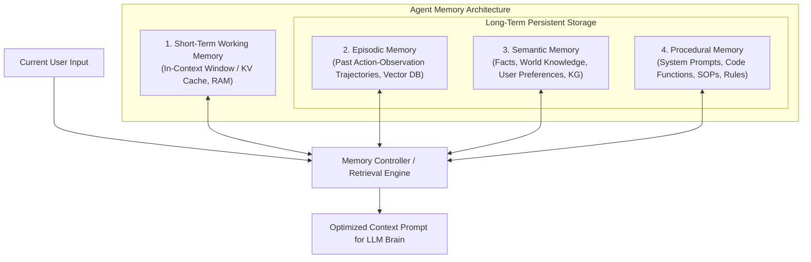

# Hệ Thống Bộ Nhớ Của Tác Nhân (Agent Memory Systems)

> **Khái niệm chính thống**: *Encyclopedia of LLMs*, Section 14.2; *Master All 20 Agentic AI Design Patterns*, Pattern 8; Packer et al. (2023) *"MemGPT: Towards LLMs as Operating Systems"*; Park et al. (2023) *"Generative Agents"*.
> **Miền kiến thức**: [[index|Cognitive Memory Architectures & Persistence]]
> **Tài liệu gốc liên quan**:
> - [Master All 20 Agentic AI Design Patterns.pdf](../resources/genai/Master%20All%2020%20Agentic%20AI%20Design%20Patterns.pdf) (Trang 22-26)
> - [Agentic AI Design Patterns(2026 Edition).pdf](../resources/genai/Agentic%20AI%20Design%20Patterns%282026%20Edition%29.pdf) (Trang 8-12)
> - [Encyclopedia of LLMs and Foundation Models.pdf](../resources/genai/Encyclopedia%20of%20LLMs%20and%20Foundation%20Models.pdf) (Trang 130-131)

---

## 1. Tóm tắt (Executive Summary)
**Hệ thống Bộ nhớ của Tác nhân (Agent Memory Systems)** là cơ sở hạ tầng lưu trữ, tổ chức và truy hồi thông tin cho phép AI Agent duy trì trạng thái ngữ cảnh nhất quán xuyên suốt phiên làm việc hiện tại và tích lũy tri thức kinh nghiệm qua nhiều phiên làm việc dài hạn trong tương lai. Lấy cảm hứng từ cấu trúc phân tầng bộ nhớ máy tính (RAM vs Disk) và tâm lý học nhận thức của con người, kiến trúc bộ nhớ Agent được chia làm 4 tầng riêng biệt: **Bộ nhớ Ngắn hạn (Short-term Working Memory)**, **Bộ nhớ Sự kiện (Episodic Memory)**, **Bộ nhớ Ngữ nghĩa (Semantic Memory)**, và **Bộ nhớ Thủ tục (Procedural Memory)**.

---

## 2. Định nghĩa chính thống & Kiến trúc 4 Tầng Bộ nhớ (Cognitive Memory Taxonomy)

### 2.1 Chi tiết 4 tầng bộ nhớ
1. **Short-Term / Working Memory (Bộ nhớ Làm việc Ngắn hạn)**:
   - *Bản chất*: Toàn bộ chuỗi token nằm trực tiếp trong Context Window của LLM tại thời điểm hiện tại.
   - *Đặc điểm*: Truy xuất tức thì, độ trễ 0ms, nhưng bị giới hạn cứng bởi kích thước context window và chi phí token đắt đỏ.
2. **Episodic Memory (Bộ nhớ Sự kiện / Trải nghiệm)**:
   - *Bản chất*: Lưu trữ biên bản nhật ký về những hành động, sai lầm và kết quả mà Agent đã từng trải qua trong quá khứ: *"Lần trước khi gọi API thanh toán với mã giảm giá X, hệ thống đã báo lỗi mã hết hạn"*.
   - *Cơ chế lưu trữ*: Thường được lưu dưới dạng embedding trong Vector DB, được truy xuất qua tìm kiếm tương đồng mỗi khi Agent gặp tình huống tương tự.
3. **Semantic Memory (Bộ nhớ Ngữ nghĩa / Tri thức thế giới)**:
   - *Bản chất*: Lưu trữ các sự thật khách quan, định nghĩa, thông tin hồ sơ người dùng (User Profile, sở thích cá nhân, điều khoản dịch vụ).
   - *Cơ chế lưu trữ*: Cơ sở dữ liệu quan hệ SQL hoặc Knowledge Graph.
4. **Procedural Memory (Bộ nhớ Thủ tục / Kỹ năng)**:
   - *Bản chất*: Tập hợp các quy tắc ứng xử bất biến, hướng dẫn vận hành chuẩn (SOP), code Python và định nghĩa tools mà Agent sở hữu để hoàn thành tác vụ.

### 2.2 Kiến trúc MemGPT (OS-Style Hierarchical Memory)
MemGPT (Packer et al., 2023) đưa ra cơ chế quản lý bộ nhớ như hệ điều hành:
- LLM được trang bị các công cụ đặc biệt để tự quản lý bộ nhớ của chính mình: `core_memory_append`, `core_memory_replace`, `archival_memory_insert`, `archival_memory_search`.
- Khi bộ nhớ ngắn hạn bị đầy, Agent tự động chạy tiến trình ngầm tóm tắt (Memory Consolidation) và đẩy dữ liệu cũ ra bộ nhớ dài hạn bên ngoài (Disk Offloading), tương tự như cơ chế Virtual Memory Paging trong HĐH.

---

## 3. So sánh & Mâu thuẫn / Sắc thái giữa các tài liệu

| Khía cạnh | Bộ nhớ Chatbot thông thường | Hệ thống Bộ nhớ Agent hoàn chỉnh | Ý nghĩa đối với AI Engineer |
| :--- | :--- | :--- | :--- |
| **Cách quản lý ngữ cảnh** | Cắt cụt đuôi (Sliding Window): Xóa các tin nhắn cũ nhất khi đầy context. | Tóm tắt phân tầng (Hierarchical Summarization) + RAG Retrieval trên lịch sử quá khứ. | Không làm mất các thông tin quan trọng đã trao đổi ở đầu phiên làm việc (như yêu cầu tiên quyết của người dùng). |
| **Khả năng học tập xuyên phiên** | Hoàn toàn bằng 0. Mỗi phiên chat mới là một thực thể mất trí nhớ (Amnesia). | Lưu trữ hồ sơ người dùng và các bài học thất bại vào Episodic Memory. | Agent trở nên thông minh hơn và cá nhân hóa sâu sắc theo thời gian sử dụng. |
| **Chi phí token** | Tăng tuyến tính và phình to cực nhanh sau 10 lượt chat. | Cố định ở mức tối ưu nhờ chỉ truy xuất các mẩu ký ức liên quan nhất vào prompt. | Tiết kiệm 60-80% chi phí vận hành hạ tầng API. |

---

## 4. Góc nhìn Thực chiến & Thiết kế Hệ thống cho AI Engineer

### 4.1 Cơ chế Tích tụ và Suy giảm Ký ức (Memory Decay & Consolidation)
Lấy cảm hứng từ nghiên cứu *Generative Agents* (Park et al., 2023), điểm số truy hồi ký ức ($Score$) được tính bằng tổng hợp của 3 yếu tố:
$$Score = \alpha \cdot \text{Recency} + \beta \cdot \text{Importance} + \gamma \cdot \text{Relevance}$$
- **Recency (Độ tươi mới)**: Ký ức vừa diễn ra cách đây vài phút có điểm số cao hơn ký ức từ tháng trước theo hàm suy giảm mũ ($e^{-\lambda \Delta t}$).
- **Importance (Tầm quan trọng)**: LLM tự chấm điểm mức độ quan trọng của sự kiện (thang điểm 1-10); sự kiện mua nhà hay đổi mật khẩu có điểm cao hơn câu chào hỏi thời tiết.
- **Relevance (Độ liên quan)**: Điểm Cosine Similarity giữa câu hỏi hiện tại và nội dung ký ức.

### 4.2 Câu hỏi phỏng vấn thực tế
- **Q**: *Làm thế nào để xử lý mâu thuẫn tri thức trong bộ nhớ dài hạn của Agent (ví dụ: ngày 1 người dùng nói "Tôi ăn chay", ngày 10 người dùng nói "Hôm nay tôi muốn ăn bít tết bò")?*
  - **A**: Áp dụng kỹ thuật **Temporal Memory Updating & Conflict Resolution**: Mọi mẩu thông tin trong Semantic/Episodic Memory bắt buộc phải có trường metadata thời gian (`timestamp`). Khi phát hiện thông tin mới đối nghịch với thông tin cũ, hệ thống cập nhật trạng thái mới nhất đồng thời gắn cờ trạng thái cũ là `is_superseded: true`, hoặc kích hoạt bước đối thoại xác nhận lại với người dùng.

---

## 5. Mạng lưới Liên kết Tri thức (Knowledge Graph & `wiki-links`)
- [[agentic-ai-core]] — Nền tảng kiến trúc chứa hệ thống bộ nhớ.
- [[vector-embeddings]] — Công cụ đánh chỉ mục cho Episodic Memory.
- [[reflection-and-self-correction]] — Nguồn dữ liệu sinh ra các bài học đúc kết lưu vào bộ nhớ.
- [[human-in-the-loop]] — Quản trị quyền riêng tư và quyền được xóa bỏ dữ liệu (GDPR) trong bộ nhớ.