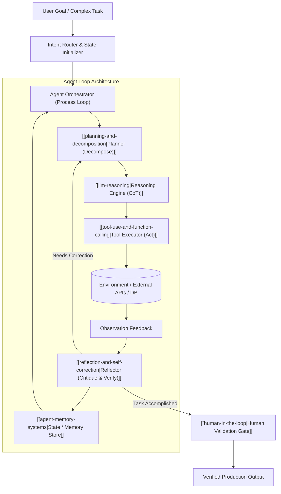

# Kiến Trúc Cốt Lõi Của Agentic AI (Agentic AI Core Architecture)

> **Khái niệm chính thống**: *Encyclopedia of LLMs*, Chapter 14 (Section 14.1); *Master All 20 Agentic AI Design Patterns* (2025), Section 1; *Agentic AI Design Patterns (2026 Edition)*; *giao_trinh_agentic.pdf*.
> **Miền kiến thức**: [[index|Agentic AI & Cognitive Autonomous Systems]]
> **Tài liệu gốc liên quan**:
> - [Master All 20 Agentic AI Design Patterns.pdf](../resources/genai/Master%20All%2020%20Agentic%20AI%20Design%20Patterns.pdf) (Trang 1-6)
> - [Agentic AI Design Patterns(2026 Edition).pdf](../resources/genai/Agentic%20AI%20Design%20Patterns%282026%20Edition%29.pdf) (Trang 1-6)
> - [giao_trinh_agentic.pdf](../resources/genai/giao_trinh_agentic.pdf) (Trang 1-8)
> - [Encyclopedia of LLMs and Foundation Models.pdf](../resources/genai/Encyclopedia%20of%20LLMs%20and%20Foundation%20Models.pdf) (Trang 129-131)
> - [846485886_122320901828195094_432191169857527385_n.jpg](../resources/images/846485886_122320901828195094_432191169857527385_n.jpg) (Sơ đồ Human-in-the-Loop)

---

## 1. Tóm tắt (Executive Summary)
**Tác nhân Trí tuệ Nhân tạo (Agentic AI)** đại diện cho bước chuyển dịch mô thức kiến trúc từ các mô hình ngôn ngữ phản xạ thụ động (Reactive Generative AI: Prompt $\rightarrow$ Response) sang các hệ thống tự chủ chủ động (Proactive Autonomous Systems). Một Agentic AI hoàn chỉnh là một hệ thống khép kín gồm 4 trụ cột: **Bộ não Suy luận (LLM Reasoning Core)**, **Bộ nhớ Đa tầng (Memory Systems)**, **Công cụ & Giao tiếp Ngoại vi (Tools & Actuators)**, và **Cơ chế Lập kế hoạch & Tự phản biện (Planning & Reflection)** vận hành liên tục qua chu trình lặp: `Perceive -> Plan -> Act -> Observe -> Reflect` để đạt mục tiêu phức tạp mà con người giao phó.

---

## 2. Định nghĩa chính thống & Mô hình Tư duy Kiến trúc sư (Mental Model 2026)

### 2.1 Mental Model chuẩn mực của Senior Architect
Theo *Agentic AI Design Patterns (2026 Edition)*:
> - **LLMs are CPUs** (Bộ vi xử lý tính toán logic thô).
> - **Prompts are Instructions / Memory Registers** (Mã lệnh và thanh ghi tạm thời).
> - **Agents are Processes** (Tiến trình thực thi nhiệm vụ độc lập có trạng thái).
> - **Agentic Frameworks are Operating Systems** (Hệ điều hành quản lý cấp phát tài nguyên, bộ nhớ, IPC và lập lịch).

### 2.2 So sánh cốt lõi: Chatbot truyền thống vs Agentic AI
Theo giáo trình *giao_trinh_agentic.pdf*:
1. **Chatbot (Passive LLM)**:
   - Không có trạng thái phiên bền vững; vòng đời kết thúc ngay khi sinh xong chuỗi token.
   - Hoàn toàn mù quáng đối với môi trường thực tế (không thể gọi API, không thể đọc file hệ thống, không thể tương tác web).
   - Không có vòng lặp tự sửa lỗi: nếu sinh sai câu lệnh SQL, nó sẽ trả thẳng lỗi cho người dùng.
2. **AI Agent (Autonomous Process)**:
   - Quản lý trạng thái (State Machine): Theo dõi rõ mình đang ở bước nào trong quy trình.
   - Tự chủ thực thi hành động qua Tool Calling.
   - Tự động bắt lỗi ngoại lệ (Exception Handling): Nếu câu lệnh SQL sinh ra bị lỗi cú pháp từ database trả về, Agent tự đọc log lỗi, tự sửa lại câu query và thử lại mà không làm phiền người dùng.

---

## 3. So sánh & Mâu thuẫn / Sắc thái giữa các tài liệu

| Khía cạnh | Tài liệu giáo trình sơ cấp | Báo cáo kiến trúc công nghiệp 2026 | Phân tích sâu của AI Engineer |
| :--- | :--- | :--- | :--- |
| **Mức độ tự chủ (Autonomy)** | Khuyến khích xây dựng "Fully Autonomous Agents" (như AutoGPT thời kỳ đầu) để máy tự làm từ A đến Z. | Khẳng định AutoGPT tự do không giới hạn là **thất bại kiến trúc lớn nhất 2023-2024**: Gây vòng lặp vô tận (infinite loops), bùng nổ chi phí token và rủi ro phá hủy hệ thống. | **Bắt buộc phải áp dụng Bound Autonomy**: Giới hạn tối đa số lượt lặp (Max Turns), đặt giới hạn ngân sách (Budget Cap) và bắt buộc có chốt phê duyệt con người ([[human-in-the-loop|Human-in-the-Loop]]). |
| **Độ tin cậy trong sản xuất** | Cho rằng Agent giải quyết được mọi tác vụ nếu prompt đủ dài và chi tiết. | Thống kê 90% lỗi của Agent trong sản xuất không phải do LLM kém thông minh, mà do: thiếu kiểm soát trạng thái, không có timeout, thiếu cơ chế retry và không có observability. | Kỹ sư giỏi tập trung 80% thời gian vào phần mềm truyền thống (State Management, Error Recovery, Retries, Logging) bọc xung quanh LLM. |

---

## 4. Góc nhìn Thực chiến & Thiết kế Hệ thống cho AI Engineer

### 4.1 Quy tắc vàng triển khai Agentic AI trong Doanh nghiệp
1. **Nguyên tắc "LLM as a Judge / Validator"**: Tách rời vai trò giữa Agent thực thi (Worker) và Agent kiểm thử (Auditor/Evaluator). Không bao giờ để một Agent vừa làm vừa tự chấm bài mà không có tiêu chuẩn độc lập.
2. **Idempotency (Tính bất biến của Tool)**: Đảm bảo các công cụ Agent gọi có tính lũy suy; nếu Agent gọi lại công cụ 2 lần do mạng chập chờn, hành động đó không gây trừ tiền hai lần trong tài khoản ngân hàng.
3. **Structured Outputs**: Bắt buộc Agent trả về dữ liệu tuân thủ nghiêm ngặt JSON Schema bằng Pydantic hoặc Zod, loại bỏ hoàn toàn việc parse text tự do bằng regex thô sơ.

### 4.2 Câu hỏi phỏng vấn thực tế
- **Q**: *Tại sao hầu hết các Agent mã nguồn mở chạy thử nghiệm trên Jupyter Notebook thì rất ấn tượng nhưng đưa vào môi trường Production thực tế đều bị sập hoặc mất kiểm soát?*
  - **A**: Vì trong môi trường thực tế, Agent phải đối mặt với các vấn đề phân tán: API bên thứ ba bị timeout hoặc đổi schema, dữ liệu người dùng chứa prompt injection tiềm ẩn, token context bị tràn sau nhiều lượt hội thoại, và việc không có một Finite State Machine (FSM) quản lý phân luồng trạng thái khiến Agent rơi vào các vòng lặp tư duy lặp đi lặp lại vô nghĩa (hallucination loops).

---

## 5. Mạng lưới Liên kết Tri thức (Knowledge Graph & `wiki-links`)
- [[react-pattern]] — Mô thức vòng lặp suy luận và hành động kinh điển.
- [[planning-and-decomposition]] — Năng lực phân rã mục tiêu lớn thành các bước khả thi.
- [[tool-use-and-function-calling]] — Cầu nối giúp Agent tương tác với thế giới thực.
- [[reflection-and-self-correction]] — Cơ chế tự đánh giá và sửa sai sau mỗi hành động.
- [[multi-agent-collaboration]] — Kết nối nhiều Agent đơn lẻ thành hệ thống phối hợp chuyên môn hóa.
- [[agent-memory-systems]] — Cơ sở hạ tầng lưu trữ ngữ cảnh ngắn hạn và dài hạn cho Agent.
- [[human-in-the-loop]] — Trụ cột quản trị rủi ro, phân định trách nhiệm pháp lý và an toàn cho Agent.