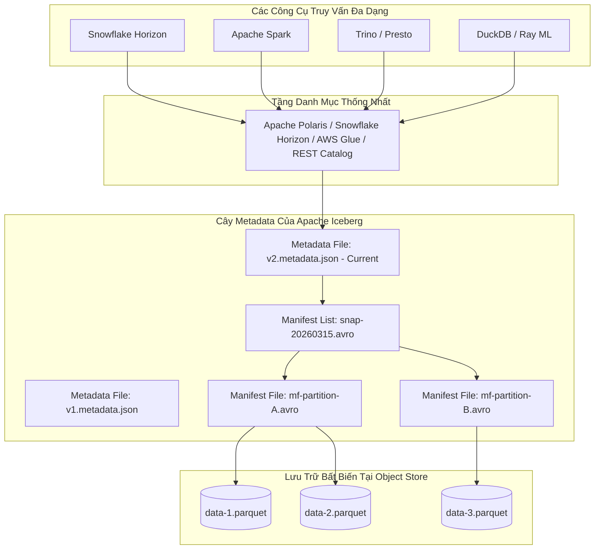
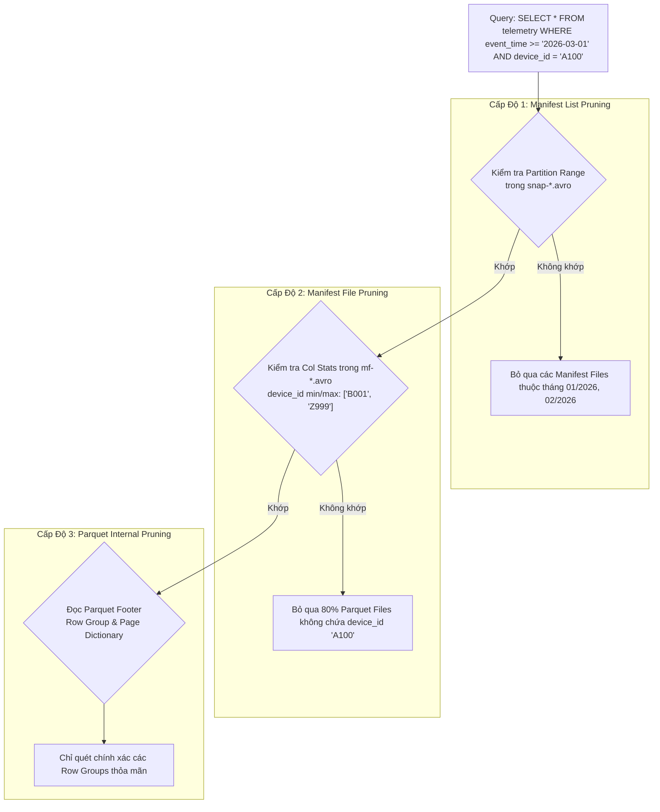

# Kiến Trúc Bảng Dữ Liệu Mở Apache Iceberg & Hồ Dữ Liệu Lai (Open Lakehouse)

> **Tóm tắt điều hành**: Apache Iceberg là định dạng bảng mở thế hệ mới (Open Table Format) cho các hồ dữ liệu (Lakehouse) quy mô petabyte. Iceberg giải quyết triệt để các tử huyệt của kiến trúc Apache Hive truyền thống (dựa vào cấu trúc thư mục vật lý) bằng cách đưa trạng thái bảng vào một **cây siêu dữ liệu phân tầng (Hierarchical Metadata Tree)**. Nhờ đó, Iceberg hỗ trợ giao dịch ACID toàn diện qua Optimistic Concurrency Control (OCC), cơ chế phân đoạn ẩn (**Hidden Partitioning**), tiến hóa phân đoạn không cần viết lại dữ liệu (**Partition Evolution**), tiến hóa lược đồ không mất mát dữ liệu thông qua định danh trường bất biến (**Field IDs**), và cắt tỉa dữ liệu 3 cấp độ (**3-Level Pruning**).

---

## 1. Bối Cảnh Lịch Sử: Từ Hive Table Đến Open Table Format

Trong kỷ nguyên Big Data thế hệ 1 (Hadoop/Hive), một bảng dữ liệu đơn thuần là một thư mục trên HDFS hoặc S3:
- Phân đoạn (Partitioning) được ánh xạ trực tiếp thành các thư mục con: `s3://bucket/table/year=2026/month=03/`.
- **Hạn chế nghiêm trọng của Hive**:
  1. *Thiếu tính nguyên tử (No ACID)*: Khi ghi dữ liệu, nếu cluster bị sập giữa chừng, bảng rơi vào trạng thái hỏng (corrupted partial write).
  2. *Liệt kê file chậm (Directory Listing Bottleneck)*: Khi bảng có hàng trăm nghìn file, thao tác `listStatus` trên S3 có thể mất hàng chục phút chỉ để xác định các file cần đọc.
  3. *Lỗi logic truy vấn người dùng*: Người dùng bắt buộc phải biết cột phân đoạn (`WHERE year = 2026 AND event_time >= '2026-03-01'`) nếu không muốn bị full-table scan.
  4. *Khóa cứng nhà cung cấp (Vendor Lock-in)*: Các định dạng độc quyền (như bảng nội bộ của Snowflake, BigQuery) buộc doanh nghiệp phải trả phí tính toán độc quyền cho cùng một nhà cung cấp.



---

## 2. Cấu Trúc Cây Metadata Phân Tầng Của Apache Iceberg

Trạng thái của một bảng Iceberg tại bất kỳ thời điểm nào được định nghĩa qua 4 tầng siêu dữ liệu độc lập:

1. **Iceberg Catalog**:
   - Lưu trữ con trỏ tới file metadata hiện tại của bảng (ví dụ: `v2.metadata.json`).
   - Đảm bảo tính nguyên tử khi chuyển đổi trạng thái bảng thông qua cơ chế so sánh và hoán đổi (**CAS - Compare-And-Swap**).
2. **Metadata File (`*.metadata.json`)**:
   - Lưu trữ lược đồ bảng (Schema với Field IDs), thông số phân đoạn (Partition Spec), thuộc tính cấu hình, danh sách tất cả các Snapshot lịch sử và con trỏ tới Snapshot hiện tại (`current-snapshot-id`).
3. **Manifest List (`snap-*.avro`)**:
   - Đại diện cho một Snapshot cụ thể. Lưu danh sách các file **Manifest File** cấu thành nên Snapshot đó.
   - Mỗi dòng chứa thông tin tóm tắt: phân đoạn nào có trong manifest file tương ứng, khoảng giá trị min/max của các partition columns.
4. **Manifest File (`*.avro`)**:
   - Chứa danh sách các file dữ liệu vật lý thực tế (`*.parquet` hoặc `*.orc`).
   - Mỗi file dữ liệu đi kèm siêu dữ liệu chi tiết ở cấp cột: giá trị cực tiểu (Min), cực đại (Max), số lượng giá trị rỗng (Null Count), số lượng giá trị NaN và kích thước byte.
5. **Data Files (`*.parquet`)**:
   - Chứa dữ liệu bản ghi thực tế được nén (thường bằng Snappy hoặc ZSTD), tổ chức theo dạng cột với các Row Groups và Dictionary Pages.

---

## 3. Cơ Chế Cắt Tỉa Dữ Liệu 3 Cấp Độ (3-Level Pruning)

Khi một câu lệnh SQL thực thi, Iceberg loại bỏ 99% dữ liệu không liên quan mà **không cần mở bất kỳ file dữ liệu vật lý nào**:



1. **Cấp 1 - Manifest List Level**: Dùng khoảng phân đoạn để lọc bỏ hàng loạt Manifest File.
2. **Cấp 2 - Manifest File Level**: Dùng thống kê Min/Max của các cột lọc (`device_id`) để bỏ qua các Data File không chứa giá trị mục tiêu.
3. **Cấp 3 - Parquet File Level (Vectorized Read)**: Sử dụng cấu trúc Footer của Parquet (Offset, Dictionary, Bloom Filter của từng Row Group) để chỉ nạp đúng các byte dữ liệu cần thiết vào bộ nhớ RAM.

---

## 4. Các Tính Năng Thiết Kế Vượt Trội

### 4.1. Hidden Partitioning (Phân Đoạn Ẩn)
- Trong Hive, nếu muốn phân đoạn theo tháng từ cột timestamp `ts`, kỹ sư phải tạo thêm cột nhân tạo `event_month = '2026-03'`. Truy vấn bắt buộc phải lọc theo cả `ts` và `event_month`.
- Trong Iceberg, phép biến đổi phân đoạn là thuộc tính của metadata:
  ```sql
  CREATE TABLE events (
      id BIGINT,
      event_time TIMESTAMP,
      payload STRING
  ) PARTITIONED BY (month(event_time));
  ```
- Người dùng chỉ cần truy vấn tự nhiên: `WHERE event_time >= '2026-03-15'`. Trình tối ưu của Iceberg tự động ánh xạ phép chiếu `month()` và cắt tỉa các phân đoạn tương ứng mà người dùng không cần biết bảng được partition như thế nào.

### 4.2. Partition Evolution (Tiến Hóa Phân Đoạn)
- Giả sử lưu lượng dữ liệu tăng gấp 100 lần, từ phân đoạn theo năm cần chuyển sang phân đoạn theo ngày:
  - Trong Hive: Bắt buộc phải tạo bảng mới và chạy ETL viết lại (rewrite) toàn bộ 500TB dữ liệu cũ $\to$ Tốn hàng nghìn USD compute.
  - Trong Iceberg: Chỉ cần chạy `ALTER TABLE events SET PARTITION SPEC (days(event_time))`. Dữ liệu cũ giữ nguyên phân đoạn theo năm; dữ liệu mới ghi theo ngày. Iceberg tự động áp dụng đúng spec tùy theo snapshot của từng file.

### 4.3. Schema Evolution An Toàn Tuyệt Đối Với Field IDs
- Iceberg theo dõi các cột bằng **Field ID (số nguyên duy nhất bất biến)** thay vì tên cột hoặc vị trí cột (index):
  - Khi đổi tên cột `amount` thành `order_value`, ID vẫn là `3`.
  - Khi xóa cột và thêm cột mới trùng tên, cột mới sẽ nhận ID mới (ví dụ `7`).
  - Dữ liệu cũ không bao giờ bị đọc nhầm giá trị sang cột mới.

### 4.4. Tính Nguyên Tử & ACID Thông Qua OCC (Optimistic Concurrency Control)
- Giao dịch thực hiện ghi dữ liệu mới và sinh các file manifest mới ở chế độ độc lập.
- Khi hoàn tất, writer cố gắng commit snapshot mới qua phép toán nguyên tử CAS trên Catalog:
  $$\text{CAS}(\text{expected\_snapshot\_id}, \text{new\_snapshot\_id})$$
- Nếu có một writer khác đã commit trước, transaction phát hiện xung đột (Conflict Detection). Nếu hai transaction không can thiệp vào cùng một file dữ liệu, Iceberg tự động **Rebase** và commit thành công; nếu trùng file, transaction sau sẽ tự hủy và retry mà không làm bẩn dữ liệu.

---

## 5. Kiến Trúc Hồ Dữ Liệu Lai: Snowflake + S3 Iceberg Tables

Mô hình kiến trúc tối ưu chi phí và phòng chống khóa cứng nhà cung cấp (Zero Vendor Lock-in) được áp dụng tại các tập đoàn lớn:

```mermaid
flowchart LR
    subgraph Storage [Lưu Trữ Đối Tượng Tập Trung - AWS S3]
        Raw[(S3 Raw Bronze Parquet)]
        Ice[(S3 Iceberg Tables - Silver)]
    end

    subgraph Catalog_Layer [Catalog Quản Trị Mở]
        Horizon[Snowflake Horizon / Apache Polaris]
    end

    subgraph Compute_Engines [Đa Động Cơ Tính Toán]
        Snowflake_WH[Snowflake Virtual Warehouse\n(BI / Executive Dashboard / Gold Layer)]
        Spark_Cluster[Apache Spark / Ray\n(Large-scale ML Feature Engineering)]
    end

    Raw -->|Snowflake COPY / ELT| Ice
    Horizon -->|Theo dõi Metadata| Ice
    Snowflake_WH <-->|Đọc & Ghi Iceberg qua External Volume| Ice
    Spark_Cluster <-->|Đọc trực tiếp Iceberg| Ice
```

### Cấu Hình Snowflake Kết Nối Bảng Iceberg Trên AWS S3:

```sql
-- 1. Tạo External Volume kết nối tới S3 Bucket
CREATE OR REPLACE EXTERNAL VOLUME s3_iceberg_ext_vol
    STORAGE_LOCATIONS = (
        (
            NAME = 'us-east-1-my-s3'
            STORAGE_PROVIDER = 'S3'
            STORAGE_BASE_URL = 's3://enterprise-lakehouse-bucket/iceberg/'
            STORAGE_AWS_ROLE_ARN = 'arn:aws:iam::123456789012:role/snowflake-s3-access-role'
        )
    );

-- 2. Khởi tạo Bảng Iceberg do Snowflake quản lý Catalog (Horizon)
CREATE OR REPLACE ICEBERG TABLE iceberg_customer_events (
    event_id STRING,
    user_id STRING,
    event_type STRING,
    event_timestamp TIMESTAMP_NTZ,
    event_data VARIANT
)
    EXTERNAL_VOLUME = 's3_iceberg_ext_vol'
    CATALOG = 'SNOWFLAKE'
    BASE_LOCATION = 'customer_events/'
    PARTITION BY (month(event_timestamp));

-- Dữ liệu Parquet được lưu 100% trên S3 của công ty, 
-- cho phép cả Snowflake, Spark, DuckDB và Trino cùng truy vấn đồng thời!
```

---

## 6. So Sánh Kiến Trúc: Snowflake Native Tables vs Iceberg Tables

| Tiêu chí | Snowflake Native Table | Snowflake Iceberg Table (S3/GCS) |
| :--- | :--- | :--- |
| **Nơi lưu trữ vật lý** | Bộ nhớ đám mây riêng của Snowflake | Cloud Object Storage của chính khách hàng (S3/Azure Blob) |
| **Định dạng file** | Định dạng độc quyền (Proprietary micro-partitions) | Chuẩn mở Apache Parquet + Avro Metadata |
| **Khả năng truy cập ngoài** | Chỉ duy nhất Snowflake truy vấn được | Bất kỳ engine nào (Spark, Trino, Flink, DuckDB, Python) |
| **Chi phí lưu trữ** | Tính theo giá storage bán lại của Snowflake | Tính trực tiếp theo đơn giá gốc của AWS S3 / Azure |
| **Tốc độ đọc/ghi (Performance)**| Tối ưu hóa tuyệt đối cho Snowflake (< 100ms) | Chậm hơn nhẹ (~5-15%) do overhead mạng S3 |
| **Chiến lược khuyến nghị** | **Tầng Gold**: Báo cáo BI thời gian thực, bảng tổng hợp | **Tầng Bronze & Silver**: Dữ liệu lớn, Data Lakehouse, ML |

---

## 7. Mạng Lưới Liên Kết Thực Thể (Wiki Links)

- [[modern-data-pipeline]] — Kiến trúc Data Pipeline hiện đại, mô hình Kimball và Medallion ELT.
- [[sql-vs-nosql-data-architecture]] — Kiến trúc SQL, NoSQL, phân tích lưu trữ Cột và Lakehouse.
- [[acid-and-transactions]] — Bản chất cơ chế Optimistic Concurrency Control (OCC) và Snapshot Isolation.
- [[data-drift-model-monitoring]] — Giám sát chất lượng dữ liệu và phân phối đầu vào cho mô hình AI.
