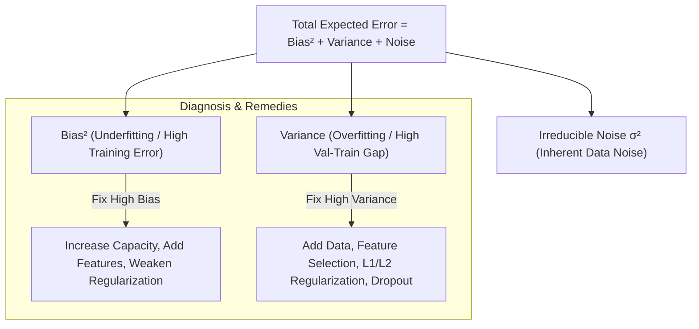

# Sự Đánh Đổi Giữa Độ Chệch và Phương Sai (Bias-Variance Tradeoff)

> **Khái niệm chính thống**: *Understanding Machine Learning* (Shalev-Shwartz & Ben-David), Chapter 5; *Mathematics for Machine Learning*, Chapter 8; *Bias-Variance_Tradeoff.pdf*.
> **Miền kiến thức**: [[index|Learning Theory & Generalization]]
> **Tài liệu gốc liên quan**:
> - [Bias-Variance_Tradeoff.pdf](../resources/machine-learning/Bias-Variance_Tradeoff.pdf) (Trang 1-71)
> - [understanding-machine-learning-theory-algorithms.pdf](../resources/machine-learning/understanding-machine-learning-theory-algorithms.pdf) (Trang 45-65)
> - [Machinelearningyearning-Vi.pdf](../resources/machine-learning/Machinelearningyearning-Vi.pdf) (Trang 15-40)
> - [847999051_122320901954195094_4534131503073995411_n.jpg](../resources/images/847999051_122320901954195094_4534131503073995411_n.jpg) (Infographic 4: Xử lý khi model sai)

---

## 1. Tóm tắt (Executive Summary)
**Sự đánh đổi giữa Độ chệch và Phương sai (Bias-Variance Tradeoff)** là định luật bảo toàn cốt lõi trong lý thuyết học máy mô tả mối quan hệ mâu thuẫn giữa hai nguồn sai số có thể kiểm soát được cấu thành nên lỗi kỳ vọng tổng thể của mô hình. **Độ chệch cao (High Bias)** phản ánh một mô hình quá đơn giản, bỏ sót các quy luật tiềm ẩn trong dữ liệu (**Hiện tượng Chưa khớp - Underfitting**). Ngược lại, **Phương sai cao (High Variance)** phản ánh một mô hình quá phức tạp, học vẹt cả các biến động ngẫu nhiên và nhiễu của tập huấn luyện (**Hiện tượng Quá khớp - Overfitting**). Mục tiêu của kỹ sư học máy là điều chỉnh độ phức tạp mô hình để tối thiểu hóa tổng sai số tổng quát hóa (Generalization Error).

---

## 2. Định nghĩa chính thống & Khai triển Toán học (Mathematical Decomposition)

### 2.1 Khai triển Sai số Dự đoán Kỳ vọng (Expected Prediction Error)
Giả sử dữ liệu sinh ra từ quan hệ: $y = f(x) + \epsilon$, với nhiễu $\mathbb{E}[\epsilon] = 0$ và $\text{Var}(\epsilon) = \sigma^2$.
Cho mô hình ước lượng $\hat{f}(x)$ được huấn luyện trên tập dữ liệu ngẫu nhiên $\mathcal{D}$.
Sai số bình phương kỳ vọng (Mean Squared Error - MSE) tại điểm kiểm tra $x_0$:
$$\text{MSE}(x_0) = \mathbb{E}_{\mathcal{D}, \epsilon} \left[ \left( y - \hat{f}(x_0) \right)^2 \right]$$

Khai triển đại số:
$$\text{MSE}(x_0) = \mathbb{E} \left[ \left( (f(x_0) + \epsilon) - \hat{f}(x_0) \right)^2 \right]$$
$$= \mathbb{E} \left[ \left( (f(x_0) - \mathbb{E}[\hat{f}(x_0)]) + (\mathbb{E}[\hat{f}(x_0)] - \hat{f}(x_0)) + \epsilon \right)^2 \right]$$

Do $\epsilon$ độc lập với $\hat{f}$, các số hạng tích chéo có kỳ vọng bằng 0, dẫn tới công thức phân rã tam phân kinh điển:
$$\text{MSE}(x_0) = \underbrace{\left( f(x_0) - \mathbb{E}[\hat{f}(x_0)] \right)^2}_{\text{Bias}^2(\hat{f}(x_0))} + \underbrace{\mathbb{E}\left[ \left( \hat{f}(x_0) - \mathbb{E}[\hat{f}(x_0)] \right)^2 \right]}_{\text{Variance}(\hat{f}(x_0))} + \underbrace{\sigma^2}_{\text{Irreducible Error}}$$

---

## 3. So sánh & Mâu thuẫn / Sắc thái: Hiện tượng "Double Descent" trong Học Sâu

| Khía cạnh | Học máy Thống kê Cổ điển (Classical ML) | Học sâu Hiện đại (Deep Learning - Double Descent) |
| :--- | :--- | :--- |
| **Đường cong sai số kiểm tra** | **Dạng chữ U (U-shaped Curve)**: Khi tăng số tham số, sai số giảm đến điểm tối ưu rồi tăng vọt trở lại do Overfitting. | **Suy giảm Kép (Double Descent - Belkin et al., 2019)**: Vượt qua ngưỡng nội suy (Interpolation Threshold), sai số kiểm tra **giảm lần thứ hai**! |
| **Cơ chế hoạt động** | Cần giới hạn số tham số $P < N$ (số tham số nhỏ hơn số mẫu dữ liệu) để tránh Overfitting. | Mạng cực lớn (Overparameterized Regimes: $P \gg N$ như LLM) tìm thấy nghiệm có chuẩn nhỏ nhất (Minimum-norm interpolator), giúp tổng quát hóa vượt trội. |
| **Ứng dụng thực tiễn** | Bắt buộc phải cân bằng chặt chẽ siêu tham số $k$ trong k-NN, độ sâu cây quyết định. | Với Deep Learning, việc mở rộng quy mô (Scale up model size) thường mang lại hiệu năng cao hơn mô hình vừa vặn. |

---

## 4. Góc nhìn Thực chiến & Thiết kế Hệ thống cho AI Engineer

### 4.1 Quy trình Chẩn đoán của Andrew Ng (Machine Learning Yearning)
Khi đánh giá mô hình, hãy so sánh:
1. **Lỗi con người (Human-level / Bayes Error)**: Giả sử $1\%$.
2. **Lỗi tập Train (Training Error)**:
   - Nếu Train Error = $15\% \rightarrow$ **High Bias (Underfitting)**. *Hành động*: Tăng kích thước mạng, thêm feature mới, giảm regularization.
3. **Lỗi tập Dev / Val (Validation Error)**:
   - Nếu Train Error = $2\%$, nhưng Val Error = $12\% \rightarrow$ **High Variance (Overfitting)**. *Hành động*: Thu thập thêm dữ liệu gán nhãn, thêm [[regularization-l1-l2|L1/L2]], áp dụng Data Augmentation.

### 4.2 Triết lý "Nếu Model sai thì sao?" (Từ Infographic 847999051)
- **Người yếu**: Thường vội vã trả lời *"Train lại model đi anh!"*.
- **Người giỏi**: Hỏi ngược lại: *Sai ở mức nào và sai số đó có chấp nhận được trong bối cảnh nghiệp vụ không?*
  - **Slicing Data**: Phân tích lỗi theo từng phân khúc khách hàng (Error Analysis by Slices). Model có thể đạt độ chính xác chung 85% nhưng lại sai tới 60% trên nhóm khách hàng VIP.
  - **Fail-safe Mechanism**: Không có model nào đúng 100%. Cần xây dựng cơ chế kiểm soát rủi ro (Risk Control) và bẫy lỗi tự động thay vì né tránh sự thật.

---

## 5. Mạng lưới Liên kết Tri thức (Knowledge Graph & `wiki-links`)
- [[linear-regression-mle]] — Ví dụ minh họa trực quan nhất cho sự phân rã sai số.
- [[regularization-l1-l2]] — Vũ khí kỹ thuật trực tiếp để ghìm cương Variance.
- [[model-selection-evaluation]] — Chiến lược chia tách dữ liệu để đo lường chính xác Bias và Variance.
- [[gradient-vanishing-exploding]] — Rào cản ngăn cản mô hình giảm Bias khi tăng chiều sâu mạng.