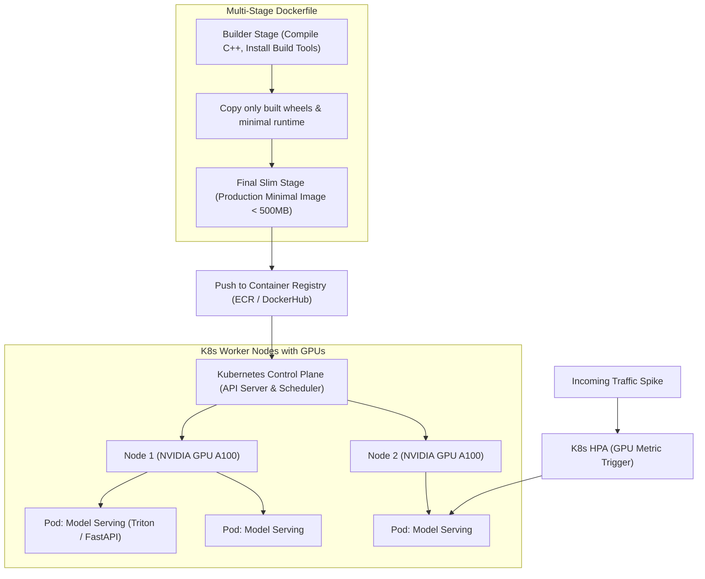

# Đóng Gói Container và Điều Phối Kubernetes (Containerization & Kubernetes for ML)

> **Khái niệm chính thống**: *Session 4: Docker Theory - Full Class Structure*; *AIO2025 Series: Kubernetes, Kubeflow, Spark Streaming và Kafka*; Cloud Native Computing Foundation (CNCF).
> **Miền kiến thức**: [[index|Cloud Infrastructure & Container Orchestration]]
> **Tài liệu gốc liên quan**:
> - [Session 4_ Docker Theory - Full Class Structure.pdf](../resources/ops/Session%204_%20Docker%20Theory%20-%20Full%20Class%20Structure.pdf) (Trang 1-25)
> - [AIO2025_MLOps-Tutorial_K8s_Kubeflow_Spark_Streaming_Kafka.pdf](../resources/ops/AIO2025_MLOps-Tutorial_K8s_Kubeflow_Spark_Streaming_Kafka.pdf) (Trang 1-35)
> - [Sesion 5 - Setup.pdf](../resources/ops/Sesion%205%20-%20Setup.pdf) (Trang 1-3)

---

## 1. Tóm tắt (Executive Summary)
**Đóng gói Container và Điều phối (Containerization & Orchestration)** là công nghệ nền tảng loại bỏ vĩnh viễn lời than phiền kinh điển: *"Mô hình chạy hoàn hảo trên máy em nhưng không chạy được trên server"*. Bằng cách sử dụng **Docker**, toàn bộ mã nguồn, thư viện phụ thuộc, phiên bản CUDA và tệp cấu hình được đóng gói thành các hình ảnh bất biến (**Immutable Container Images**). Để vận hành hàng trăm container mô hình trên cụm máy chủ phân tán có gắn GPU, **Kubernetes (K8s)** đóng vai trò là hệ điều hành đám mây tự động hóa việc lập lịch tài nguyên, tự phục hồi lỗi (**Self-healing**), và mở rộng quy mô tự động (**Horizontal Pod Autoscaling - HPA**).

---

## 2. Định nghĩa chính thống & Kiến trúc Docker & Kubernetes



### 2.1 Kỹ thuật Multi-Stage Build trong Docker cho AI
Hình ảnh Docker cho Deep Learning thường bị phình to khủng khiếp (10GB - 20GB) do chứa trình biên dịch GCC, CUDA toolkit đầy đủ và rác cache.
Kỹ thuật **Multi-stage Build** chia Dockerfile thành 2 giai đoạn:
1. **Builder Stage**: Dùng image đầy đủ (`devel`) để cài đặt thư viện và biên dịch.
2. **Final Stage**: Chỉ dùng image rút gọn (`runtime-slim`), copy các thư viện đã biên dịch sang và loại bỏ toàn bộ công cụ dev. Kích thước image giảm từ 15GB xuống dưới 1.5GB, giúp tăng tốc độ tải và triển khai Pod trên Kubernetes gấp 10 lần.

### 2.2 Quản lý Tài nguyên GPU trong Kubernetes
Kubernetes quản lý phần cứng GPU thông qua plugin **NVIDIA GPU Operator**:
Kỹ sư khai báo tài nguyên trong tệp cấu hình Pod manifest (`deployment.yaml`):
```yaml
resources:
  limits:
    nvidia.com/gpu: 1 # Yêu cầu đúng 1 GPU vật lý
    memory: "16Gi"
    cpu: "4"
  requests:
    memory: "8Gi"
    cpu: "2"
```

---

## 3. So sánh & Mâu thuẫn / Sắc thái giữa các tài liệu

| Thành phần | Máy Ảo truyền thống (Virtual Machines) | Docker Container | Đánh giá Kỹ thuật |
| :--- | :--- | :--- | :--- |
| **Cơ chế cô lập** | Ảo hóa toàn bộ phần cứng (Hardware-level Virtualization); mỗi VM chạy một hệ điều hành khách (Guest OS) riêng. | Cô lập ở cấp độ hệ điều hành qua **Linux cgroups** và **namespaces**; chia sẻ chung nhân Linux Kernel với máy chủ vật lý. | Container khởi động trong vài giây (so với vài phút của VM) và tiêu hao tài nguyên CPU/RAM tối thiểu. |
| **Tương tác Driver GPU** | Đòi hỏi cấu hình GPU Passthrough phức tạp. | Dùng chung **NVIDIA Container Toolkit (nvidia-docker)**; ứng dụng trong container gọi trực tiếp tới driver GPU của máy chủ vật lý. | Hiệu năng tính toán đạt 99.5% tương đương chạy trực tiếp trên bare-metal. |

---

## 4. Góc nhìn Thực chiến & Thiết kế Hệ thống cho AI Engineer

### 4.1 Các thực hành tốt nhất (Best Practices) cho Docker AI
1. **Tuyệt đối không chạy container dưới quyền `root`**: Luôn tạo một user không có quyền quản trị:
   `RUN useradd -m appuser && USER appuser` để phòng chống tấn công chiếm quyền máy chủ (Container Escape).
2. **Sử dụng tệp `.dockerignore`**: Loại bỏ thư mục `.git`, `.venv`, `__pycache__` và các tệp dữ liệu huấn luyện nặng để tránh làm nặng Docker build context.
3. **Cài đặt Liveness và Readiness Probes trong Kubernetes**:
   - `readinessProbe`: Đảm bảo K8s không chuyển traffic vào Pod chừng nào mô hình chưa nạp xong toàn bộ trọng số vào VRAM GPU (tránh lỗi 502/503 khi vừa khởi động).
   - `livenessProbe`: Tự động khởi động lại container nếu tiến trình bị treo (`Deadlock`).

### 4.2 Câu hỏi phỏng vấn thực tế
- **Q**: *Làm thế nào Kubernetes có thể tự động mở rộng (Autoscale) số lượng Pod mô hình dựa trên mức độ sử dụng GPU thay vì chỉ CPU thông thường?*
  - **A**: Theo mặc định, bộ điều phối Kubernetes Horizontal Pod Autoscaler (HPA) chỉ đọc được số liệu CPU và RAM từ metrics-server. Để scale theo GPU:
    1. Cài đặt **NVIDIA DCGM Exporter** (Data Center GPU Manager) trên cụm để thu thập số liệu phần cứng GPU (GPU Utilization %, VRAM Usage).
    2. Đẩy các số liệu này vào **Prometheus**.
    3. Cài đặt **Prometheus Adapter** để chuyển đổi metric này thành **Custom Metrics API** trong Kubernetes.
    4. Cấu hình HPA theo dõi custom metric: `container_gpu_utilization > 75%` để tự động tạo thêm Pod mới khi hệ thống chịu tải nặng.

---

## 5. Mạng lưới Liên kết Tri thức (Knowledge Graph & `wiki-links`)
- [[mlops-lifecycle]] — Môi trường đóng gói phần mềm trong chu trình MLOps.
- [[model-serving-api]] — Ứng dụng được chứa đựng bên trong các container.
- [[continuous-integration-cd-ml]] — CI/CD tự động xây dựng Docker image và deploy lên cụm K8s.
- [[data-drift-model-monitoring]] — Giám sát hạ tầng container và Pods qua Prometheus.