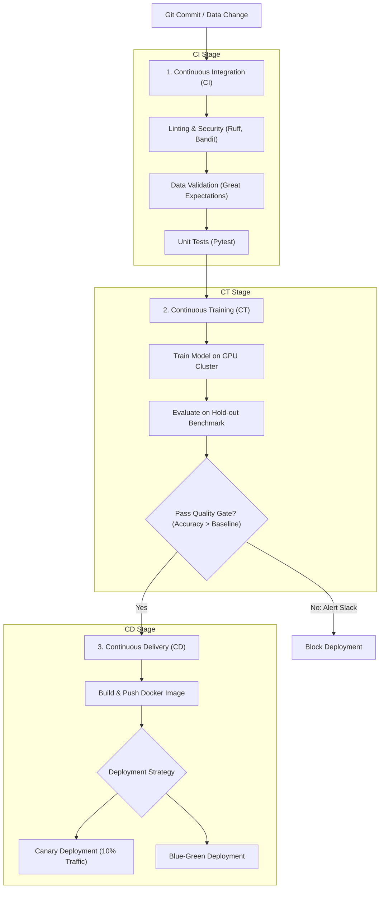

# Tích Hợp và Triển Khai Liên Tục Cho Học Máy (CI/CD/CT for Machine Learning)

> **Khái niệm chính thống**: *AIO2025 Series: Tutorial CI/CD với GitHub Actions, Jenkins và GitLab CI*; *Session 6: CICD_1*; Google Cloud Architecture Center *"MLOps: Continuous delivery and automation pipelines in machine learning"*.
> **Miền kiến thức**: [[index|DevOps for AI & Automated Pipelines]]
> **Tài liệu gốc liên quan**:
> - [AIO2025_MLOps_CICD.pdf](../resources/ops/AIO2025_MLOps_CICD.pdf) (Trang 1-40)
> - [Session 6_CICD_1.pdf](../resources/ops/Session%206_CICD_1.pdf) (Trang 1-31)
> - [AIO2025_MLOps-Tutorial_K8s_Kubeflow_Spark_Streaming_Kafka.pdf](../resources/ops/AIO2025_MLOps-Tutorial_K8s_Kubeflow_Spark_Streaming_Kafka.pdf) (Trang 35-50)

---

## 1. Tóm tắt (Executive Summary)
**Tích hợp và Triển khai Liên tục cho Học máy (CI/CD/CT for ML)** là sự mở rộng toàn diện của các nguyên lý DevOps truyền thống sang lĩnh vực trí tuệ nhân tạo. Trong khi phần mềm truyền thống chỉ kiểm soát một chiều là **Mã nguồn (Code)**, hệ thống Machine Learning là sự kết hợp hữu cơ của 3 thành phần động: **Mã nguồn (Code)**, **Dữ liệu (Data)**, và **Mô hình (Model)**. Do đó, quy trình CI/CD trong MLOps không chỉ kiểm thử cú pháp code mà còn bao gồm kiểm thử chất lượng dữ liệu (**Data Testing**), kiểm định độ chính xác mô hình (**Model Quality Gate**), triển khai an toàn không gián đoạn (**Canary / Blue-Green Deployments**) và vòng lặp tự động huấn luyện lại (**Continuous Training - CT**).

---

## 2. Định nghĩa chính thống & Vòng lặp Tam hợp CI/CD/CT



### 2.1 Ba thành phần cốt lõi của CI/CD/CT
1. **Continuous Integration (CI)**:
   - Tự động chạy khi kỹ sư tạo Pull Request: Kiểm tra format code (Flake8, Black, Ruff), kiểm tra bảo mật (Bandit), chạy Unit Tests cho các hàm xử lý dữ liệu và kiểm tra cấu trúc schema dữ liệu.
2. **Continuous Training (CT - Điểm đặc thù của ML)**:
   - Tự động kích hoạt pipeline huấn luyện lại trên cụm GPU khi có luồng dữ liệu mới được nạp vào kho hoặc khi hệ thống phát hiện Concept Drift.
   - **Quality Gate Check**: So sánh mô hình mới (Challenger) với mô hình đang chạy thực tế (Champion). Chỉ thăng hạng khi mô hình mới vượt trội hơn trên tập benchmark chuẩn.
3. **Continuous Deployment (CD)**:
   - Tự động đóng gói mô hình vào Docker container và cập nhật cấu hình triển khai Kubernetes qua luồng GitOps (ArgoCD).

---

## 3. So sánh & Mâu thuẫn / Sắc thái: Các Chiến Lược Triển Khai (Deployment Strategies)

| Chiến lược | Cơ chế điều phối giao thông | Mức độ rủi ro gián đoạn | Chi phí hạ tầng |
| :--- | :--- | :--- | :--- |
| **Recreate / Big Bang** | Tắt toàn bộ phiên bản cũ (v1) rồi mới bật phiên bản mới (v2). | Rất cao; hệ thống bị sập dịch vụ (Downtime) trong thời gian container v2 khởi động. | Thấp nhất (không tốn thêm server). |
| **Blue-Green Deployment** | Duy trì 2 môi trường song song giống hệt nhau: Môi trường Blue (v1 đang chạy) và Green (v2 mới deploy). Sau khi kiểm thử Green ổn định, bộ cân bằng tải Router chuyển 100% traffic từ Blue sang Green tức thì. | Rất thấp; nếu có lỗi xảy ra, chỉ cần gạt router quay lại Blue trong 1 giây (**Instant Rollback**). | Gấp đôi chi phí server/GPU trong giai đoạn chuyển giao. |
| **Canary Deployment** | Điều hướng một tỷ lệ nhỏ traffic thực tế (e.g., 5% - 10%) sang phiên bản mới v2, trong khi 90% người dùng vẫn dùng v1. Sau vài giờ nếu không có lỗi ngoại lệ hoặc drift, tăng dần lên 25%, 50% và 100%. | **An toàn nhất trong sản xuất**. Nếu model mới có lỗi tiềm ẩn, chỉ có 5% người dùng bị ảnh hưởng. | Trung bình; đòi hỏi bộ định tuyến thông minh (như Istio / NGINX Ingress). |
| **Shadow / Dark Launching** | Toàn bộ request được nhân bản (Forked traffic): gửi đồng thời tới cả v1 và v2, nhưng **chỉ trả kết quả của v1 cho người dùng**. Kết quả của v2 được ghi vào log để phân tích hiệu năng và độ trễ ngầm. | Không có rủi ro nào cho trải nghiệm người dùng cuối. | Tốn tài nguyên tính toán gấp đôi cho mọi request. |

---

## 4. Góc nhìn Thực chiến & Thiết kế Hệ thống cho AI Engineer

### 4.1 Xây dựng GitHub Actions Pipeline mẫu cho MLOps
Tệp `.github/workflows/mlops-pipeline.yml`:
```yaml
name: MLOps Production Pipeline
on: [push, pull_request]

jobs:
  code-and-data-quality:
    runs-on: ubuntu-latest
    steps:
      - uses: actions/checkout@v4
      - name: Set up Python
        uses: actions/setup-python@v5
        with:
          python-version: '3.11'
      - name: Install dependencies
        run: |
          pip install uv
          uv pip install -r requirements-test.txt
      - name: Run Linters & Security
        run: |
          ruff check src/
          bandit -r src/
      - name: Run Unit Tests & Data Integrity
        run: |
          pytest tests/ --cov=src/
```

### 4.2 Câu hỏi phỏng vấn thực tế
- **Q**: *Sự khác biệt cốt lõi giữa Kiểm thử Phần mềm truyền thống (Traditional Software Testing) và Kiểm thử Hệ thống Học máy (ML System Testing) là gì?*
  - **A**:
    - Phần mềm truyền thống có tính tất định (Deterministic): Với cùng input $x$, logic code cố định sẽ luôn cho ra output $y$ chính xác. Kiểm thử tập trung vào tính đúng đắn của logic (Unit test).
    - Hệ thống ML mang tính xác suất (Probabilistic): Dù mã nguồn không có bất kỳ lỗi cú pháp nào, mô hình vẫn có thể thất bại thảm hại nếu dữ liệu huấn luyện bị trôi dạt (Data Drift), bị mất cân bằng nhãn hoặc bị thiên kiến. Kiểm thử ML bắt buộc phải có thêm 3 chiều: **Data Testing** (kiểm tra phân phối, giá trị null, định dạng), **Model Behavioral Testing** (kiểm tra tính bất biến - Invariance test, kiểm tra biên độ nhạy cảm - Directional Expectation test), và **Fairness/Bias Testing**.

---

## 5. Mạng lưới Liên kết Tri thức (Knowledge Graph & `wiki-links`)
- [[mlops-lifecycle]] — Nền tảng quy trình mà CI/CD/CT tự động hóa.
- [[experiment-tracking-model-registry]] — Điểm kích hoạt (Trigger) cho luồng CD khi model đổi trạng thái.
- [[containerization-kubernetes-ml]] — Môi trường đích tiếp nhận các bản phát hành tự động.
- [[data-drift-model-monitoring]] — Cung cấp tín hiệu kích hoạt ngược cho vòng lặp CT.