# Mạng Nơ-ron Tích Chập (Convolutional Neural Networks - CNN & ResNet)

> **Khái niệm chính thống**: *The Principles of Deep Learning Theory* (Roberts & Yaida, Cambridge), Chapter 1 & 2; LeCun et al. (1998) *"Gradient-Based Learning Applied to Document Recognition"*; He et al. (2016) *"Deep Residual Learning for Image Recognition"*.
> **Miền kiến thức**: [[index|Deep Learning Foundations & Computer Vision]]
> **Tài liệu gốc liên quan**:
> - [AIO2025_Reading_CNNs.pdf](../resources/deep-learning/computer-vision/AIO2025_Reading_CNNs.pdf) (Trang 1-19)
> - [Classification - CNN.pdf](../resources/deep-learning/computer-vision/Classification%20-%20CNN.pdf) (Trang 1-73)
> - [Deep Learning_Computer Vision_NLP.pdf](../resources/deep-learning/Deep%20Learning_Computer%20Vision_NLP.pdf) (Trang 45-110)
> - [The-Principles-of-Deep-Learning-Theory.pdf](../resources/deep-learning/The-Principles-of-Deep-Learning-Theory.pdf) (Trang 1-40)

---

## 1. Tóm tắt (Executive Summary)
**Mạng Nơ-ron Tích chập (Convolutional Neural Networks - CNN)** là lớp kiến trúc học sâu chuyên biệt được thiết kế để xử lý dữ liệu dạng lưới không gian (như ảnh 2D, âm thanh phổ tần spectrogram và video). Dựa trên hai nguyên lý quy nạp toán học then chốt là **tính bất biến tịnh tiến (Translation Invariance)** và **tính cục bộ không gian (Spatial Locality)** thông qua cơ chế chia sẻ trọng số (Parameter Sharing) và trường thụ cảm (Receptive Field), CNN giải phóng mạng nơ-ron khỏi sự bùng nổ số lượng tham số của mạng kết nối đầy đủ (MLP). Sự ra đời của kiến trúc **ResNet với kết nối tắt (Skip / Residual Connections)** đã giải quyết triệt để vấn đề suy biến gradient, mở đường cho việc huấn luyện các mạng sâu hàng trăm tầng.

---

## 2. Định nghĩa chính thống & Cơ chế Toán học (Mathematical Foundations)

### 2.1 Toán tử Tích chập 2D rời rạc (Discrete Cross-Correlation)
Trong học sâu, phép tính tích chập giữa ảnh đầu vào $I \in \mathbb{R}^{H \times W \times C_{in}}$ và bộ lọc (Kernel/Filter) $K \in \mathbb{R}^{k_h \times k_w \times C_{in}}$ tại vị trí $(i, j)$ được tính theo công thức tương quan chéo:
$$S(i, j) = (I * K)(i, j) = \sum_{m=0}^{k_h-1} \sum_{n=0}^{k_w-1} \sum_{c=0}^{C_{in}-1} I(i \cdot s + m, \; j \cdot s + n, \; c) \cdot K(m, n, c) + b$$
Trong đó:
- $s$ là bước trượt (Stride).
- Kích thước chiều không gian đầu ra sau tích chập với phần đệm (Padding) $p$:
  $$H_{out} = \left\lfloor \frac{H_{in} - k_h + 2p}{s} \right\rfloor + 1, \quad W_{out} = \left\lfloor \frac{W_{in} - k_w + 2p}{s} \right\rfloor + 1$$

```mermaid
flowchart LR
    Input["Input Image (H x W x C)"] --> Conv["Conv2D (Locality & Weight Sharing)"]
    Conv --> BN["BatchNorm / LayerNorm"]
    BN --> Act["ReLU / SiLU Activation"]
    Act --> Pool["MaxPooling / Strided Conv"]
    Pool --> ResBlock["Residual Block with Skip Connection: F(x) + x"]
    ResBlock --> GlobalPool["Global Average Pooling"]
    GlobalPool --> Dense["Dense Layer / Classification Head"]
```

### 2.2 Đột phá Residual Learning (ResNet - He et al., 2016)
Khi mạng nơ-ron trở nên quá sâu, việc tối ưu hóa gặp hiện tượng suy thoái (Degradation Problem): lỗi huấn luyện tăng lên dù không phải do quá khớp (overfitting).
ResNet tái cấu trúc phép ánh xạ mục tiêu $H(x)$ thành ánh xạ thặng dư:
$$H(x) = \mathcal{F}(x, \{W_i\}) + x$$
$$\text{Output } y = \sigma(\mathcal{F}(x) + x)$$
- Thay vì bắt các tầng nơ-ron học một hàm ánh xạ trực tiếp $H(x)$, mạng chỉ cần học phần sai khác $\mathcal{F}(x) = H(x) - x$.
- Nếu hàm đồng nhất (Identity Mapping) là tối ưu, bộ tối ưu hóa chỉ cần đẩy các trọng số của $\mathcal{F}(x)$ về 0, việc này dễ dàng hơn nhiều về mặt toán học.
- Đạo hàm theo lan truyền ngược:
  $$\frac{\partial \mathcal{E}}{\partial x} = \frac{\partial \mathcal{E}}{\partial y} \left( \frac{\partial \mathcal{F}}{\partial x} + 1 \right)$$
  Thành phần $+1$ đảm bảo gradient luôn có một "đường cao tốc" (gradient highway) truyền ngược thẳng về các tầng đầu tiên mà không bị triệt tiêu dù mạng sâu hàng trăm tầng.

---

## 3. So sánh & Mâu thuẫn / Sắc thái giữa các tài liệu

| Kiến trúc | Điểm mạnh cốt lõi | Điểm yếu cốt lõi | Mối quan hệ trong Thị giác Hiện đại |
| :--- | :--- | :--- | :--- |
| **CNN truyền thống (VGG, ResNet)** | Hiểu tính cục bộ cực nhanh, ít tốn dữ liệu (Strong Inductive Bias), chi phí tính toán thấp trên ảnh phân giải nhỏ. | Tầm nhìn bị hạn chế bởi Receptive Field; khó mô hình hóa các mối quan hệ ngữ cảnh toàn cục xa nhau trên bức ảnh. | Vẫn là xương sống (Backbone) trong các thiết bị nhúng và mô hình Mobile edge. |
| **Vision Transformer (ViT)** | Cơ chế Global Self-Attention giúp nhìn bao quát toàn bộ bức ảnh từ tầng đầu tiên. | Yếu về Inductive Bias; đòi hỏi tập dữ liệu khổng lồ (JFT-300M, ImageNet-22k) mới huấn luyện tốt. | Thống trị các tác vụ phân tích thị giác quy mô lớn khi có đủ dữ liệu. |
| **Swin Transformer / ConvNeXt** | Dung hợp: Đưa cấu trúc phân tầng và cục bộ của CNN vào cơ chế Attention của Transformer. | Độ phức tạp mã nguồn và tối ưu hóa phần cứng cao hơn. | Trở thành tiêu chuẩn SOTA cân bằng giữa hai trường phái. |

---

## 4. Góc nhìn Thực chiến & Thiết kế Hệ thống cho AI Engineer

### 4.1 Quy tắc thiết kế Receptive Field và Kernel Size
- **Tại sao nên dùng chuỗi các bộ lọc $3 \times 3$ thay vì dùng một bộ lọc $7 \times 7$?**
  - Hai tầng Conv $3 \times 3$ liên tiếp có cùng Effective Receptive Field là $5 \times 5$. Ba tầng Conv $3 \times 3$ có cùng Receptive Field là $7 \times 7$.
  - *Lợi ích*: Số lượng tham số giảm mạnh: $3 \times (3 \times 3 \times C^2) = 27 C^2$ so với $1 \times (7 \times 7 \times C^2) = 49 C^2$ (tiết kiệm gần một nửa tham số và FLOPs).
  - Đồng thời xen kẽ được 3 hàm kích hoạt phi tuyến tính thay vì 1, giúp tăng khả năng biểu diễn của mạng.

### 4.2 Câu hỏi phỏng vấn thực tế
- **Q**: *Batch Normalization (BN) hoạt động thế nào và tại sao cần chuyển sang chế độ `eval()` khi inference?*
  - **A**: Trong quá trình huấn luyện, BN chuẩn hóa từng kênh đặc trưng dựa trên giá trị trung bình $\mu_B$ và phương sai $\sigma_B^2$ được tính trực tiếp từ mini-batch hiện tại. Khi sang môi trường inference (chế độ phục vụ sản xuất), kích thước batch có thể chỉ là 1 ảnh duy nhất (không thể tính phương sai batch). Khi gọi `model.eval()`, BN sẽ cố định và sử dụng các giá trị trung bình và phương sai động (Running Mean & Running Variance) đã tích lũy trong toàn bộ quá trình huấn luyện, đảm bảo tính tất định và ổn định của mô hình.

---

## 5. Mạng lưới Liên kết Tri thức (Knowledge Graph & `wiki-links`)
- [[unet-architecture]] — Ứng dụng kiến trúc tích chập và skip connection vào phân đoạn ảnh.
- [[object-detection-yolo]] — Sử dụng CNN backbone để phát hiện và định vị vật thể.
- [[vision-transformers]] — Bước tiến hóa vượt qua giới hạn không gian của CNN.
- [[gradient-vanishing-exploding]] — Nền tảng toán học giải thích lý do ResNet thành công.
- [[inference-optimization-tensorrt]] — Tối ưu hóa nhân Conv2D và hợp nhất lớp (Conv + BN + ReLU Fusion).