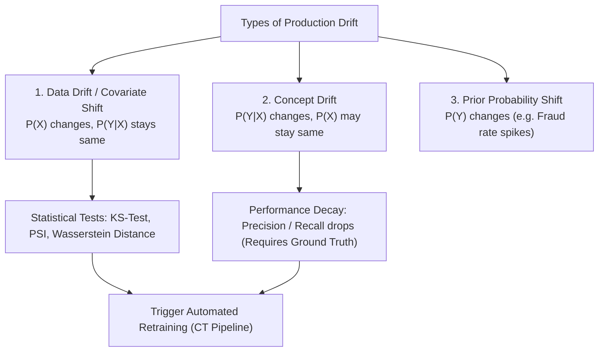

# Giám Sát Dữ Liệu và Trôi Dạt Mô Hình (Data Drift & Model Monitoring)

> **Khái niệm chính thống**: *Session 9: Model Monitoring*; Google Cloud Architecture Center *"Monitoring Machine Learning Systems"*; *847762397...jpg* ("2. Dữ liệu bẩn xử lý sao?"); *847999051...jpg* ("4. Nếu model sai thì sao?").
> **Miền kiến thức**: [[index|Production Observability & Reliability Engineering]]
> **Tài liệu gốc liên quan**:
> - [Session 9_ Model Monitoring.pdf](../resources/ops/Session%209_%20Model%20Monitoring.pdf) (Trang 1-39)
> - [847762397_122320901834195094_274771350129520392_n.jpg](../resources/images/847762397_122320901834195094_274771350129520392_n.jpg) (Infographic 2: Phân loại dữ liệu bẩn)
> - [847999051_122320901954195094_4534131503073995411_n.jpg](../resources/images/847999051_122320901954195094_4534131503073995411_n.jpg) (Infographic 4: Xử lý model sai)

---

## 1. Tóm tắt (Executive Summary)
**Giám sát Mô hình và Phát hiện Trôi dạt (Model Monitoring & Drift Detection)** là phòng tuyến phòng thủ cuối cùng bảo vệ hệ thống AI trong môi trường sản xuất. Ngay sau khi được đưa vào phục vụ thực tế, hiệu năng của mọi mô hình học máy đều có xu hướng suy thoái âm thầm theo thời gian (**Silent Model Degradation**) do thế giới thực luôn thay đổi không ngừng. Khác với lỗi sập phần mềm truyền thống (Crash / HTTP 500), mô hình bị drift vẫn trả về mã 200 OK bình thường nhưng kết quả dự đoán hoàn toàn sai lệch. Hệ thống giám sát MLOps theo dõi liên tục 4 tầng: **Hạ tầng (System Health)**, **Chất lượng Dữ liệu (Data Quality)**, **Trôi dạt Dữ liệu (Data Drift / Covariate Shift)**, và **Trôi dạt Khái niệm (Concept Drift)**.

---

## 2. Định nghĩa chính thống & Phân loại Các Dạng Trôi Dạt (Taxonomy of Drift)

Theo lý thuyết xác suất Bayes, mối quan hệ giữa biến đầu vào $X$ và nhãn mục tiêu $Y$ được mô tả qua phân phối đồng thời:
$$P(X, Y) = P(X) \cdot P(Y \mid X) = P(Y) \cdot P(X \mid Y)$$

### 2.1 Chi tiết 3 dạng trôi dạt
1. **Data Drift (Covariate Shift - Trôi dạt biến đầu vào)**:
   - Phân phối của dữ liệu đầu vào $P(X)$ thay đổi, nhưng quan hệ ánh xạ giữa đầu vào và đầu ra $P(Y \mid X)$ không đổi.
   - *Ví dụ*: Ứng dụng vay tiền mở rộng sang phục vụ nhóm khách hàng sinh viên trẻ tuổi (phân phối thu nhập và độ tuổi $P(X)$ dịch chuyển rõ rệt so với tập train ban đầu gồm người đi làm).
2. **Concept Drift (Trôi dạt Khái niệm)**:
   - Bản chất ý nghĩa mối quan hệ nghiệp vụ $P(Y \mid X)$ thay đổi, ngay cả khi phân phối đầu vào $P(X)$ trông có vẻ như cũ.
   - *Ví dụ*: Hành vi mua sắm trước và trong đại dịch COVID-19. Cùng một người dùng $X$, nhưng hành vi mua hàng tiêu dùng và khẩu trang $Y$ thay đổi hoàn toàn.
3. **Prior Probability Shift (Trôi dạt Nhãn mục tiêu)**:
   - Tỷ lệ phân phối $P(Y)$ thay đổi (ví dụ: tỷ lệ gian lận trong mùa mua sắm Black Friday tăng vọt gấp 10 lần ngày thường).

---

## 3. Các Phương Pháp Thống Kê Định Lượng Trôi Dạt (Statistical Testing)

### 3.1 Kolmogorov-Smirnov Test (KS-Test)
Dành cho các biến số liên tục (Numerical features):
- So sánh hai hàm phân phối tích lũy thực nghiệm (ECDF): $F_{\text{baseline}}(x)$ và $F_{\text{production}}(x)$.
- Thống kê kiểm định $D$:
  $$D = \sup_x |F_{\text{baseline}}(x) - F_{\text{production}}(x)|$$
- Nếu p-value $< 0.05$, bác bỏ giả thuyết $H_0$, kết luận thuộc tính đã bị trôi dạt có ý nghĩa thống kê.

### 3.2 Population Stability Index (PSI - Tiêu chuẩn ngành Ngân hàng & Tài chính)
Dành cho việc so sánh phân phối xác suất giữa tập tham chiếu (Baseline/Expected) và tập thực tế (Actual):
Chia dữ liệu thành $K$ giỏ (bins):
$$\text{PSI} = \sum_{i=1}^K \left( \text{Actual}_i - \text{Expected}_i \right) \times \ln\left( \frac{\text{Actual}_i}{\text{Expected}_i} \right)$$
- **Thang đánh giá chuẩn mực của PSI**:
  - $\text{PSI} < 0.1$: Phân phối ổn định, không có thay đổi đáng kể.
  - $0.1 \le \text{PSI} < 0.25$: Bắt đầu có sự dịch chuyển; cần đưa vào danh sách theo dõi cảnh báo.
  - $\text{PSI} \ge 0.25$: **Trôi dạt nghiêm trọng (Significant Drift)**; bắt buộc phải kích hoạt pipeline huấn luyện lại mô hình!

---

## 4. Góc nhìn Thực chiến & Thiết kế Hệ thống cho AI Engineer

### 4.1 Thách thức "Độ trễ Nhãn Thực tế" (Ground Truth Latency)
- Trong hầu hết các bài toán kinh doanh (chấm điểm tín dụng, dự đoán khách hàng rời bỏ - Churn), nhãn thực tế $Y$ phải mất vài tuần hoặc vài tháng sau mới xuất hiện (khách hàng có trả nợ hay không sau 90 ngày).
- **Hệ quả sống còn**: Kỹ sư **không thể đợi có nhãn $Y$ mới đo Accuracy hay F1 score để biết model bị hỏng hay chưa**!
- **Giải pháp**: Bắt buộc phải dựa vào **Data Drift Metrics (PSI, KS-Test)** trên dữ liệu đầu vào $X$ và phân phối của giá trị dự đoán $\hat{Y}$ (Prediction Drift) như một tín hiệu cảnh báo sớm (Early-warning proxy) theo thời gian thực.

### 4.2 Câu hỏi phỏng vấn thực tế
- **Q**: *Khi hệ thống cảnh báo PSI của một thuộc tính quan trọng nhảy lên 0.35 (Drift nghiêm trọng), bạn sẽ xử lý thế nào? Có nên tự động kích hoạt train lại model ngay lập tức không?*
  - **A**: **Tuyệt đối không huấn luyện lại một cách mù quáng ngay lập tức**! Quy trình chuẩn của Senior AI Engineer gồm 3 bước:
    1. **Kiểm tra tính toàn vẹn dữ liệu (Data Quality Check)**: Kiểm tra xem có lỗi pipeline kỹ thuật không (ví dụ: API upstream bị lỗi đổi đơn vị từ mét sang milimet, hoặc có một lượng lớn giá trị NULL bất thường). Nếu train lại trên dữ liệu bị lỗi kỹ thuật, mô hình sẽ bị phá hủy.
    2. **Phân tích bối cảnh kinh doanh**: Nếu drift phản ánh sự kiện thực tế ngắn hạn (ví dụ: đợt khuyến mãi bùng nổ 3 ngày Black Friday), dữ liệu này có thể là ngoại lai tạm thời, không nên làm méo mô hình dài hạn.
    3. **Huấn luyện lại an toàn (Safe Retraining)**: Sau khi xác nhận dữ liệu mới phản ánh xu thế chuyển dịch thực tế bền vững, kích hoạt pipeline CT, huấn luyện mô hình Challenger và tiến hành kiểm định chất lượng (Quality Gate) trước khi thăng hạng.

---

## 5. Mạng lưới Liên kết Tri thức (Knowledge Graph & `wiki-links`)
- [[mlops-lifecycle]] — Tầng giám sát vận hành trong vòng đời MLOps.
- [[continuous-integration-cd-ml]] — Phát tín hiệu kích hoạt ngược cho vòng lặp Continuous Training (CT).
- [[model-selection-evaluation]] — Phân tích lỗi theo lát cắt (Slicing Analysis) và phân loại dữ liệu bẩn.
- [[experiment-tracking-model-registry]] — Đối chiếu phiên bản mô hình cần cập nhật.