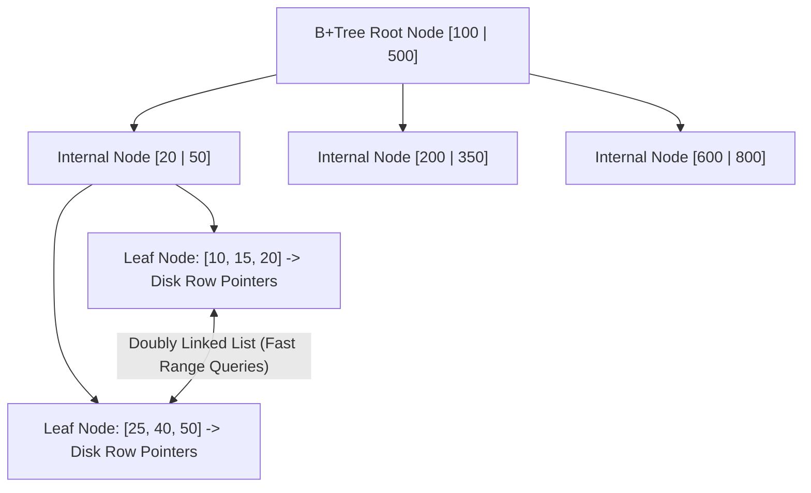

# Đánh Chỉ Mục Cơ Sở Dữ Liệu và Tối Ưu Hóa Truy Vấn (Database Indexing & Query Optimization)

> **Khái niệm chính thống**: *Fundamentals of Database Systems* (Elmasri & Navathe, Pearson); *Nền tảng Hệ thống Cơ sở dữ liệu cho Data Scientist* (TS. Lê Thiện Hòa); *DatabaseSQL.jpg*.
> **Miền kiến thức**: [[index|Relational Databases & Performance Tuning]]
> **Tài liệu gốc liên quan**:
> - [DatabaseSQL.jpg](../resources/software/DatabaseSQL.jpg) (Sơ đồ phỏng vấn Database / SQL)
> - [Fundamentals of Database System.pdf](../resources/software/Fundamentals%20of%20Database%20System.pdf) (Trang 1-45)
> - [Nền tảng Hệ thống Cơ sở dữ liệu cho Data Scientist – Bài giảng của Tiến sĩ Lê Thiện Hòa.pdf](../resources/data-sciense/N%E1%BB%81n%20t%E1%BA%A3ng%20H%E1%BB%87%20th%E1%BB%91ng%20C%C6%A1%20s%E1%BB%9F%20d%E1%BB%AF%20li%E1%BB%87u%20cho%20Data%20Scientist%20%E2%80%93%20B%C3%A0i%20gi%E1%BA%A3ng%20c%E1%BB%A7a%20Ti%E1%BA%BFn%20s%C4%A9%20L%C3%AA%20Thi%E1%BB%87n%20H%C3%B2a.pdf) (Trang 1-40)

---

## 1. Tóm tắt (Executive Summary)
**Đánh Chỉ mục Cơ sở dữ liệu (Database Indexing)** là cấu trúc dữ liệu bổ trợ (thường là **B-Tree / B+Tree**) được xây dựng trên một hoặc nhiều cột của bảng dữ liệu nhằm tăng tốc độ tìm kiếm và trích xuất dữ liệu từ độ phức tạp quét toàn bộ bảng $\mathcal{O}(N)$ (**Full Table Scan**) xuống độ phức tạp logarit $\mathcal{O}(\log N)$. Tuy nhiên, việc lạm dụng chỉ mục sẽ làm chậm các thao tác ghi dữ liệu (INSERT, UPDATE, DELETE) và tiêu tốn bộ nhớ đĩa. Tối ưu hóa truy vấn SQL đòi hỏi kỹ sư phải đọc hiểu kế hoạch thực thi (**EXPLAIN Execution Plan**), xử lý triệt để vấn đề **N+1 Query Problem**, và nắm vững nguyên lý chọn cột đánh chỉ mục.

---

## 2. Định nghĩa chính thống & Cấu trúc Dữ liệu B+Tree Index

### 2.1 Đặc tính vượt trội của B+Tree
- Mọi bản ghi dữ liệu thực tế (hoặc con trỏ trỏ tới dòng dữ liệu trên đĩa) **chỉ nằm ở các nút lá (Leaf Nodes)**.
- Các nút lá được liên kết với nhau bằng danh sách liên kết đôi (Doubly Linked List), giúp các truy vấn tìm kiếm theo dải phạm vi (`WHERE age BETWEEN 20 AND 30`) chạy với tốc độ cực đại.
- Cây luôn tự cân bằng hoàn hảo; độ cao của cây $h \approx \log_B(N)$ (với bậc nhánh $B \approx 100 - 500$). Một bảng 100 triệu dòng chỉ có độ cao cây $h \approx 3 - 4$, đồng nghĩa chỉ cần **tối đa 3 đến 4 lần đọc đĩa (Disk I/O)** để tìm thấy bất kỳ bản ghi nào!

### 2.2 Phân biệt Clustered Index vs Non-Clustered Index
- **Clustered Index (Chỉ mục Cụm)**:
  - Bản thân các dòng dữ liệu vật lý trên ổ đĩa được sắp xếp đúng theo thứ tự của chỉ mục cụm (trong MySQL InnoDB, khóa chính `PRIMARY KEY` mặc định là Clustered Index).
  - Mỗi bảng **chỉ có duy nhất 1 Clustered Index**.
- **Non-Clustered / Secondary Index (Chỉ mục Phụ)**:
  - Cấu trúc B+Tree độc lập nằm ở vùng đĩa khác; nút lá chứa giá trị khóa phụ và giá trị khóa chính (Primary Key).
  - Khi tìm kiếm qua Secondary Index, database phải thực hiện thêm một bước tra cứu ngược (**Bookmark Lookup / Table Access by Index RowID**) để lấy toàn bộ dữ liệu dòng, trừ khi đó là một **Covering Index** (chỉ mục bao phủ chứa đủ toàn bộ các cột được `SELECT`).

---

## 3. Câu Hỏi Phỏng Vấn Sát Sườn: Trả Lời Bộ Câu Hỏi DatabaseSQL.jpg

### 3.1 Em đã từng dùng EXPLAIN để tối ưu query chưa? Những chỉ số nào hay xem nhất?
Khi chạy lệnh `EXPLAIN ANALYZE SELECT ...`, các chỉ số sống còn cần phân tích:
1. **`type` (Access Type - Loại truy cập)**: Thể hiện cách database tìm kiếm dữ liệu (thứ tự từ tốt nhất đến tệ nhất):
   $$\text{system} > \text{const} > \text{eq\_ref} > \text{ref} > \text{range} > \text{index} > \text{ALL}$$
   - Nếu `type = ALL`: Báo động đỏ! Đây là **Full Table Scan** (quét toàn bộ bảng).
   - Mục tiêu tối ưu: Đưa về ít nhất `range` hoặc `ref`.
2. **`key`**: Tên của Index thực tế mà bộ tối ưu hóa (Query Optimizer) đã chọn sử dụng. Nếu `key = NULL`, nghĩa là không dùng index.
3. **`rows`**: Số lượng dòng ước tính mà database phải quét qua.
4. **`Extra`**:
   - `Using index`: Rất tốt! Đạt trạng thái **Covering Index** (không cần đọc bảng đĩa).
   - `Using filesort`: Báo động! Database phải tự sắp xếp dữ liệu trong RAM/đĩa ngoài thay vì tận dụng index sẵn có.
   - `Using temporary`: Cực xấu! Phải tạo bảng tạm để xử lý `GROUP BY` hoặc `DISTINCT`.

### 3.2 Index nên tạo ở những cột nào? Dựa vào đâu để quyết định?
- **NÊN TẠO**:
  1. Cột xuất hiện thường xuyên trong mệnh đề `WHERE`, `JOIN ON`, `ORDER BY`, `GROUP BY`.
  2. Cột có **Độ chọn lọc cao (High Cardinality)**: Tỷ lệ các giá trị phân biệt lớn (ví dụ: `email`, `user_id`, `citizen_id`).
  3. Sử dụng **Composite Index (Chỉ mục Hỗn hợp)** tuân thủ quy tắc tiền tố bên trái (**Leftmost Prefix Rule**).
- **KHÔNG NÊN TẠO**:
  1. Cột có độ chọn lọc quá thấp (Low Cardinality: như cột `gender` chỉ có Nam/Nữ, `status` chỉ có 0/1). Đánh index ở đây vô ích vì database thà quét Full Table Scan còn nhanh hơn!
  2. Bảng có tần suất GHI (Insert/Update) liên tục hàng chục ngàn TPS mà ít khi đọc.

### 3.3 Vấn đề N+1 Query Problem là gì? Cách xử lý triệt để?
- **Bản chất**: Xảy ra khi sử dụng các framework ORM (Hibernate, JPA, SQLAlchemy, Django ORM).
  - 1 câu query ban đầu để lấy danh sách $N$ bản ghi: `SELECT * FROM orders LIMIT 100;` (1 query).
  - Sau đó trong vòng lặp duyệt qua từng đơn hàng, ORM lại bắn thêm 1 câu query để lấy thông tin khách hàng tương ứng: `SELECT * FROM customer WHERE id = ?;` ($N$ queries).
  - Tổng cộng hệ thống bắn **$1 + N = 101$ câu queries vào database**, gây nghẽn kết nối và sập server.
- **Cách xử lý**:
  1. Sử dụng kỹ thuật **Eager Loading** qua phép `JOIN` tường minh: trong SQL dùng `LEFT JOIN FETCH`, trong SQLAlchemy dùng `joinedload()` hoặc `selectinload()`.
  2. Gom cụm các ID để truy vấn 1 lần bằng mệnh đề `IN`: `SELECT * FROM customer WHERE id IN (1, 2, ..., N);`.

### 3.4 Khi nào dùng WHERE, khi nào dùng HAVING?
- **`WHERE`**: Lọc dữ liệu **trước khi** thực hiện gom nhóm (`GROUP BY`). Không được dùng các hàm tổng hợp (`SUM`, `COUNT`, `AVG`) trong `WHERE`.
- **`HAVING`**: Lọc dữ liệu **sau khi** đã tính toán gom nhóm và tổng hợp.
- **Quy tắc hiệu năng**: Luôn luôn lọc tối đa bằng `WHERE` trước để giảm số dòng cần nạp vào RAM tính toán, chỉ dùng `HAVING` cho các điều kiện dựa trên kết quả của hàm aggregate.

### 3.5 So sánh TRUNCATE, DELETE và DROP
- **`DELETE`**: Lệnh DML (Data Manipulation Language). Xóa từng dòng một, kích hoạt Triggers, ghi nhận toàn bộ log vào Transaction Log (Undo/Rollback được). Tốc độ chậm nhất.
- **`TRUNCATE`**: Lệnh DDL (Data Definition Language). Xóa trắng toàn bộ bảng bằng cách hủy cấp phát các trang dữ liệu (Deallocate Data Pages), reset lại cột tự tăng (Auto-increment), không kích hoạt trigger, ghi log tối thiểu. Tốc độ cực nhanh.
- **`DROP`**: Lệnh DDL. Xóa bỏ hoàn toàn toàn bộ bảng (cả dữ liệu, cấu trúc schema, index và phân quyền) khỏi cơ sở dữ liệu.

---

## 4. Mạng lưới Liên kết Tri thức (Knowledge Graph & `wiki-links`)
- [[acid-and-transactions]] — Quản lý giao dịch và khóa dòng khi tối ưu truy vấn.
- [[sql-vs-nosql-data-architecture]] — So sánh giữa cơ sở dữ liệu quan hệ dòng và cơ sở dữ liệu cột OLAP.
- [[vector-embeddings]] — Chỉ mục ANN (HNSW) là sự tiến hóa của chỉ mục B-Tree lên không gian đa chiều.