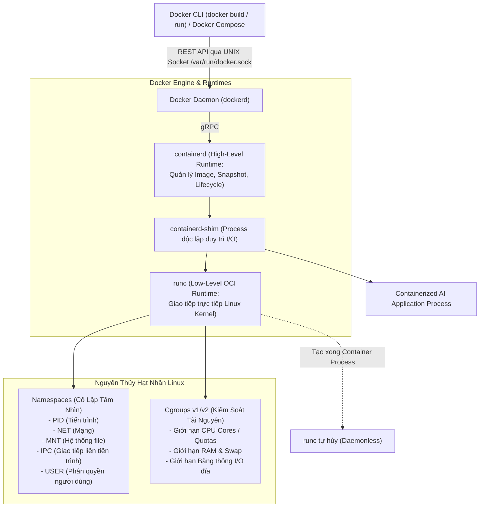
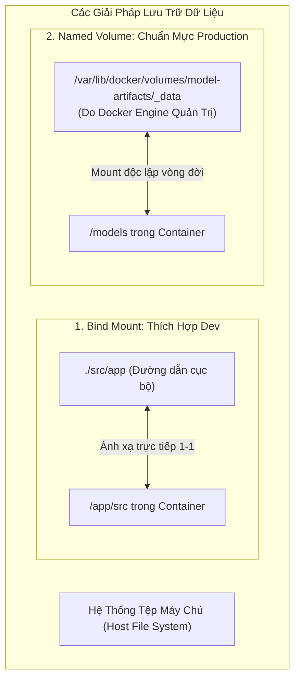
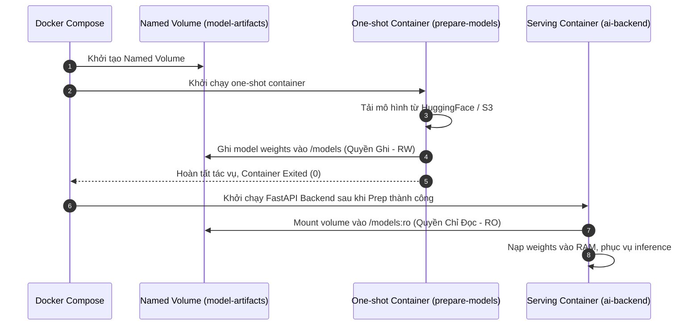

# Đóng Gói Suy Luận AI Với Docker & Docker Compose (Containerizing AI Inference)

> **Tóm tắt điều hành**: Đưa mô hình Trí tuệ Nhân tạo từ môi trường phát triển (Jupyter Notebook / Local) sang môi trường sản xuất (Production) đòi hỏi sự nhất quán tuyệt đối về Runtime, phiên bản CUDA, thư viện hệ thống C++ và trọng số mô hình. Docker giải quyết vấn đề "chạy được trên máy tôi nhưng lỗi trên server" bằng cách trừu tượng hóa các nguyên thủy hạt nhân Linux (Namespaces và Cgroups) thông qua tiêu chuẩn mở OCI. Bài toán triển khai suy luận AI đặt ra những thách thức đặc thù: quản lý dung lượng image khổng lồ do PyTorch/CUDA, tách rời vòng đời của Model Artifacts khỏi Application Code, điều phối chu trình khởi động theo trạng thái sẵn sàng (Healthcheck Liveness/Readiness), và tuân thủ nguyên tắc đặc quyền tối thiểu (Non-root Least Privilege).

---

## 1. Kiến Trúc Tầng Sâu Của Docker: Từ Client Đến Linux Kernel

Docker vận hành theo mô hình Client-Server phân tầng, tuân thủ đặc tả của **Open Container Initiative (OCI)**:



### Sự Khác Biệt Giữa Container và Máy Ảo (VM):
- **Máy ảo (Virtual Machine)**: Yêu cầu một hệ điều hành khách (Guest OS) hoàn chỉnh chạy trên một phần mềm ảo hóa (Hypervisor), ngốn hàng chục GB dung lượng và mất vài phút khởi động.
- **Container**: Chia sẻ chung Linux Kernel của máy chủ, chỉ đóng gói **User Space** (nhị phân, thư viện và mã nguồn ứng dụng). Khởi động chỉ mất vài mili-giây với chi phí tài nguyên tối thiểu.

---

## 2. Hệ Thống Tệp Phân Tầng & Bộ Nhớ Lưu Trữ Bền Vững

### 2.1. Tính Bất Biến Của Image Layers & Cơ Chế Copy-on-Write (CoW)
- Mỗi chỉ dẫn trong Dockerfile (`RUN`, `COPY`, `ADD`) sinh ra một **Image Layer chỉ đọc (Read-only Layer)**, được định danh duy nhất bằng mã băm nội dung SHA-256.
- Khi một container khởi chạy, Docker xếp chồng các layer này và gắn thêm một **Container Writable Layer (Lớp ghi mỏng)** lên trên cùng.
- **Cơ chế Copy-on-Write**: Khi ứng dụng sửa đổi một file sẵn có từ image, Docker sao chép file đó lên writable layer trước khi ghi. Image gốc không bao giờ bị biến đổi và có thể tái sử dụng an toàn cho hàng trăm container cùng lúc.
- *Hạn chế*: Writable layer bị xóa sổ vĩnh viễn khi container bị xóa (`docker rm`).



### 2.2. So Sánh: Named Volume vs Bind Mount Trong AI System

| Tiêu chí | Named Volume (`model-artifacts`) | Bind Mount (`./backend/src`) |
| :--- | :--- | :--- |
| **Vị trí lưu trữ** | Vùng dữ liệu riêng của Docker (`/var/lib/docker/volumes/`) | Bất kỳ thư mục nào trên Host máy tính |
| **Vòng đời** | **Độc lập hoàn toàn**: Xóa container không mất volume | Gắn liền với cấu trúc thư mục của máy chủ host |
| **Bảo mật** | Container chỉ truy cập vùng được cấp, dễ set `:ro` | Có thể vô tình để container truy cập các file nhạy cảm của host |
| **Ứng dụng tối ưu** | **Model Weights (Artifacts)**, cơ sở dữ liệu (PostgreSQL/Chroma) | **Mã nguồn phát triển (Hot-reloading)** |

---

## 3. Tối Ưu Hóa Docker Image Cho AI: Cắt Giảm Từ 10GB Xuống 2.8GB

Mô hình Deep Learning thường đi kèm với các package có kích thước khổng lồ (PyTorch, TorchVision, CUDA runtime). Một Dockerfile bất cẩn sẽ dễ dàng tạo ra image nặng hơn 10GB:

### 3.1. Quy Tắc Tái Sử Dụng Build Cache: "Stable First, Volatile Last"
Docker kiểm tra cache theo thứ tự từ trên xuống dưới. Nếu một layer bị vô hiệu hóa (cache invalidated), toàn bộ các layer phía sau bắt buộc phải build lại.
- **Thứ tự sai (Cache-inefficient)**:
  ```dockerfile
  COPY . .                       # Mã nguồn thay đổi liên tục -> Vô hiệu hóa cache!
  RUN pip install -r requirements.txt  # Bị tải lại toàn bộ PyTorch 5GB mỗi lần sửa 1 dòng code!
  ```
- **Thứ tự chuẩn (Cache-efficient)**:
  ```dockerfile
  COPY requirements.txt .        # File requirements rất ít khi thay đổi -> Cache HIT!
  RUN pip install --no-cache-dir -r requirements.txt
  COPY . .                       # Chỉ lớp mã nguồn cuối cùng được build lại trong 1 giây
  ```

### 3.2. Multi-Stage Build & Tách Rời Bánh Xe PyTorch CPU

Trong môi trường phục vụ suy luận chỉ sử dụng CPU, việc cài đặt PyTorch mặc định sẽ kéo theo hàng gigabyte driver NVIDIA CUDA và cuDNN hoàn toàn vô dụng:

```dockerfile
# ==========================================
# Giai đoạn 1: Builder (Chuẩn bị venv)
# ==========================================
FROM python:3.11-slim AS builder

ENV VIRTUAL_ENV=/opt/venv \
    PATH="/opt/venv/bin:$PATH"

RUN python -m venv "$VIRTUAL_ENV"

COPY requirements.txt .

# Tải PyTorch phiên bản CPU chuyên biệt từ index riêng của PyTorch
RUN pip install --no-cache-dir \
    torch==2.1.2 torchvision==0.16.2 \
    --index-url https://download.pytorch.org/whl/cpu \
    && pip install --no-cache-dir -r requirements.txt

# ==========================================
# Giai đoạn 2: Runtime Tối Thiểu (Non-root)
# ==========================================
FROM python:3.11-slim AS runtime

# Tạo user không có quyền root (UID 10001) theo nguyên tắc Least Privilege
RUN groupadd -g 10001 app && \
    useradd -u 10001 -g app -s /bin/sh -m app

WORKDIR /app

# Chỉ copy môi trường ảo đã được biên dịch sạch từ builder
COPY --from=builder /opt/venv /opt/venv
ENV PATH="/opt/venv/bin:$PATH"

COPY app/ ./app/

# Chuyển quyền thực thi sang user app
USER app

EXPOSE 8000
CMD ["uvicorn", "app.main:app", "--host", "0.0.0.0", "--port", "8000"]
```

> [!TIP]
> **Hiệu quả thực nghiệm**: Image giảm từ **10.36 GB** xuống còn **2.81 GB** (trong đó thư viện suy luận trong `/opt/venv` chiếm 1.81 GB). Thời gian truyền tải qua mạng khi pull image trên hạ tầng đám mây giảm hơn 75%.

---

## 4. Tách Rời Model Artifacts Khỏi Application Code

Một sai lầm kinh điển trong AI Engineering là **đóng gói trọng số mô hình trực tiếp vào Docker image**:
- Mỗi khi Data Science cập nhật mô hình mới (v1.1 $\to$ v1.2), CI/CD phải build lại toàn bộ image 5GB-10GB.
- Khó kiểm soát phiên bản độc lập giữa Code và Weights.



### Các Biến Môi Trường Cấu Hình Runtime (12-Factor App):
- `MODEL_DIR=/models`: Cho phép ứng dụng tìm kiếm trọng số linh hoạt mà không bị hardcode đường dẫn.
- `INFERENCE_DEVICE=cpu`: Chỉ định thiết bị tính toán.
- `HF_HUB_OFFLINE=1`: Ép thư viện Hugging Face không bao giờ cố kết nối ra Internet trong quá trình suy luận, ngăn chặn tắc nghẽn do mạng chập chờn.
- `HF_TOKEN`: Chỉ truyền vào container lúc nạp model qua biến môi trường bí mật, **tuyệt đối không ghi trong Dockerfile**.

---

## 5. Điều Phối Đa Dịch Vụ Với Docker Compose (Production Orchestration)

Khi một hệ thống AI gồm Frontend (Streamlit/Gradio) và Backend (FastAPI), việc điều phối thứ tự khởi động là điều kiện tiên quyết:

```yaml
services:
  # 1. Dịch vụ một lần: Chuẩn bị trọng số mô hình
  prepare-models:
    image: ai-backend:1.0
    build: ./backend
    user: "0:0"  # Cần quyền root để ghi vào volume mới
    command: ["python", "scripts/prepare_models.py"]
    volumes:
      - model-artifacts:/models
    restart: "no"  # One-shot service: Chạy xong là kết thúc

  # 2. Dịch vụ Backend phục vụ suy luận
  backend:
    image: ai-backend:1.0
    build: ./backend
    environment:
      MODEL_DIR: /models
      INFERENCE_DEVICE: cpu
      HF_HUB_OFFLINE: "1"
    volumes:
      - model-artifacts:/models:ro  # Quyền chỉ đọc (Least Privilege)
    ports:
      - "8000:8000"
    depends_on:
      prepare-models:
        condition: service_completed_successfully  # Chờ nạp xong model mới khởi động
    healthcheck:
      test: ["CMD", "python", "-c", "import urllib.request; urllib.request.urlopen('http://127.0.0.1:8000/health', timeout=3)"]
      interval: 10s
      timeout: 5s
      retries: 5
      start_period: 30s  # Dành 30 giây cho mô hình khởi tạo mà không bị tính lỗi retry
    restart: unless-stopped

  # 3. Dịch vụ Frontend giao diện người dùng
  frontend:
    image: ai-frontend:1.0
    build: ./frontend
    environment:
      BACKEND_URL: http://backend:8000  # Tận dụng Service Discovery qua tên service
    ports:
      - "8501:8501"
    depends_on:
      backend:
        condition: service_healthy  # Chỉ khởi động UI khi Backend đã thực sự Healthy
    restart: unless-stopped

volumes:
  model-artifacts:
    name: model-artifacts
```

### 3 Trạng Thái Phân Biệt Trong Giám Sát Container:
1. **Running**: Process chính bên trong container đang hoạt động (nhưng Uvicorn có thể đang bận nạp mô hình, chưa thể nhận request).
2. **Healthy**: Endpoint `/health` phản hồi mã HTTP 200, báo hiệu web server đã sẵn sàng nhận kết nối mạng.
3. **Inference-Ready**: Đã thực hiện thành công một request suy luận thực nghiệm (**Smoke Test**), xác nhận model weights đã nạp vào bộ nhớ và pipeline không bị lỗi phiên bản.

---

## 6. Mạng Lưới Liên Kết Thực Thể (Wiki Links)

- [[containerization-kubernetes-ml]] — Kiến trúc tổng thể Docker và điều phối nâng cao Kubernetes với GPU Operator.
- [[model-serving-api]] — Triển khai API phục vụ mô hình học máy với FastAPI và Triton.
- [[fastapi-production-ml-serving]] — Chi tiết kiến trúc FastAPI, Lifespan và bẫy chặn Event Loop.
- [[mlops-lifecycle]] — Vòng đời MLOps chuẩn và chuyển đổi mã nguồn từ Notebook sang Production.
