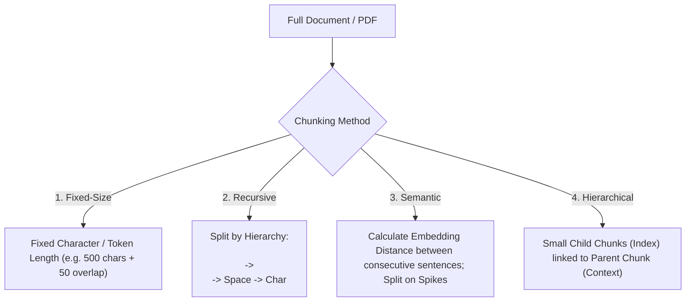

# Chiến Lược Phân Đoạn Tài Liệu (Document Chunking Strategies)

> **Khái niệm chính thống**: *Encyclopedia of LLMs*, Section 13.3; *TOP RAG CHUNKING METHODS YOU SHOULD* (Mouka, 2025); *giao_trinh_rag.pdf*.
> **Miền kiến thức**: [[index|RAG Pre-processing & Data Ingestion]]
> **Tài liệu gốc liên quan**:
> - [TOP RAG CHUNKING METHODS YOU SHOULD.pdf](../resources/genai/TOP%20RAG%20CHUNKING%20METHODS%20YOU%20SHOULD.pdf) (Trang 1-25)
> - [giao_trinh_rag.pdf](../resources/genai/giao_trinh_rag.pdf) (Trang 4-8)
> - [AIO2026_[Reading]-RAG-System.pdf](../resources/genai/AIO2026_%5BReading%5D-RAG-System.pdf) (Trang 20-38)

---

## 1. Tóm tắt (Executive Summary)
**Phân đoạn Tài liệu (Document Chunking)** là kỹ thuật phân tách các văn bản dài phi cấu trúc thành các đơn vị thông tin nhỏ hơn (chunks) có ý nghĩa ngữ nghĩa độc lập trước khi tạo vector embedding và lưu trữ vào cơ sở dữ liệu vector. Chunking quyết định trực tiếp đến **Độ chính xác truy xuất (Retrieval Precision)** và **Ngữ cảnh tạo sinh (Generation Context)**. Kỹ thuật chunking đã phát triển từ phân tách độ dài ký tự cố định thô sơ sang phân đoạn đệ quy theo cấu trúc cú pháp, phân đoạn ngữ nghĩa thích ứng (Semantic Chunking) và phân đoạn phân tầng cha-con (Parent-Document / Small-to-Big Retrieval).

---

## 2. Định nghĩa chính thống & Các phương pháp Chunking cốt lõi

### 2.1 Đánh đổi then chốt trong kích thước Chunk (The Chunk Size Trade-off)
- **Chunk quá nhỏ (50-100 tokens)**: Độ tương đồng vector với câu truy vấn rất cao vì embedding tập trung, nhưng làm mất đứt gãy ngữ cảnh xung quanh, khiến LLM không đủ thông tin để trả lời.
- **Chunk quá lớn (1000-2000 tokens)**: Ngữ cảnh phong phú nhưng vector embedding bị loãng (diluted embedding) do chứa quá nhiều chủ đề hỗn tạp, khiến thuật toán tìm kiếm tương đồng dễ bỏ qua.
- **Chunk Overlap (Độ gối đầu)**: Thường thiết lập từ 10% đến 20% kích thước chunk để tránh việc một câu văn quan trọng bị cắt đôi ngay giữa chừng.

### 2.2 Chi tiết 5 phương pháp Chunking chuẩn mực
1. **Fixed-Size Chunking with Overlap**:
   - Cắt văn bản sau mỗi $K$ ký tự hoặc token, gối đầu $M$ token. Đơn giản nhất nhưng dễ phá vỡ cấu trúc câu và đoạn văn.
2. **Recursive Character Chunking (LangChain Standard)**:
   - Cắt đệ quy theo danh sách phân tách ưu tiên: `["\n\n", "\n", " ", ""]`. Thuật toán cố gắng giữ nguyên vẹn đoạn văn (paragraph); nếu đoạn quá dài mới cắt theo câu, nếu câu quá dài mới cắt theo từ.
3. **Document-Structure / Markdown-Aware Chunking**:
   - Tôn trọng ngữ nghĩa tài liệu: Tách theo tiêu đề Heading (`#`, `##`, `###`), phần tử bảng biểu HTML, danh sách gạch đầu dòng hoặc khối mã nguồn. Thêm breadcrumbs metadata (e.g., `Header 1 > Subheader 2`) vào đầu mỗi chunk.
4. **Semantic Chunking (Phân đoạn Ngữ nghĩa Động)**:
   - Chia văn bản thành các câu riêng biệt, tính vector embedding cho từng câu.
   - Tính khoảng cách cosine giữa câu $i$ và câu $i+1$. Khi khoảng cách vượt qua ngưỡng độ lệch chuẩn (threshold percentile), hệ thống xác định có sự chuyển đổi chủ đề (topic shift) và đặt điểm cắt đoạn tại đó.
5. **Parent-Document / Small-to-Big Chunking**:
   - Chia tài liệu thành các khối cha lớn (1.000 token). Mỗi khối cha lại được chia nhỏ thành 5-10 khối con (100-200 token).
   - Chỉ lưu vector nhúng của các khối con vào Vector DB để tìm kiếm (tối ưu hóa Retrieval Precision). Nhưng khi truy xuất trúng khối con, hệ thống nạp toàn bộ khối cha tương ứng vào context cho LLM (tối ưu hóa Generation Context).

---

## 3. So sánh & Mâu thuẫn / Sắc thái giữa các tài liệu

| Phương pháp | Chi phí tính toán | Khả năng bảo toàn ngữ nghĩa | Độ phức tạp triển khai | Phù hợp nhất cho |
| :--- | :--- | :--- | :--- | :--- |
| **Fixed-Size** | Rất thấp ($\mathcal{O}(N)$ chuỗi). | Rất kém. | Tối thiểu. | Dữ liệu thô sơ, kiểm thử nhanh ban đầu (PoC). |
| **Recursive Text** | Thấp. | Tốt cho văn bản thông thường. | Thấp. | Sách truyện, bài báo tin tức thông thường. |
| **Markdown / Structure** | Thấp đến trung bình. | Rất cao với tài liệu kỹ thuật, báo cáo. | Trung bình (cần parser chuẩn). | Tài liệu hướng dẫn, API docs, báo cáo tài chính. |
| **Semantic Chunking** | Rất cao (phải gọi embedding cho từng câu). | Xuất sắc cho văn bản biến chuyển nhiều chủ đề. | Cao. | Biên bản họp, bài phát biểu, diễn đàn trao đổi. |
| **Parent-Document** | Trung bình. | Toàn diện nhất (giải quyết triệt để trade-off). | Trung bình. | **Tiêu chuẩn vàng cho Enterprise Production RAG**. |

---

## 4. Góc nhìn Thực chiến & Thiết kế Hệ thống cho AI Engineer

### 4.1 Bẫy bảng biểu và dữ liệu có cấu trúc trong PDF
- Khi xử lý bảng biểu trong PDF báo cáo tài chính: Nếu dùng Recursive Chunking thông thường, các dòng trong bảng sẽ bị xé lẻ thành các đoạn vô nghĩa (ví dụ: dòng số liệu bị tách khỏi tiêu đề cột).
- **Giải pháp**:
  - Dùng công cụ bóc tách chuyên biệt (như `Marker`, `Unstructured`, `PyMuPDF`) để nhận diện bảng và chuyển đổi nguyên vẹn bảng sang định dạng **Markdown Table** hoặc **HTML Table**.
  - Không bao giờ cắt ngang một bảng biểu nếu kích thước của bảng nhỏ hơn context window cho phép.
  - Sinh thêm một đoạn văn bản tóm tắt nội dung bảng đính kèm làm metadata để hỗ trợ tìm kiếm ngữ nghĩa.

### 4.2 Câu hỏi phỏng vấn thực tế
- **Q**: *Tại sao Semantic Chunking dù rất thông minh trên lý thuyết nhưng lại ít khi được dùng cho các kho dữ liệu hàng triệu văn bản trong thực tế?*
  - **A**: Vì rào cản chi phí và thời gian tính toán (Computational Latency): Việc phải tính embedding riêng cho hàng trăm triệu câu văn đơn lẻ và so sánh khoảng cách liên tục tiêu tốn tài nguyên GPU khổng lồ, khiến quá trình Ingestion dữ liệu bị nghẽn (bottleneck). Trong thực tế sản xuất, Recursive Chunking kết hợp Markdown Header và Parent-Document mang lại tỷ lệ chi phí/hiệu quả (ROI) vượt trội hơn hẳn.

---

## 5. Mạng lưới Liên kết Tri thức (Knowledge Graph & `wiki-links`)
- [[rag-architecture]] — Nơi chunking đóng vai trò bước xử lý tiền đề sống còn.
- [[vector-embeddings]] — Biến đổi các chunk thành vector toán học.
- [[hybrid-search]] — Truy xuất các chunk qua vector và từ khóa.
- [[reranking]] — Tinh lọc các chunk ứng viên sau khi truy xuất.