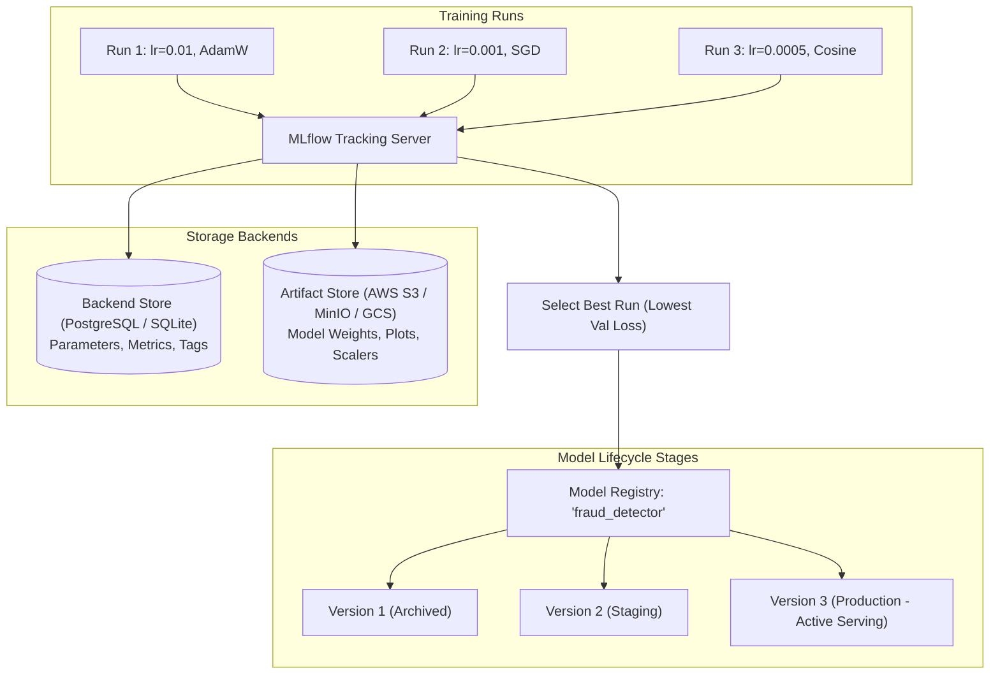

# Theo Dõi Thử Nghiệm và Đăng Ký Mô Hình (Experiment Tracking & Model Registry)

> **Khái niệm chính thống**: *Session 2: Experiment Tracking & Model Management*; Zaharia et al. (2018) *"Accelerating the Machine Learning Lifecycle with MLflow"*; Biewald (2020) *"Experiment Tracking with Weights & Biases"*.
> **Miền kiến thức**: [[index|MLOps Governance & Artifact Management]]
> **Tài liệu gốc liên quan**:
> - [Session 2_ Experiment Tracking & Model Management.pdf](../resources/ops/Session%202_%20Experiment%20Tracking%20%26%20Model%20Management.pdf) (Trang 1-29)
> - [AIO2025_MLOps-Tutorial_K8s_Kubeflow_Spark_Streaming_Kafka.pdf](../resources/ops/AIO2025_MLOps-Tutorial_K8s_Kubeflow_Spark_Streaming_Kafka.pdf) (Trang 25-40)

---

## 1. Tóm tắt (Executive Summary)
**Theo dõi Thử nghiệm và Đăng ký Mô hình (Experiment Tracking & Model Registry)** là hai thành phần xương sống của quản trị MLOps đảm bảo tính minh bạch, có thể tái lập (Reproducibility) và kiểm soát phiên bản trong suốt quá trình nghiên cứu phát triển mô hình. **Experiment Tracking** (sử dụng MLflow Tracking, W&B) tự động ghi lại toàn bộ siêu tham số, số liệu đánh giá (metrics theo từng epoch), mã nguồn git commit và môi trường phần cứng. **Model Registry** đóng vai trò là một kho lưu trữ tập trung (Central Hub) quản lý vòng đời của các artifact mô hình đã được xác thực, kiểm soát việc thăng hạng phiên bản qua các giai đoạn: `Staging -> Production -> Archived`.

---

## 2. Định nghĩa chính thống & Kiến trúc MLflow

### 2.1 4 Trụ cột Thông tin bắt buộc ghi lại của một Run
1. **Code Version**: Git commit hash chính xác của lần chạy thử nghiệm đó.
2. **Parameters & Hyperparameters**: Tệp cấu hình đầu vào (learning rate, batch size, model architecture, random seed).
3. **Metrics (Time-series data)**: Training loss, validation accuracy, F1 score ghi nhận tại từng step hoặc epoch.
4. **Artifacts (Binary Files)**: Trọng số mô hình (`model.bin`), ma trận nhầm lẫn (`confusion_matrix.png`), bộ tiền xử lý (`preprocessor.pkl`), tệp mô tả môi trường (`conda.yaml` / `requirements.txt`).

---

## 3. So sánh & Mâu thuẫn / Sắc thái giữa các công cụ

| Tiêu chí | Git LFS / DVC (Data Version Control) | MLflow | Weights & Biases (W&B) |
| :--- | :--- | :--- | :--- |
| **Bản chất cốt lõi** | Quản lý phiên bản dữ liệu lớn và file nhị phân qua cơ chế con trỏ Git. | Nền tảng MLOps toàn diện mã nguồn mở (Tracking, Models, Registry, Projects). | Nền tảng SaaS thương mại trực quan hóa và giám sát thử nghiệm cao cấp. |
| **Môi trường triển khai** | Chạy CLI cục bộ, lưu trữ trên S3/GCS. | Dễ dàng tự host (Self-hosted) trên máy chủ nội bộ hoặc Kubernetes. | Đám mây công cộng (Cloud-hosted) hoặc Enterprise On-premise đắt đỏ. |
| **Thế mạnh đặc thù** | Versioning các tập dataset hàng chục GB. | **Model Registry** độc lập, tích hợp mượt mà với API Serving. | Trực quan hóa tương tác 3D, biểu đồ phân tích chuyên sâu cho LLM/Computer Vision. |

---

## 4. Góc nhìn Thực chiến & Thiết kế Hệ thống cho AI Engineer

### 4.1 Quy trình Thăng hạng Mô hình (Model Promotion Workflow)
Tuyệt đối không bao giờ cho phép mô hình mới train xong deploy thẳng vào Production:
1. **Candidate Registration**: Mô hình tốt nhất trong đợt huấn luyện được đẩy vào Registry với nhãn trạng thái `Stage: Staging`.
2. **Automated Integration Testing**: Hệ thống CI/CD kích hoạt kiểm thử ngầm trên tập dữ liệu kiểm định độc lập (Golden Evaluation Dataset), đo độ trễ suy luận và kiểm tra lỗ hổng bảo mật.
3. **Human Approval / Canary Transition**: Chuyên gia AI duyệt thăng hạng `Stage: Production`. Hệ thống điều phối hạ tầng tự động cập nhật API server trỏ sang phiên bản mới mà không gây gián đoạn dịch vụ (Zero-Downtime Deployment).

### 4.2 Câu hỏi phỏng vấn thực tế
- **Q**: *Tại sao việc lưu trữ hạt giống ngẫu nhiên (Random Seed) trong Experiment Tracking là cần thiết nhưng vẫn chưa đủ để đảm bảo tính tái lập 100% trên GPU?*
  - **A**: Mặc dù đã cố định seed trong Python (`random.seed`), NumPy (`np.random.seed`) và PyTorch (`torch.manual_seed`), trên GPU NVIDIA các thuật toán tính toán tích chập và giảm trừ của thư viện cuDNN/CUDA mặc định sử dụng cơ chế bất định (Non-deterministic atomic operations) để tối ưu hóa tốc độ. Để đạt tính tái lập tuyệt đối, kỹ sư bắt buộc phải bật cờ:
    `torch.use_deterministic_algorithms(True)` và `torch.backends.cudnn.deterministic = True` (chấp nhận đánh đổi tốc độ chậm hơn một chút).

---

## 5. Mạng lưới Liên kết Tri thức (Knowledge Graph & `wiki-links`)
- [[mlops-lifecycle]] — Khung vận hành MLOps tổng thể.
- [[model-serving-api]] — Nơi tiếp nhận artifact mô hình từ Model Registry để phục vụ API.
- [[continuous-integration-cd-ml]] — Kích hoạt pipeline kiểm thử tự động khi model thăng hạng.
- [[data-drift-model-monitoring]] — Đối chiếu phiên bản model trong Registry với dữ liệu drift thực tế.