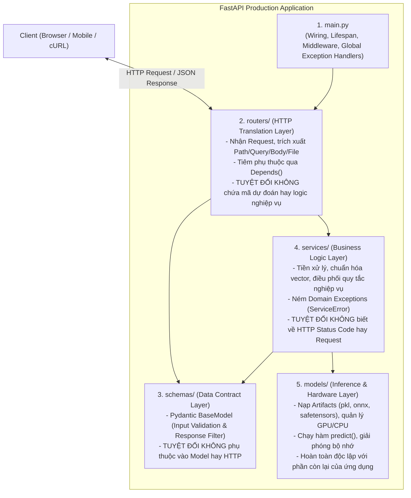
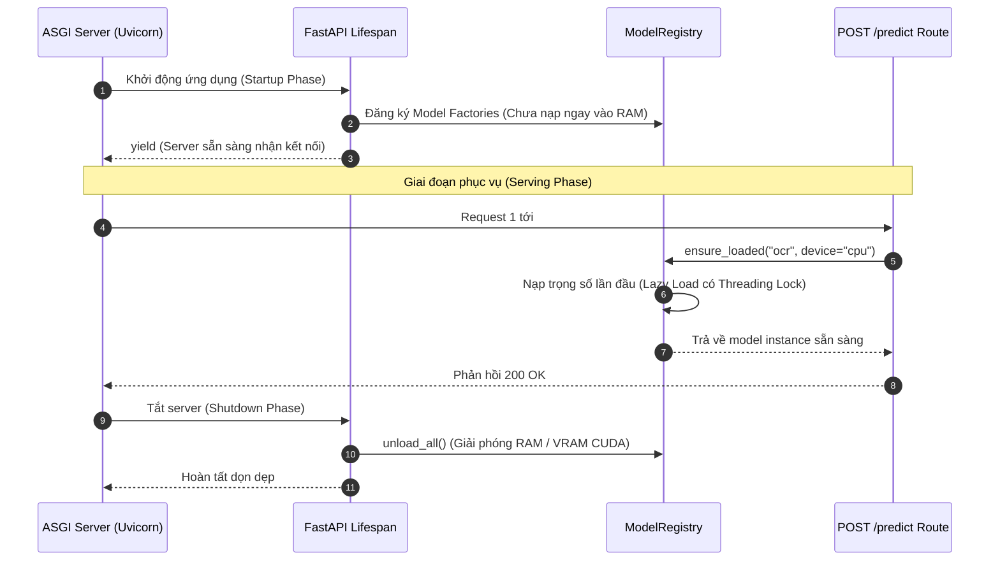
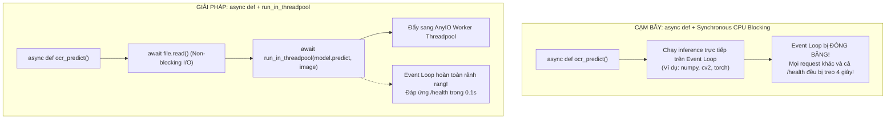

# Triển Khai Phục Vụ Mô Hình Máy Học Với FastAPI (Serving ML Models with FastAPI)

> **Tóm tắt điều hành**: Chuyển đổi mã nguồn mô hình học máy từ môi trường thử nghiệm (Jupyter Notebook) sang dịch vụ API sản xuất (Production API Service) đòi hỏi phải giải quyết 4 thách thức cốt lõi: ngăn chặn hiện tượng trôi lệch dữ liệu giữa huấn luyện và phục vụ (**Train/Serve Skew**), loại bỏ chi phí khởi tạo mô hình lặp lại qua **Lifespan Context Manager**, bảo đảm tính toàn vẹn của hợp đồng dữ liệu qua **Pydantic Validation & Response Model**, và hóa giải bẫy chặn luồng sự kiện (**Event Loop Blocking Trap**) khi xử lý suy luận nặng về CPU bằng cách phân tách luồng bất đồng bộ I/O và tính toán đa luồng (**Worker Threadpool**).

---

## 1. Kiến Trúc Phân Lớp Độc Lập (5-Layer Clean Architecture)

Một lỗi phổ biến của các kỹ sư AI là dồn toàn bộ mã nguồn vào một file `main.py` duy nhất, gây trộn lẫn giữa giao thức HTTP, logic tiền xử lý và gọi hàm dự đoán. Kiến trúc sản xuất chuẩn mực phân định ranh giới nghiêm ngặt thành 5 tầng độc lập:



> [!IMPORTANT]
> **Quy tắc phụ thuộc một chiều (Dependency Inversion)**: Tầng bên dưới tuyệt đối không bao giờ được phép import tầng bên trên (`models/` không bao giờ import từ `routers/` hay `services/`). Điều này triệt tiêu hoàn toàn lỗi nhập vòng lặp (**Circular Import**) và cho phép viết Unit Test độc lập cho từng thành phần mà không cần khởi chạy web server.

---

## 2. Ba Tử Huyệt Kinh Điển Khi Chuyển Từ Notebook Sang API

### 2.1. Tử Huyệt 1: Train/Serve Skew (Lệch Chuẩn Hóa Tiền Xử Lý)
- **Sai lầm**: Trong notebook, kỹ sư fit `StandardScaler` trên toàn bộ tập train $X_{\text{train}}$. Nhưng khi sang API, kỹ sư vô tình viết:
  ```python
  # SAI LẦM CHẾT NGƯỜI: fit_transform trên từng request đơn lẻ
  scaler = StandardScaler()
  x_scaled = scaler.fit_transform([features])  # Toàn bộ vector biến thành [0, 0, 0, 0]!
  ```
  Vì trung bình của một mẫu duy nhất chính là mẫu đó, mọi mẫu đầu vào đều bị biến thành vector $0$, khiến mô hình luôn trả về cùng một nhãn sai lệch cho mọi khách hàng!
- **Giải pháp**: Đóng gói toàn bộ quy trình tiền xử lý và mô hình vào một scikit-learn `Pipeline` thống nhất, lưu thành một artifact duy nhất:
  ```python
  # Huấn luyện & Lưu trữ Pipeline hoàn chỉnh
  pipeline = Pipeline([('scaler', StandardScaler()), ('clf', LogisticRegression())])
  pipeline.fit(X_train, y_train)
  joblib.dump(pipeline, "pipeline.joblib")
  
  # Phía Server chỉ gọi transform đã học
  pipeline.predict([features])
  ```

### 2.2. Tử Huyệt 2: Nạp Mô Hình Trong Endpoint (Disk I/O Latency)
- **Sai lầm**: Gọi `pickle.load()` hoặc `onnx.InferenceSession()` ngay bên trong hàm xử lý route `POST /predict`.
- **Hậu quả**: Mỗi request gửi đến, server phải đọc lại file từ ổ cứng lên RAM. Thực nghiệm với `RapidOCR` cho thấy:
  - Nạp lại mỗi request: **404 ms** (201 ms đọc đĩa + 203 ms suy luận).
  - Nạp sẵn một lần lúc khởi động: **203 ms** (tiết kiệm 50% thời gian phản hồi và triệt tiêu nguy cơ quá tải I/O).

### 2.3. Tử Huyệt 3: Đầu Vào Dữ Liệu Dạng Primitive Không Kiểm Soát
- **Sai lầm**: Nhận danh sách thô `features: list[float]`.
- **Hậu quả**: Khi client gửi thiếu trường `[1.2, 3.4]` hoặc gửi nhầm thứ tự, mô hình scikit-learn sẽ văng lỗi `ValueError: X has 2 features, but model expects 4`, khiến server sụp đổ với mã lỗi `500 Internal Server Error` không rõ nguyên nhân. Tệ hơn, nếu gửi đủ 4 số nhưng đảo lộn vị trí, mô hình vẫn chạy và sinh ra kết quả sai lệch âm thầm.

---

## 3. Quản Lý Vòng Đời Mô Hình Với Lifespan & Model Registry

Sử dụng `lifespan context manager` chuẩn mực của ASGI để quản lý tài nguyên đắt đỏ:



### Triển Khai ModelRegistry An Toàn Tuyệt Đối Đa Luồng:

```python
import threading
from typing import Any, Callable

class ModelRegistry:
    """Quản lý vòng đời mô hình: Đăng ký factory, nạp lười (lazy load) và giải phóng."""
    def __init__(self):
        self._factories: dict[str, Callable[[str], Any]] = {}
        self._instances: dict[str, Any] = {}
        self._lock = threading.Lock()

    def register(self, name: str, factory: Callable[[str], Any]) -> None:
        self._factories[name] = factory

    def ensure_loaded(self, name: str, device: str = "cpu") -> Any:
        key = f"{name}::{device}"
        if key not in self._instances:
            with self._lock:  # Bắt buộc dùng lock để tránh race-condition nạp trùng
                if key not in self._instances:
                    if name not in self._factories:
                        raise KeyError(f"Mô hình {name} chưa được đăng ký!")
                    instance = self._factories[name](device)
                    if hasattr(instance, "load"):
                        instance.load()
                    self._instances[key] = instance
        return self._instances[key]

    def unload_all(self) -> None:
        with self._lock:
            for instance in self._instances.values():
                if hasattr(instance, "unload"):
                    instance.unload()
            self._instances.clear()
```

---

## 4. Hóa Giải Bẫy Chặn Event Loop (Event Loop Blocking Trap)

Một trong những cạm bẫy nguy hiểm nhất trong lập trình FastAPI cho AI là việc khai báo hàm `async def` nhưng lại gọi trực tiếp tác vụ suy luận nặng về CPU:



### Triển Khai Chuẩn Xác Với `run_in_threadpool`:

```python
from fastapi import APIRouter, Depends, File, Form, UploadFile
from fastapi.concurrency import run_in_threadpool
from app.services.ocr_service import OCRService
from app.schemas.ocr import OCRResponse

router = APIRouter(prefix="/ocr", tags=["ocr"])

@router.post("/upload", response_model=OCRResponse)
async def ocr_upload(
    file: UploadFile = File(..., description="Ảnh tài liệu hoặc hóa đơn"),
    model_name: str = Form("rapidocr"),
    service: OCRService = Depends(get_ocr_service)
):
    # 1. Non-blocking I/O: Đọc luồng byte trên Event Loop
    contents = await file.read()
    
    # 2. Tiền xử lý & Kiểm tra kích thước file
    image = service.preprocess_image(contents)
    
    # 3. Đẩy tác vụ nặng CPU sang threadpool độc lập, không chặn Event Loop
    result = await run_in_threadpool(
        service.extract_text, 
        image=image, 
        model_name=model_name
    )
    return result
```

> [!NOTE]
> **Nuance về Python GIL**: Đa luồng (`threadpool`) giải quyết triệt để bài toán **Tính Đồng Thời (Concurrency)** giúp server không bị nghẽn nhận request, nhưng không làm tăng tốc tính toán của mã Python thuần do khóa GIL. Tuy nhiên, các thư viện suy luận như **ONNX Runtime, PyTorch, OpenCV C++** tự động nhả GIL (release GIL) trong quá trình nhân ma trận, nhờ đó tận dụng tối đa năng lực đa lõi của CPU.

---

## 5. Chuẩn Hóa Hợp Đồng Dữ Liệu & Xử Lý Lỗi Hệ Thống

### 5.1. Kiểm Soát Đầu Ra Với `response_model`
- Tự động lọc bỏ các trường nhạy cảm hoặc trường debug nội bộ (ví dụ: `debug_raw_scores`, `internal_weights_id`).
- Cam kết cấu trúc phản hồi nhất quán giúp đội ngũ Frontend yên tâm tích hợp mà không lo đột ngột thay đổi schema.

### 5.2. Hệ Thống Mã Lỗi Hướng Miền (Domain Exceptions)
Không bao giờ trả mã lỗi 500 kèm traceback hệ thống cho người dùng. Toàn bộ lỗi nghiệp vụ kế thừa từ `ServiceError`:

```python
# core/errors.py
class ServiceError(Exception):
    status_code: int = 500
    code: str = "INTERNAL_ERROR"
    def __init__(self, message: str):
        super().__init__(message)

class LowConfidenceError(ServiceError):
    status_code = 400
    code = "LOW_CONFIDENCE"

class ModelNotFoundError(ServiceError):
    status_code = 404
    code = "MODEL_NOT_FOUND"

class InvalidDeviceError(ServiceError):
    status_code = 400
    code = "INVALID_DEVICE"
```

Đăng ký Exception Handler duy nhất tại `main.py`:
```python
@app.exception_handler(ServiceError)
async def service_error_handler(request: Request, exc: ServiceError):
    return JSONResponse(
        status_code=exc.status_code,
        content={"error": {"code": exc.code, "message": str(exc)}}
    )
```

Phía Client sẽ luôn nhận được một cấu trúc JSON đồng nhất:
```json
{
  "error": {
    "code": "LOW_CONFIDENCE",
    "message": "Độ tin cậy 0.65 thấp hơn ngưỡng yêu cầu 0.85"
  }
}
```

---

## 6. Mạng Lưới Liên Kết Thực Thể (Wiki Links)

- [[model-serving-api]] — Triển khai dịch vụ phục vụ mô hình học máy quy mô lớn với Triton và vLLM.
- [[docker-ai-inference-packaging]] — Đóng gói dịch vụ FastAPI và quản lý model artifacts qua Docker.
- [[containerization-kubernetes-ml]] — MLOps Containerization và điều phối dịch vụ với Kubernetes.
- [[solid-principles]] — Áp dụng 5 nguyên lý SOLID trong thiết kế cấu trúc phân tầng API.
