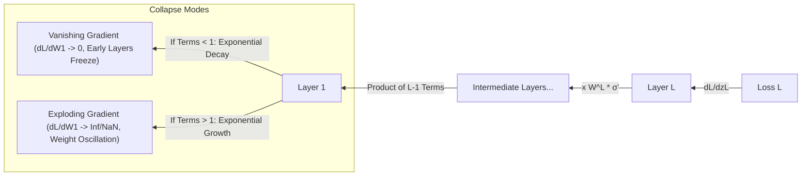

# Vấn Đề Triệt Tiêu và Bùng Nổ Gradient (Vanishing & Exploding Gradients)

> **Khái niệm chính thống**: *The Principles of Deep Learning Theory* (Roberts & Yaida, Cambridge), Chapter 3; Bengio et al. (1994) *"Learning long-term dependencies with gradient descent is difficult"*; Glorot & Bengio (AISTATS 2010) *"Xavier Initialization"*; He et al. (ICCV 2015) *"He / Kaiming Initialization"*.
> **Miền kiến thức**: [[index|Deep Learning Theory & Backpropagation Dynamics]]
> **Tài liệu gốc liên quan**:
> - [AIO2025_GradientVanishing.pdf](../resources/machine-learning/AIO2025_GradientVanishing.pdf) (Trang 1-35)
> - [\[Description_v1\]-Project-Vanishing-gradient-problem.pdf](../resources/machine-learning/%5BDescription_v1%5D-Project-Vanishing-gradient-problem.pdf) (Trang 1-38)
> - [The-Principles-of-Deep-Learning-Theory.pdf](../resources/deep-learning/The-Principles-of-Deep-Learning-Theory.pdf) (Trang 35-50)

---

## 1. Tóm tắt (Executive Summary)
**Vấn đề Triệt tiêu Gradient (Vanishing Gradient)** và **Bùng nổ Gradient (Exploding Gradient)** là hai căn bệnh kinh niên cản trở việc huấn luyện các mạng nơ-ron sâu trong nhiều thập kỷ. Xuất phát từ bản chất toán học của **Quy tắc Chuỗi (Chain Rule)** trong thuật toán Lan truyền ngược (Backpropagation), gradient của hàm mất mát truyền ngược từ tầng cuối về các tầng đầu tiên là tích liên tiếp của các ma trận trọng số và đạo hàm hàm kích hoạt. Khi các thành phần nhân tử nhỏ hơn 1, gradient suy giảm theo hàm mũ về 0 khiến các tầng đầu tiên ngừng học hoàn toàn. Ngược lại, khi các nhân tử lớn hơn 1, gradient bùng nổ vô tận làm mất ổn định số học (`NaN/Inf`).

---

## 2. Định nghĩa chính thống & Dẫn xuất Toán học (Mathematical Analysis)

### 2.1 Bản chất Quy tắc Chuỗi trong Mạng Sâu $L$ Tầng
Xét mạng nơ-ron truyền thẳng gồm $L$ tầng: $z^{(l)} = W^{(l)} a^{(l-1)} + b^{(l)}$, với $a^{(l)} = \sigma(z^{(l)})$.
Đạo hàm của hàm mất mát $\mathcal{L}$ đối với trọng số của tầng đầu tiên $W^{(1)}$:
$$\frac{\partial \mathcal{L}}{\partial W^{(1)}} = \frac{\partial \mathcal{L}}{\partial z^{(L)}} \left[ \prod_{l=2}^L \frac{\partial z^{(l)}}{\partial z^{(l-1)}} \right] \frac{\partial z^{(1)}}{\partial W^{(1)}}$$

Trong đó ma trận Jacobian chuyển tiếp giữa hai tầng liên tiếp là:
$$\frac{\partial z^{(l)}}{\partial z^{(l-1)}} = W^{(l)} \cdot \text{diag}\left( \sigma'(z^{(l-1)}) \right)$$
Do đó, độ lớn của gradient chịu sự chi phối của tích ma trận:
$$\frac{\partial \mathcal{L}}{\partial W^{(1)}} \propto \prod_{l=2}^L W^{(l)} \cdot \sigma'(z^{(l-1)})$$

### 2.2 Tử huyệt của Hàm Kích hoạt Sigmoid và Tanh
- Đạo hàm của hàm Sigmoid $\sigma(z) = \frac{1}{1 + e^{-z}}$ là:
  $$\sigma'(z) = \sigma(z)(1 - \sigma(z))$$
  Giá trị cực đại của $\sigma'(z)$ đạt được tại $z = 0$, nhưng cũng chỉ bằng **$0.25$**.
- Khi mạng có 10 tầng sử dụng Sigmoid: $(0.25)^{10} \approx 9.5 \times 10^{-7}$.
- Tín hiệu gradient truyền về tầng đầu tiên bị teo nhỏ gần một triệu lần, khiến việc cập nhật trọng số ở các tầng trích xuất đặc trưng cơ sở hoàn toàn bị đóng băng!

---

## 3. So sánh & Mâu thuẫn / Sắc thái giữa các tài liệu

| Phương diện | Giải pháp Lịch sử (Trước 2015) | Giải pháp Kiến trúc Hiện đại (2016-2026) | Nhận định Kỹ thuật |
| :--- | :--- | :--- | :--- |
| **Hàm kích hoạt (Activations)** | Sigmoid, Tanh (bị bão hòa ở hai đầu cực trị). | **ReLU, LeakyReLU, GeLU, SwiGLU**. | $\text{ReLU}'(z) = 1$ khi $z > 0$, triệt tiêu hoàn toàn sự suy hao gradient qua hàm kích hoạt. |
| **Khởi tạo trọng số (Weight Init)** | Khởi tạo ngẫu nhiên nhỏ $\mathcal{N}(0, 0.01^2)$ hoặc đồng đều thô sơ. | **He (Kaiming) Normal** cho ReLU; **Xavier (Glorot)** cho Sigmoid/Tanh. | Bảo toàn phương sai của kích hoạt và gradient qua từng tầng: $\text{Var}(W) = \frac{2}{n_{in}}$ cho He Init. |
| **Cấu trúc mạng (Architecture)** | Mạng truyền thẳng tuần tự đơn thuần. | **Residual Skip Connections (ResNet)** và **LayerNorm / RMSNorm**. | Skip connection tạo ra đường truyền tắt với gradient bằng 1; LayerNorm tái chuẩn hóa kích hoạt về phân phối chuẩn ổn định. |
| **Chống bùng nổ gradient** | Giảm learning rate xuống cực nhỏ khiến mạng học rất chậm. | **Gradient Clipping** ($\|\mathbf{g}\| \leftarrow \min(1, \frac{c}{\|\mathbf{g}\|}) \mathbf{g}$). | Cắt tỉa biên độ vector gradient khi vượt ngưỡng mà không làm thay đổi hướng vector. |

---

## 4. Góc nhìn Thực chiến & Thiết kế Hệ thống cho AI Engineer

### 4.1 "Dying ReLU" và cách khắc phục
- **Vấn đề "ReLU Chết"**: Nếu một neuron bị rơi vào trạng thái $z < 0$ với toàn bộ tập dữ liệu, đạo hàm của nó luôn bằng 0: $\text{ReLU}'(z) = 0$. Trọng số không bao giờ được cập nhật nữa và neuron đó "chết vĩnh viễn".
- **Giải pháp**:
  1. Sử dụng **LeakyReLU** ($\sigma(z) = \max(\alpha z, z)$ với $\alpha = 0.01$) hoặc **GELU / SiLU** trong các mô hình Transformer hiện đại.
  2. Tuyệt đối không đặt Learning Rate quá lớn ở giai đoạn đầu; luôn sử dụng kỹ thuật **Learning Rate Warmup**.

### 4.2 Câu hỏi phỏng vấn thực tế
- **Q**: *Tại sao phép khởi tạo Xavier Init lại thất bại đối với hàm kích hoạt ReLU, và công thức He (Kaiming) Init đã sửa đổi điều đó như thế nào?*
  - **A**: Xavier Init dựa trên giả định hàm kích hoạt là tuyến tính quanh 0 với đạo hàm bằng 1, từ đó suy ra phương sai cần thiết là $\text{Var}(W) = \frac{2}{n_{in} + n_{out}}$. Tuy nhiên, ReLU triệt tiêu hoàn toàn nửa trục âm ($z < 0$), tức là làm biến mất 50% số lượng neuron ở mỗi tầng. Kaiming He nhận ra điều này và bù đắp bằng cách nhân đôi phương sai: $\text{Var}(W) = \frac{2}{n_{in}}$, giúp duy trì phương sai của tín hiệu truyền xuôi và gradient truyền ngược ổn định không đổi qua hàng trăm tầng mạng.

---

## 5. Mạng lưới Liên kết Tri thức (Knowledge Graph & `wiki-links`)
- [[convolutional-neural-networks]] — ResNet được thiết kế trực tiếp để khắc phục vanishing gradient.
- [[transformer-architecture]] — Sử dụng Pre-LN và Residual Connections để huấn luyện mạng sâu.
- [[optimization-algorithms]] — Các bộ tối ưu hóa thích ứng kết hợp Gradient Clipping.
- [[linear-regression-mle]] — Trường hợp tuyến tính đơn giản không gặp vấn đề triệt tiêu gradient.