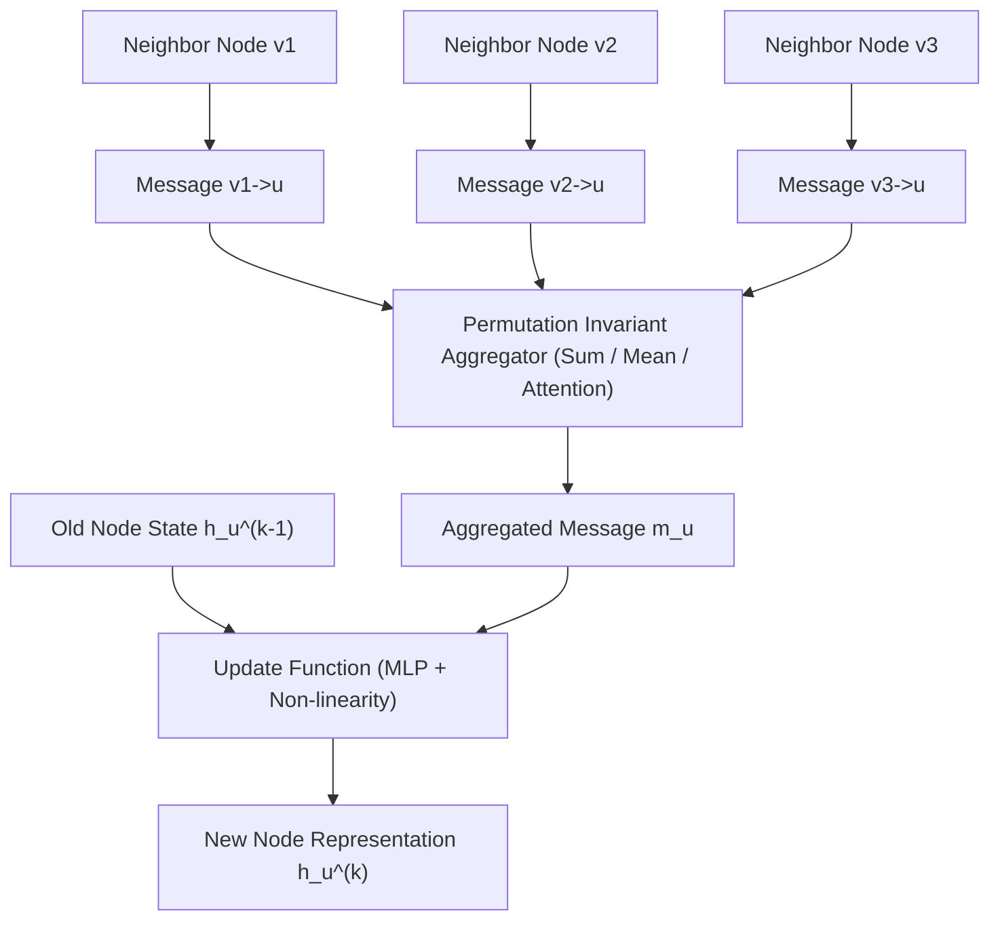

# Mạng Nơ-ron Đồ Thị (Graph Neural Networks - GNN & GCN)

> **Khái niệm chính thống**: *Deep Learning on Graphs* (Yao Ma & Jiliang Tang, Cambridge 2021); Kipf & Welling (ICLR 2017) *"Semi-Supervised Classification with Graph Convolutional Networks"*; Veličković et al. (ICLR 2018) *"Graph Attention Networks (GAT)"*.
> **Miền kiến thức**: [[index|Geometric Deep Learning & Non-Euclidean Data]]
> **Tài liệu gốc liên quan**:
> - [Deep-Learning-on-Graphs.pdf](../resources/deep-learning/Deep-Learning-on-Graphs.pdf) (Trang 1-60; 100-145)
> - [Deep Learning_Computer Vision_NLP.pdf](../resources/deep-learning/Deep%20Learning_Computer%20Vision_NLP.pdf) (Trang 160-185)

---

## 1. Tóm tắt (Executive Summary)
**Mạng Nơ-ron Đồ thị (Graph Neural Networks - GNN)** là lớp mô hình học sâu được thiết kế để xử lý dữ liệu phi cấu trúc Euclid dạng đồ thị $\mathcal{G} = (\mathcal{V}, \mathcal{E})$, nơi các thực thể (nút - Nodes) liên kết với nhau qua các mối quan hệ (cạnh - Edges) bất đối xứng và không có trật tự cố định. Khác với CNN hay Transformer xử lý dữ liệu dạng mảng hay chuỗi tuần tự, GNN vận hành dựa trên cơ chế **Truyền tin (Message Passing Paradigm)**: mỗi nút tổng hợp thông tin đặc trưng từ tập hợp các nút láng giềng để cập nhật biểu diễn trạng thái của chính mình. GNN đóng vai trò cốt lõi trong phân tích mạng xã hội, hệ thống gợi ý (Recommender Systems), phát hiện gian lận tài chính, và thiết kế cấu trúc phân tử sinh hóa.

---

## 2. Định nghĩa chính thống & Khung Truyền tin (Message Passing Framework)

### 2.1 Khung Thông điệp Tổng quát (Gilmer et al., 2017)
Tại tầng thứ $k$ của mạng GNN, biểu diễn ẩn $h_u^{(k)}$ của nút $u$ được tính toán qua 3 bước:
1. **Message Function**: Tạo thông điệp từ nút láng giềng $v \in \mathcal{N}(u)$:
   $$m_{u,v}^{(k)} = \text{MSG}^{(k)}\left(h_u^{(k-1)}, \; h_v^{(k-1)}, \; e_{u,v}\right)$$
2. **Aggregation Function**: Tổng hợp các thông điệp từ toàn bộ láng giềng bằng một toán tử bất biến hoán vị (Permutation Invariant: Sum, Mean, Max):
   $$m_u^{(k)} = \text{AGG}^{(k)}\left( \left\{ m_{u,v}^{(k)} : v \in \mathcal{N}(u) \right\} \right)$$
3. **Update Function**: Cập nhật trạng thái mới của nút $u$:
   $$h_u^{(k)} = \text{UPDATE}^{(k)}\left( h_u^{(k-1)}, \; m_u^{(k)} \right)$$

### 2.2 Các kiến trúc GNN tiêu biểu
1. **GCN (Graph Convolutional Networks - Kipf & Welling, 2017)**:
   - Xấp xỉ cấp 1 của tích chập phổ trên đồ thị:
     $$H^{(k+1)} = \sigma\left( \tilde{D}^{-\frac{1}{2}} \tilde{A} \tilde{D}^{-\frac{1}{2}} H^{(k)} W^{(k)} \right)$$
   - Trong đó $\tilde{A} = A + I_N$ là ma trận kề có thêm vòng tự liên kết (Self-loops), và $\tilde{D}_{ii} = \sum_j \tilde{A}_{ij}$ là ma trận bậc (Degree Matrix).
2. **GAT (Graph Attention Networks - Veličković et al., 2018)**:
   - Không coi mọi láng giềng đều có tầm quan trọng như nhau; GAT sử dụng cơ chế Self-Attention để học trọng số $\alpha_{ij}$ tự động giữa nút $i$ và nút $j$:
     $$\alpha_{ij} = \frac{\exp\left(\text{LeakyReLU}\left(\mathbf{a}^T [\mathbf{W}h_i \,\|\, \mathbf{W}h_j]\right)\right)}{\sum_{k \in \mathcal{N}(i)} \exp\left(\text{LeakyReLU}\left(\mathbf{a}^T [\mathbf{W}h_i \,\|\, \mathbf{W}h_k]\right)\right)}$$

---

## 3. So sánh & Mâu thuẫn / Sắc thái giữa các tài liệu

| Thách thức lý thuyết | Bản chất kỹ thuật | Triệu chứng trong mô hình | Giải pháp của Kỹ sư AI |
| :--- | :--- | :--- | :--- |
| **Hiện tượng Làm mịn Quá mức (Over-smoothing)** | Khi số tầng GNN tăng lên quá sâu ($k > 4 - 8$), cơ chế truyền tin liên tục làm biểu diễn của mọi nút trong đồ thị hội tụ về cùng một vector trung bình giống hệt nhau. | Mô hình mất hoàn toàn khả năng phân biệt giữa các nút khác nhau; độ chính xác phân loại sụp đổ. | Sử dụng **Residual/Jumping Connections**, DropEdge, hoặc giới hạn độ sâu mạng chỉ từ 2 đến 3 tầng. |
| **Hiện tượng Nghẽn cổ chai Thông tin (Over-squashing)** | Khi đồ thị có cấu trúc hình học mở rộng theo hàm mũ (lượng láng giềng tăng vọt sau mỗi hop), việc nén thông tin từ hàng ngàn nút vào một vector kích thước cố định gây nghẽn thông tin. | Các nút ở khoảng cách xa không thể truyền tín hiệu hữu ích cho nhau. | Biến đổi cấu trúc đồ thị (Graph Rewiring), bổ sung các cạnh ảo (Virtual Nodes). |

---

## 4. Góc nhìn Thực chiến & Thiết kế Hệ thống cho AI Engineer

### 4.1 Quy mô lớn (Scalability) trong Hệ thống Gợi ý (GraphSAGE)
- Trong các đồ thị thực tế (mạng xã hội hàng tỷ nút), phép nhân ma trận toàn cục của GCN là bất khả thi vì không thể nhét toàn bộ đồ thị vào RAM/GPU.
- **Giải pháp**: Thuật toán **GraphSAGE (Sample and Aggregate)**:
  - Thay vì lấy toàn bộ láng giềng, chỉ lấy mẫu ngẫu nhiên một số lượng láng giềng cố định (Uniform Sampling: e.g., lấy 10 láng giềng ở hop 1, 25 láng giềng ở hop 2).
  - Cho phép huấn luyện GNN theo từng mini-batch độc lập như mạng nơ-ron thông thường, mở khóa khả năng mở rộng trên các đồ thị quy mô Internet (Pinterest, Uber Eats).

### 4.2 Câu hỏi phỏng vấn thực tế
- **Q**: *Tại sao toán tử tổng hợp (Aggregation Function) trong GNN bắt buộc phải là một hàm bất biến hoán vị (Permutation Invariant)?*
  - **A**: Đồ thị toán học là một tập hợp các nút và cạnh không có thứ tự tự nhiên (khác với câu văn có thứ tự từ trái sang phải, hoặc bức ảnh có tọa độ trên dưới). Nếu đổi chỗ vị trí của các hàng/cột trong ma trận kề (đổi tên nhãn nút), bản chất đồ thị vẫn không đổi (Graph Isomorphism). Do đó, toán tử tổng hợp từ tập láng giềng $\mathcal{N}(u)$ bắt buộc phải cho ra kết quả giống nhau bất kể thứ tự duyệt qua các láng giềng là gì (phép Sum, Mean, Max thỏa mãn điều này, trong khi hàm nối Concat hay LSTM phụ thuộc thứ tự sẽ thất bại).

---

## 5. Mạng lưới Liên kết Tri thức (Knowledge Graph & `wiki-links`)
- [[graph-rag]] — Ứng dụng đồ thị tri thức để mở rộng năng lực truy xuất của RAG.
- [[transformer-architecture]] — Transformer là trường hợp đặc biệt của GNN trên đồ thị đầy đủ (Fully-connected Graph).
- [[convolutional-neural-networks]] — So sánh đối chiếu giữa tích chập trên lưới Euclid và tích chập trên đồ thị phi Euclid.