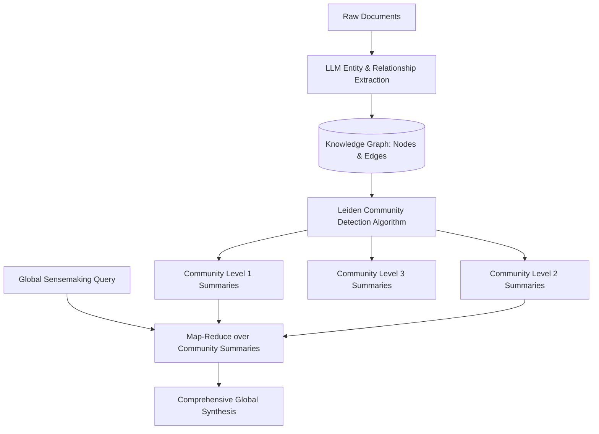

# Graph RAG và Đồ Thị Tri Thức (Graph RAG & Knowledge Graphs)

> **Khái niệm chính thống**: *Encyclopedia of LLMs*, Section 13.6.2; Edge et al. (2024, Microsoft Research) *"From Local to Global: A Graph RAG Approach to Query-Focused Summarization"*; *Deep-Learning-on-Graphs* (Ma & Tang, Cambridge).
> **Miền kiến thức**: [[index|Advanced Knowledge Representation & Graph Systems]]
> **Tài liệu gốc liên quan**:
> - [Encyclopedia of LLMs and Foundation Models.pdf](../resources/genai/Encyclopedia%20of%20LLMs%20and%20Foundation%20Models.pdf) (Trang 126-128)
> - [Deep-Learning-on-Graphs.pdf](../resources/deep-learning/Deep-Learning-on-Graphs.pdf) (Trang 1-45)
> - [AIO2026_[Reading]-RAG-System.pdf](../resources/genai/AIO2026_%5BReading%5D-RAG-System.pdf) (Trang 95-113)

---

## 1. Tóm tắt (Executive Summary)
**Graph RAG** là kiến trúc RAG thế hệ mới tích hợp **Đồ thị Tri thức (Knowledge Graph - KG)** vào quy trình lập chỉ mục và truy xuất thông tin của LLM. Trong khi Vector RAG truyền thống hoạt động dựa trên sự tương đồng cục bộ của từng đoạn văn bản riêng lẻ (phù hợp cho câu hỏi tìm kiếm điểm hẹp - "Point Queries"), nó hoàn toàn thất bại trước các câu hỏi tổng thể đòi hỏi kết nối thông tin toàn kho dữ liệu (như: *"Các chủ đề chính trong tập tài liệu này là gì?"*). Graph RAG trích xuất các thực thể (Entities), mối quan hệ (Relationships) và phân cụm cộng đồng (Community Detection) để tạo ra các bản tóm tắt phân tầng, cho phép hệ thống thực hiện cả truy xuất suy luận đa chặng (Multi-hop) và tóm tắt toàn cục (Global Sensemaking).

---

## 2. Định nghĩa chính thống & Kiến trúc Microsoft Graph RAG

### 2.1 Quy trình Lập chỉ mục Đồ thị (Graph Indexing Pipeline)
1. **Source Text Chunking**: Phân nhỏ văn bản thành các text units lớn (~1200 tokens).
2. **Entity & Relation Extraction**: Sử dụng LLM để trích xuất toàn bộ các thực thể (Nodes) và quan hệ giữa chúng (Edges), cùng mô tả chi tiết cho từng phần tử:
   $$(E_{\text{source}}, \text{Relationship Description}, E_{\text{target}})$$
3. **Entity Resolution (Giải quyết đồng thực thể)**: Hợp nhất các biến thể tên gọi cùng chỉ một đối tượng (ví dụ: "Bộ Y tế", "BYT", "MOH").
4. **Hierarchical Community Detection (Leiden Algorithm)**: Áp dụng thuật toán Leiden để phát hiện các phân cụm cộng đồng mạng lưới từ vi mô đến vĩ mô.
5. **Community Summarization**: LLM tạo ra các báo cáo tóm tắt toàn diện cho từng cụm cộng đồng ở từng cấp độ phân tầng.

### 2.2 Global Search vs Local Search trong Graph RAG
- **Local Search (Tìm kiếm Cục bộ)**: Dành cho câu hỏi về các thực thể cụ thể (e.g., *"Ai là giám đốc dự án Apollo và họ có mối quan hệ gì với công ty X?"*). Hệ thống tìm kiếm nút thực thể trong đồ thị, lan truyền láng giềng k-hop để lấy các quan hệ liên kết và đoạn văn bản gốc tương ứng.
- **Global Search (Tìm kiếm Toàn cục)**: Dành cho câu hỏi tổng thể (e.g., *"Những rủi ro địa chính trị lớn nhất được nhắc tới trong kho hồ sơ này là gì?"*). Hệ thống thực hiện quy trình Map-Reduce trên các bản tóm tắt cộng đồng (Community Summaries) mà không cần quét qua hàng triệu văn bản gốc.

---

## 3. So sánh & Mâu thuẫn / Sắc thái giữa các tài liệu

| Tiêu chí | Vector RAG truyền thống | Microsoft Graph RAG | Đánh giá kiến trúc AI Engineering |
| :--- | :--- | :--- | :--- |
| **Chi phí lập chỉ mục (Indexing Cost)** | Cực rẻ. Chỉ cần gọi mô hình embedding 1 lần cho mỗi chunk. | Rất đắt. Phải gọi LLM hàng ngàn lần để trích xuất thực thể, quan hệ và sinh tóm tắt cộng đồng. | Chỉ đầu tư Graph RAG khi dữ liệu có tính kết nối cao và giá trị thông tin khai thác biện minh được cho chi phí. |
| **Khả năng trả lời câu hỏi tổng quát** | Gần như bằng 0. Vector search chỉ kéo về được vài chunk rời rạc ngẫu nhiên. | Xuất sắc. Bản tóm tắt phân tầng bao quát toàn bộ bức tranh dữ liệu. | Graph RAG là giải pháp duy nhất hiện nay giải quyết triệt để bài toán "Global Corpus Understanding". |
| **Độ trễ truy vấn (Query Latency)** | Thấp (< 50ms cho vector search). | Trung bình đến cao (Local search ~1-2s; Global search cần luồng Map-Reduce đa bước). | Cần lưu cache các bản tóm tắt và câu trả lời thường gặp. |

---

## 4. Góc nhìn Thực chiến & Thiết kế Hệ thống cho AI Engineer

### 4.1 Kiến trúc Graph-Vector Hybrid
Trong thực tế sản xuất, không ai dùng Graph RAG thuần túy mà luôn triển khai kiến trúc lai (**Hybrid Graph-Vector System**):
- Sử dụng **Neo4j** hoặc **AWS Neptune** để lưu trữ Graph Triples.
- Nhúng vector vào chính các nút thực thể và bản tóm tắt cộng đồng trong Vector DB.
- Khi người dùng hỏi:
  - Vector search tìm ra các nút thực thể khởi đầu (Seed Entities).
  - Graph traversal mở rộng mạng lưới tri thức 1-2 bước (1-hop / 2-hop subgraphs).
  - Nạp thông tin cấu trúc đồ thị vào ngữ cảnh của LLM.

### 4.2 Câu hỏi phỏng vấn thực tế
- **Q**: *Khi nào hệ thống nên dùng Graph RAG thay vì Vector RAG truyền thống?*
  - **A**: Dùng Graph RAG khi:
    1. Tác vụ đòi hỏi suy luận xuyên văn bản qua nhiều bước kết nối thực thể (Multi-hop Reasoning: A liên quan B, B sở hữu C, tìm mối quan hệ giữa A và C).
    2. Dữ liệu có cấu trúc mạng lưới quan hệ chằng chịt: Hồ sơ điều tra chống gian lận tài chính, phả hệ y sinh/dược phẩm, chuỗi cung ứng logistics.
    3. Cần trả lời các câu hỏi tóm tắt tổng thể toàn bộ kho tri thức mà Vector search thông thường bị mù cục bộ.

---

## 5. Mạng lưới Liên kết Tri thức (Knowledge Graph & `wiki-links`)
- [[rag-architecture]] — Bức tranh tổng thể nơi Graph RAG đại diện cho thế hệ tiên tiến nhất.
- [[vector-embeddings]] — Kết hợp vector nhúng trên các nút thực thể đồ thị.
- [[graph-neural-networks]] — Cơ sở toán học nền tảng về xử lý học sâu trên cấu trúc đồ thị.
- [[llm-evaluation]] — Đo lường độ bao phủ tri thức và tính trung thực của các câu trả lời tổng hợp.