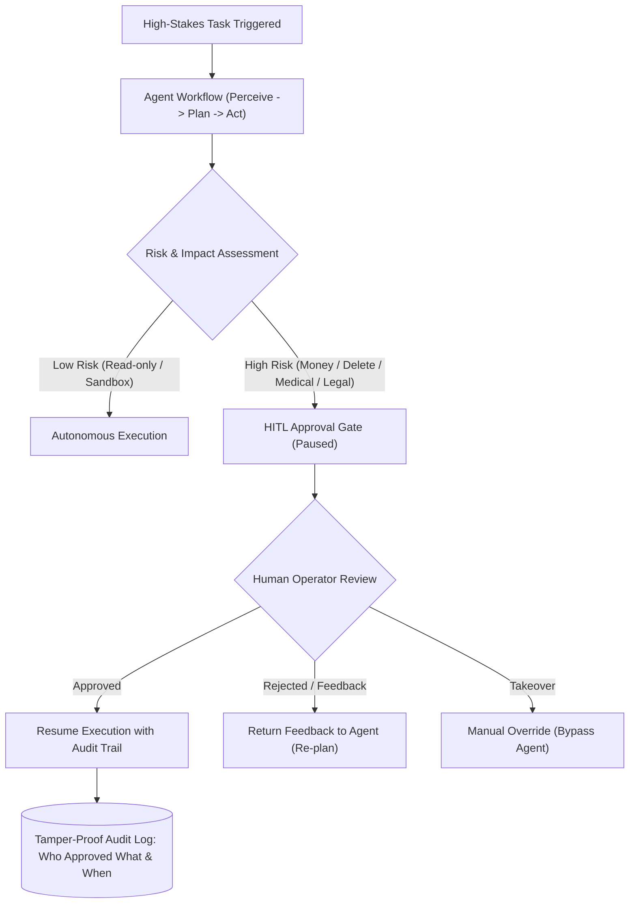

# Con Người Trong Vòng Lặp và Quản Trị Tác Nhân (Human-in-the-Loop & Agent Governance)

> **Khái niệm chính thống**: *Master All 20 Agentic AI Design Patterns*, Pattern 12; *Agentic AI Design Patterns (2026 Edition)*, Section 8; *846485886...jpg* ("5. Ai chịu trách nhiệm kết quả? AI Agents With Human In The Loop"); *848044627...jpg* ("3. Khi nào không nên dùng AI?").
> **Miền kiến thức**: [[index|AI Safety, Ethics & Production Governance]]
> **Tài liệu gốc liên quan**:
> - [846485886_122320901828195094_432191169857527385_n.jpg](../resources/images/846485886_122320901828195094_432191169857527385_n.jpg) (Infographic 5: Trách nhiệm kết quả & HITL)
> - [848044627_122320901882195094_403801078837249544_n.jpg](../resources/images/848044627_122320901882195094_403801078837249544_n.jpg) (Infographic 3: Khi nào không nên dùng AI?)
> - [Master All 20 Agentic AI Design Patterns.pdf](../resources/genai/Master%20All%2020%20Agentic%20AI%20Design%20Patterns.pdf) (Trang 26-28)
> - [Encyclopedia of LLMs and Foundation Models.pdf](../resources/genai/Encyclopedia%20of%20LLMs%20and%20Foundation%20Models.pdf) (Trang 136)

---

## 1. Tóm tắt (Executive Summary)
**Con người trong Vòng lặp (Human-in-the-Loop - HITL)** là mô thức kiến trúc và quản trị sống còn đảm bảo sự kiểm soát an toàn, độ tin cậy và tuân thủ pháp lý của các hệ thống Agentic AI trong môi trường doanh nghiệp. Về mặt kỹ thuật, HITL thiết lập các **Chốt chặn Kiểm duyệt (Approval Gates)** và **Cơ chế Leo thang (Escalation Policies)** để tạm dừng tiến trình tự chủ của Agent trước các hành động rủi ro cao hoặc khi độ tin cậy của mô hình xuống thấp. Về mặt triết lý và đạo đức nghề nghiệp, HITL khẳng định nguyên lý tối thượng: **AI chỉ là công cụ hỗ trợ quyết định; trách nhiệm đạo đức, pháp lý và hậu quả cuối cùng luôn thuộc về con người và tổ chức.**

---

## 2. Định nghĩa chính thống & Triết lý Cốt lõi (Core Philosophy & Architecture)

### 2.1 "Ai chịu trách nhiệm kết quả?" (Triết lý Phân biệt Junior vs Senior)
Theo trích đoạn đúc kết kinh nghiệm thực chiến từ chuyên gia (*resources/images/846485886...jpg*):
> - **Người mới (Junior)**: Hay nghĩ trách nhiệm thuộc về mô hình (Model) hoặc dữ liệu (Data). Khi có sự cố, thường đổ lỗi cho thuật toán.
> - **Người có trình độ (Senior / Architect)**: Hiểu sâu sắc rằng **trách nhiệm luôn thuộc về con người và tổ chức vận hành**.
> - AI chỉ là công cụ hỗ trợ ra quyết định (Decision Support Tool). Bắt buộc phải thiết kế quy trình kiểm soát và phê duyệt kết quả. Không thể đổ lỗi cho thuật toán khi có hậu quả xảy ra. Hiểu được câu hỏi này là dấu hiệu bước sang đẳng cấp Senior.

### 2.2 Các hình thái tích hợp Human-in-the-Loop
1. **Human-on-the-Loop (Giám sát thụ động)**: Agent chạy tự động, con người theo dõi dashboard thời gian thực và có thể bấm nút "Emergency Kill Switch" khi phát hiện bất thường.
2. **Human-in-the-Loop (Phê duyệt chủ động)**: Luồng công việc bị đóng băng (State Suspended) tại các điểm giao cắt quan trọng, chờ con người click "Approve" hoặc nhập thông tin bổ sung qua giao diện UI/Slack trước khi tiếp tục.
3. **Human-in-Command (Con người chỉ đạo)**: Con người đưa ra quyết định ở từng chặng, Agent chỉ đóng vai trò phân tích dữ liệu, tóm tắt và đưa ra 3 phương án gợi ý.

---

## 3. So sánh & Mâu thuẫn / Sắc thái giữa các tài liệu

| Tiêu chí | Tư duy Thử nghiệm (Dự án nghiên cứu / Demo) | Tư duy Vận hành Doanh nghiệp (Enterprise Production) |
| :--- | :--- | :--- |
| **Mục tiêu tối thượng** | Tìm kiếm sự tự chủ 100% (Zero-human intervention). | **Quản trị rủi ro tối đa (Zero-unauthorized catastrophic action)**. |
| **Quyền hạn của Agent** | Cung cấp toàn bộ API keys có quyền cao nhất (Admin/Root) cho Agent tự do gọi. | **Nguyên tắc Đặc quyền Tối thiểu (Principle of Least Privilege)**: Chỉ cấp quyền đọc (Read-only). Mọi quyền ghi/xóa/giao dịch tài chính bắt buộc phải qua HITL Gate. |
| **Ghi nhận lịch sử (Auditing)** | Chỉ in log ra terminal qua `print()`. | **Lưu vết kiểm toán bất biến (Tamper-proof Audit Trail)**: Ghi lại từng prompt, token, lý do gọi hàm, ID của nhân viên duyệt, và thời điểm phê duyệt phục vụ thanh tra pháp lý. |

---

## 4. Góc nhìn Thực chiến & Thiết kế Hệ thống cho AI Engineer

### 4.1 "Khi nào KHÔNG NÊN dùng AI?" (Nguyên lý loại trừ từ Infographic 848044627)
Một AI Engineer đẳng cấp thể hiện ở việc **biết từ chối đưa AI vào những bài toán không phù hợp**:
- **Người non**: Thường nghĩ bài toán nào cũng nhét AI vào để thể hiện công nghệ.
- **Người có kinh nghiệm**: Biết rất nhiều trường hợp KHÔNG ĐƯỢC dùng AI:
  1. *Dữ liệu quá ít hoặc quá không ổn định*: Rủi ro mô hình sai lệch cực lớn.
  2. *Bài toán cần giải thích rõ ràng 100% logic*: AI hộp đen phức tạp là bất lợi pháp lý (hãy dùng Rule-based, Decision Tree hoặc SQL).
  3. *Chi phí triển khai và vận hành lớn hơn lợi ích kinh doanh mang lại*.
  4. *Có những bài toán tự động hóa xác định (Automation using connectors/triggers)*: Chạy theo lịch trình (Scheduled triggers) hoặc sự kiện (Event-based webhooks) bằng code thuần hiệu quả và ổn định hơn ngàn lần AI.

### 4.2 Câu hỏi phỏng vấn thực tế
- **Q**: *Nếu hệ thống AI Agent hỗ trợ chẩn đoán y tế hoặc duyệt giải ngân khoản vay ngân hàng đưa ra quyết định sai lầm gây thiệt hại nghiêm trọng, ai là người chịu trách nhiệm trước pháp luật?*
  - **A**: Về mặt pháp lý và tổ chức, thuật toán và mô hình AI không phải là thực thể pháp nhân (Legal Entity) nên không thể chịu trách nhiệm pháp lý. Trách nhiệm hoàn toàn thuộc về **ban lãnh đạo tổ chức sở hữu hệ thống và kỹ sư/chuyên viên con người đã ký duyệt quy trình**. Một kiến trúc sư phần mềm AI có đạo đức phải thiết kế hệ thống sao cho AI luôn ở vị thế "khuyến nghị" (Recommendation) và bắt buộc phải có chữ ký số xác nhận của chuyên gia con người trước khi hành động có hiệu lực.

---

## 5. Mạng lưới Liên kết Tri thức (Knowledge Graph & `wiki-links`)
- [[agentic-ai-core]] — Khung kiến trúc tổng thể nơi HITL đóng vai trò chốt chặn an toàn.
- [[tool-use-and-function-calling]] — Phân loại các công cụ nguy hiểm cần kích hoạt HITL.
- [[reflection-and-self-correction]] — Điểm leo thang lên con người khi cơ chế tự sửa lỗi thất bại.
- [[llm-evaluation]] — Cung cấp các số liệu định lượng về tỷ lệ sai sót của mô hình để thiết lập ngưỡng HITL.