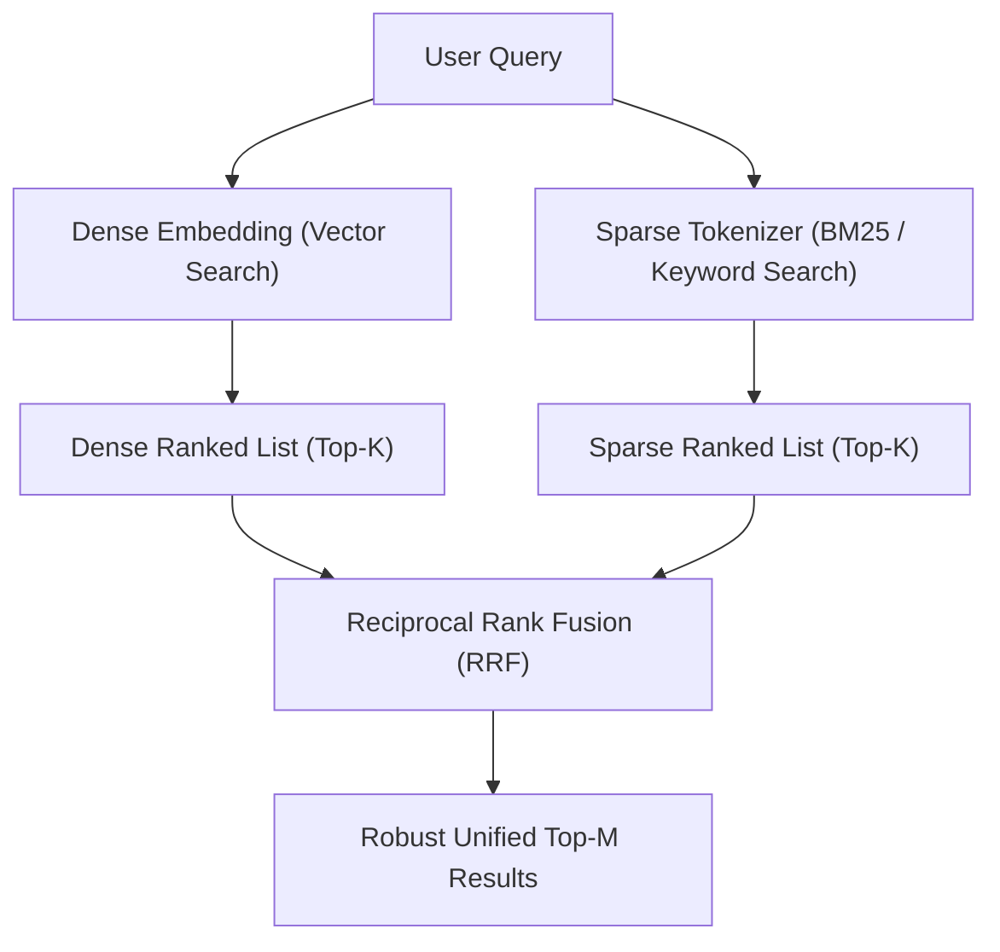

# Tìm Kiếm Lai (Hybrid Search: Dense Vector + Sparse BM25)

> **Khái niệm chính thống**: *Encyclopedia of LLMs*, Section 13.2.4; Robertson et al. (1994) *"Okapi BM25"*; Cormack et al. (2009) *"Reciprocal Rank Fusion (RRF)"*.
> **Miền kiến thức**: [[index|Advanced Retrieval Architectures]]
> **Tài liệu gốc liên quan**:
> - [Encyclopedia of LLMs and Foundation Models.pdf](../resources/genai/Encyclopedia%20of%20LLMs%20and%20Foundation%20Models.pdf) (Trang 123-125)
> - [AIO2026_[Reading]-RAG-System.pdf](../resources/genai/AIO2026_%5BReading%5D-RAG-System.pdf) (Trang 60-80)
> - [english_GiaiThichThuatNguRAG.pdf](../resources/genai/english_GiaiThichThuatNguRAG.pdf) (Trang 8-12)

---

## 1. Tóm tắt (Executive Summary)
**Tìm kiếm Lai (Hybrid Search)** là phương pháp kết hợp đồng thời hai cơ chế truy xuất bổ trợ nhau: **Tìm kiếm Ngữ nghĩa Dày đặc (Dense Semantic Retrieval)** dựa trên vector nhúng và **Tìm kiếm Từ khóa Thưa thớt (Sparse Lexical Retrieval)** dựa trên thuật toán BM25 / Inverted Index. Bằng cách dung hợp kết quả xếp hạng từ hai luồng thông qua giải thuật **Reciprocal Rank Fusion (RRF)** hoặc kết hợp điểm tuyến tính có trọng số, Hybrid Search giải quyết hoàn hảo bài toán "điểm mù" của vector search (vốn thường bỏ sót các mã lỗi, tên riêng, thuật ngữ chuyên ngành) và điểm mù của keyword search (vốn không hiểu ngữ cảnh và từ đồng nghĩa).

---

## 2. Định nghĩa chính thống & Thuật toán Dung hợp (Algorithms & Mathematical Fusion)

### 2.1 Thuật toán BM25 (Okapi BM25)
Điểm số BM25 của tài liệu $D$ đối với truy vấn $Q = \{q_1, q_2, ..., q_n\}$ được định nghĩa:
$$\text{Score}_{BM25}(D, Q) = \sum_{i=1}^n \text{IDF}(q_i) \cdot \frac{f(q_i, D) \cdot (k_1 + 1)}{f(q_i, D) + k_1 \cdot \left(1 - b + b \cdot \frac{|D|}{\text{avgdl}}\right)}$$
Trong đó:
- $f(q_i, D)$ là tần suất xuất hiện của từ $q_i$ trong tài liệu $D$.
- $|D|$ và $\text{avgdl}$ lần lượt là độ dài tài liệu $D$ và độ dài trung bình của mọi tài liệu trong kho.
- $k_1$ (thường $1.2 - 2.0$) kiểm soát độ bão hòa tần suất từ; $b$ (thường $0.75$) kiểm soát mức độ phạt độ dài văn bản.

### 2.2 Thuật toán Reciprocal Rank Fusion (RRF)
RRF là giải thuật dung hợp thứ hạng không tham số tiêu chuẩn công nghiệp: Không cần chuẩn hóa điểm số khác biệt giữa thang điểm cosine $[0, 1]$ và thang điểm BM25 $[0, \infty)$, RRF chỉ quan tâm đến vị trí thứ hạng (rank) của tài liệu trong mỗi danh sách:
$$\text{RRF\_Score}(d \in \mathcal{D}) = \sum_{m \in \mathcal{M}} \frac{1}{k + r_m(d)}$$
Trong đó:
- $\mathcal{M}$ là tập hợp các bộ truy xuất (ở đây gồm Dense và Sparse).
- $r_m(d)$ là thứ hạng của tài liệu $d$ trong hệ thống truy xuất $m$ ($r \in \{1, 2, 3, ...\}$).
- $k$ là hằng số làm mượt (smoothing constant), thường chọn mặc định $k = 60$ để giảm thiểu sức ảnh hưởng thái quá của các vị trí đứng đầu bảng.

---

## 3. So sánh & Mâu thuẫn / Sắc thái giữa các tài liệu

| Trường hợp truy vấn | Chỉ dùng Dense Vector Search | Chỉ dùng BM25 Keyword Search | Kết quả của Hybrid Search (RRF) |
| :--- | :--- | :--- | :--- |
| **"Lỗi ngoại lệ NullPointerException tại dòng 42"** | Kém; vector bị trôi dạt vào các bài viết chung chung về lỗi Java. | Xuất sắc; tìm trúng chính xác chuỗi ký tự lỗi và số dòng. | **Thành công vượt trội**: Đưa chính xác đoạn code lỗi lên Top 1. |
| **"Cách làm dịu cơn đau đầu mà không cần dùng thuốc"** | Xuất sắc; hiểu được các ý niệm tương đồng như thư giãn, bấm huyệt, uống nước. | Kém; nếu tài liệu không chứa đúng cụm từ "làm dịu" hay "cơn đau đầu" thì bị loại bỏ. | **Thành công vượt trội**: Bao quát toàn bộ các bài viết liên quan ngữ nghĩa. |
| **Truy vấn đa ngôn ngữ hoặc từ viết tắt** | Hiểu được ngữ cảnh chéo ngôn ngữ. | Thất bại nếu không khớp từ khóa. | Cân bằng hoàn hảo giữa độ chính xác và độ bao phủ. |

---

## 4. Góc nhìn Thực chiến & Thiết kế Hệ thống cho AI Engineer

### 4.1 Trọng số Alpha Tuning (Weighted Score Fusion)
Bên cạnh RRF, một số hệ thống (như Qdrant, Elasticsearch, Weaviate) hỗ trợ dung hợp tuyến tính:
$$\text{Score}_{\text{Hybrid}} = \alpha \cdot \text{Score}_{\text{Dense}} + (1 - \alpha) \cdot \text{Score}_{\text{Sparse}}$$
- Khi $\alpha = 1.0$: Hệ thống trở thành Dense Search thuần túy.
- Khi $\alpha = 0.0$: Hệ thống trở thành Keyword Search thuần túy.
- **Kinh nghiệm thực chiến**: Với các hệ thống tài liệu nội bộ chứa nhiều mã hợp đồng, số hiệu điều luật: Hãy đặt $\alpha \in [0.4, 0.6]$. Với hệ thống hỏi đáp người dùng thông thường: Đặt $\alpha \in [0.7, 0.8]$.

### 4.2 Câu hỏi phỏng vấn thực tế
- **Q**: *Tại sao RRF lại được ưu tiên hơn Weighted Score Fusion trong các hệ thống đa nguồn tìm kiếm phức tạp?*
  - **A**: Vì điểm số (raw score) của các thuật toán khác nhau có phân phối hoàn toàn khác biệt: Cosine bị giới hạn $[-1, 1]$, Dot product không giới hạn, BM25 phụ thuộc vào độ dài văn bản và số lượng tài liệu trong corpus. Việc chuẩn hóa điểm số (Min-Max scaler hay Z-score) rất nhạy cảm với các giá trị ngoại lai (outliers). RRF hoàn toàn miễn nhiễm với vấn đề này vì nó hoạt động thuần túy trên thứ tự xếp hạng (ordinal ranking).

---

## 5. Mạng lưới Liên kết Tri thức (Knowledge Graph & `wiki-links`)
- [[rag-architecture]] — Khung kiến trúc tổng thể ứng dụng tìm kiếm lai.
- [[vector-embeddings]] — Trụ cột Dense của Hybrid Search.
- [[reranking]] — Tầng kế tiếp nhận đầu ra của Hybrid Search để tái xếp hạng chính xác.