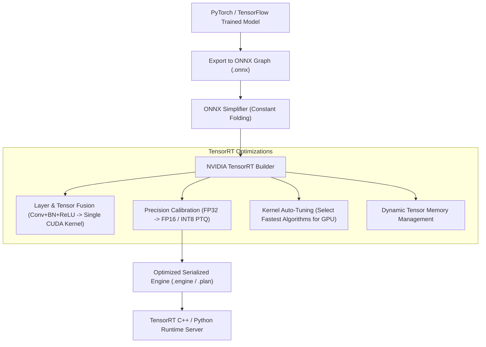

# Tối Ưu Hóa Suy Luận và TensorRT (Inference Optimization & TensorRT)

> **Khái niệm chính thống**: NVIDIA TensorRT Developer Guide; *AIO2025 Series: Tối ưu hiệu suất mô hình với ONNX và TensorRT*; *Encyclopedia of LLMs*, Chapter 11.
> **Miền kiến thức**: [[index|Model Deployment & Hardware Acceleration]]
> **Tài liệu gốc liên quan**:
> - [AIO2025_Reading_ONNX_TensorRT.pdf](../resources/deep-learning/computer-vision/AIO2025_Reading_ONNX_TensorRT.pdf) (Trang 1-42)
> - [AIO2025_M08W05-Reading_ONNX_TensorRT.pdf](../resources/deep-learning/computer-vision/AIO2025_M08W05-Reading_ONNX_TensorRT.pdf) (Trang 1-42)
> - [Encyclopedia of LLMs and Foundation Models.pdf](../resources/genai/Encyclopedia%20of%20LLMs%20and%20Foundation%20Models.pdf) (Trang 101-105)

---

## 1. Tóm tắt (Executive Summary)
**Tối ưu hóa Suy luận (Inference Optimization)** là quá trình chuyển đổi, biên dịch và tinh gọn một mô hình học sâu sau huấn luyện (từ PyTorch/TensorFlow) sang một công cụ thực thi tối ưu hóa ở cấp độ phần cứng (Hardware-specific Execution Engine) nhằm đạt **thời gian phản hồi thấp nhất (Latency Minimization)** và **thông lượng cao nhất (Throughput Maximization)**. Tiêu chuẩn vàng trong hệ sinh thái NVIDIA là chuyển đổi mô hình qua định dạng trung gian **ONNX (Open Neural Network Exchange)**, sau đó nạp vào trình biên dịch **TensorRT** để thực hiện hợp nhất toán tử (Kernel Fusion), lượng tử hóa bán chính xác (FP16/INT8 Calibration) và tự động lựa chọn nhân CUDA tối ưu nhất trên kiến trúc vi xử lý mục tiêu.

---

## 2. Định nghĩa chính thống & Các kỹ thuật Tối ưu hóa TensorRT

### 2.1 4 Kỹ thuật tối ưu hóa cốt lõi của TensorRT
1. **Hợp nhất Tầng và Toán tử (Layer & Tensor Fusion)**:
   - Trong đồ thị PyTorch thông thường, chuỗi `Convolution -> BatchNorm -> ReLU` đòi hỏi GPU phải thực thi 3 CUDA kernels riêng biệt, ghi dữ liệu trung gian ra bộ nhớ VRAM (HBM) rồi đọc lại 3 lần.
   - TensorRT hợp nhất 3 thao tác này thành **một nhân tính toán duy nhất (CBR Fused Kernel)**: Dữ liệu được giữ trong thanh ghi nội bộ của chip (Registers/SRAM), giảm thiểu 66% băng thông đọc/ghi bộ nhớ.
2. **Hiệu chuẩn Lượng tử hóa INT8 (INT8 Post-Training Calibration)**:
   - Chuyển đổi trọng số và ma trận kích hoạt từ 32-bit sang số nguyên 8-bit.
   - Sử dụng thuật toán đo phân kỳ Kullback-Leibler (**KL Divergence**) trên một tập dữ liệu hiệu chuẩn nhỏ (Calibration Dataset) để tìm ngưỡng cắt (Threshold clipping) tối ưu, đảm bảo thông tin ngữ nghĩa bị mất đi là nhỏ nhất.
3. **Kernel Auto-Tuning (Tự động tinh chỉnh nhân CUDA)**:
   - TensorRT chạy thử nghiệm thực tế hàng chục giải thuật nhân ma trận khác nhau (GEMM, Winograd, Direct Convolution) trực tiếp trên dòng card GPU đang chạy (ví dụ RTX 4090, A100 hay T4) và chọn ra thuật toán có tốc độ thực thi nhanh nhất tương ứng với batch size chỉ định.
4. **Tái sử dụng Bộ nhớ Động (Dynamic Memory Management)**:
   - Cấp phát lại các vùng đệm bộ nhớ (Memory footprint) dùng chung cho các tensor không tồn tại đồng thời, giảm đáng kể dung lượng VRAM tổng thể.

---

## 3. So sánh & Mâu thuẫn / Sắc thái giữa các tài liệu

| Môi trường Thực thi | Độ trễ (Latency) | Khả năng mở rộng phần cứng | Mức độ phức tạp triển khai |
| :--- | :--- | :--- | :--- |
| **PyTorch Native (`model(x)`)** | Cao (chứa overhead của Python runtime, CUDA kernel launches rời rạc). | Rất linh hoạt (chạy được trên mọi thiết bị). | Thấp nhất (sẵn sàng ngay sau huấn luyện). |
| **ONNX Runtime (CPU / GPU)** | Nhanh hơn PyTorch 1.5 - 2.5 lần; tối ưu hóa đồ thị nền tảng. | Đa nền tảng (Intel CPU, AMD, NVIDIA, ARM). | Trung bình; dễ debug bằng Netron viewer. |
| **TensorRT Engine** | **Nhanh nhất (Nhanh hơn PyTorch 3 - 8 lần)**; khai thác tối đa Tensor Cores. | Độc quyền phần cứng NVIDIA GPU. Checkpoint `.engine` biên dịch trên card nào chỉ chạy được trên card đó! | Cao; đòi hỏi cài đặt CUDA/cuDNN/TensorRT tương thích phiên bản nghiêm ngặt. |

---

## 4. Góc nhìn Thực chiến & Thiết kế Hệ thống cho AI Engineer

### 4.1 Quy tắc triển khai TensorRT trong Production
1. **Quy tắc "Hardware Binding"**: Không bao giờ biên dịch TensorRT engine trên máy tính cá nhân (ví dụ GPU RTX 3060) rồi copy file `.engine` lên máy chủ Cloud (GPU NVIDIA T4 hoặc A10G). File engine gắn chặt với kiến trúc Compute Capability của phần cứng; bắt buộc phải biên dịch file engine ngay trên chính môi trường phần cứng máy chủ phục vụ.
2. **Hỗ trợ Dynamic Shape**: Khi xuất ONNX và build TensorRT, phải khai báo dải kích thước linh hoạt (`min_shape`, `opt_shape`, `max_shape`) cho batch size và sequence length để engine có thể phục vụ cả các request đơn lẻ (batch=1) lẫn các đợt request dồn dập (batch=16, 32).

### 4.2 Câu hỏi phỏng vấn thực tế
- **Q**: *Tại sao quy trình INT8 Calibration trong TensorRT lại sử dụng phân kỳ KL (Kullback-Leibler Divergence) thay vì chỉ lấy giá trị Max đơn thuần (Max-Range)?*
  - **A**: Nếu chỉ lấy giá trị Max tuyệt đối của ma trận kích hoạt làm ngưỡng lượng tử hóa, các giá trị ngoại lai cực đoan (outliers - có thể chỉ chiếm 0.01% số lượng điểm ảnh nhưng có độ lớn gấp 100 lần) sẽ kéo dãn thang đo $S$, khiến 99.99% các giá trị bình thường còn lại bị co cụm vào chỉ một vài giá trị số nguyên INT8 lân cận 0, làm phá hủy hoàn toàn độ chính xác của mạng. Phương pháp phân kỳ KL đo lường sự mất mát thông tin giữa phân phối liên tục gốc và phân phối lượng tử hóa rời rạc, từ đó tìm ra ngưỡng cắt tối ưu để bão hòa các outlier nhưng bảo toàn tối đa độ phân giải cho khối dữ liệu chủ đạo.

---

## 5. Mạng lưới Liên kết Tri thức (Knowledge Graph & `wiki-links`)
- [[convolutional-neural-networks]] — Mô hình đối tượng hưởng lợi trực tiếp từ hợp nhất lớp CBR.
- [[object-detection-yolo]] — Triển khai TensorRT là chuẩn mực bắt buộc để chạy YOLO 60+ FPS.
- [[quantization-and-compression]] — Nền tảng lý thuyết lượng tử hóa INT8 và FP16.
- [[model-serving-api]] — Tích hợp TensorRT engine vào Triton Inference Server hoặc FastAPI backend.