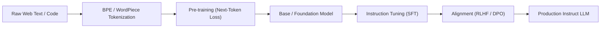

# Mô hình Ngôn ngữ Lớn (Large Language Models - LLM)

> **Khái niệm chính thống**: *Encyclopedia of Large Language Models and Foundation Models* (Hasi Hays, 2026), Chapter 1 & 2.
> **Miền kiến thức**: [[index|Generative AI & Foundation Models]]
> **Tài liệu gốc liên quan**:
> - [Encyclopedia of LLMs and Foundation Models.pdf](../resources/genai/Encyclopedia%20of%20LLMs%20and%20Foundation%20Models.pdf) (Trang 1-25)
> - [Vietnamese_Introduction-to-LLMs.pdf](../resources/genai/Vietnamese_Introduction-to-LLMs.pdf) (Trang 1-45)
> - [LLM Interview QnA.pdf](../resources/genai/LLM%20Interview%20QnA.pdf) (Trang 1-12)

---

## 1. Tóm tắt (Executive Summary)
**Mô hình Ngôn ngữ Lớn (Large Language Models - LLM)** là các mạng nơ-ron sâu dựa trên kiến trúc Transformer với hàng tỷ đến hàng nghìn tỷ tham số, được huấn luyện tự giám sát (self-supervised) trên các kho ngữ liệu văn bản quy mô Internet. LLM mô hình hóa phân phối xác suất có điều kiện của chuỗi từ/token $P(w_t | w_1, w_2, ..., w_{t-1})$, từ đó thể hiện các khả năng đột sinh (emergent abilities) như hiểu ngữ cảnh, suy luận nhiều bước, lập trình và giải quyết vấn đề tổng quát mà không cần huấn luyện lại từ đầu cho từng tác vụ riêng biệt.

---

## 2. Định nghĩa chính thống & Cơ chế cốt lõi (Canonical Definition & Mechanism)

### 2.1 Định nghĩa chuẩn mực từ Encyclopedia of LLMs
Theo *Encyclopedia of Large Language Models and Foundation Models* (2026, Section 1.1):
> *"A Large Language Model is a high-capacity parameterized probabilistic model of natural text, characterized by scale across three orthogonal axes: parameter count ($N$), dataset volume in tokens ($D$), and cumulative training compute ($C$). By optimizing the next-token prediction objective over massive corpora, the model captures syntactic, semantic, factual, and algorithmic representations of human language."*

### 2.2 Mục tiêu huấn luyện (Objective Function)
Mục tiêu cơ bản của autoregressive causal LLM là tối đa hóa log-likelihood (hoặc tối thiểu hóa Cross-Entropy Loss) trên chuỗi token:
$$\mathcal{L}_{CLM}(\theta) = - \sum_{i=1}^{T} \log P(x_i | x_{<i}; \theta)$$

Trong đó:
- $x = (x_1, x_2, ..., x_T)$ là chuỗi token đầu vào.
- $x_{<i} = (x_1, ..., x_{i-1})$ là ngữ cảnh các token đi trước.
- $\theta$ là tập trọng số tham số hóa của Transformer.

### 2.3 Các định luật tỷ lệ (Scaling Laws)
Kaplan et al. (2020) và Chinchilla Scaling Laws (Hoffmann et al., 2022) chứng minh hàm mất mát kiểm tra nghiệm đúng quan hệ lũy thừa (power-law):
$$L(N, D) = E + \frac{A}{N^\alpha} + \frac{B}{D^\beta}$$
Quy tắc Chinchilla chỉ ra rằng để đạt hiệu quả tối ưu về compute, số lượng tham số $N$ và số token huấn luyện $D$ cần được mở rộng theo tỷ lệ bằng nhau ($N \propto D$), thay vì chỉ tập trung tăng số tham số như GPT-3 thời kỳ đầu.

---

## 3. So sánh & Mâu thuẫn / Sắc thái giữa các tài liệu (Contradictions & Nuances across Sources)

| Khía cạnh | Sách chuẩn mực (*Encyclopedia of LLMs*) | Tài liệu bài giảng / Slide thực hành | Góc nhìn giải quyết cho AI Engineer |
| :--- | :--- | :--- | :--- |
| **Bản chất của "Emergence"** | Đặt nghi vấn về "tính đột sinh", chỉ ra rằng emergence có thể chỉ là ảo giác do việc lựa chọn độ đo không liên tục (non-linear metrics) thay vì chuyển pha thực sự. | Coi năng lực đột sinh (CoT, in-context learning) là đặc tính tự phát thần kỳ khi model vượt ngưỡng tham số (10B, 100B). | Đừng ỷ lại vào kích thước model; năng lực giải quyết tác vụ phụ thuộc mật thiết vào chất lượng dữ liệu huấn luyện (Curated Data) và phương pháp prompting/reasoning. |
| **Phân loại kiến trúc** | Phân chia rành mạch thành 3 nhánh: *Encoder-only* (BERT), *Encoder-Decoder* (T5, BART), và *Decoder-only* (GPT, LLaMA). | Thực tế ngành công nghiệp hiện đại gần như đồng nhất "LLM" là *Decoder-only Causal Transformer*. | Hiểu rõ: Decoder-only thống trị tạo sinh và zero-shot reasoning; nhưng Encoder-only vẫn giữ ưu thế tuyệt đối về chi phí/tốc độ trong Bi-Encoder vector embedding và phân loại thực thể (NER). |
| **Độ tin cậy của kiến thức** | Khẳng định trọng số tham số (parametric memory) vốn dĩ là bộ nhớ xác suất, nén mất mát (lossy compression) nên không thể tránh khỏi ảo giác (*hallucination*). | Một số hướng dẫn quảng cáo fine-tuning như phương pháp cập nhật kiến thức mới cho LLM. | **Quy tắc vàng**: Fine-tuning dùng để học định dạng, phong cách và phong cách suy luận; muốn bổ sung tri thức thực tế chính xác phải dùng [[rag-architecture|RAG]] hoặc [[tool-use-and-function-calling|Tool Calling]]. |

---

## 4. Góc nhìn Thực chiến & Thiết kế Hệ thống cho AI Engineer

### 4.1 Khi nào NÊN và KHÔNG NÊN dùng LLM?
*(Tham khảo nguyên lý kiến trúc từ hình ảnh phân tích thực chiến)*:
- **NÊN DÙNG**:
  - Tác vụ xử lý ngôn ngữ tự nhiên không có cấu trúc cố định: tóm tắt văn bản, trích xuất thực thể phức tạp, dịch máy thích ứng, sinh mã nguồn.
  - Các hệ thống suy luận đa bước kết hợp [[agentic-ai-core|Agentic AI Workflows]].
- **KHÔNG NÊN DÙNG**:
  - Các bài toán hoàn toàn xác định (deterministic): tính toán toán học chuẩn xác, logic nghiệp vụ cố định, tra cứu bảng tính đơn giản (hãy dùng code thuần hoặc SQL query).
  - Yêu cầu độ trễ siêu thấp (< 10ms) với ngân sách hạn hẹp.

### 4.2 Các Failure Modes trong Production
1. **Ảo giác sự thật (Factual Hallucination)**: Mô hình tạo ra thông tin nghe có vẻ thuyết phục nhưng hoàn toàn hư cấu.
2. **Suy giảm chú ý do ngữ cảnh dài (Lost-in-the-Middle)**: Khi đưa ngữ cảnh 32k-128k token, model chú ý tốt ở đầu và cuối prompt, bỏ sót thông tin nằm giữa.
3. **Tính phi tiền định (Non-determinism)**: Cùng một prompt nhưng nhiệt độ $T > 0$ sinh kết quả khác nhau, gây khó khăn cho việc kiểm thử phần mềm.

### 4.3 Câu hỏi phỏng vấn thực tế (Interview Q&A)
- **Q**: *Tại sao các LLM hiện đại đều chuyển sang kiến trúc Decoder-only thay vì Encoder-Decoder như ban đầu?*
  - **A**: Decoder-only đơn giản hơn trong việc phân bổ tài nguyên tính toán (KV cache chia sẻ một luồng duy nhất), hiệu quả vượt trội trong việc mở rộng quy mô (scaling laws) và có khả năng tương thích tự nhiên nhất với tác vụ in-context learning và multi-turn generation.

---

## 5. Mạng lưới Liên kết Tri thức (Knowledge Graph & `wiki-links`)
- [[transformer-architecture]] — Nền tảng kiến trúc sâu của mọi LLM hiện đại.
- [[llm-reasoning]] — Cơ chế kích hoạt năng lực tư duy System 2 trong LLM.
- [[llm-fine-tuning]] — Tinh chỉnh tham số thích ứng chuyên biệt cho LLM.
- [[llm-alignment]] — Căn chỉnh hành vi và độ an toàn qua RLHF, DPO.
- [[prompt-engineering]] — Kỹ thuật tương tác và khai thác tiềm năng LLM ở inference time.
- [[quantization-and-compression]] — Nén mô hình để triển khai tiết kiệm tài nguyên.
- [[rag-architecture]] — Giải pháp kết nối kiến thức động từ bên ngoài để triệt tiêu ảo giác.