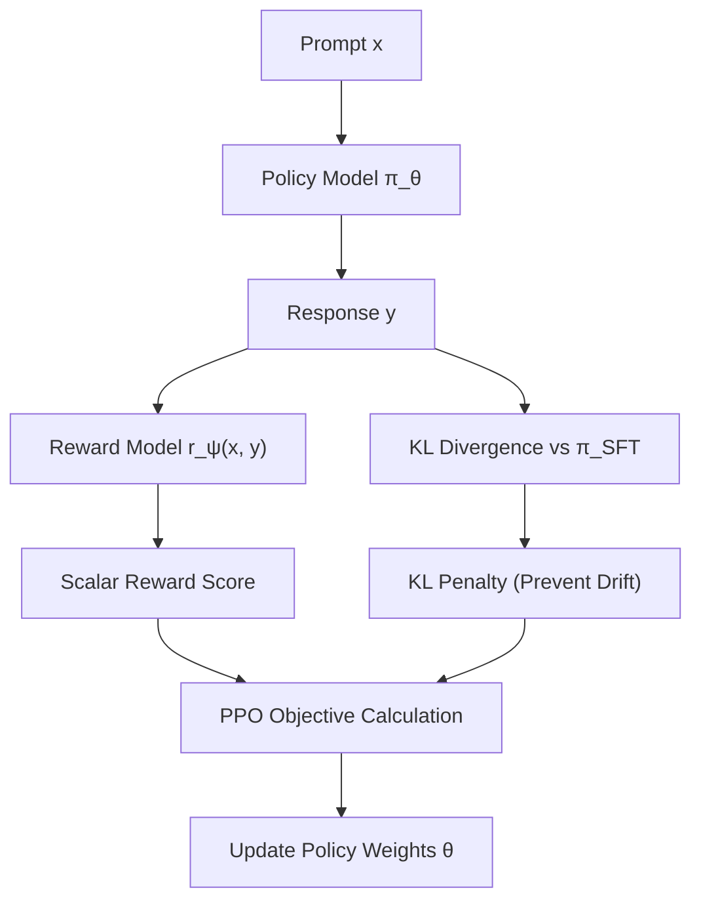

# Căn Chỉnh Mô Hình Ngôn Ngữ Lớn (LLM Alignment: RLHF, DPO & Constitutional AI)

> **Khái niệm chính thống**: *Encyclopedia of LLMs*, Chapter 4 (Sections 4.7 - 4.8); Ouyang et al. (2022) *"InstructGPT"*; Rafailov et al. (2023) *"Direct Preference Optimization"*; Bai et al. (2022) *"Constitutional AI"*.
> **Miền kiến thức**: [[index|GenAI Safety & Preference Alignment]]
> **Tài liệu gốc liên quan**:
> - [Encyclopedia of LLMs and Foundation Models.pdf](../resources/genai/Encyclopedia%20of%20LLMs%20and%20Foundation%20Models.pdf) (Trang 31-34; 76-78)
> - [LLM Interview QnA.pdf](../resources/genai/LLM%20Interview%20QnA.pdf) (Trang 30-45)
> - [Vietnamese_Introduction-to-LLMs.pdf](../resources/genai/Vietnamese_Introduction-to-LLMs.pdf) (Trang 76-90)

---

## 1. Tóm tắt (Executive Summary)
**Căn chỉnh Mô hình Ngôn ngữ Lớn (LLM Alignment)** là quá trình huấn luyện nhằm định hướng hành vi của mô hình hội tụ theo 3 mục tiêu cốt lõi của nhân loại (**HHH: Helpful, Honest, Harmless**). Sau khi hoàn tất Pre-training và SFT, mô hình vẫn có xu hướng sản sinh nội dung độc hại, thiên kiến hoặc bịa đặt. Alignment giải quyết bài toán này thông qua hai trường phái chính: sử dụng Học tăng cường từ phản hồi con người (**RLHF** với PPO) và tối ưu hóa sở thích trực tiếp qua hàm mất mát giải tích đóng (**DPO**), cùng cơ chế tự giám sát an toàn (**Constitutional AI**).

---

## 2. Định nghĩa chính thống & Cơ chế cốt lõi (Canonical Definition & Mechanism)

### 2.1 Quy trình 3 giai đoạn kinh điển của RLHF (InstructGPT / PPO)
1. **Giai đoạn 1: Supervised Fine-Tuning (SFT)**: Huấn luyện base model trên các cặp prompt-response chất lượng cao để sinh model $\pi^{SFT}$.
2. **Giai đoạn 2: Reward Modeling (RM)**: Người gán nhãn so sánh các phản hồi cho cùng một prompt, tạo cặp dữ liệu sở thích $(y_w \succ y_l)$ (trong đó $y_w$ là câu trả lời được ưa chuộng hơn, $y_l$ là câu trả lời kém hơn). Mô hình phần thưởng $r_\psi(x, y)$ được tối ưu hóa theo mô hình Bradley-Terry:
   $$\mathcal{L}_{RM}(\psi) = - \mathbb{E}_{(x, y_w, y_l)} \left[ \log \sigma \left( r_\psi(x, y_w) - r_\psi(x, y_l) \right) \right]$$
3. **Giai đoạn 3: Policy Optimization bằng PPO**: Huấn luyện chính sách $\pi_\theta$ để tối đa hóa điểm thưởng đồng thời phạt khoảng cách phân kỳ KL divergence với mô hình SFT ban đầu để chống hiện tượng sụp đổ chính sách:
   $$\max_{\theta} \mathbb{E}_{x \sim \mathcal{D}, y \sim \pi_\theta} \left[ r_\psi(x, y) \right] - \beta \, \mathbb{D}_{KL} \left( \pi_\theta(y|x) \,\|\, \pi^{SFT}(y|x) \right)$$

### 2.2 Đột phá DPO (Direct Preference Optimization)
Rafailov et al. (2023) chứng minh rằng bài toán RLHF có nghiệm giải tích chính xác liên kết giữa mô hình phần thưởng tiềm ẩn và chính sách tối ưu:
$$r(x, y) = \beta \log \frac{\pi_\theta(y|x)}{\pi_{\text{ref}}(y|x)} + \beta \log Z(x)$$
Thay thế quan hệ này trực tiếp vào hàm mục tiêu Bradley-Terry, DPO loại bỏ hoàn toàn việc phải huấn luyện Reward Model riêng biệt và loại bỏ vòng lặp RL PPO vốn cực kỳ bất ổn định:
$$\mathcal{L}_{DPO}(\theta; \pi_{\text{ref}}) = - \mathbb{E}_{(x, y_w, y_l)} \left[ \log \sigma \left( \beta \log \frac{\pi_\theta(y_w|x)}{\pi_{\text{ref}}(y_w|x)} - \beta \log \frac{\pi_\theta(y_l|x)}{\pi_{\text{ref}}(y_l|x)} \right) \right]$$

---

## 3. So sánh & Mâu thuẫn / Sắc thái giữa các tài liệu

| Tiêu chí | RLHF truyền thống (PPO) | DPO (Direct Preference Optimization) | Constitutional AI / RLAIF |
| :--- | :--- | :--- | :--- |
| **Độ ổn định huấn luyện** | Rất thấp. Nhạy cảm cao với siêu tham số (learning rate, clipping, KL coefficient). Dễ rơi vào Reward Hacking. | Rất cao. Huấn luyện phân loại nhị phân ổn định như SFT thông thường. | Cao. Sử dụng AI tự sinh phản hồi và tự phê bình dựa trên bộ hiến pháp nguyên tắc. |
| **Hạ tầng GPU cần thiết** | Cực kỳ tốn kém. Phải nạp cùng lúc 4 mô hình vào bộ nhớ: Actor, Critic/Value, Reward Model, Reference Model. | Tối thiểu. Chỉ cần nạp mô hình đang train $\pi_\theta$ và mô hình tham chiếu đóng băng $\pi_{\text{ref}}$. | Tối ưu chi phí gán nhãn con người; mở rộng dữ liệu căn chỉnh theo quy mô tự động. |
| **Độ bám sát sở thích phức tạp** | Vẫn là tiêu chuẩn vàng của các frontier lab (OpenAI, Anthropic) khi cần học tăng cường trực tiếp trên môi trường đa bước. | Tiêu chuẩn thống trị trong cộng đồng mã nguồn mở (LLaMA 3, Mistral, Zephyr). | Giải quyết triệt để vấn đề thiên kiến cá nhân của người chấm nhãn thủ công. |

---

## 4. Góc nhìn Thực chiến & Thiết kế Hệ thống cho AI Engineer

### 4.1 "Thuế căn chỉnh" (Alignment Tax) và Hội chứng Từ chối thái quá
Một hiện tượng tiêu cực thường gặp trong căn chỉnh an toàn là **Alignment Tax**:
- Khi mô hình bị căn chỉnh quá mức (over-aligned), năng lực sáng tạo, lập trình và suy luận toán học bị suy giảm rõ rệt.
- Hiện tượng **Từ chối sai (False Refusal)**: Mô hình từ chối các câu hỏi vô hại vì chứa từ khóa nhạy cảm (ví dụ: *"Làm thế nào để giết (kill) một process chạy nền trong Linux?"*).
- **Giải pháp**: Thiết kế dữ liệu sở thích tương phản (contrastive hard negatives) và áp dụng DPO với hệ số $\beta$ được điều chỉnh cẩn trọng ($0.1 - 0.5$).

### 4.2 Câu hỏi phỏng vấn thực tế
- **Q**: *Tại sao trong hàm mục tiêu của RLHF bắt buộc phải có thành phần phạt $KL(\pi_\theta || \pi_{ref})$?*
  - **A**: Nếu không có KL penalty, mô hình Actor sẽ nhanh chóng tìm ra các lỗ hổng của Reward Model (gọi là hiện tượng Reward Hacking / Goodhart's Law), ví dụ như sinh ra chuỗi văn bản dài dòng vô nghĩa nhưng chứa nhiều từ ngữ tâng bốc khiến Reward Model chấm điểm cực cao, dẫn tới suy sụp hoàn toàn năng lực ngôn ngữ của mô hình.

---

## 5. Mạng lưới Liên kết Tri thức (Knowledge Graph & `wiki-links`)
- [[large-language-models]] — Đối tượng thụ hưởng quá trình căn chỉnh an toàn.
- [[llm-fine-tuning]] — Giai đoạn SFT tiên quyết trước khi bước vào Alignment.
- [[llm-reasoning]] — Sự cân bằng giữa an toàn và năng lực suy luận sâu.
- [[llm-evaluation]] — Đo lường độ an toàn, tính trung thực và benchmark Red-teaming.