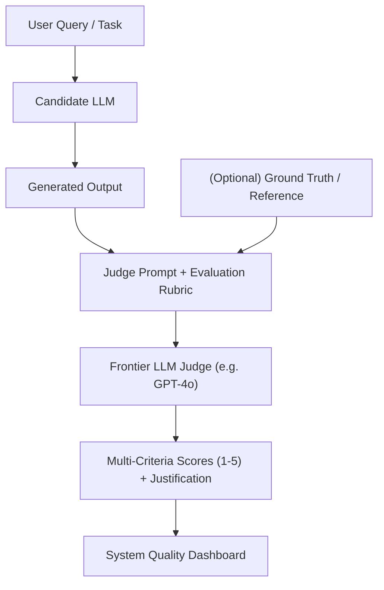

# Đánh Giá Mô Hình Ngôn Ngữ Lớn (LLM Evaluation & Benchmarking)

> **Khái niệm chính thống**: *Encyclopedia of LLMs*, Chapter 7; *Sổ tay hướng dẫn cách dùng LLM để tự đánh giá câu trả lời của LLM* (2025); Zheng et al. (2023) *"Judging LLM-as-a-Judge with MT-Bench and Chatbot Arena"*.
> **Miền kiến thức**: [[index|GenAI Evaluation & Quality Assurance]]
> **Tài liệu gốc liên quan**:
> - [Sổ tay hướng dẫn cách dùng LLM để tự đánh giá câu trả lời của LLM.pdf](../resources/genai/S%E1%BB%95%20tay%20h%C6%B0%E1%BB%9Bng%20d%E1%BA%ABn%20c%C3%A1ch%20d%C3%B9ng%20LLM%20%C4%91%E1%BB%83%20t%E1%BB%B1%20%C4%91%C3%A1nh%20gi%C3%A1%20c%C3%A2u%20tr%E1%BA%A3%20l%E1%BB%9Di%20c%E1%BB%A7a%20LLM.pdf) (Trang 1-69)
> - [Encyclopedia of LLMs and Foundation Models.pdf](../resources/genai/Encyclopedia%20of%20LLMs%20and%20Foundation%20Models.pdf) (Trang 57-65)
> - [LLM Interview QnA.pdf](../resources/genai/LLM%20Interview%20QnA.pdf) (Trang 35-45)

---

## 1. Tóm tắt (Executive Summary)
**Đánh giá Mô hình Ngôn ngữ Lớn (LLM Evaluation)** là quy trình định lượng và định tính hóa năng lực, độ an toàn và chất lượng đầu ra của các hệ thống AI tạo sinh. Do tính chất mở và phi tiền định của ngôn ngữ tự nhiên, các thang đo truyền thống dựa trên sự trùng lặp bề mặt từ (như BLEU, ROUGE) đã bộc lộ giới hạn nghiêm trọng. Ngành công nghiệp đã chuyển dịch mạnh mẽ sang bộ ba phương pháp: **Academic Benchmarks** (MMLU, GSM8K, HumanEval), **Human Evaluation** (LMSYS Chatbot Arena với ELO rating), và phương pháp tự động hóa quy mô lớn **LLM-as-a-Judge** (sử dụng GPT-4o/Claude để chấm điểm dựa trên rubric chi tiết).

---

## 2. Định nghĩa chính thống & Cơ chế cốt lõi (Canonical Definition & Mechanism)

### 2.1 Các nhóm phương pháp đánh giá
1. **Rule-based & Exact Match Metrics**:
   - Dùng cho các bài toán có đáp án xác thực: Accuracy, Pass@k (cho sinh mã nguồn), F1 score.
2. **N-gram Overlap Metrics (BLEU, ROUGE, METEOR)**:
   - So sánh mức độ trùng lặp từ ngữ giữa câu sinh ra và câu tham chiếu con người. Tuy nhiên, một câu diễn đạt lại hoàn toàn bằng từ đồng nghĩa vẫn có thể bị chấm điểm 0 dù ngữ nghĩa hoàn hảo.
3. **Embedding-based Semantic Similarity (BERTScore)**:
   - Tính cosine similarity giữa các vector nhúng ngữ cảnh của từng token để đo độ tương đồng ngữ nghĩa.
4. **LLM-as-a-Judge (Phương pháp chủ đạo)**:
   - Sử dụng một mô hình ngôn ngữ cao cấp đóng vai trò giám khảo độc lập, đọc đề bài, tiêu chuẩn chấm (Rubric), câu trả lời của ứng viên và đưa ra điểm số kèm lý do giải thích bằng văn bản.

### 2.2 Các thiên kiến cố hữu của LLM-as-a-Judge (Biases)
Theo *Sổ tay hướng dẫn cách dùng LLM để tự đánh giá* và nghiên cứu MT-Bench:
- **Position Bias**: Mô hình giám khảo có xu hướng thiên vị câu trả lời xuất hiện ở vị trí đầu tiên (hoặc thứ hai) trong so sánh cặp đôi. *Khắc phục*: Đảo vị trí câu trả lời và chấm 2 lần (Swap Evaluation).
- **Verbosity Bias**: Mô hình có xu hướng chấm điểm cao hơn cho các câu trả lời dài dòng, format đẹp mắt dù nội dung sáo rỗng.
- **Self-Enhancement Bias**: Mô hình do OpenAI phát triển có xu hướng thiên vị câu trả lời của chính các mô hình cùng họ OpenAI so với các model khác.

---

## 3. So sánh & Mâu thuẫn / Sắc thái giữa các tài liệu

| Phương pháp | Chi phí & Tốc độ | Khả năng mở rộng (Scalability) | Độ tin cậy thực tế | Điểm nghẽn chính |
| :--- | :--- | :--- | :--- | :--- |
| **Con người đánh giá (Human Eval)** | Cực kỳ đắt đỏ, tốc độ chậm tính theo tuần/tháng. | Kém; không thể chạy liên tục trong luồng CI/CD. | Rất cao nếu người chấm là chuyên gia; kém nếu là công nhân crowdsourcing thiếu chuyên môn. | Không thể scale khi lượng dữ liệu lớn. |
| **Benchmark học thuật (MMLU, GSM8K)** | Rất rẻ, chạy tự động nhanh chóng. | Cực cao. | Đang suy giảm nghiêm trọng do hiện tượng **Nhiễm bẩn dữ liệu (Data Contamination)** khi các lab vô tình hay hữu ý đưa bài test vào tập pre-train. | Điểm số cao trên benchmark không đồng nghĩa với việc mô hình hữu ích trong sản phẩm thực tế. |
| **LLM-as-a-Judge** | Chi phí vừa phải (tiền gọi API), chạy trong vài phút. | Rất cao, tích hợp mượt mà vào automated testing pipeline. | Tương quan cao với con người (correlation > 80%) nếu có rubric chặt chẽ. | Bị ảnh hưởng bởi thiên kiến (position/verbosity bias); tốn chi phí token. |

---

## 4. Góc nhìn Thực chiến & Thiết kế Hệ thống cho AI Engineer

### 4.1 Xây dựng hệ thống Đánh giá RAG với Ragas Framework
Trong các hệ thống RAG thực tế, việc đánh giá cần bóc tách thành 4 chỉ số cốt lõi:
1. **Faithfulness (Độ trung thực)**: Tỷ lệ các luận điểm trong câu trả lời có thể suy ra trực tiếp từ Context được truy xuất (đo lường ảo giác).
2. **Answer Relevance (Độ liên quan của câu trả lời)**: Câu trả lời có giải quyết đúng trọng tâm câu hỏi của người dùng không.
3. **Context Precision (Độ chính xác ngữ cảnh)**: Các đoạn chunk chứa thông tin quan trọng có được rank ở các vị trí đầu tiên không.
4. **Context Recall (Độ bao phủ ngữ cảnh)**: Toàn bộ thông tin cần thiết để trả lời câu hỏi có được truy xuất đầy đủ về không.

### 4.2 Câu hỏi phỏng vấn thực tế
- **Q**: *Làm thế nào để phát hiện xem một mô hình LLM có bị học vẹt (overfit/contaminated) trên tập benchmark công khai hay không?*
  - **A**: Áp dụng kỹ thuật Canary GUID test (tìm kiếm chuỗi định danh đặc thù trong dữ liệu huấn luyện), hoặc thực hiện Benchmark Perturbation (giữ nguyên cấu trúc logic của bài toán nhưng thay đổi tên nhân vật, số liệu và câu chữ). Nếu điểm số của mô hình sụt giảm mạnh trên tập biến thể, chứng tỏ mô hình chỉ ghi nhớ vẹt dữ liệu gốc.

---

## 5. Mạng lưới Liên kết Tri thức (Knowledge Graph & `wiki-links`)
- [[large-language-models]] — Đối tượng cần được đánh giá chất lượng.
- [[rag-architecture]] — Kiến trúc ứng dụng các framework đánh giá chuyên biệt (Ragas).
- [[llm-alignment]] — Sử dụng kết quả đánh giá để làm tín hiệu thưởng cho alignment.
- [[prompt-engineering]] — Thiết kế Prompt Rubric cho LLM-as-a-Judge.