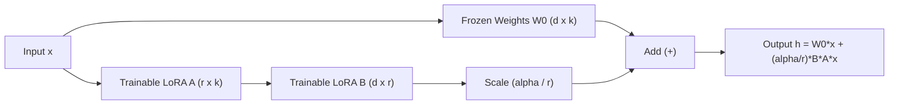

# Tinh Chỉnh Mô Hình Ngôn Ngữ Lớn (LLM Fine-Tuning & Adaptation)

> **Khái niệm chính thống**: *Encyclopedia of LLMs*, Chapter 4 (Sections 4.5 - 4.6); *AIO2025 Series: LLMs Fine-tuning*; Hu et al. (2021) *"LoRA: Low-Rank Adaptation of Large Language Models"*; Dettmers et al. (2023) *"QLoRA"*.
> **Miền kiến thức**: [[index|GenAI Engineering & Model Adaptation]]
> **Tài liệu gốc liên quan**:
> - [AIO2025_[Description]-LLMs-Fine-tuning.pdf](../resources/genai/AIO2025_%5BDescription%5D-LLMs-Fine-tuning.pdf) (Trang 1-31)
> - [Encyclopedia of LLMs and Foundation Models.pdf](../resources/genai/Encyclopedia%20of%20LLMs%20and%20Foundation%20Models.pdf) (Trang 29-31)
> - [Vietnamese_Introduction-to-LLMs.pdf](../resources/genai/Vietnamese_Introduction-to-LLMs.pdf) (Trang 50-75)

---

## 1. Tóm tắt (Executive Summary)
**Tinh chỉnh Mô hình Ngôn ngữ Lớn (LLM Fine-Tuning)** là quá trình tiếp tục huấn luyện một mô hình nền tảng (Foundation Model) đã được tiền huấn luyện trên một tập dữ liệu chuyên biệt có giám sát (Supervised Fine-Tuning - SFT) nhằm điều chỉnh hành vi, phong cách phản hồi hoặc năng lực thực thi tác vụ miền. Thay vì tinh chỉnh toàn bộ trọng số (Full Fine-Tuning) đòi hỏi tài nguyên khổng lồ, các kỹ thuật **PEFT (Parameter-Efficient Fine-Tuning)** như **LoRA** và **QLoRA** đã trở thành tiêu chuẩn công nghiệp khi chỉ cập nhật dưới 1% số lượng tham số nhưng vẫn đạt hiệu năng tương đương.

---

## 2. Định nghĩa chính thống & Cơ chế cốt lõi (Canonical Definition & Mechanism)

### 2.1 Bản chất toán học của LoRA (Low-Rank Adaptation)
Theo Hu et al. (2021), trong quá trình thích ứng tác vụ, sự biến thiên trọng số $\Delta W$ có "chiều nội tại" (intrinsic rank) rất thấp.
Với ma trận trọng số gốc $W_0 \in \mathbb{R}^{d \times k}$ được đóng băng (freeze), LoRA phân rã ma trận cập nhật $\Delta W$ thành tích của hai ma trận hạng thấp:
$$W = W_0 + \Delta W = W_0 + \frac{\alpha}{r} (B \cdot A)$$

Trong đó:
- $A \in \mathbb{R}^{r \times k}$ được khởi tạo ngẫu nhiên theo phân phối chuẩn Gaussian $\mathcal{N}(0, \sigma^2)$.
- $B \in \mathbb{R}^{d \times r}$ được khởi tạo bằng 0, đảm bảo tại bước đầu huấn luyện $\Delta W = 0$.
- $r \ll \min(d, k)$ là hạng phân rã (thường chọn $r \in [4, 64]$).
- $\alpha$ là hệ số tỷ lệ không đổi (scaling factor).

### 2.2 Đột phá QLoRA (Quantized Low-Rank Adaptation)
QLoRA (Dettmers et al., 2023) đưa hiệu năng tinh chỉnh lên tầm cao mới cho phép finetune mô hình 65B-70B trên 1 GPU thương mại 48GB/24GB thông qua 3 cơ chế:
1. **Kiểu dữ liệu NF4 (NormalFloat 4-bit)**: Kiểu biểu diễn số thực 4-bit tối ưu thông tin lý thuyết cho dữ liệu tuân theo phân phối chuẩn.
2. **Double Quantization (DQ)**: Lượng tử hóa chính các hệ số lượng tử hóa (quantization constants), tiết kiệm thêm ~0.37 bit trên mỗi tham số.
3. **Paged Optimizers**: Sử dụng bộ nhớ ảo NVIDIA CUDA Unified Memory để phân trang trạng thái tối ưu hóa giữa GPU VRAM và CPU RAM khi gặp đỉnh đột biến độ dài chuỗi (gradient checkpointing spikes).

---

## 3. So sánh & Mâu thuẫn / Sắc thái giữa các tài liệu

| Phương pháp | Bộ nhớ VRAM yêu cầu | Tỷ lệ tham số huấn luyện | Chi phí lưu trữ Checkpoint | Rủi ro Quên lãng Thảm họa (Catastrophic Forgetting) |
| :--- | :--- | :--- | :--- | :--- |
| **Full Fine-Tuning** | Rất cao (~16-20 byte/param cho FP16 + Adam state). 70B model cần > 800GB VRAM. | 100% | Rất lớn (bằng toàn bộ kích thước model gốc: 140GB cho 70B). | Cực kỳ cao; mô hình dễ mất đi năng lực tổng quát ban đầu. |
| **LoRA** | Trung bình (~1/3 đến 1/4 Full Tuning). | 0.1% – 1% | Rất nhỏ (vài chục MB đến vài trăm MB cho ma trận adapter). | Thấp; trọng số gốc giữ nguyên nên có thể tháo/lắp adapter linh hoạt. |
| **QLoRA** | Cực thấp (Model gốc nén 4-bit trong VRAM). 70B chạy vừa vặn trên 2x A100 40GB hoặc 1x 80GB. | 0.1% – 1% | Rất nhỏ (vài chục MB). | Thấp; đánh đổi tốc độ huấn luyện chậm hơn LoRA khoảng 20-30% do bước giải nén dequantization on-the-fly. |

---

## 4. Góc nhìn Thực chiến & Thiết kế Hệ thống cho AI Engineer

### 4.1 Fine-Tuning vs RAG: Ma trận Quyết định (Decision Matrix)
Một trong những lỗi phổ biến nhất của kỹ sư mới vào ngành là dùng Fine-Tuning để nhồi tri thức tài liệu nội bộ:
- **Dùng RAG khi**: Cần bổ sung tri thức thực tế (factual knowledge), dữ liệu thay đổi thường xuyên theo ngày/giờ, cần trích dẫn chính xác nguồn dữ liệu và triệt tiêu hallucination.
- **Dùng Fine-Tuning khi**: Cần thay đổi **cách hành xử (behavior)**, định dạng đầu ra chuyên biệt (như trả về JSON schema cố định, sinh mã SQL đặc thù của doanh nghiệp), học văn phong/ngữ điệu thương hiệu, hoặc khi muốn nén tri thức từ mô hình lớn sang mô hình nhỏ (Knowledge Distillation).
- **Kết hợp RAG + Fine-Tuning**: Tinh chỉnh một mô hình nhỏ (e.g., LLaMA-3-8B) để chuyên đọc hiểu và trích xuất ngữ cảnh RAG (RAG-specialized Reader model).

### 4.2 Các cạm bẫy trong chuẩn bị dữ liệu SFT
1. **Chất lượng hơn số lượng**: 1.000 cặp câu hỏi-trả lời được chuyên gia biên tập kỹ lưỡng mang lại hiệu năng cao hơn nhiều so với 100.000 mẫu dữ liệu cào bừa bãi trên web (LIMA Hypothesis).
2. **Cân bằng phân phối**: Phải trộn dữ liệu nghiệp vụ mới với một tỷ lệ nhỏ dữ liệu hội thoại tổng quát để ngăn mô hình bị suy thoái năng lực ngôn ngữ cơ bản.

### 4.3 Câu hỏi phỏng vấn thực tế
- **Q**: *Tại sao ma trận $B$ trong LoRA lại được khởi tạo bằng 0, còn ma trận $A$ lại khởi tạo ngẫu nhiên theo Gaussian?*
  - **A**: Nếu cả hai đều khởi tạo ngẫu nhiên, tích $B \cdot A \neq 0$ sẽ làm biến đổi đột ngột các trọng số gốc đã qua huấn luyện của mô hình ngay tại epoch 0, phá vỡ biểu diễn ban đầu. Bằng cách đặt $B=0$, ta đảm bảo $\Delta W = 0$ tại bước đầu tiên, mô hình xuất phát chính xác từ trạng thái của base model và học dần dần.

---

## 5. Mạng lưới Liên kết Tri thức (Knowledge Graph & `wiki-links`)
- [[large-language-models]] — Đối tượng thực hiện quá trình tinh chỉnh.
- [[llm-alignment]] — Bước tiếp theo sau SFT (RLHF / DPO).
- [[quantization-and-compression]] — Nền tảng kỹ thuật lượng tử hóa 4-bit của QLoRA.
- [[rag-architecture]] — Chiến lược kiến trúc bổ trợ và phân định ranh giới với Fine-Tuning.