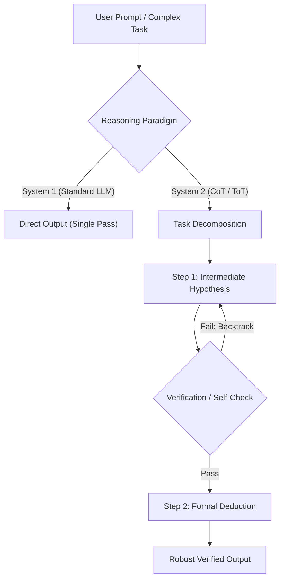

# Suy luận trong Mô hình Ngôn ngữ Lớn (LLM Reasoning & Thinking Paradigms)

> **Khái niệm chính thống**: *Encyclopedia of LLMs*, Chapter 5 & 6; *AIO2025 Series: Reasoning LLMs*; Wei et al. (2022) *"Chain-of-Thought Prompting"*; Yao et al. (2023) *"Tree of Thoughts"*.
> **Miền kiến thức**: [[index|Generative AI & Cognitive Architectures]]
> **Tài liệu gốc liên quan**:
> - [AIO2025_[Reading]-Reasoning-LLMs.pdf](../resources/genai/AIO2025_%5BReading%5D-Reasoning-LLMs.pdf) (Trang 1-17)
> - [Encyclopedia of LLMs and Foundation Models.pdf](../resources/genai/Encyclopedia%20of%20LLMs%20and%20Foundation%20Models.pdf) (Trang 37-42; 50-52)
> - [LLM Interview QnA.pdf](../resources/genai/LLM%20Interview%20QnA.pdf) (Trang 15-28)

---

## 1. Tóm tắt (Executive Summary)
**Suy luận trong LLM (Reasoning)** là năng lực của mô hình ngôn ngữ trong việc phân rã một bài toán phức tạp thành các bước logic trung gian có thể kiểm chứng được trước khi đưa ra câu trả lời cuối cùng. Bắt đầu từ kỹ thuật kích hoạt lúc suy luận như **Chain-of-Thought (CoT)**, **Tree-of-Thoughts (ToT)** cho đến mô hình thế hệ mới tối ưu hóa điện toán thời gian suy luận (Test-Time Compute) như OpenAI o1/o3 và DeepSeek-R1, suy luận đã chuyển dịch từ tư duy phản xạ nhanh (System 1) sang tư duy thận trọng, tự phản biện và tìm kiếm không gian lời giải (System 2).

---

## 2. Định nghĩa chính thống & Cơ chế cốt lõi (Canonical Definition & Mechanism)

### 2.1 Từ System 1 đến System 2 (Kahneman Cognitive Framework)
Trong khoa học nhận thức và lý thuyết LLM hiện đại:
- **System 1 (Fast / Intuitive Thinking)**: Sinh token tự động tiếp theo theo xác suất bề mặt (surface-level language patterns) với số lượng FLOPs cố định cho mỗi token.
- **System 2 (Slow / Deliberative Thinking)**: Cấp phát ngân sách điện toán suy luận động (Dynamic Test-Time Compute) để mô hình tự sinh "vùng nháp tư duy" (Internal Scratchpad / Thought Tokens), thực hiện quay lui (backtracking), tự phát hiện sai sót và khám phá nhiều nhánh lập luận.

### 2.2 Các mô thức suy luận cốt lõi
1. **Chain-of-Thought (CoT)**: Thêm chỉ dẫn *"Let's think step by step"* hoặc cung cấp ví dụ few-shot kèm chuỗi suy luận mẫu. Về mặt xác suất, CoT biến bài toán $P(Y|X)$ thành:
   $$P(Y|X) = \sum_{Z} P(Y, Z | X) = \sum_{Z} P(Y | Z, X) P(Z | X)$$
   Trong đó $Z = (z_1, z_2, ..., z_k)$ là các biến ẩn lập luận trung gian.
2. **Self-Consistency CoT (Wang et al., 2022)**: Sinh $N$ đường đi tư duy độc lập với nhiệt độ $T > 0$, sau đó tiến hành bầu chọn đa số (Majority Voting) trên kết quả cuối cùng.
3. **Tree-of-Thoughts (ToT) / Graph-of-Thoughts (GoT)**: Kết hợp LLM với thuật toán tìm kiếm kinh điển trong AI (BFS, DFS, A*, MCTS - Monte Carlo Tree Search). LLM đóng vai trò:
   - Bộ sinh trạng thái (Thought Generator).
   - Bộ đánh giá heuristic trạng thái (State Evaluator / PRM - Process Reward Model).
4. **Học tăng cường cho Suy luận (RL for Reasoning - DeepSeek-R1 / o1 Paradigm)**: Thay vì chỉ fine-tuning bắt chước lời giải con người (SFT), mô hình được huấn luyện bằng Large-Scale Reinforcement Learning với phần thưởng dựa trên tính đúng đắn của kết quả (Rule-Based Verifiable Rewards trong Toán học và Lập trình).

---

## 3. So sánh & Mâu thuẫn / Sắc thái giữa các tài liệu

| Mô thức suy luận | Cơ chế kiểm soát | Ưu điểm cốt lõi | Nhược điểm & Rào cản thực tế |
| :--- | :--- | :--- | :--- |
| **Zero-Shot / Few-Shot CoT** | Prompt engineering thuần túy. | Đơn giản, áp dụng ngay lập tức cho bất kỳ API LLM nào. | Dễ gặp hiện tượng dồn tích sai số (error compounding); nếu một bước sai, toàn bộ chuỗi sau sai theo. |
| **Self-Consistency** | Lấy mẫu nhiều lần + Bầu chọn đa số. | Tăng vọt độ chính xác trong các bài toán toán học / trắc nghiệm. | Chi phí API tăng tuyến tính gấp $N$ lần (thường $N=5$ đến $40$). |
| **Tree-of-Thoughts (ToT)** | Thuật toán tìm kiếm (BFS/DFS) + Prompting. | Khả năng quay lui (backtrack), giải quyết bài toán cần nhìn trước nhiều nước (Game 24, viết kịch bản). | Độ trễ cực cao, kiến trúc gọi prompt phức tạp, tiêu tốn token rất lớn. |
| **Reasoning Model chuyên biệt (R1 / o1)** | Huấn luyện nội tại (RL trên quy trình tư duy). | Tự biết sửa sai, sinh token suy luận ẩn, giải quyết bài toán mức độ Olympic. | Không kiểm soát được số lượng token suy luận sinh ra; chi phí inference cao hơn model thông thường. |

---

## 4. Góc nhìn Thực chiến & Thiết kế Hệ thống cho AI Engineer

### 4.1 Quy tắc đánh đổi: Token Cost vs Latency vs Accuracy
- **Khi bài toán có câu trả lời xác thực được (Verifiable Outcomes)** (Toán, Code, Cú pháp SQL, Cân bằng phản ứng hóa học): Hãy dùng Reasoning LLM hoặc CoT + Verification Gate.
- **Khi bài toán mang tính hội thoại / trích xuất thông tin thông thường**: **TUYỆT ĐỐI KHÔNG** kích hoạt reasoning models, vì sẽ làm tăng độ trễ từ 500ms lên 10-30s và lãng phí 80% chi phí vào các token "tự độc thoại" không cần thiết.

### 4.2 Triển khai Process Reward Models (PRM)
Trong hệ thống tự động đánh giá:
- **Outcome Reward Model (ORM)**: Chỉ thưởng/phạt ở kết quả cuối cùng. Dẫn đến hiện tượng "kết quả đúng nhưng lập luận bừa" (False Positive).
- **Process Reward Model (PRM)**: Đánh giá từng bước lập luận $z_i$. Cho phép hệ thống thực hiện **Best-of-N Search** hoặc **Beam Search** hiệu quả vượt bậc tại thời điểm suy luận.

### 4.3 Câu hỏi phỏng vấn thực tế
- **Q**: *Sự khác biệt cốt lõi giữa việc tăng Compute lúc Pre-training (Train-time compute) và lúc Inference (Test-time compute) là gì?*
  - **A**: Pre-training compute mở rộng tri thức tĩnh và năng lực ngôn ngữ tổng quát của mô hình nhưng chạm ngưỡng hiệu suất giảm dần (diminishing returns). Test-time compute cho phép mô hình dành thêm tài nguyên tính toán để "suy nghĩ" sâu hơn trên các mẫu dữ liệu khó, mở rộng không gian tìm kiếm lời giải và tự kiểm tra tính hợp lệ trước khi cam kết đưa ra câu trả lời.

---

## 5. Mạng lưới Liên kết Tri thức (Knowledge Graph & `wiki-links`)
- [[large-language-models]] — Nền tảng sinh token tạo nên các chuỗi suy luận.
- [[prompt-engineering]] — Phương pháp kích hoạt chuỗi CoT và cấu trúc prompt.
- [[agentic-ai-core]] — Sự kết hợp giữa suy luận (Reasoning) và hành động (Acting).
- [[react-pattern]] — Mô thức đưa suy luận CoT vào vòng lặp tương tác với môi trường bên ngoài.
- [[llm-evaluation]] — Đo lường độ chính xác logic và kiểm thử hallucination.