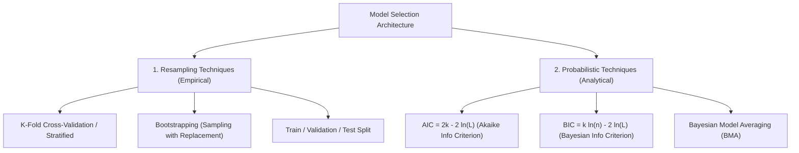

# Chiến Lược Lựa Chọn và Đánh Giá Mô Hình (Model Selection & Evaluation)

> **Khái niệm chính thống**: *Understanding Machine Learning*, Chapter 11 (Model Selection and Validation); *Mathematics for Machine Learning*, Chapter 8; *848563711...jpg* ("1. Model này dùng khi nào?"); *847762397...jpg* ("2. Dữ liệu bẩn xử lý sao?"); *847999051...jpg* ("4. Nếu model sai thì sao?").
> **Miền kiến thức**: [[index|Methodology, Validation & Production Thinking]]
> **Tài liệu gốc liên quan**:
> - [848563711_122320900772195094_1553865876902100027_n.jpg](../resources/images/848563711_122320900772195094_1553865876902100027_n.jpg) (Infographic 1: Model Selection & Context)
> - [847762397_122320901834195094_274771350129520392_n.jpg](../resources/images/847762397_122320901834195094_274771350129520392_n.jpg) (Infographic 2: Dữ liệu bẩn)
> - [847999051_122320901954195094_4534131503073995411_n.jpg](../resources/images/847999051_122320901954195094_4534131503073995411_n.jpg) (Infographic 4: Xử lý lỗi model)
> - [Learning_Phases.pdf](../resources/machine-learning/Learning_Phases.pdf) (Trang 1-39)

---

## 1. Tóm tắt (Executive Summary)
**Lựa chọn và Đánh giá Mô hình (Model Selection & Evaluation)** là quy trình khoa học mang tính hệ thống nhằm so sánh, định lượng và thẩm định tính bền vững của các thuật toán ứng viên trên dữ liệu chưa từng thấy trước khi đưa vào vận hành thực tế. Không có mô hình nào là tối ưu tuyệt đối cho mọi tình huống (**No Free Lunch Theorem**). Quy trình này bao gồm việc thiết lập chiến lược kiểm tra chéo (**K-Fold Cross-Validation**, **Stratified Splits**), sử dụng các tiêu chuẩn thông tin xác suất (**AIC, BIC**), ngăn chặn triệt để hiện tượng rò rỉ dữ liệu (**Data Leakage**), và quan trọng nhất là năng lực tư duy kỹ sư: **chọn mô hình gắn liền với ngữ cảnh bài toán, độ trễ, chi phí và khả năng giải thích**.

---

## 2. Định nghĩa chính thống & Hai trường phái Lựa chọn Mô hình (From Infographic 848563711)

### 2.1 Chi tiết hai trường phái
1. **Resampling Techniques (Trường phái Thực nghiệm)**:
   - Dùng sức mạnh tính toán để chia tập dữ liệu nhiều lần:
     - **K-Fold Cross-Validation**: Chia $K$ phần bằng nhau, luân phiên dùng $K-1$ phần để train và 1 phần để test.
     - **Stratified K-Fold**: Bắt buộc giữ nguyên tỷ lệ phân phối các lớp mục tiêu trong từng fold (tối quan trọng khi dữ liệu mất cân bằng).
     - **Time-Series Purged / Blocked Split**: Với dữ liệu chuỗi thời gian, tuyệt đối không dùng K-Fold ngẫu nhiên mà phải chia tuần tự theo trục thời gian (Walk-forward Validation) để ngăn rò rỉ thông tin tương lai về quá khứ.
2. **Probabilistic Techniques (Trường phái Xác suất Lý thuyết)**:
   - Đánh giá mô hình dựa trên hàm hợp lý cực đại kết hợp số hạng phạt số lượng tham số $k$:
     - **AIC (Akaike Information Criterion)**: $\text{AIC} = 2k - 2\ln(\hat{L})$. Hướng tới mô hình dự đoán tốt nhất khi kích thước mẫu tiến tới vô cùng.
     - **BIC (Bayesian Information Criterion)**: $\text{BIC} = k\ln(n) - 2\ln(\hat{L})$. Phạt độ phức tạp nặng hơn AIC theo $\ln(n)$, hướng tới việc tìm ra mô hình chân lý thực sự đã sinh ra dữ liệu.

---

## 3. Tư duy Kỹ sư AI Thực chiến: Bài học từ Bộ 3 Infographics Chuyên gia

### 3.1 "Model này dùng khi nào?" (Infographic 848563711)
- **Người yếu**: Thường trả lời bằng tên model (e.g., *"Bài này cứ tương XGBoost hoặc LLM vào là xong!"*), không quan tâm bối cảnh.
- **Người có trình độ (Senior)**: Luôn hỏi lại bài toán, phân bố dữ liệu và ràng buộc hệ thống:
  1. *Kích thước dữ liệu là bao nhiêu?*
  2. *Yêu cầu độ trễ (Latency SLA) là bao nhiêu mili-giây?*
  3. *Hệ thống có cần khả năng giải thích (Explainability / White-box) cho cơ quan pháp lý không?*
  4. *Chi phí hạ tầng và ngân sách vận hành là bao nhiêu?*
  - **Quy tắc vàng**: Không phải model mạnh nhất là dùng được trong mọi tình huống. Có những bài toán dùng mô hình thống kê cổ điển hoặc Rule-based còn tốt và bền vững hơn AI ngàn lần!

### 3.2 "Dữ liệu bẩn xử lý sao?" (Infographic 847762397)
- **Người mới**: Hay nói chung chung là "làm sạch dữ liệu".
- **Người giỏi**: Phân loại rành mạch bản chất của dữ liệu bẩn:
  1. **Thiếu dữ liệu (Missing)** khác hoàn toàn với **Dữ liệu sai (Corrupted)**.
  2. **Ngoại lai (Outlier)**: Có lúc là lỗi đo đạc, nhưng có lúc lại là **tín hiệu quan trọng nhất** của toàn bộ bài toán (ví dụ: giao dịch lừa đảo gian lận tín dụng chính là các outliers!).
  3. Không phải lúc nào cũng vội vàng xóa bỏ dữ liệu ngoại lai.
  4. Xử lý dữ liệu luôn gắn chặt với nghiệp vụ kinh doanh (Business Context).

### 3.3 "Nếu Model sai thì sao?" (Infographic 847999051)
- **Slicing Analysis**: Không đánh giá mô hình bằng một con số trung bình duy nhất (như Accuracy = 73.8%). Phải mổ xẻ sai số theo từng lát cắt vùng miền/nhóm đối tượng.
- **Thiết kế Cơ chế Dự phòng (Fail-safes)**: Xây dựng hàng rào kiểm soát rủi ro, phân ngưỡng tin cậy để chuyển giao cho con người xử lý ([[human-in-the-loop]]) khi model không chắc chắn.

---

## 4. Các cạm bẫy sống còn: Data Leakage (Rò rỉ Dữ liệu)

### 4.1 3 Dạng Rò rỉ Dữ liệu phổ biến nhất
1. **Feature Preprocessing Leakage**: Fit bộ chuẩn hóa `StandardScaler` hoặc `Imputer` trên toàn bộ tập dữ liệu trước khi thực hiện `train_test_split`. *Hậu quả*: Thông tin về giá trị trung bình và độ lệch chuẩn của tập Test đã bị rò rỉ vào tập Train, khiến kết quả kiểm thử cao giả tạo.
   - *Cách khắc phục*: Bắt buộc dùng `Pipeline` trong scikit-learn để fit scaler **chỉ trên tập train** và transform trên tập test.
2. **Temporal Leakage**: Sử dụng các đặc trưng trong tương lai để dự đoán quá khứ.
3. **Group / Identity Leakage**: Mẫu ảnh của cùng một bệnh nhân xuất hiện ở cả tập Train và tập Test.

### 4.2 Câu hỏi phỏng vấn thực tế
- **Q**: *Khi gặp bài toán phân loại gian lận thẻ tín dụng với tỷ lệ gian lận chỉ chiếm 0.1%, chỉ số Accuracy đạt 99.9% có ý nghĩa gì không? Bạn sẽ dùng bộ chỉ số nào để đánh giá và lựa chọn mô hình?*
  - **A**: Accuracy = 99.9% là vô nghĩa (Dummy model chỉ cần dự đoán tất cả đều là "Không gian lận" đã đạt 99.9% nhưng hệ thống hoàn toàn vô dụng).
  - Phải sử dụng:
    1. **Precision-Recall Curve (PR-AUC)** thay vì ROC-AUC (vì ROC-AUC bị lạc quan giả tạo khi số lượng mẫu âm tính áp đảo).
    2. **Recall tại một mức Precision cố định** (ví dụ: Tìm được bao nhiêu % ca gian lận với điều kiện tỷ lệ báo động giả không vượt quá 5%).
    3. **Ma trận Chi phí Doanh nghiệp (Cost-Benefit Matrix)**: Gán trọng số thiệt hại tài chính cụ thể cho lỗi False Negative (bỏ lọt gian lận, mất tiền) so với False Positive (chặn nhầm khách hàng thật, gây phiền toái).

---

## 5. Mạng lưới Liên kết Tri thức (Knowledge Graph & `wiki-links`)
- [[bias-variance-tradeoff]] — Nền tảng lý thuyết phân tích lỗi để lựa chọn mô hình.
- [[linear-regression-mle]] — Ứng dụng AIC/BIC để lựa chọn biến trong hồi quy.
- [[regularization-l1-l2]] — Kỹ thuật kiểm soát mô hình được chọn.
- [[human-in-the-loop]] — Thiết kế cổng kiểm soát an toàn khi mô hình sai trong thực tế.