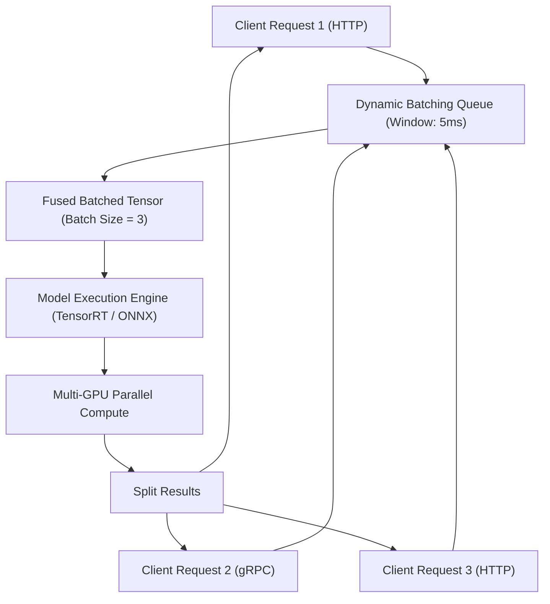

# Triển Khai Mô Hình Thành Dịch Vụ API (Model Serving & High-Performance APIs)

> **Khái niệm chính thống**: *Session 3: Serving Models as a Live API*; NVIDIA Triton Inference Server Architecture; *Encyclopedia of LLMs*, Section 11.2 (Serving Infrastructure).
> **Miền kiến thức**: [[index|Backend Engineering & Inference Serving]]
> **Tài liệu gốc liên quan**:
> - [Session 3_ Serving Models as a Live API.pdf](../resources/ops/Session%203_%20Serving%20Models%20as%20a%20Live%20API.pdf) (Trang 1-29)
> - [AIO2025_MLOps-Tutorial_K8s_Kubeflow_Spark_Streaming_Kafka.pdf](../resources/ops/AIO2025_MLOps-Tutorial_K8s_Kubeflow_Spark_Streaming_Kafka.pdf) (Trang 45-60)
> - [Encyclopedia of LLMs and Foundation Models.pdf](../resources/genai/Encyclopedia%20of%20LLMs%20and%20Foundation%20Models.pdf) (Trang 103-105)

---

## 1. Tóm tắt (Executive Summary)
**Triển khai Mô hình thành Dịch vụ API (Model Serving)** là bước chuyển hóa mô hình học máy từ các tệp nhị phân tĩnh (Artifacts) thành một dịch vụ mạng (Web Service) hoạt động bền bỉ, có khả năng tiếp nhận yêu cầu dự đoán và trả về kết quả qua các giao thức chuẩn (**HTTP REST**, **gRPC**) với độ trễ thấp và độ tin cậy cao. Đối với các tác vụ thông thường, **FastAPI** kết hợp máy chủ bất đồng bộ **Uvicorn** là tiêu chuẩn công nghiệp hiện đại nhờ hiệu năng cao và tự động kiểm thực dữ liệu qua Pydantic. Đối với các hệ thống AI quy mô lớn đòi hỏi thông lượng cao trên GPU, các máy chủ suy luận chuyên dụng như **NVIDIA Triton Inference Server** hoặc **vLLM** được sử dụng để tối ưu hóa việc xếp hàng lô động (**Dynamic Batching**) và tận dụng tối đa phần cứng.

---

## 2. Định nghĩa chính thống & Kiến trúc Máy chủ Suy luận (Inference Server Architecture)

### 2.1 Cơ chế Gom lô Động (Dynamic Batching)
Trong môi trường thực tế, các yêu cầu suy luận từ người dùng gửi tới máy chủ độc lập từng cái một (Batch size = 1):
- *Vấn đề*: Chạy mô hình với Batch size = 1 làm lãng phí 80-90% năng lực tính toán song song khổng lồ của GPU.
- *Giải pháp Dynamic Batching*: Máy chủ giữ một hàng đợi ngắn với cửa sổ thời gian trễ tối đa (ví dụ `max_queue_delay_microseconds = 5000` — 5 mili-giây). Toàn bộ các request gửi tới trong 5ms này được tự động ghép lại thành một Tensor Batch duy nhất để đẩy vào GPU tính toán một lần, sau đó tách kết quả trả về cho từng client riêng biệt.
- *Kết quả*: Tăng thông lượng hệ thống (Throughput - RPS) lên gấp 5-10 lần mà độ trễ chỉ tăng thêm vài mili-giây không đáng kể.

---

## 3. So sánh & Mâu thuẫn / Sắc thái giữa các Framework Serving

| Tiêu chí | Flask (Legacy) | FastAPI + Uvicorn (Chuẩn hiện đại) | NVIDIA Triton Inference Server |
| :--- | :--- | :--- | :--- |
| **Mô hình lập trình** | Đồng bộ (Synchronous / Blocking WSGI). | Bất đồng bộ (**Async / Await ASGI**). | Máy chủ nhị phân viết bằng C++ chuyên dụng cho GPU. |
| **Tốc độ & Thông lượng** | Thấp; dễ bị nghẽn I/O khi chịu tải. | Rất cao cho các bài toán trung bình và I/O-bound. | **Cao nhất (Tối ưu hóa cấp độ phần cứng)**. |
| **Hỗ trợ Dynamic Batching** | Không có (phải tự code hàng đợi). | Phải tự xây dựng qua Redis/Celery. | **Tích hợp sẵn gốc (Native feature)**. |
| **Giao thức mạng** | Chỉ hỗ trợ HTTP/1.1 REST. | HTTP/1.1, WebSockets, Server-Sent Events (SSE). | **Hỗ trợ song song cả HTTP REST và gRPC**. |
| **Đa ngôn ngữ & Đa framework** | Chỉ chạy Python. | Chỉ chạy Python. | Chạy song song PyTorch, TensorFlow, TensorRT, ONNX, vLLM trên cùng 1 server. |

---

## 4. Góc nhìn Thực chiến & Thiết kế Hệ thống cho AI Engineer

### 4.1 Phân biệt CPU-Bound vs I/O-Bound trong FastAPI AI Server
Một sai lầm kinh điển của kỹ sư Python khi viết API cho AI:
- Thao tác mạng/database (đọc file ảnh từ S3, truy vấn Vector DB) là **I/O-Bound**: Viết hàm bất đồng bộ `async def` để luồng event loop không bị khóa.
- Thao tác tính toán mô hình (`model.predict(tensor)`) là **CPU/GPU-Bound**:
  - *Cảnh báo nguy hiểm*: Nếu viết `async def predict(...)` rồi gọi trực tiếp `model(x)` bên trong, luồng Event Loop của FastAPI sẽ bị block đứng hình hoàn toàn trong suốt thời gian GPU tính toán! Toàn bộ các request khác gửi tới server sẽ bị đóng băng.
  - *Giải pháp*: Với tác vụ nặng, định nghĩa hàm đồng bộ `def predict(...)` thông thường (FastAPI sẽ tự động đẩy hàm này ra một thread pool riêng biệt `threadpool`), hoặc sử dụng tiến trình nền phân tán (Celery / RabbitMQ).

### 4.2 Câu hỏi phỏng vấn thực tế
- **Q**: *Tại sao trong các hệ thống suy luận thời gian thực (như giao dịch tài chính hay xe tự hành), giao thức gRPC lại được ưu tiên vượt trội so với HTTP REST JSON?*
  - **A**:
    1. **Định dạng nhị phân siêu nhẹ (Protocol Buffers)**: gRPC tuần tự hóa dữ liệu tensor thành nhị phân thay vì chuỗi văn bản JSON, tiết kiệm băng thông và giảm 70% thời gian đóng gói/giải mã (Serialization overhead).
    2. **HTTP/2 Multiplexing**: Cho phép truyền nhiều luồng dữ liệu song song trên cùng một kết nối TCP duy nhất, loại bỏ việc bắt tay thiết lập kết nối (Head-of-Line blocking) của HTTP/1.1.
    3. **Hỗ trợ Streaming hai chiều (Bidirectional Streaming)**: Rất phù hợp cho các bài toán truyền dữ liệu liên tục như video stream hoặc audio chunking thời gian thực.

---

## 5. Mạng lưới Liên kết Tri thức (Knowledge Graph & `wiki-links`)
- [[mlops-lifecycle]] — Giai đoạn biến đổi từ kịch bản sang dịch vụ API.
- [[inference-optimization-tensorrt]] — Nhân tính toán phía sau các Inference Server hiệu năng cao.
- [[containerization-kubernetes-ml]] — Đóng gói API server vào Docker và scale trên Kubernetes.
- [[continuous-integration-cd-ml]] — Chiến lược triển khai Blue-Green và Canary cho API.