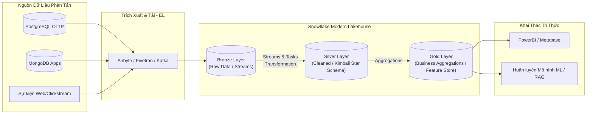
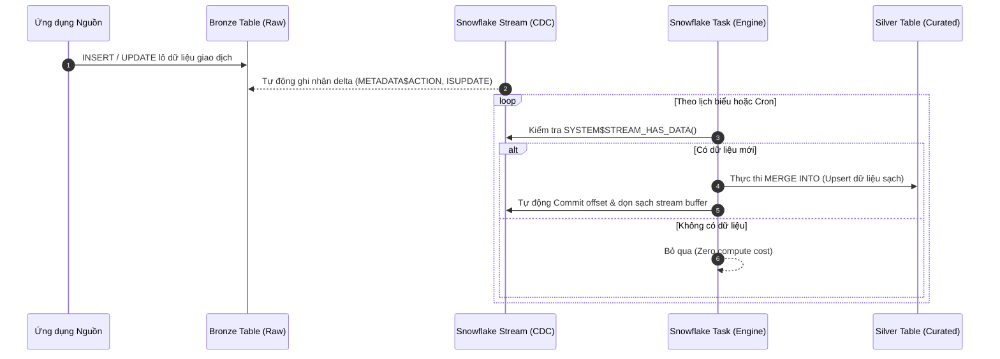

# Kiến Trúc Data Pipeline Hiện Đại & Kho Dữ Liệu (Modern Data Pipeline & Data Warehousing)

> **Tóm tắt điều hành**: Data Pipeline hiện đại đã dịch chuyển từ các chu trình ETL (Extract - Transform - Load) theo lô cứng nhắc sang mô hình ELT (Extract - Load - Transform) linh hoạt trên nền tảng đám mây. Kiến trúc này kết hợp triết lý thiết kế mô hình chiều của Kimball, kiến trúc phân tách lưu trữ - tính toán 3 tầng của Snowflake, mô hình hồ dữ liệu Medallion (Bronze - Silver - Gold), và cơ chế đồng bộ biến động dữ liệu CDC (Change Data Capture) qua Streams & Tasks.

---

## 1. Nền Tảng: OLTP vs OLAP & Mô Hình Hóa Dữ Liệu

Trong hệ thống dữ liệu doanh nghiệp, sự phân định ranh giới giữa giao dịch vận hành và phân tích chiến lược là bất biến:

| Đặc tính | OLTP (Online Transaction Processing) | OLAP (Online Analytical Processing) |
| :--- | :--- | :--- |
| **Mục đích** | Xử lý giao dịch tác nghiệp hàng ngày (CRUD) | Phân tích dữ liệu lịch sử, báo cáo BI, đào tạo ML |
| **Bản chất truy vấn** | Đọc/ghi đơn dòng, độ trễ cực thấp (< 10ms) | Quét hàng triệu/tỷ dòng, tính toán tổng hợp (SUM, AVG, GROUP BY) |
| **Cấu trúc lưu trữ** | Ghi theo dòng (Row-oriented: PostgreSQL, MySQL) | Ghi theo cột (Columnar: Snowflake, Parquet, ClickHouse) |
| **Thiết kế schema** | Chuẩn hóa cao (3NF - Third Normal Form) tránh dư thừa | Phi chuẩn hóa (Star Schema, Snowflake Schema) tối ưu tốc độ đọc |
| **Mức độ sẵn sàng** | Nghiêm ngặt ACID, khóa bi quan/lạc quan theo dòng | Tính toán theo lô (Batch) hoặc vi lô (Micro-batch), snapshot ACID |



### Cuộc Tranh Luận Kinh Điển: Inmon vs Kimball

1. **Bill Inmon (Corporate Information Factory - CIF)**:
   - Tiếp cận **Top-down**: Dữ liệu từ các nguồn được đổ về một Enterprise Data Warehouse (EDW) duy nhất ở dạng chuẩn hóa cấp 3 (3NF).
   - Từ EDW, các Data Mart phụ trợ được trích xuất phục vụ từng phòng ban.
   - *Ưu điểm*: Nguồn chân lý duy nhất (Single Source of Truth), tính nhất quán toàn diện, không trùng lặp dữ liệu.
   - *Nhược điểm*: Chi phí xây dựng ban đầu khổng lồ, thời gian hoàn thiện kéo dài hàng năm, thiếu linh hoạt trước yêu cầu nghiệp vụ thay đổi nhanh.

2. **Ralph Kimball (Dimensional Modeling - Mô hình Chiều)**:
   - Tiếp cận **Bottom-up**: Xây dựng kho dữ liệu trực tiếp từ các Data Mart theo mô hình chiều (Star Schema / Snowflake Schema) thông qua các **Conformed Dimensions** (chiều dùng chung như `Dim_Date`, `Dim_Customer`).
   - Gồm 2 thực thể cốt lõi:
     - **Fact Table (Bảng Sự kiện)**: Chứa các đại lượng đo lường định lượng (metrics: doanh thu, số lượng, thời gian phản hồi) và các khóa ngoại (Foreign Keys) trỏ tới các chiều. Dữ liệu tăng liên tục theo thời gian, có tính chất chắp thêm (append-only).
     - **Dimension Table (Bảng Chiều)**: Chứa thông tin ngữ cảnh định tính (who, what, where, when) dùng để lọc, phân nhóm và gắn nhãn. Thay đổi chậm theo thời gian qua các kỹ thuật SCD (Slowly Changing Dimensions Type 1/2/3).
   - *Ưu điểm*: Tối ưu hóa tuyệt đối cho các câu lệnh JOIN và GROUP BY của OLAP, người dùng kinh doanh dễ hiểu, triển khai nhanh từng giai đoạn.
   - *Thực tế*: 90% Data Warehouse và Lakehouse hiện đại (bao gồm Snowflake và Databricks) áp dụng tư tưởng mô hình hóa chiều của Kimball cho tầng Silver và Gold.

---

## 2. Kiến Trúc Snowflake 3 Tầng (Three-Tier Cloud Architecture)

Khác biệt cốt lõi của Snowflake so với các hệ thống MPP truyền thống (như Teradata, Amazon Redshift đời đầu) là việc **tách rời hoàn toàn giữa Lưu Trữ (Storage) và Tính Toán (Compute)**:

```mermaid
graph TD
    subgraph Layer3 [3. Cloud Services Layer - Não Bộ Điều Khiển]
        CS1[Xác thực & Bảo mật RBAC]
        CS2[Trình Tối ưu Hóa Truy vấn SQL]
        CS3[Quản lý Metadata & Transaction ACID]
        CS4[Quản lý Khóa Mã Hóa E2E]
    end

    subgraph Layer2 [2. Virtual Warehouse Compute Layer - Cơ Bắp Tính Toán]
        VW1[Warehouse BI - Size XS\n(PowerBI / Ad-hoc Queries)]
        VW2[Warehouse ELT - Size L\n(Streams & Tasks Data Load)]
        VW3[Warehouse ML - Size XL\n(Feature Engineering / Training)]
    end

    subgraph Layer1 [1. Centralized Storage Layer - Kho Dữ Liệu Bất Biến]
        S3[(AWS S3 / GCP Storage / Azure Blob)]
        MP1[Micro-partition 1\n(Columnar Pax)]
        MP2[Micro-partition 2\n(Compressed ZSTD)]
        MP3[Micro-partition 3\n(Encrypted)]
    end

    Layer3 --> Layer2
    Layer2 --> Layer1
```

### Chi Tiết 3 Tầng Kiến Trúc:

1. **Database Storage Layer (Lưu trữ tập trung)**:
   - Toàn bộ dữ liệu được lưu trên Cloud Object Storage (AWS S3, Azure Blob, GCS).
   - Dữ liệu được tổ chức thành các **Micro-partitions**: Mỗi partition có kích thước nén từ 50MB đến 500MB, lưu trữ theo định dạng cột lai (hybrid columnar/PAX), được mã hóa tự động bằng AES-256.
   - Tính bất biến (Immutable): Khi có lệnh UPDATE hay DELETE, Snowflake không sửa đè file cũ mà ghi một micro-partition mới và cập nhật con trỏ metadata.
2. **Query Processing Layer (Virtual Warehouses - Tính toán)**:
   - Các cụm máy tính độc lập (Virtual Warehouses) thực hiện các tác vụ biên dịch và thực thi câu lệnh SQL.
   - **Đặc tính độc lập tài nguyên**: Một warehouse chạy ETL khối lượng lớn không làm ảnh hưởng đến hiệu năng của warehouse phục vụ báo cáo BI hay trích xuất đặc trưng ML.
   - Tự động co giãn (Auto-scaling & Auto-suspend): Khởi động trong vài giây và tự động tạm dừng khi không có query, tối ưu chi phí hạ tầng.
3. **Cloud Services Layer (Dịch vụ đám mây)**:
   - Bộ não điều khiển toàn hệ thống: xử lý xác thực (Authentication), kiểm soát quyền truy cập (RBAC), tối ưu hóa truy vấn (Query Optimizer), quản lý metadata của từng micro-partition (min/max values, distinct count, null count) phục vụ **Partition Pruning**.

---

## 3. Các Tính Năng Đột Phá Cho AI & Data Engineering

### 3.1. Zero-Copy Cloning
- Cho phép tạo bản sao tức thời của một Database, Schema hoặc Table mà **không nhân bản dữ liệu vật lý**:
  ```sql
  CREATE DATABASE production_clone CLONE production_db;
  ```
- *Cơ chế*: Snowflake chỉ sao chép con trỏ metadata trỏ tới các micro-partition sẵn có tại thời điểm clone. Khi môi trường clone thực hiện thao tác ghi (Write), cơ chế **Copy-on-Write (CoW)** sẽ sinh micro-partition mới chỉ chứa phần khác biệt.
- *Ứng dụng*: Cho phép Data Scientist và AI Engineer tạo môi trường Staging/Dev từ dữ liệu Production thực tế 100TB trong 3 giây với chi phí lưu trữ ban đầu bằng $0.

### 3.2. Time Travel & Fail-safe
- **Time Travel**: Cho phép truy vấn, khôi phục bảng dữ liệu tại một thời điểm chính xác trong quá khứ (lên tới 90 ngày với Enterprise Edition):
  ```sql
  -- Truy vấn bảng tại thời điểm 15 phút trước
  SELECT * FROM transactions AT(OFFSET => -60*15);

  -- Truy vấn bảng trước khi một câu lệnh SQL tai hại được thực thi
  SELECT * FROM customers BEFORE(STATEMENT => '01b7a2d4-0001-2a9c-0000-00001234abcd');
  ```
- **Fail-safe**: 7 ngày lưu trữ dự phòng không thể truy vấn bởi người dùng, chỉ đội ngũ Snowflake Support mới có quyền khôi phục khi xảy ra thảm họa phần cứng.

### 3.3. Bảo Mật Cấp Cột & Dynamic Data Masking
- Ẩn thông tin định danh cá nhân (PII: thẻ tín dụng, CCCD, email) dựa trên role của người dùng mà không cần nhân bản bảng dữ liệu:
  ```sql
  CREATE OR REPLACE MASKING POLICY email_mask AS (val string) 
  RETURNS string ->
      CASE 
          WHEN CURRENT_ROLE() IN ('COMPLIANCE_OFFICER', 'ADMIN') THEN val
          ELSE REGEXP_REPLACE(val, '^.*@', '****@')
      END;

  ALTER TABLE dim_customers MODIFY COLUMN email SET MASKING POLICY email_mask;
  ```

---

## 4. Xây Dựng Medallion Pipeline Tự Động Hóa Với Streams & Tasks

Để vận hành kiến trúc hồ dữ liệu Medallion (Bronze $\to$ Silver $\to$ Gold) theo cơ chế sự kiện (Event-driven CDC):



### Mã Nguồn Triển Khai Thực Chiến (Production SQL):

```sql
-- 1. Bảng Bronze: Tiếp nhận dữ liệu thô
CREATE OR REPLACE TABLE bronze_orders (
    raw_id VARCHAR,
    customer_id VARCHAR,
    amount NUMBER(12, 2),
    status VARCHAR,
    ingested_at TIMESTAMP_NTZ DEFAULT CURRENT_TIMESTAMP()
);

-- 2. Khởi tạo Stream ghi nhận CDC trên Bronze
CREATE OR REPLACE STREAM bronze_orders_stream ON TABLE bronze_orders;

-- 3. Bảng Silver: Chuẩn hóa theo mô hình Kimball
CREATE OR REPLACE TABLE silver_fact_orders (
    order_id VARCHAR PRIMARY KEY,
    customer_key VARCHAR,
    order_amount NUMBER(12, 2),
    order_status VARCHAR,
    valid_flag BOOLEAN,
    updated_at TIMESTAMP_NTZ
);

-- 4. Snowflake Task: Tự động biến đổi và Upsert vào Silver
CREATE OR REPLACE TASK process_orders_cdc_task
    WAREHOUSE = 'COMPUTE_WH'
    SCHEDULE = 'USING CRON */5 * * * * Asia/Ho_Chi_Minh'
    WHEN SYSTEM$STREAM_HAS_DATA('bronze_orders_stream')
AS
MERGE INTO silver_fact_orders target
USING (
    SELECT 
        raw_id AS order_id,
        customer_id AS customer_key,
        amount AS order_amount,
        status AS order_status,
        IFF(amount > 0 AND status IS NOT NULL, TRUE, FALSE) AS valid_flag,
        CURRENT_TIMESTAMP() AS updated_at,
        METADATA$ACTION AS cdc_action,
        METADATA$ISUPDATE AS cdc_is_update
    FROM bronze_orders_stream
) source
ON target.order_id = source.order_id
WHEN MATCHED AND source.cdc_action = 'DELETE' THEN
    DELETE
WHEN MATCHED AND source.cdc_action = 'INSERT' AND source.cdc_is_update THEN
    UPDATE SET 
        target.order_amount = source.order_amount,
        target.order_status = source.order_status,
        target.valid_flag = source.valid_flag,
        target.updated_at = source.updated_at
WHEN NOT MATCHED AND source.cdc_action = 'INSERT' THEN
    INSERT (order_id, customer_key, order_amount, order_status, valid_flag, updated_at)
    VALUES (source.order_id, source.customer_key, source.order_amount, source.order_status, source.valid_flag, source.updated_at);

-- Kích hoạt Task
ALTER TASK process_orders_cdc_task RESUME;
```

---

## 5. Cổng Kiểm Soát Chất Lượng Dữ Liệu (Data Quality Gates)

Một Data Pipeline phục vụ AI/ML tuyệt đối không được để "Rác vào - Rác ra" (Garbage In - Garbage Out). Cần thiết lập 3 cổng kiểm soát:
1. **Schema Quality Gate**: Kiểm tra ràng buộc Schema Drift (cột mới, đổi kiểu dữ liệu).
2. **Semantic Quality Gate**: Kiểm định tính logic nghiệp vụ (Số tiền không âm, ngày đặt hàng không lớn hơn ngày hiện tại, email đúng regex).
3. **Statistical Quality Gate**: Phát hiện [[data-drift-model-monitoring|Data Drift]], tỷ lệ missing values vượt ngưỡng cho phép (e.g. > 5% báo động tới Slack/PagerDuty).

---

## 6. Mạng Lưới Liên Kết Thực Thể (Wiki Links)

- [[sql-vs-nosql-data-architecture]] — So sánh lưu trữ Hàng vs Cột, kiến trúc Lakehouse.
- [[apache-iceberg]] — Đi sâu kiến trúc Open Table Format, Pruning 3 cấp độ và Hidden Partitioning.
- [[acid-and-transactions]] — Bản chất các cấp độ cô lập ACID và giải quyết xung đột đồng thời.
- [[database-indexing-optimization]] — Tối ưu hóa truy vấn SQL và cấu trúc B+Tree.
- [[data-drift-model-monitoring]] — Giám sát chất lượng dữ liệu và trôi dạt phân phối cho mô hình ML.
