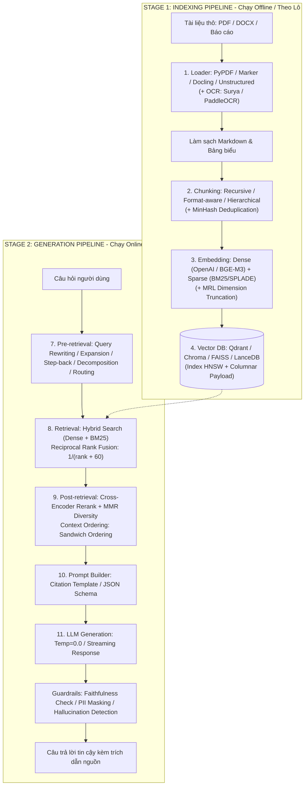
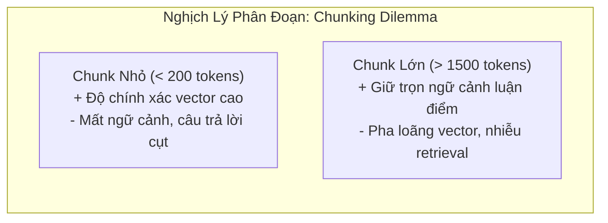
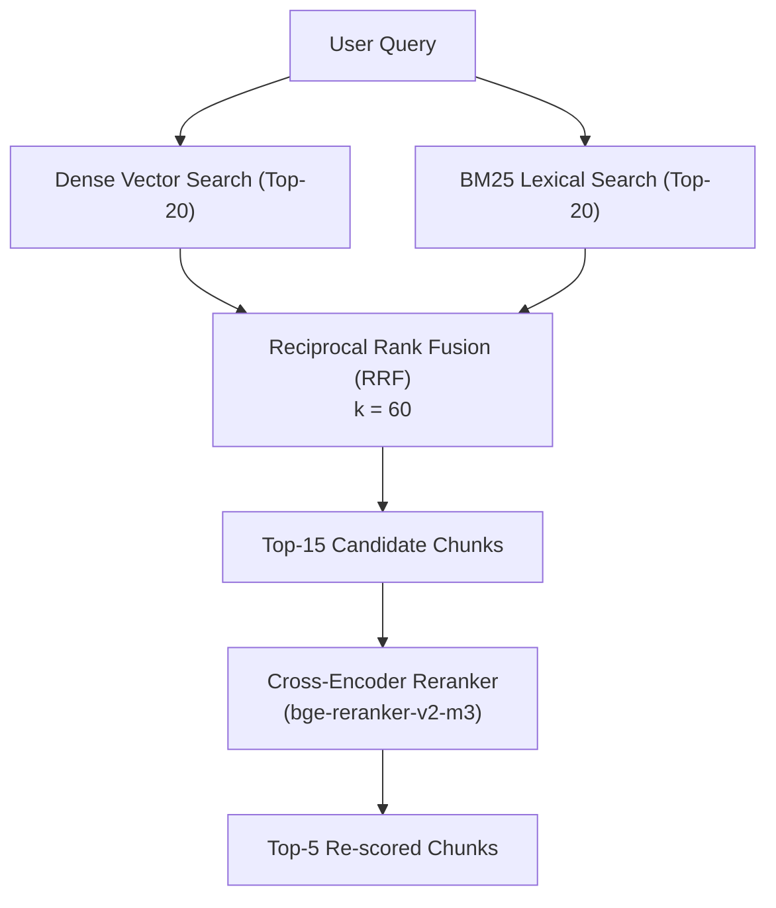
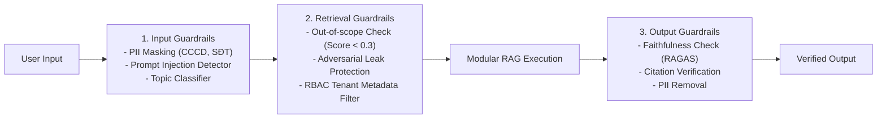
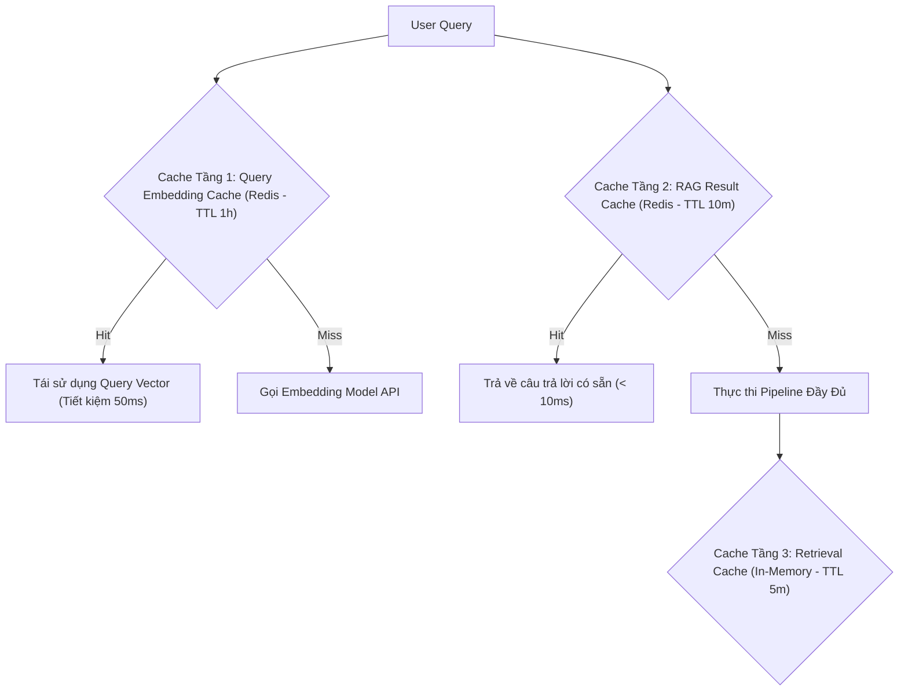

# Kiến Trúc Modular RAG & Kỹ Nghệ Triển Khai Thực Chiến (Modular RAG & Production Guardrails)

> **Tóm tắt điều hành**: Modular RAG là kiến trúc tách rời (Decoupled Architecture) toàn diện quy trình Tìm kiếm Tăng cường Tạo sinh thành hai giai đoạn độc lập: **Stage 1 - Indexing (Offline)** và **Stage 2 - Generation (Online)**. Kiến trúc này tối ưu hóa từng mắt xích thông qua các bộ chuyển đổi tài liệu đa thể thức (Document Loaders & OCR), 7 chiến lược phân đoạn nâng cao (Chunking), biểu diễn véc-tơ đa kích thước (MRL) kết hợp từ khóa (BM25/SPLADE), thuật toán dung hợp thứ hạng RRF ($\sum \frac{1}{\text{rank}+60}$), bộ tái sắp xếp Cross-Encoder giải quyết hiện tượng Lost-in-the-Middle bằng Sandwich Ordering, và hệ thống phòng vệ 3 lớp (Input/Output/Retrieval Guardrails).

---

## 1. Bản Đồ Quy Trình Hai Giai Đoạn (Two-Stage Decoupled Pipeline)

---

## 2. Stage 1 — Kỹ Nghệ Indexing & Tiền Xử Lý Dữ Liệu

Chất lượng câu trả lời của RAG bị chặn trên bởi chất lượng phân tích tài liệu ở bước Indexing (Garbage In - Garbage Out):

### 2.1. Đánh Đổi Giữa Các Bộ Nạp Tài Liệu (Document Loaders & OCR)

| Bộ Nạp (Loader) | Cơ Chế Hoạt Động | Điểm Mạnh | Hạn Chế / Rủi Ro | Use Case Phù Hợp |
| :--- | :--- | :--- | :--- | :--- |
| **PyPDF** | Đọc trực tiếp text layer của PDF | Siêu nhanh (vài giây/100 trang), nhẹ RAM, offline | Bỏ qua ảnh scan, bảng bị nát thành chuỗi lộn xộn | Hợp đồng văn bản thuần, báo cáo prose đơn giản |
| **PyMuPDF (fitz)** | Render PDF engine, trích xuất text kèm tọa độ $(x,y)$ | Nhanh, trích xuất metadata phong phú (font, vị trí), render ảnh | Bảng biểu phức tạp vẫn khó định dạng | Tài liệu có bố cục 2 cột, cần metadata tọa độ |
| **PDFPlumber** | Phân tích đường kẻ ngang/dọc và căn lề | Nhận diện và xuất bảng ra Markdown table chuẩn xác | Chậm gấp 3-5 lần PyPDF, khó xử lý bảng không viền (borderless) | Báo cáo tài chính, bảng cân đối kế toán |
| **Marker** ⭐ | Vision model sâu phân tích layout, OCR và công thức | Chất lượng Markdown tuyệt hảo, công thức $\to$ LaTeX, bảng chuẩn | Chậm (10-30x), cần tải model ~1.5GB, cần GPU | Luận văn học thuật, tài liệu kỹ thuật toán/lý |
| **Docling (IBM)** | Model TableFormer chuyên biệt cho bảng biểu | Rất mạnh về nhận diện cấu trúc phân tầng, xuất JSON/Markdown | Tải model ~2-3GB, cấu hình phức tạp | Tài liệu doanh nghiệp hỗn hợp (PDF, Word, PPTX) |
| **Unstructured** | Pipeline ETL trích xuất đa thể thức | Nhận diện 20+ định dạng file, tích hợp OCR mạnh mẽ | Chậm nhất, cần cài Tesseract/Poppler hệ thống | Kho dữ liệu hỗn hợp scan + bản chụp di động |

### 2.2. Chiến Lược Phân Đoạn (Chunking Strategies & Trade-offs)

1. **Recursive Character Chunking**: Cắt theo danh sách separator ưu tiên: `["\n\n", "\n", ". ", " ", ""]`. Giữ nguyên ranh giới đoạn văn, không bao giờ cắt giữa từ. Luôn kèm **10-15% Chunk Overlap** để chống đứt đoạn thông tin ranh giới.
2. **Format-aware Chunking**: Tận dụng cú pháp Markdown (`#`, `##`, `###`) do Marker/Docling sinh ra để chia chunk theo từng tiểu mục (Section). Code block và Table được giữ nguyên khối, không bị băm nhỏ.
3. **Semantic Chunking**: Chia văn bản thành các câu đơn lẻ, embed từng câu và tính Cosine Similarity giữa các câu liền kề. Khi độ tương đồng sụt giảm đột ngột vượt ngưỡng (Breakpoint), hệ thống xác định đó là điểm chuyển chủ đề và tách chunk.
4. **Hierarchical / Parent-Child Chunking**:
   - Tạo **Parent Chunk** lớn (1.500 ký tự) lưu trữ tại Document Store.
   - Cắt Parent thành 3-4 **Child Chunks** nhỏ (300-400 ký tự) lưu tại Vector DB kèm metadata `parent_id`.
   - *Lúc truy vấn*: Tìm kiếm vector bằng Child Chunk (độ chính xác cao), nhưng nạp Parent Chunk vào LLM (đủ ngữ cảnh).
5. **Contextual Chunking (Anthropic, 2024)**: Dùng LLM tiền xử lý để tạo một đoạn mô tả ngữ cảnh ngắn gắn vào đầu mỗi chunk trước khi embed (ví dụ: `"[Từ tài liệu Hợp đồng A, Điều 5 về Phí Dịch Vụ] Chunk text..."`). Cải thiện Retrieval Recall tới **+49%**.
6. **MinHash Deduplication**: Sử dụng thuật toán MinHash/LSH để loại bỏ các chunk trùng lặp (header/footer, bản quyền, mẫu biểu hành chính) trước khi embed, giảm kích thước Vector DB và tránh lãng phí context window.

---

## 3. Không Gian Nhúng: Dense, Sparse & MRL

### 3.1. Phối Hợp Đa Dạng Không Gian Vector
- **Dense Embedding**: Biểu diễn ngữ nghĩa tổng quát (Semantic). Hỗ trợ nắm bắt ý niệm tương đồng dù dùng từ khác nhau ("xe hơi" $\approx$ "ô tô"). Các model hàng đầu: `text-embedding-3-small/large` (OpenAI), `bge-m3` (BAAI), `Qwen3-Embedding-4B`.
- **Sparse Embedding (BM25 / SPLADE)**: Biểu diễn từ khóa chính xác (Lexical). Bắt trọn các thực thể tên riêng, mã hợp đồng, số hiệu, mã SKU hoặc thuật ngữ viết tắt mà Dense Embedding thường bỏ sót.
- **MRL (Matryoshka Representation Learning)**: Cho phép cắt ngắn kích thước vector (ví dụ từ 1.536 chiều xuống 512 chiều) mà vẫn giữ lại ~92% chất lượng tìm kiếm, giúp giảm 3 lần chi phí lưu trữ RAM/Disk và tăng tốc độ tìm kiếm vector lên 3 lần.

---

## 4. Stage 2 — Kỹ Nghệ Generation, Reranking & Tối Ưu Ngữ Cảnh

### 4.1. Tiền Truy Vấn (Pre-retrieval Query Transformation)
- **Query Rewriting**: LLM sửa lỗi chính tả, mở rộng câu hỏi cụt, giải quyết đại từ chỉ định ("cái đó hoạt động ra sao?" $\to$ "Kiến trúc của Snowflake Virtual Warehouse hoạt động ra sao?").
- **Step-back Prompting**: Tạo câu hỏi khái quát hơn để truy xuất kiến thức nền tảng trước khi trả lời câu hỏi hẹp chi tiết.
- **Query Decomposition**: Bẻ câu hỏi phức tạp nhiều thực thể thành các truy vấn con độc lập (Sub-queries), truy xuất song song và tổng hợp kết quả.

### 4.2. Truy Vấn Lai & Hợp Nhất Xếp Hạng RRF (Reciprocal Rank Fusion)
Thay vì cộng dồn điểm thô (Raw Scores) vốn khác biệt về mặt phân phối giữa Dense (Cosine $[0, 1]$) và Sparse (BM25 $[0, \infty)$), giải thuật **RRF** sử dụng vị trí thứ hạng (Rank):

$$\text{RRF\_Score}(d) = \sum_{m \in \{\text{Dense}, \text{Sparse}\}} \frac{1}{k + \text{rank}_m(d)}$$

Với hằng số làm mịn chuẩn mực $k = 60$.

### 4.3. Tái Xếp Hạng (Reranking) & Hiện Tượng Lost-in-the-Middle

1. **Cross-Encoder Reranker**: Đọc đồng thời cặp `(Query, Chunk)` qua cơ chế Full Self-Attention, mang lại độ chính xác vượt trội hơn hẳn Bi-Encoder (vốn embed độc lập).
2. **Hiện tượng Lost-in-the-Middle (Liu et al., 2023)**: LLM có xu hướng chú ý cao vào **phần đầu** và **phần cuối** của Context Window, và dễ dàng bỏ sót các thông tin quan trọng nằm ở chính giữa.
3. **Sandwich Ordering (Sắp xếp Bánh Mì Kẹp)**:
   - Sắp xếp thứ tự các chunk trong prompt nạp vào LLM theo quy tắc:
     $$\text{Prompt Context} = [\text{Chunk Rank 1 (Tốt nhất)}, \text{Chunk Rank 3}, \dots, \text{Chunk Rank 4}, \text{Chunk Rank 2 (Tốt nhì)}]$$
   - Đảm bảo 2 thông tin quan trọng nhất luôn nằm tại 2 điểm neo chú ý cực đại của mô hình.

---

## 5. Kiến Trúc Phòng Vệ Ba Lớp Cho Production (Production Guardrails)

1. **Input Guardrails**:
   - *PII Detection*: Nhận diện tên, số CCCD, thẻ ngân hàng qua NER/Regex để ẩn danh hóa (anonymize) trước khi gửi vào Vector DB hoặc gọi API LLM.
   - *Prompt Injection Defense*: Kiểm tra các tiền tố phá vỡ hệ thống (`"Ignore previous instructions"`), giới hạn độ dài câu hỏi (< 2.000 ký tự).
2. **Retrieval Guardrails**:
   - *Out-of-scope Detection*: Nếu toàn bộ điểm tương đồng lớn nhất của các chunk $\max(\text{score}) < 0.3$, hệ thống kích hoạt kịch bản ngắt: *"Thông tin này nằm ngoài phạm vi tài liệu được cung cấp"* mà không cần gọi LLM sinh chữ.
   - *RBAC Metadata Filtering*: Bắt buộc bổ sung điều kiện truy vấn `filter={"tenant_id": user.tenant_id, "access_level": {"$lte": user.level}}` ở cấp độ Vector DB để triệt tiêu nguy cơ rò rỉ dữ liệu giữa các phòng ban.
3. **Output Guardrails & Faithfulness Verification**:
   - Sử dụng các thước đo **RAGAS** (Retrieval Augmented Generation Assessment):
     - **Faithfulness (0 - 1)**: Đánh giá xem từng luận điểm (claim) trong câu trả lời có bằng chứng xác thực nằm trong context hay không. Nếu $\text{Faithfulness} < 0.8$, cảnh báo ảo giác (hallucination).
     - **Answer Relevancy (0 - 1)**: Đánh giá câu trả lời có giải quyết đúng trọng tâm câu hỏi người dùng hay không.
     - **Context Recall (0 - 1)**: Kiểm tra tài liệu được truy xuất có chứa đủ thông tin để trả lời trọn vẹn không.

---

## 6. Chiến Lược Cache 3 Tầng & Ngân Sách Độ Trễ (Latency Budget)

Trong hệ thống phục vụ hàng nghìn người dùng đồng thời, thời gian phản hồi mục tiêu phải dưới 2.5 giây:

| Thành Phần Pipeline | Thời Gian Ước Tính | Chiến Lược Tối Ưu Hóa |
| :--- | :--- | :--- |
| **Pre-retrieval (Rewrite)** | ~ 500 - 800 ms | Chỉ bật khi phát hiện câu hỏi quá ngắn hoặc có đại từ |
| **Query Embedding** | ~ 50 ms | Cache Redis câu hỏi phổ biến, dùng model kích thước nhỏ |
| **Vector DB Search** | ~ 20 - 40 ms | Đánh chỉ mục HNSW, lưu trữ bộ nhớ RAM, MRL 512 dims |
| **Cross-Encoder Rerank** | ~ 150 - 250 ms | Chỉ rerank Top-15 xuống Top-5, chạy trên CPU tối ưu ONNX |
| **Prompt Assembly** | ~ 5 ms | Ghép chuỗi bộ nhớ đệm |
| **LLM Generation** | ~ 1.000 - 1.500 ms | Kích hoạt Streaming SSE, đặt `temperature = 0.0` |
| **Tổng Thời Gian (End-to-End)** | **~ 1.7 - 2.5 giây** | Trải nghiệm mượt mà, từ đầu tiên hiển thị sau < 800ms |

---

## 7. Mạng Lưới Liên Kết Thực Thể (Wiki Links)

- [[rag-architecture]] — Kiến trúc 4 thế hệ RAG và bài toán nền tảng lý thuyết Lewis et al.
- [[document-chunking]] — Các kỹ thuật phân đoạn tài liệu và giải quyết xung đột ranh giới.
- [[vector-embeddings]] — Không gian vector, khoảng cách Cosine và thuật toán HNSW.
- [[hybrid-search]] — Phối hợp chi tiết giữa Dense Vector và giải thuật BM25/RRF.
- [[reranking]] — Cơ chế hoạt động của Cross-Encoder và mô hình hai tầng Two-Stage Retrieval.
- [[query-transformation]] — Các phương pháp biến đổi truy vấn nâng cao (HyDE, Sub-queries).
- [[llm-evaluation]] — Đánh giá hệ thống RAG và LLM qua Ragas và LLM-as-a-Judge.
