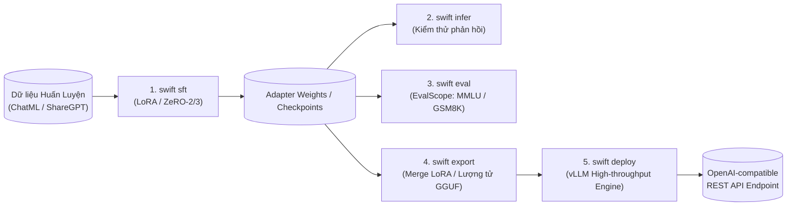
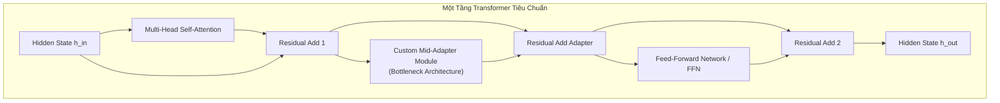

# Tinh Chỉnh Mô Hình Ngôn Ngữ Lớn Với MS-SWIFT (Enterprise LLM Fine-Tuning)

> **Tóm tắt điều hành**: MS-SWIFT (ModelScope Swift) là framework mã nguồn mở cấp doanh nghiệp của Alibaba, chuẩn hóa toàn bộ vòng đời tinh chỉnh và triển khai Large Language Models (LLMs) và Multi-modal Models (MLLMs). Framework này tích hợp quy trình 5 bước khép kín (`sft` $\to$ `infer` $\to$ `eval` $\to$ `export` $\to$ `deploy`), hỗ trợ huấn luyện phân tán (DDP, DeepSpeed ZeRO-2/3, FSDP), các kỹ thuật PEFT tiên tiến (LoRA, QLoRA, DoRA), và cho phép can thiệp vào tầng sâu kiến trúc mô hình (như kỹ thuật chèn `mid_adapter` với khởi tạo trọng số 0) thông qua hệ thống plugin registry và Hugging Face `auto_map`.

---

## 1. Vòng Đời Tinh Chỉnh Mô Hình Khép Kín Của MS-SWIFT

MS-SWIFT giải quyết tình trạng phân mảnh công cụ trong cộng đồng mã nguồn mở bằng cách cung cấp một bộ công cụ dòng lệnh (CLI) thống nhất:



### Chi Tiết 5 Giai Đoạn Vận Hành:

1. **`swift sft` (Supervised Fine-Tuning)**:
   - Tự động nạp Chat Template tương ứng với từng họ mô hình (Qwen, LLaMA, Mistral, DeepSeek).
   - Tối ưu hóa bộ nhớ với FlashAttention-2, gradient checkpointing và kỹ thuật đóng gói token (packing).
2. **`swift infer` (Thử nghiệm tương tác)**:
   - Chạy suy luận dòng lệnh hoặc giao diện Web UI tức thì để đánh giá định tính chất lượng phản hồi sau mỗi checkpoint.
3. **`swift eval` (Đánh giá định lượng chuẩn mực)**:
   - Tích hợp trực tiếp với **EvalScope**, tự động chạy benchmark trên các tập kiểm thử quốc tế: GSM8K (toán học), MMLU (kiến thức tổng hợp), HumanEval (mã nguồn), ARC, CEval.
4. **`swift export` (Đóng gói & Hợp nhất trọng số)**:
   - Hợp nhất ma trận LoRA $\Delta W = A \cdot B$ vào ma trận gốc $W$ để triệt tiêu phụ trội độ trễ (Zero inference latency overhead).
   - Lượng tử hóa sang AWQ, GPTQ (GPU) hoặc GGUF (CPU/Edge).
5. **`swift deploy` (Triển khai sản xuất)**:
   - Khởi chạy server API chuẩn tương thích OpenAI (`/v1/chat/completions`) sử dụng backend suy luận hiệu năng cao **vLLM**, tự động hỗ trợ PagedAttention và Continuous Batching.

---

## 2. Chuẩn Hóa Dữ Liệu & Chat Template (ChatML)

Định dạng hội thoại nhiều lượt (Multi-turn conversation) được chuẩn hóa theo định dạng ChatML:

```json
[
  {
    "messages": [
      {"role": "system", "content": "Bạn là một trợ lý toán học thông minh."},
      {"role": "user", "content": "Một hình chữ nhật có chu vi 30cm, chiều dài hơn chiều rộng 5cm. Tính diện tích?"},
      {"role": "assistant", "content": "Nửa chu vi là: 30 / 2 = 15 cm.\nChiều rộng: (15 - 5) / 2 = 5 cm.\nChiều dài: 5 + 5 = 10 cm.\nDiện tích: 10 * 5 = 50 cm²."}
    ]
  }
]
```

*Nuance kiến trúc*: MS-SWIFT tự động nhận diện token đặc biệt (`<|im_start|>`, `<|im_end|>`) và chỉ tính toán hàm mất mát Cross-Entropy trên các token thuộc lượt trả lời của `assistant` (Loss Masking), hoàn toàn bỏ qua các token của `system` và `user`.

---

## 3. Huấn Luyện Phân Tán: DDP vs DeepSpeed ZeRO-2/3

Khi tinh chỉnh mô hình từ 7B đến 70B tham số, một GPU không thể chứa đủ trọng số và trạng thái tối ưu (Optimizer States):

### 3.1. Toán Học Về Kích Thước Batch Hiệu Dụng
Kích thước batch thực tế tác động lên gradient được tính theo công thức:
$$\text{Effective Batch Size} = \text{per\_device\_batch\_size} \times \text{gradient\_accumulation\_steps} \times N_{\text{GPUs}}$$
- Khi tài nguyên VRAM hạn chế, ta giảm `per_device_batch_size` xuống $1$ hoặc $2$, đồng thời tăng `gradient_accumulation_steps` để duy trì kích thước batch ổn định nhằm đảm bảo gradient không bị dao động nhiễu.

### 3.2. So Sánh Các Chế Độ Phân Tán

| Tiêu chí | DDP (PyTorch Data Parallel) | DeepSpeed ZeRO-2 | DeepSpeed ZeRO-3 |
| :--- | :--- | :--- | :--- |
| **Phân mảnh Optimizer States** | Không (Nhân bản trên mọi GPU) | **Có** (Chia đều cho các GPU) | **Có** (Chia đều cho các GPU) |
| **Phân mảnh Gradients** | Không | **Có** (Chia đều) | **Có** (Chia đều) |
| **Phân mảnh Model Weights** | Không | Không | **Có** (Chia đều trọng số) |
| **Băng thông mạng đòi hỏi** | Thấp (AllReduce gradients) | Trung bình | Rất cao (AllGather liên tục lúc forward & backward) |
| **Phù hợp nhất khi** | Fine-tune LoRA cho model 7B-14B | LoRA/Full-FT model 14B-32B | Full Fine-Tuning model > 32B |

```bash
# Ví dụ lệnh chạy SFT với LoRA trên 4 GPU dùng DeepSpeed ZeRO-2
NPROC_PER_NODE=4 swift sft \
    --model_type qwen2_5-7b-instruct \
    --dataset my_dataset.json \
    --train_type lora \
    --lora_rank 16 \
    --lora_alpha 32 \
    --deepspeed default-zero2 \
    --per_device_train_batch_size 2 \
    --gradient_accumulation_steps 8 \
    --learning_rate 1e-4 \
    --output_dir output/qwen2_5_lora
```

---

## 4. Kỹ Thuật Can Thiệp Sâu Kiến Trúc: Mid-Adapter Injection

Một trong những bài toán phức tạp trong nghiên cứu và ứng dụng công nghiệp là **chèn thêm các khối xử lý tùy chỉnh (Custom Modules)** vào bên trong các tầng Transformer có sẵn mà không phá vỡ khả năng hiểu ngôn ngữ của mô hình gốc.



### 4.1. Cấu Trúc Khối Mid-Adapter
Khối Adapter thường được thiết kế theo dạng nút cổ chai (Bottleneck):
$$\text{Adapter}(h) = W_{\text{up}} \cdot \text{GELU}(W_{\text{down}} \cdot h)$$
Trong đó:
- $W_{\text{down}} \in \mathbb{R}^{d_{\text{model}} \times d_{\text{mid}}}$: Ma trận chiếu giảm chiều.
- $W_{\text{up}} \in \mathbb{R}^{d_{\text{mid}} \times d_{\text{model}}}$: Ma trận chiếu tăng trở lại chiều ban đầu.

### 4.2. Nguyên Lý Vàng: Khởi Tạo Trọng Số Bằng 0 (Zero-Initialization)
> [!CRITICAL]
> Nếu khởi tạo ngẫu nhiên cả $W_{\text{down}}$ và $W_{\text{up}}$ bằng phân phối Gaussian thông thường, tại bước huấn luyện $0$ (step 0), đầu ra của tầng Transformer sẽ bị thay đổi đột ngột:
> $$h_{\text{adapted}} = h + \text{Noise}$$
> Sự sai lệch này lan truyền qua hàng chục tầng Transformer sẽ phá hủy hoàn toàn biểu diễn ngôn ngữ đã học của mô hình (Catastrophic Forgetting).

**Giải pháp chuẩn xác**:
1. Khởi tạo $W_{\text{down}}$ bằng phân phối ngẫu nhiên Kaiming/Xavier: $W_{\text{down}} \sim \mathcal{N}\left(0, \frac{2}{d_{\text{model}}}\right)$.
2. **Bắt buộc khởi tạo $W_{\text{up}}$ bằng toàn bộ số 0**:
   $$W_{\text{up}} \leftarrow \mathbf{0}$$
3. Khi đó, tại bước 0:
   $$\text{Adapter}(h) = \mathbf{0} \cdot \text{GELU}(W_{\text{down}} \cdot h) = \mathbf{0}$$
   $$h_{\text{new}} = h + \text{Adapter}(h) = h + \mathbf{0} = h$$
   Mô hình đảm bảo **phép ánh xạ đồng nhất (Identity Mapping)** 100% tại thời điểm bắt đầu huấn luyện. Trọng số của adapter sẽ dần thích nghi theo gradient của tập dữ liệu mới một cách mượt mà.

---

## 5. Cơ Chế Mở Rộng Plugin Của MS-SWIFT & Hugging Face AutoMap

Để nạp một kiến trúc tùy biến mà không cần fork lại thư viện Transformers của Hugging Face:

1. **Cấu hình `configuration.json` với `auto_map`**:
   ```json
   {
     "auto_map": {
       "AutoConfig": "configuration_custom.CustomConfig",
       "AutoModelForCausalLM": "modeling_custom.CustomForCausalLM"
     }
   }
   ```
2. **Đăng ký vào MS-SWIFT Plugin Registry (`custom_plugin.py`)**:
   ```python
   from swift.llm import register_model, ModelInfo

   # Đăng ký model tùy biến với MS-SWIFT
   register_model(
       model_type="my-custom-qwen",
       model_id_or_path="path/to/custom_model_dir",
       template="qwen",
       requires_trust_remote_code=True
   )
   ```
3. Sau khi đăng ký, kỹ sư có thể tận dụng toàn bộ pipeline `swift sft`, `swift eval` và `swift deploy` mà không phải viết lại code huấn luyện phân tán.

---

## 6. Mạng Lưới Liên Kết Thực Thể (Wiki Links)

- [[llm-fine-tuning]] — Lý thuyết nền tảng LoRA, QLoRA và phân định ranh giới giữa Fine-Tuning và RAG.
- [[large-language-models]] — Tổng quan kiến trúc LLM, Scaling Laws và Causal Decoder.
- [[quantization-and-compression]] — Lượng tử hóa AWQ, GPTQ và tối ưu hóa bộ nhớ suy luận.
- [[model-serving-api]] — Triển khai dịch vụ phục vụ mô hình thông lượng cao với FastAPI và vLLM.
- [[containerization-kubernetes-ml]] — Đóng gói môi trường huấn luyện GPU bằng Docker và NVIDIA Container Toolkit.
