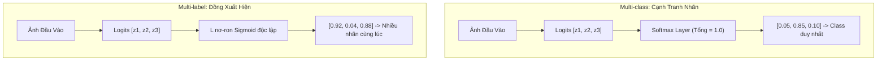

# Phân Loại Đa Nhãn & Kiến Trúc C2AE (Multi-label Classification & Canonical Correlated AutoEncoder)

> **Tóm tắt điều hành**: Phân loại đa nhãn (Multi-label Classification) là bài toán gán một tập con các nhãn mục tiêu cho một mẫu dữ liệu, trái ngược với phân loại đa lớp (Multi-class Classification) nơi các lớp triệt tiêu lẫn nhau qua hàm Softmax. Các phương pháp biến đổi truyền thống như Binary Relevance (bỏ qua tương quan nhãn) hay Label Powerset (bùng nổ tổ hợp $2^L$) đều bộc lộ hạn chế cố hữu. **C2AE (Canonical Correlated AutoEncoder)** giải quyết bài toán này bằng cách chiếu cả không gian đặc trưng $X$ và không gian nhãn $Y$ vào một không gian tiềm ẩn chung (Latent Space), ràng buộc trực giao bằng Gram Matrix Loss, và tối ưu hóa thứ tự nhãn thông qua hàm mất mát Pairwise Ranking Loss hàm mũ.

---

## 1. Phân Định Bản Chất: Multi-class vs Multi-label

| Tiêu chí | Phân Loại Đa Lớp (Multi-class) | Phân Loại Đa Nhãn (Multi-label) |
| :--- | :--- | :--- |
| **Không gian nhãn** | Tập nhãn rời rạc $y \in \{1, 2, \dots, K\}$ | Tập con nhãn $y \subseteq \{1, 2, \dots, L\}$, biểu diễn vector $y \in \{0, 1\}^L$ |
| **Ràng buộc xác suất** | Các lớp cạnh tranh, loại trừ lẫn nhau: $\sum_{k=1}^K p_k = 1$ | Các nhãn độc lập hoặc đồng xuất hiện: $p_k \in [0, 1]$ |
| **Hàm kích hoạt đầu ra** | **Softmax**: $\sigma(z)_i = \frac{e^{z_i}}{\sum_j e^{z_j}}$ | **Sigmoid** trên từng nơ-ron: $\sigma(z)_i = \frac{1}{1 + e^{-z_i}}$ |
| **Hàm mất mát chuẩn** | Categorical Cross-Entropy Loss | Binary Cross-Entropy Loss (BCE) tính tổng trên $L$ nhãn |
| **Ví dụ thực tế** | Nhận diện chữ số viết tay MNIST (chỉ là số 3 HOẶC 7) | Gắn thẻ ảnh: một bức ảnh đồng thời chứa `[Mèo, Bãi cỏ, Ban ngày]` |



---

## 2. Các Phương Pháp Biến Đổi Truyền Thống & Giới Hạn

Trước khi có mạng nơ-ron sâu, các phương pháp Machine Learning tiếp cận phân loại đa nhãn qua 3 chiến lược:

1. **Binary Relevance (BR)**:
   - Huấn luyện $L$ bộ phân loại nhị phân độc lập, mỗi bộ phân loại chịu trách nhiệm dự đoán 1 nhãn: $f_j(x) \to \{0, 1\}$.
   - *Tử huyệt*: Hoàn toàn bỏ qua sự phụ thuộc và tương quan giữa các nhãn (ví dụ: xác suất xuất hiện nhãn `Cá heo` và `Đại dương` có tương quan rất cao, nhưng BR xem chúng là 2 bài toán tách biệt).
2. **Classifier Chains (CC)**:
   - Xây dựng một chuỗi các bộ phân loại: Bộ phân loại thứ $j$ nhận đầu vào là đặc trưng $x$ kèm theo dự đoán của tất cả các bộ phân loại trước đó: $f_j(x, \hat{y}_1, \dots, \hat{y}_{j-1}) \to \hat{y}_j$.
   - *Tử huyệt*: Thứ tự chuỗi nhãn ảnh hưởng cực lớn đến kết quả cuối cùng. Lỗi sai ở các nhãn đầu chuỗi sẽ lan truyền và tích lũy (Error Propagation) xuống các nhãn sau.
3. **Label Powerset (LP)**:
   - Biến đổi mỗi tập con nhãn duy nhất xuất hiện trong dữ liệu huấn luyện thành một lớp riêng biệt trong bài toán đa lớp.
   - *Tử huyệt*: Bùng nổ tổ hợp! Nếu có $L$ nhãn, số lượng lớp có thể lên tới $2^L$. Hầu hết các lớp chỉ có 1 hoặc 2 mẫu dữ liệu, dẫn đến hiện tượng thiếu dữ liệu cực đoan (Extreme Data Sparsity) và không thể tổng quát hóa với các tổ hợp nhãn mới lúc inference.

---

## 3. Kiến Trúc C2AE (Canonical Correlated AutoEncoder)

C2AE là một trong những kiến trúc Deep Learning kinh điển giải quyết trọn vẹn sự phụ thuộc giữa các nhãn thông qua học biểu diễn tiềm ẩn (Latent Representation Learning):

```mermaid
graph LR
    subgraph Feature_Branch [Nhánh Đặc Trưng]
        X[Đặc trưng x] --> F_x["Feature Encoder F_x(x)"]
        F_x --> Fx_emb["Latent Vector fx"]
    end

    subgraph Label_Branch [Nhánh Nhãn (Chỉ dùng lúc Train)]
        Y[Nhãn y] --> F_e["Label Encoder F_e(y)"]
        F_e --> Fe_emb["Latent Vector fe"]
    end

    subgraph Latent_Alignment [Không Gian Tiềm Ẩn Chung]
        Fx_emb <-->|Frobenius Alignment Loss| Fe_emb
        Fx_emb ---|Gram Matrix Penalty| Ortho["Ràng buộc Trực giao: (A^T A - I)^2"]
    end

    subgraph Decoding [Giải Mã Chung]
        Fx_emb --> F_d["Shared Decoder F_d(z)"]
        F_d --> Logits["Predicted Scores s in R^L"]
        Logits --> Thresh{"Validation Thresholding"}
        Thresh --> Y_pred["Dự đoán nhãn nhị phân"]
    end
```

### 3.1. Các Thành Phần Mạng
- **Feature Encoder $F_x(x)$**: Ánh xạ vector đặc trưng đầu vào $x \in \mathbb{R}^d$ sang không gian tiềm ẩn $z_x \in \mathbb{R}^r$ ($r \ll L$).
- **Label Encoder $F_e(y)$**: Ánh xạ vector nhãn nhị phân $y \in \{0, 1\}^L$ sang không gian tiềm ẩn $z_y \in \mathbb{R}^r$.
- **Shared Decoder $F_d(z)$**: Ánh xạ từ vector tiềm ẩn $z \in \mathbb{R}^r$ trở lại không gian nhãn $\mathbb{R}^L$ để xuất ra điểm số dự đoán $s$.

*Lưu ý kiến trúc lúc inference*: Nhánh Label Encoder $F_e(y)$ bị lược bỏ hoàn toàn. Mẫu kiểm thử $x$ chỉ đi qua $F_x$ để tạo $z_x$, sau đó đưa trực tiếp vào $F_d$ để sinh nhãn.

---

## 4. Công Thức Toán Học & Các Hàm Mất Mát Cốt Lõi

Quá trình tối ưu C2AE là bài toán đa mục tiêu gồm 3 thành phần mất mát:

### 4.1. Hàm Mất Mát Căn Chỉnh Tiềm Ẩn (Latent Alignment Loss)
Mục tiêu là kéo biểu diễn tiềm ẩn từ đặc trưng $F_x(X)$ lại gần biểu diễn tiềm ẩn từ nhãn $F_e(Y)$:
$$\mathcal{L}_{\text{align}} = \frac{1}{2} \| F_x(X) - F_e(Y) \|_{F}^2$$
Trong đó $\| \cdot \|_F$ là chuẩn Frobenius của ma trận.

### 4.2. Ràng Buộc Trực Giao Ma Trận Gram (Gram Matrix Penalty)
Để tránh hiện tượng suy biến (Representation Collapse - khi mô hình học nghiệm tầm thường bằng cách gán toàn bộ latent vectors về vector 0), C2AE áp đặt điều kiện trực chuẩn hóa lên ma trận tiềm ẩn $A = F_x(X) \in \mathbb{R}^{N \times r}$:
$$\mathcal{L}_{\text{ortho}} = \frac{1}{2r} \| A^T A - I_r \|_{F}^2$$
- $I_r$ là ma trận đơn vị kích thước $r \times r$.
- Ràng buộc này ép các chiều trong không gian tiềm ẩn phải độc lập tuyến tính và có phương sai chuẩn hóa, bảo toàn tối đa lượng thông tin truyền tải.

### 4.3. Hàm Mất Mát Thứ Tự Cặp Hàm Mũ (Exponential Pairwise Ranking Loss)
Decoder $F_d$ không dùng hàm mất mát bình phương tối thiểu (MSE) thông thường mà sử dụng Ranking Loss. Với mỗi mẫu $x_i$, gọi:
- $Y_i^+ = \{j \mid y_{ij} = 1\}$ là tập các nhãn dương (relevant labels).
- $Y_i^- = \{k \mid y_{ik} = 0\}$ là tập các nhãn âm (irrelevant labels).

Hàm mất mát xếp hạng phạt theo cấp số mũ mỗi khi điểm số của nhãn âm $s_{ik}$ lớn hơn hoặc xấp xỉ điểm số của nhãn dương $s_{ij}$:
$$\mathcal{L}_{\text{rank}} = \sum_{i=1}^N \frac{1}{|Y_i^+| |Y_i^-|} \sum_{j \in Y_i^+} \sum_{k \in Y_i^-} \exp\left( - (s_{ij} - s_{ik}) \right)$$
- Nếu $s_{ij} \gg s_{ik}$ (mô hình dự đoán đúng thứ tự), số hạng mũ $\exp(-(\text{dương})) \to 0$.
- Nếu $s_{ik} \ge s_{ij}$ (nghịch đảo thứ tự), loss tăng vọt theo hàm mũ, ép gradient kéo điểm nhãn dương lên trên nhãn âm.

### Hàm Mục Tiêu Tổng Thể (Joint Objective):
$$\mathcal{L}_{\text{total}} = \mathcal{L}_{\text{align}} + \alpha \mathcal{L}_{\text{ortho}} + \beta \mathcal{L}_{\text{rank}} + \gamma \mathcal{L}_{\text{reg}}$$

---

## 5. Hiệu Chuẩn Ngưỡng Quyết Định (Threshold Calibration)

Sau khi Decoder tạo ra vector điểm số liên tục $s \in \mathbb{R}^L$, làm sao chuyển thành vector nhị phân $\{0, 1\}^L$?
- **Ngưỡng cố định (Fixed threshold $\tau = 0.5$)**: Thường thất bại vì phân phối điểm số của các nhãn rất khác nhau.
- **Hiệu chuẩn trên tập Validation (T-cal)**:
  - Học một ngưỡng riêng $\tau_j$ cho từng nhãn $j$, tối ưu hóa độ đo F1 trên tập kiểm định:
    $$\tau_j^* = \arg\max_{\tau} F1_j(\tau)$$
  - Hoặc học một hàm hồi quy dự đoán ngưỡng động theo từng mẫu (Instance-dependent thresholding): $\tau(x) = w^T F_x(x) + b$.

---

## 6. Các Độ Đo Đánh Giá Đa Nhãn Chuẩn Mực

Không thể dùng Accuracy thông thường cho bài toán đa nhãn. 4 độ đo chuẩn mực gồm:

1. **Hamming Loss**: Tỷ lệ các nhãn bị dự đoán sai trên tổng số nhãn:
   $$\text{Hamming Loss} = \frac{1}{N \cdot L} \sum_{i=1}^N \sum_{j=1}^L \mathbb{I}(y_{ij} \neq \hat{y}_{ij})$$
   *(Càng nhỏ càng tốt, lý tưởng = 0)*.
2. **Subset Accuracy (Exact Match)**: Tỷ lệ mẫu mà toàn bộ tập nhãn dự đoán khớp chính xác 100% với nhãn thực tế:
   $$\text{Subset Acc} = \frac{1}{N} \sum_{i=1}^N \mathbb{I}(y_i = \hat{y}_i)$$
   *(Rất khắt khe; dự đoán 9/10 nhãn đúng vẫn bị tính điểm 0)*.
3. **Micro-F1**: Gom toàn bộ True Positives ($TP$), False Positives ($FP$), False Negatives ($FN$) trên toàn bộ dataset rồi tính F1:
   $$\text{Micro-F1} = \frac{2 \sum TP_j}{2 \sum TP_j + \sum FP_j + \sum FN_j}$$
   *(Bị chi phối bởi các nhãn phổ biến)*.
4. **Macro-F1**: Tính điểm F1 độc lập cho từng nhãn rồi lấy trung bình số học:
   $$\text{Macro-F1} = \frac{1}{L} \sum_{j=1}^L F1_j$$
   *(Đánh giá công bằng cho các nhãn hiếm / imbalanced data)*.

---

## 7. Mã Nguồn Triển Khai C2AE Với PyTorch

```python
import torch
import torch.nn as nn
import torch.nn.functional as F

class C2AE(nn.Module):
    """Canonical Correlated AutoEncoder cho Multi-label Classification."""
    def __init__(self, input_dim: int, num_labels: int, latent_dim: int = 64):
        super().__init__()
        # 1. Feature Encoder F_x
        self.feature_encoder = nn.Sequential(
            nn.Linear(input_dim, 256),
            nn.BatchNorm1d(256),
            nn.LeakyReLU(0.2),
            nn.Linear(256, latent_dim)
        )
        # 2. Label Encoder F_e (Chỉ dùng lúc train)
        self.label_encoder = nn.Sequential(
            nn.Linear(num_labels, 128),
            nn.BatchNorm1d(128),
            nn.LeakyReLU(0.2),
            nn.Linear(128, latent_dim)
        )
        # 3. Shared Decoder F_d
        self.decoder = nn.Sequential(
            nn.Linear(latent_dim, 128),
            nn.LeakyReLU(0.2),
            nn.Linear(128, num_labels)
        )

    def forward(self, x: torch.Tensor, y: torch.Tensor | None = None):
        fx = self.feature_encoder(x)
        if self.training and y is not None:
            fe = self.label_encoder(y.float())
            scores = self.decoder(fx)
            return fx, fe, scores
        # Lúc inference: chỉ dùng fx và decoder
        scores = self.decoder(fx)
        return scores

def c2ae_loss_function(fx, fe, scores, y, alpha=0.1, beta=1.0):
    """Hàm mất mát C2AE: Latent Alignment + Gram Penalty + Pairwise Ranking."""
    batch_size, latent_dim = fx.shape
    
    # 1. Latent Alignment Loss
    loss_align = 0.5 * torch.mean((fx - fe) ** 2)
    
    # 2. Gram Matrix Orthonormality Penalty (A^T A - I)^2
    gram_matrix = torch.matmul(fx.T, fx) / batch_size
    identity = torch.eye(latent_dim, device=fx.device)
    loss_ortho = 0.5 * torch.mean((gram_matrix - identity) ** 2)
    
    # 3. Exponential Pairwise Ranking Loss
    loss_rank = 0.0
    for i in range(batch_size):
        pos_indices = (y[i] == 1).nonzero(as_tuple=True)[0]
        neg_indices = (y[i] == 0).nonzero(as_tuple=True)[0]
        if len(pos_indices) > 0 and len(neg_indices) > 0:
            diff = scores[i, neg_indices].unsqueeze(1) - scores[i, pos_indices].unsqueeze(0)
            exp_diff = torch.exp(diff)
            loss_rank += torch.mean(exp_diff)
    loss_rank = loss_rank / batch_size
    
    return loss_align + alpha * loss_ortho + beta * loss_rank
```

---

## 8. Mạng Lưới Liên Kết Thực Thể (Wiki Links)

- [[model-selection-evaluation]] — Tiêu chí đánh giá mô hình, K-Fold và phòng chống data leakage.
- [[convolutional-neural-networks]] — Mạng trích xuất đặc trưng hình ảnh trước khi đưa vào bộ phân loại.
- [[object-detection-yolo]] — Mối quan hệ giữa phân loại đa nhãn và phát hiện đa vật thể.
- [[optimization-algorithms]] — Các giải thuật tối ưu gradient descent (AdamW).
