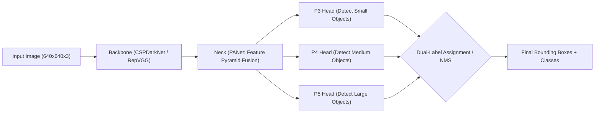

# Phát Hiện Vật Thể và Dòng Họ YOLO (Object Detection & YOLO Evolution)

> **Khái niệm chính thống**: Redmon et al. (CVPR 2016) *"You Only Look Once: Unified, Real-Time Object Detection"*; Wang et al. (2024) *"YOLOv10: Real-Time End-to-End Object Detection"*; *AIO2025 Series: YOLO Tutorial*.
> **Miền kiến thức**: [[index|Computer Vision & Real-time Object Detection]]
> **Tài liệu gốc liên quan**:
> - [AIO2025_YOLO-Tutorial.pdf](../resources/deep-learning/computer-vision/AIO2025_YOLO-Tutorial.pdf) (Trang 1-88)
> - [AIO2025_Object-Detection-Quiz.pdf](../resources/deep-learning/computer-vision/AIO2025_Object-Detection-Quiz.pdf) (Trang 1-27)
> - [Object Detection.pdf](../resources/deep-learning/computer-vision/Object%20Detection.pdf) (Trang 1-47)
> - [Deep Learning_Computer Vision_NLP.pdf](../resources/deep-learning/Deep%20Learning_Computer%20Vision_NLP.pdf) (Trang 80-120)

---

## 1. Tóm tắt (Executive Summary)
**Phát hiện Vật thể (Object Detection)** là bài toán thị giác máy tính cốt lõi đồng thời xác định vị trí biên tọa độ (Bounding Box) và phân loại nhãn (Classification) của nhiều vật thể xuất hiện trong ảnh. Cuộc cách mạng **YOLO (You Only Look Once)** đã tái định nghĩa bài toán từ quy trình hai giai đoạn chậm chạp (Two-Stage Detectors như R-CNN/Faster R-CNN) thành bài toán hồi quy đơn giai đoạn (**Single-Stage Regression**), dự đoán trực tiếp tọa độ hộp và xác suất lớp chỉ qua một lượt truyền xuôi duy nhất (Single Forward Pass). Trải qua từ YOLOv1 đến YOLOv10/v11, dòng họ YOLO đã tích hợp các cơ chế Anchor-free, Path Aggregation, và gần đây nhất là loại bỏ hoàn toàn thuật toán hậu xử lý NMS (NMS-free training) để đạt tốc độ xử lý thời gian thực hàng trăm FPS.

---

## 2. Định nghĩa chính thống & Kiến trúc Phát hiện Vật thể

### 2.1 Mô hình Kiến trúc 3 Thành phần Chuẩn mực
Mọi mô hình phát hiện vật thể hiện đại đều được cấu thành từ 3 phần:
1. **Backbone**: Mạng tích chập sâu (DarkNet, CSPDarknet, HGNet) trích xuất các bản đồ đặc trưng đa tỷ lệ từ ảnh đầu vào.
2. **Neck**: Mạng kết hợp đặc trưng phân tầng (**FPN - Feature Pyramid Network**, **PANet - Path Aggregation Network**), trộn các đặc trưng ngữ nghĩa mức cao với đặc trưng vị trí mức thấp để phát hiện vật thể ở nhiều kích thước khác nhau (nhỏ, vừa, lớn).
3. **Head**: Dự đoán các hộp giới hạn (Bounding Boxes), độ tin cậy chứa vật thể (Objectness Score), và phân phối xác suất lớp (Class Probabilities).

### 2.2 Các độ đo chất lượng then chốt
1. **IoU (Intersection over Union)**:
   $$\text{IoU} = \frac{\text{Area of Overlap}}{\text{Area of Union}} = \frac{|B_p \cap B_{gt}|}{|B_p \cup B_{gt}|}$$
2. **mAP (Mean Average Precision)**:
   - Tính diện tích dưới đường cong Precision-Recall (AUC-PR) cho từng lớp, sau đó lấy trung bình trên toàn bộ các lớp đối tượng.
   - **mAP@50**: Độ chính xác trung bình khi ngưỡng IoU $\ge 0.50$.
   - **mAP@50:95 (Chuẩn COCO)**: Lấy trung bình của mAP tại 10 ngưỡng IoU khác nhau từ 0.50 đến 0.95 với bước nhảy 0.05.

---

## 3. So sánh & Mâu thuẫn / Sắc thái giữa các tài liệu

| Thế hệ YOLO | Cơ chế Anchor | Đột phá kiến trúc then chốt | Điểm nghẽn khắc phục |
| :--- | :--- | :--- | :--- |
| **YOLOv1 - v3** | Anchor-based (Sử dụng K-means phân cụm kích thước hộp neo cố định). | DarkNet, FPN, đa tỷ lệ (3 scale outputs). | Tốc độ cao nhưng khó bắt vật thể nhỏ và vật thể đứng sát nhau. |
| **YOLOv4 - v7** | Anchor-based / CSPNet. | Mosaic Data Augmentation, CSPNet (Cross-Stage Partial), E-ELAN. | Tối ưu hóa việc sử dụng bộ nhớ và tính toán trên phần cứng GPU tiêu dùng. |
| **YOLOv8** | **Anchor-free**. | Tách biệt nhánh phân loại và hồi quy hộp (Decoupled Head); loại bỏ hoàn toàn khái niệm Anchor box. | Loại bỏ sự phụ thuộc vào việc tinh chỉnh thủ công kích thước anchor boxes cho từng tập dữ liệu mới. |
| **YOLOv10 (2024)** | **NMS-Free (End-to-End)**. | Huấn luyện nhãn kép (Consistent Dual Assignments: One-to-Many cho training, One-to-One cho inference). | **Loại bỏ hoàn toàn NMS**: Triệt tiêu độ trễ hậu xử lý, giảm độ trễ inference xuống mức tối thiểu. |

---

## 4. Góc nhìn Thực chiến & Thiết kế Hệ thống cho AI Engineer

### 4.1 Tử huyệt NMS trong Edge Deployment
- Thuật toán **Non-Maximum Suppression (NMS)** truyền thống:
  - Lặp qua hàng ngàn hộp dự đoán, sắp xếp theo điểm tin cậy, tính IoU để loại bỏ các hộp trùng lặp có $\text{IoU} > \text{threshold}$.
  - *Vấn đề trong Production*: NMS chạy tuần tự trên CPU hoặc cần nhân CUDA phức tạp, có thể chiếm tới 30-50% tổng độ trễ của toàn bộ pipeline khi trên ảnh có hàng trăm vật thể chen chúc.
  - *Giải pháp 2025-2026*: Chuyển dịch sang các kiến trúc **End-to-End không cần NMS** (như YOLOv10 hoặc RT-DETR).

### 4.2 Câu hỏi phỏng vấn thực tế
- **Q**: *Sự khác biệt cốt lõi giữa hàm mất mát GIoU, DIoU, CIoU trong hồi quy hộp giới hạn là gì?*
  - **A**:
    - **IoU Loss**: Bằng 0 khi hai hộp không giao nhau, khiến gradient bị triệt tiêu hoàn toàn.
    - **GIoU (Generalized IoU)**: Thêm hệ số phạt dựa trên diện tích hộp bao nhỏ nhất chứa cả 2 hộp, giúp đẩy 2 hộp lại gần nhau ngay cả khi không giao nhau.
    - **DIoU (Distance IoU)**: Thêm thành phần khoảng cách Euclid giữa hai tâm hộp chuẩn hóa theo đường chéo của hộp bao, tăng tốc độ hội tụ cực nhanh.
    - **CIoU (Complete IoU)**: Hoàn thiện bằng cách bổ sung thêm ràng buộc về tỷ lệ khung hình (Aspect Ratio consistency) giữa hộp dự đoán và hộp nhãn gốc, là hàm mất mát tiêu chuẩn trong các bản YOLO hiện đại.

---

## 5. Mạng lưới Liên kết Tri thức (Knowledge Graph & `wiki-links`)
- [[convolutional-neural-networks]] — Xương sống trích xuất đặc trưng của YOLO.
- [[unet-architecture]] — So sánh đối chiếu giữa phân đoạn điểm ảnh và bounding box.
- [[inference-optimization-tensorrt]] — Quy trình bắt buộc để deploy YOLO thời gian thực trên camera giao thông/robotics.