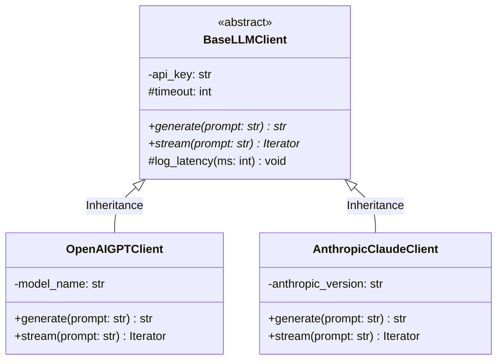

# 4 Tính Chất Cốt Lõi Của Lập Trình Hướng Đối Tượng (OOP Core Pillars & Interfaces)

> **Khái niệm chính thống**: Booch et al. *"Object-Oriented Analysis and Design with Applications"*; Gamma et al. *"Design Patterns: Elements of Reusable Object-Oriented Software"*; *JavaOOP-Core.jpg*; *Questtion.txt*.
> **Miền kiến thức**: [[index|Software Engineering Foundations for AI]]
> **Tài liệu gốc liên quan**:
> - [Questtion.txt](../resources/software/Questtion.txt) (Trang 1: Yêu cầu thực tế về OOP & Interface)
> - [JavaOOP-Core.jpg](../resources/software/JavaOOP-Core.jpg) (Sơ đồ phỏng vấn Java Core / OOP)
> - [Backend Engineering (Phần 1) - LeThienHoa.pdf](../resources/software/Backend%20Engineering%20%28Ph%E1%BA%A7n%201%29%20-%20LeThienHoa.pdf) (Trang 15-45)

---

## 1. Tóm tắt (Executive Summary)
**Lập trình Hướng đối tượng (Object-Oriented Programming - OOP)** là mô thức kiến trúc phần mềm tổ chức mã nguồn xoay quanh các "Đối tượng" (Objects) đóng gói trạng thái (State / Attributes) và hành vi (Behavior / Methods) tương ứng, thay vì các hàm xử lý dữ liệu rời rạc. Bốn trụ cột cốt lõi của OOP bao gồm: **Tính Đóng gói (Encapsulation)**, **Tính Kế thừa (Inheritance)**, **Tính Đa hình (Polymorphism)**, và **Tính Trừu tượng (Abstraction)**. Trong kỹ nghệ phần mềm và hệ thống AI thực tế, việc làm chủ OOP không dừng lại ở các ví dụ trường học kinh điển mà nằm ở khả năng thiết kế giao diện (**Interface**) chuẩn mực, phân tách vai trò và làm chủ nguyên lý cắm-rút module.

---

## 2. Định nghĩa chính thống & 4 Trụ Cột Thực Chiến (Production-Grade Pillars)

*(Cảnh báo từ `Questtion.txt`: Tuyệt đối không dùng các ví dụ sáo rỗng như con chó, con mèo; phải giải thích bằng ví dụ hệ thống thực tế)*:

### 2.1 Tính Đóng gói (Encapsulation)
- **Bản chất**: Che giấu trạng thái nội tại bên trong của đối tượng và chỉ cho phép tương tác ra bên ngoài thông qua các phương thức công khai được kiểm soát chặt chẽ (Public API / Getters & Setters / Properties).
- **Ví dụ Kỹ thuật Thực tế**:
  Trong một `LLMTokenBucketRateLimiter`, biến `current_tokens` và `last_refill_timestamp` được khai báo `private`. Bên ngoài không thể gán tùy tiện `limiter.current_tokens = 9999` để gian lận quota. Mọi tương tác phải qua hàm `public acquire_tokens(int n)` có cơ chế đồng bộ hóa luồng (Thread-safe Lock) và kiểm tra điều kiện nghiêm ngặt.

### 2.2 Tính Trừu tượng (Abstraction)
- **Bản chất**: Trưng ra giao diện tương tác đơn giản, ẩn đi toàn bộ chi tiết cài đặt thuật toán phức tạp và hạ tầng công nghệ bên dưới.
- **Ví dụ Kỹ thuật Thực tế**:
  Một interface `VectorStore`:
  ```python
  class VectorStore(ABC):
      @abstractmethod
      def similarity_search(self, query_vector: list[float], top_k: int) -> list[Document]:
          pass
  ```
  Ứng dụng RAG chỉ cần gọi `vector_store.similarity_search(...)` mà hoàn toàn không cần bận tâm bên dưới đang chạy PostgreSQL pgvector, Milvus cluster hay Pinecone cloud.

### 2.3 Tính Kế thừa (Inheritance)
- **Bản chất**: Cho phép lớp con tái sử dụng cấu trúc và hành vi chung của lớp cha, mở rộng hoặc ghi đè (Override) các hành vi đặc thù.
- **Ví dụ Kỹ thuật Thực tế**:
  Lớp cha `BaseEmbeddingModel` quản lý cơ chế caching, đo lường độ trễ (latency tracking) và batching. Các lớp con `OpenAIEmbedding` và `HuggingFaceBGEEmbedding` chỉ cần kế thừa và cài đặt hàm cụ thể `_encode_text()`.

### 2.4 Tính Đa hình (Polymorphism)
- **Bản chất**: Khả năng các đối tượng khác nhau phản ứng theo các cách khác nhau đối với cùng một thông điệp/lời gọi hàm (Dynamic Dispatch / Late Binding).
- **Ví dụ Kỹ thuật Thực tế**:
  Một danh sách các bộ truy xuất: `retrievers: list[BaseRetriever] = [DenseVectorRetriever(), BM25SparseRetriever(), KnowledgeGraphRetriever()]`. Vòng lặp `for r in retrievers: r.retrieve(query)` thực thi hành vi hoàn toàn khác nhau cho từng đối tượng tại thời điểm chạy mà code điều phối không cần bất kỳ câu lệnh `if/else` nào.



---

## 3. Tử Huyệt Phỏng Vấn: "Vì Sao Lại Cần Phải Có Interface?" (From Questtion.txt)

Đây là câu hỏi phân định đẳng cấp giữa một thợ code và một Kỹ sư Thiết kế Hệ thống:
1. **Lập trình hướng Giao diện, không hướng Cài đặt (Program to an Interface, not an Implementation)**:
   - Nếu tầng Service gọi trực tiếp lớp cụ thể `MySQLDatabase db = new MySQLDatabase()`, tầng Service bị trói chặt (Tightly Coupled) với MySQL. Khi công ty muốn chuyển sang PostgreSQL hoặc mock dữ liệu để viết Unit Test, toàn bộ mã nguồn Service bị phá vỡ.
   - Khi có interface `DatabaseConnection`, Service chỉ phụ thuộc vào bản hợp đồng (Contract). Việc hoán đổi sang `PostgreSQLDatabase` hay `MockDatabase` diễn ra trong 0 dòng code sửa đổi ở Service.
2. **Khắc phục Giới hạn Đơn kế thừa (Multiple Inheritance)**:
   - Các ngôn ngữ như Java/C# cấm đa kế thừa class để tránh "Vấn đề Kim cương" (Diamond Problem). Interface cho phép một lớp có thể thực thi nhiều hợp đồng độc lập: một `DocumentProcessor` có thể vừa `implements AutoCloseable`, vừa `implements Searchable`, vừa `implements Serializable`.
3. **Mở khóa Đa hình và Dependency Injection**:
   - Interface là nền tảng tuyệt đối để triển khai chữ **D** trong SOLID ([[solid-principles|Dependency Inversion Principle]]) và các Design Patterns kinh điển (Strategy, Factory, Adapter).

---

## 4. Phân Biệt Thực Thể: Object vs Class; Abstract Class vs Interface

| Khía cạnh | Abstract Class (Lớp trừu tượng) | Interface (Giao diện) |
| :--- | :--- | :--- |
| **Bản chất triết lý** | Quan hệ bản thể: **LÀ MỘT (IS-A)**. Đại diện cho bản sắc của đối tượng. | Quan hệ năng lực: **CÓ THỂ LÀM ĐƯỢC (CAN-DO / LIKE-A)**. Đại diện cho một hợp đồng hành vi. |
| **Trạng thái (State)** | Có thể chứa các thuộc tính thành viên có trạng thái (`protected int counter`), constructor đầy đủ. | Không thể chứa trạng thái thành viên (chỉ có hằng số `public static final`). |
| **Phương thức cài đặt** | Có thể chứa cả phương thức trừu tượng lẫn phương thức đã cài đặt logic mặc định cụ thể. | Chủ yếu là các phương thức trừu tượng (từ Java 8 có thêm `default method`). |
| **Mức độ kế thừa** | Một lớp chỉ có thể kế thừa **1 Abstract Class duy nhất** (Đơn kế thừa). | Một lớp có thể thực thi **nhiều Interface cùng lúc** (Đa giao diện). |

---

## 5. Mạng lưới Liên kết Tri thức (Knowledge Graph & `wiki-links`)
- [[solid-principles]] — Sự kế thừa và nâng tầm từ 4 tính chất OOP lên 5 nguyên lý thiết kế bền vững.
- [[tool-use-and-function-calling]] — Thiết kế các Tools của Agent tuân thủ tính đóng gói và trừu tượng.
- [[database-indexing-optimization]] — Thiết kế lớp Repository trừu tượng hóa tương tác cơ sở dữ liệu.