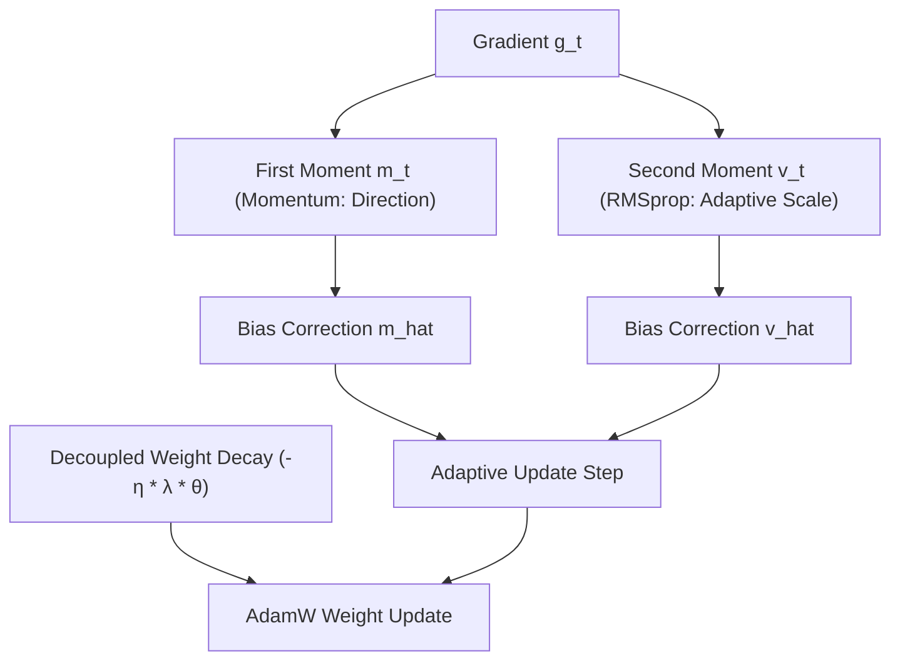

# Các Thuật Toán Tối Ưu Hóa (Optimization: SGD, Adam, AdamW & Schedules)

> **Khái niệm chính thống**: *Mathematics for Machine Learning*, Chapter 7 (Continuous Optimization); *Understanding Machine Learning*, Chapter 14; Kingma & Ba (ICLR 2015) *"Adam: A Method for Stochastic Optimization"*; Loshchilov & Hutter (ICLR 2019) *"Decoupled Weight Decay Regularization (AdamW)"*.
> **Miền kiến thức**: [[index|Optimization & Deep Learning Training]]
> **Tài liệu gốc liên quan**:
> - [AIO2025_[Description]_Optimizer.pdf](../resources/machine-learning/AIO2025_%5BDescription%5D_Optimizer.pdf) (Trang 1-29)
> - [Mathematics-for-Machine-Learning.pdf](../resources/machine-learning/Mathematics-for-Machine-Learning.pdf) (Trang 230-265)
> - [Encyclopedia of LLMs and Foundation Models.pdf](../resources/genai/Encyclopedia%20of%20LLMs%20and%20Foundation%20Models.pdf) (Trang 27-28; 86-88)

---

## 1. Tóm tắt (Executive Summary)
**Các thuật toán Tối ưu hóa (Optimization Algorithms)** là động cơ thúc đẩy toàn bộ quá trình học máy và học sâu, có nhiệm vụ điều chỉnh trọng số mô hình $\theta$ để tìm kiếm cực tiểu của hàm mất mát thực nghiệm $\mathcal{L}(\theta)$. Bắt đầu từ thuật toán cổ điển **Hạ Gradient Ngẫu nhiên (SGD)** với nhược điểm hội tụ chậm ở vùng yên ngựa và thung lũng hẹp, các giải thuật tích lũy động lượng (**Momentum**, **Nesterov**) và tốc độ học thích ứng theo từng tham số (**RMSprop**, **Adam**) đã ra đời. Trong kỷ nguyên LLM hiện đại, **AdamW (Decoupled Weight Decay)** kết hợp với biểu đồ tốc độ học **Cosine Annealing with Warmup** đã trở thành tiêu chuẩn vàng không thể thay thế.

---

## 2. Định nghĩa chính thống & Dẫn xuất Thuật toán (Algorithmic Formulations)

### 2.1 Cây phả hệ tiến hóa của các Bộ tối ưu hóa
1. **SGD with Momentum**:
   Tích lũy vận tốc động lượng theo moment bậc 1 để vượt qua các cực tiểu cục bộ và giảm rung lắc:
   $$v_t = \beta v_{t-1} + (1 - \beta) g_t$$
   $$\theta_t = \theta_{t-1} - \eta v_t$$
2. **RMSprop (Root Mean Square Propagation - Hinton, 2012)**:
   Điều chỉnh learning rate riêng cho từng tham số bằng cách chia cho căn bậc hai của trung bình trượt bình phương gradient (moment bậc 2):
   $$s_t = \gamma s_{t-1} + (1 - \gamma) g_t^2$$
   $$\theta_t = \theta_{t-1} - \frac{\eta}{\sqrt{s_t} + \epsilon} \odot g_t$$
3. **Adam (Adaptive Moment Estimation - Kingma & Ba, 2015)**:
   Kết hợp cả Momentum (quán tính) và RMSprop (thích ứng từng chiều), kèm bước hiệu chỉnh thiên kiến (Bias Correction) ở các bước đầu:
   $$m_t = \beta_1 m_{t-1} + (1 - \beta_1) g_t, \quad v_t = \beta_2 v_{t-1} + (1 - \beta_2) g_t^2$$
   $$\hat{m}_t = \frac{m_t}{1 - \beta_1^t}, \quad \hat{v}_t = \frac{v_t}{1 - \beta_2^t}$$
   $$\theta_t = \theta_{t-1} - \frac{\eta}{\sqrt{\hat{v}_t} + \epsilon} \hat{m}_t$$

### 2.2 Đột phá AdamW (Loshchilov & Hutter, 2019)
Trong Adam truyền thống, số hạng L2 Regularization được cộng thẳng vào gradient ($g_t \leftarrow g_t + \lambda \theta$). Khi đi qua phép chia $\sqrt{\hat{v}_t}$, tham số nào có gradient lớn sẽ bị phạt chính quy hóa ít hơn, làm mất đi ý nghĩa toán học của Weight Decay.
**AdamW sửa sai**: Tách rời hoàn toàn bước phạt suy giảm trọng số khỏi bước gradient thích ứng:
$$\theta_t = \theta_{t-1} - \eta_t \lambda \theta_{t-1} - \frac{\eta_t}{\sqrt{\hat{v}_t} + \epsilon} \hat{m}_t$$

---

## 3. So sánh & Mâu thuẫn / Sắc thái giữa các tài liệu

| Thuật toán | Tốc độ hội tụ lúc đầu | Khả năng tổng quát hóa (Generalization) cuối cùng | Bộ nhớ GPU tiêu thụ | Lĩnh vực thống trị |
| :--- | :--- | :--- | :--- | :--- |
| **SGD + Momentum** | Chậm; đòi hỏi tinh chỉnh learning rate rất khắt khe. | **Rất cao**. Thường tìm được các cực tiểu phẳng (Flat Minima) tổng quát hóa tốt hơn Adam. | Thấp (chỉ lưu thêm 1 trạng thái vận tốc $v$: 4 byte/param). | Thị giác máy tính cổ điển (ResNet trên ImageNet). |
| **Adam** | Rất nhanh; ít nhạy cảm với việc chọn learning rate ban đầu. | Kém hơn SGD một chút trên một số bài toán Computer Vision. | Cao (lưu cả $m$ và $v$: 8 byte/param). | Thập kỷ 2015-2019. |
| **AdamW** | Cực nhanh; ổn định số học vượt trội. | **Xuất sắc**. Bắt kịp và vượt qua SGD nhờ cơ chế Weight Decay tách rời chuẩn mực. | Cao (8 byte/param cho optimizer state). | **Tiêu chuẩn tuyệt đối cho toàn bộ LLMs, Transformers và Diffusion Models**. |

---

## 4. Góc nhìn Thực chiến & Thiết kế Hệ thống cho AI Engineer

### 4.1 Chiến lược Biểu đồ Tốc độ học (Learning Rate Schedules)
Không bao giờ dùng một Learning Rate cố định từ đầu đến cuối khi huấn luyện mạng sâu hoặc fine-tuning LLM:
1. **Warmup Phase (Khởi động)**: Tăng tuyến tính learning rate từ $0$ lên $\eta_{\max}$ trong $1\% - 5\%$ số bước đầu tiên. Giúp các moment $\hat{m}_t, \hat{v}_t$ thoát khỏi các giá trị ban đầu thiếu ổn định mà không làm nổ trọng số.
2. **Cosine Annealing Decay**: Hạ dần learning rate theo đường cong cosin từ $\eta_{\max}$ về $\eta_{\min} \approx 0.1 \times \eta_{\max}$. Giúp mô hình lắng đọng nhẹ nhàng vào đáy của thung lũng cực tiểu tối ưu.

### 4.2 Câu hỏi phỏng vấn thực tế
- **Q**: *Tại sao trong huấn luyện LLM phân tán, trạng thái của AdamW (Optimizer States) lại chiếm tới 50-60% dung lượng VRAM GPU chứ không phải bản thân trọng số mô hình?*
  - **A**: Với mô hình nạp ở độ chính xác FP16/BF16:
    - Trọng số mô hình chiếm: $2 \times N$ bytes.
    - Gradient chiếm: $2 \times N$ bytes.
    - Nhưng Optimizer AdamW bắt buộc phải duy trì độ chính xác cao **FP32 Master Weights** ($4 \times N$ bytes) để tránh mất mát số học khi cộng giá trị nhỏ, cộng thêm **Moment bậc 1 $m_t$ (FP32)** ($4 \times N$ bytes), và **Moment bậc 2 $v_t$ (FP32)** ($4 \times N$ bytes).
    - Tổng cộng trạng thái AdamW chiếm tới **$12 \times N$ bytes** (gấp 6 lần kích thước trọng số FP16 của mô hình!). Đây là lý do ra đời các kỹ thuật ZeRO (DeepSpeed) và 8-bit Adam (bitsandbytes).

---

## 5. Mạng lưới Liên kết Tri thức (Knowledge Graph & `wiki-links`)
- [[gradient-vanishing-exploding]] — Động lực thúc đẩy việc cải tiến các bộ tối ưu hóa thích ứng.
- [[regularization-l1-l2]] — Bản chất toán học phân biệt Adam và AdamW.
- [[large-language-models]] — AdamW là xương sống huấn luyện mọi LLM hàng đầu.
- [[quantization-and-compression]] — Nén trạng thái optimizer (Paged / 8-bit Optimizers) để tiết kiệm VRAM.