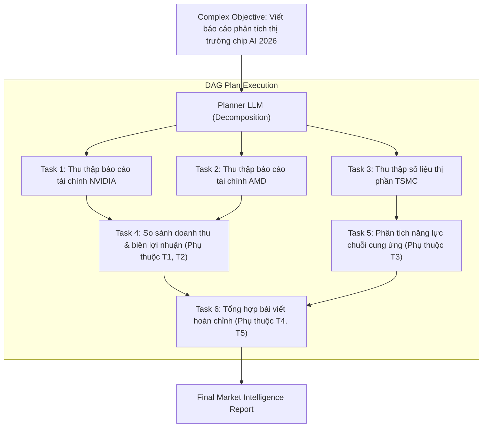

# Lập Kế Hoạch và Phân Rã Nhiệm Vụ (Planning & Task Decomposition)

> **Khái niệm chính thống**: *Encyclopedia of LLMs*, Section 14.4; *Master All 20 Agentic AI Design Patterns*, Pattern 6; Wang et al. (2023) *"Plan-and-Solve Prompting"*; Kim et al. (2024) *"LLM Compiler"*.
> **Miền kiến thức**: [[index|Hierarchical Planning & Task Execution]]
> **Tài liệu gốc liên quan**:
> - [Master All 20 Agentic AI Design Patterns.pdf](../resources/genai/Master%20All%2020%20Agentic%20AI%20Design%20Patterns.pdf) (Trang 14-18)
> - [Agentic AI Design Patterns(2026 Edition).pdf](../resources/genai/Agentic%20AI%20Design%20Patterns%282026%20Edition%29.pdf) (Trang 10-14)
> - [Encyclopedia of LLMs and Foundation Models.pdf](../resources/genai/Encyclopedia%20of%20LLMs%20and%20Foundation%20Models.pdf) (Trang 132-134)

---

## 1. Tóm tắt (Executive Summary)
**Lập kế hoạch và Phân rã Nhiệm vụ (Planning & Task Decomposition)** là khả năng kiến trúc cho phép AI Agent chia tách một mục tiêu lớn, trừu tượng, dài hạn thành một đồ thị có hướng không chu trình (**DAG - Directed Acyclic Graph**) của các nhiệm vụ con độc lập, có thể thực thi tuần tự hoặc song song. Thay vì nhảy ngay vào hành động theo cảm tính, Agent dành một giai đoạn tiền khả thi để xây dựng lộ trình, xác định các phụ thuộc dữ liệu giữa các bước, từ đó giảm thiểu tối đa rủi ro đi chệch hướng và tối ưu hóa thời gian thực thi thông qua tính toán song song.

---

## 2. Định nghĩa chính thống & Các chiến lược Lập kế hoạch (Planning Strategies)

### 2.1 Phân loại các mô hình Planning
1. **Planning without Feedback (Static Planning)**:
   - Mô hình lập toàn bộ danh sách các bước từ đầu đến cuối trước khi thực hiện (như **Plan-and-Solve Prompting**). Phù hợp cho các bài toán có quy trình chuẩn xác định (Deterministic Workflows).
2. **Planning with Feedback (Dynamic / Adaptive Planning)**:
   - Mô hình lập kế hoạch sơ bộ, sau mỗi bước thực thi sẽ cập nhật lại kế hoạch dựa trên kết quả thực tế thu được từ môi trường (như **Hierarchical Task Networks - HTN** hoặc **ReAct với Dynamic Todo List**).
3. **LLM Compiler (Parallel DAG Execution)**:
   - Lập kế hoạch theo cấu trúc đồ thị luồng dữ liệu (Dataflow Graph). Các tác vụ không phụ thuộc nhau được bắn đồng thời vào thread pool chạy song song trên nhiều workers, giảm thời gian thực thi từ hàng phút xuống vài giây.



---

## 3. So sánh & Mâu thuẫn / Sắc thái giữa các tài liệu

| Phương pháp | Chi phí Token | Độ trễ tổng thể | Khả năng thích ứng với ngoại lệ |
| :--- | :--- | :--- | :--- |
| **ReAct thuần túy (Không có Planner)** | Rất cao (mỗi bước phải nạp lại toàn bộ lịch sử các bước trước). | Chậm (tuần tự từng bước $1, 2, ..., N$). | Thích ứng vi mô tốt, nhưng dễ bị mất tầm nhìn vĩ mô ("lạc trôi" sau bước thứ 5). |
| **Plan-and-Solve (Kế hoạch tĩnh)** | Thấp (lập kế hoạch 1 lần, sau đó chạy lần lượt). | Nhanh hơn ReAct. | Rất kém; nếu bước 2 bị lỗi, các bước 3, 4, 5 phía sau lập tức bị vô hiệu hóa vì dựa trên dữ liệu không tồn tại. |
| **Hierarchical Planning + DAG Compiler** | Tối ưu hóa nhờ cache prompt và chạy song song. | **Nhanh nhất** (các nhánh độc lập chạy đa luồng). | **Xuất sắc nhất**; có thể tái lập kế hoạch (re-plan) cục bộ cho nhánh bị lỗi mà không ảnh hưởng các nhánh khác. |

---

## 4. Góc nhìn Thực chiến & Thiết kế Hệ thống cho AI Engineer

### 4.1 Quy chuẩn cấu trúc dữ liệu của một Task DAG
Một Task Plan chuyên nghiệp bắt buộc phải có schema rõ ràng:
```json
{
  "plan_id": "market_analysis_01",
  "tasks": [
    {
      "task_id": "fetch_nvidia",
      "description": "Crawl Q3 2026 earnings report of Nvidia",
      "tool": "web_search",
      "dependencies": []
    },
    {
      "task_id": "fetch_amd",
      "description": "Crawl Q3 2026 earnings report of AMD",
      "tool": "web_search",
      "dependencies": []
    },
    {
      "task_id": "synthesize_margin",
      "description": "Calculate gross margin gap",
      "tool": "python_calculator",
      "dependencies": ["fetch_nvidia", "fetch_amd"]
    }
  ]
}
```

### 4.2 Câu hỏi phỏng vấn thực tế
- **Q**: *Khi một bước trong DAG Plan bị thất bại do API bên ngoài sập, hệ thống nên xử lý thế nào để không phải chạy lại toàn bộ từ đầu?*
  - **A**: Áp dụng kỹ thuật **Checkpointing & State Serialization**: Lưu trạng thái kết quả của từng node đã hoàn thành vào database (như PostgreSQL hoặc Redis). Khi một node thất bại, cơ chế Error Recovery chỉ kích hoạt bộ Planner để tái lập kế hoạch cục bộ cho các node con bị ảnh hưởng trực tiếp (Downstream dependents), bảo toàn nguyên vẹn kết quả của các node độc lập đã chạy thành công trước đó.

---

## 5. Mạng lưới Liên kết Tri thức (Knowledge Graph & `wiki-links`)
- [[agentic-ai-core]] — Năng lực điều phối cốt lõi của Agent.
- [[multi-agent-collaboration]] — Phân bổ các tác vụ trong kế hoạch cho các chuyên viên agent khác nhau.
- [[tool-use-and-function-calling]] — Công cụ thực thi từng tác vụ cụ thể trong kế hoạch.
- [[reflection-and-self-correction]] — Đánh giá tính khả thi của kế hoạch trước khi chạy.