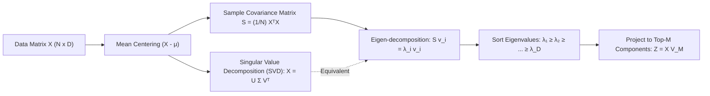

# Phân Tích Thành Phần Chính (Principal Component Analysis - PCA)

> **Khái niệm chính thống**: *Mathematics for Machine Learning*, Chapter 10 (Dimensionality Reduction with Principal Component Analysis); *Principal Component Analysis.pdf* (Ngoc Hoang Luong, UIT).
> **Miền kiến thức**: [[index|Unsupervised Learning & Linear Algebra]]
> **Tài liệu gốc liên quan**:
> - [Principal Component Analysis.pdf](../resources/machine-learning/Principal%20Component%20Analysis.pdf) (Trang 1-26)
> - [Mathematics-for-Machine-Learning.pdf](../resources/machine-learning/Mathematics-for-Machine-Learning.pdf) (Trang 321-355)
> - [Data Science_Machine Learning course (1).pdf](../resources/machine-learning/Data%20Science_Machine%20Learning%20course%20%281%29.pdf) (Trang 110-135)

---

## 1. Tóm tắt (Executive Summary)
**Phân tích Thành phần Chính (Principal Component Analysis - PCA)** là thuật toán học không giám sát kinh điển dùng để giảm số chiều dữ liệu từ không gian ban đầu $\mathbb{R}^D$ xuống không gian con tuyến tính $\mathbb{R}^M$ ($M < D$) trong khi vẫn bảo toàn tối đa lượng thông tin (độ biến thiên / phương sai) của dữ liệu gốc. Về mặt hình học, PCA tìm kiếm một hệ trục tọa độ trực giao mới sao cho trục thứ nhất (First Principal Component) định hướng theo phương có phương sai lớn nhất, và các trục tiếp theo trực giao với các trục trước đó và bảo toàn phương sai giảm dần. Về mặt toán học, các thành phần chính chính là các **Vector riêng (Eigenvectors)** của ma trận hiệp phương sai mẫu.

---

## 2. Định nghĩa chính thống & Hai góc nhìn Toán học Tương đương

### 2.1 Góc nhìn 1: Tối đa hóa Phương sai Chiếu (Maximum Variance Perspective)
Cho tập dữ liệu đã chuẩn hóa trừ trung bình: $\sum_{n=1}^N x_n = 0$.
Ma trận hiệp phương sai mẫu $S \in \mathbb{R}^{D \times D}$:
$$S = \frac{1}{N} \sum_{n=1}^N x_n x_n^T = \frac{1}{N} X^T X$$
Xét vector đơn vị $u_1 \in \mathbb{R}^D$ ($\|u_1\|_2 = 1$). Phương sai của dữ liệu khi chiếu lên $u_1$:
$$\text{Var}(X u_1) = \frac{1}{N} \sum_{n=1}^N (u_1^T x_n)^2 = u_1^T S u_1$$

Bài toán tối ưu hóa với nhân tử Lagrange:
$$\max_{u_1} u_1^T S u_1 \quad \text{s.t.} \quad u_1^T u_1 = 1$$
$$\mathcal{L}(u_1, \lambda_1) = u_1^T S u_1 - \lambda_1 (u_1^T u_1 - 1)$$
Lấy đạo hàm theo $u_1$ và đặt bằng 0:
$$\nabla_{u_1} \mathcal{L} = 2 S u_1 - 2 \lambda_1 u_1 = 0 \implies S u_1 = \lambda_1 u_1$$
*(Đây chính là phương trình định nghĩa trị riêng và vector riêng! Phương sai lớn nhất đạt được chính là trị riêng lớn nhất $\lambda_1$).*

### 2.2 Góc nhìn 2: Tối thiểu hóa Sai số Tái tạo (Minimum Reconstruction Error)
PCA đồng thời là phép chiếu tuyến tính tối ưu hóa việc tái dựng lại dữ liệu gốc với sai số bình phương nhỏ nhất:
$$\min_{U_M} \frac{1}{N} \sum_{n=1}^N \|x_n - U_M U_M^T x_n\|_2^2$$
Hai góc nhìn Tối đa hóa Phương sai và Tối thiểu hóa Sai số Tái tạo là **tương đương tuyệt đối về mặt toán học**.

---

## 3. So sánh & Mâu thuẫn / Sắc thái giữa các tài liệu

| Tiêu chí | PCA qua Phân rã Ma trận Hiệp phương sai (Eigen-decomposition) | PCA qua Phân rã Giá trị Kỳ dị (SVD) | Ý nghĩa Kỹ thuật Thực chiến |
| :--- | :--- | :--- | :--- |
| **Công thức** | Tính $S = \frac{1}{N} X^T X$, sau đó phân rã $S = V \Lambda V^T$. | Phân rã trực tiếp ma trận dữ liệu: $X = U \Sigma V^T$. | Giá trị kỳ dị $\sigma_i$ của $X$ liên hệ với trị riêng của $S$: $\lambda_i = \frac{\sigma_i^2}{N}$. |
| **Ổn định Số học** | Kém; phép tính $X^T X$ làm bình phương số điều kiện (Condition Number), gây mất độ chính xác dấu phẩy động. | **Rất cao**. Không bao giờ phải tính trực tiếp ma trận $X^T X$. | `scikit-learn` và mọi thư viện chuẩn đều dùng SVD để cài đặt PCA thay vì tính ma trận hiệp phương sai. |
| **Độ phức tạp bộ nhớ** | Tốn $\mathcal{O}(D^2)$ lưu ma trận hiệp phương sai. | Tối ưu; có thể chạy dạng dòng dữ liệu (Incremental PCA). | Áp dụng được cho kho dữ liệu lớn không vừa RAM. |

---

## 4. Góc nhìn Thực chiến & Thiết kế Hệ thống cho AI Engineer

### 4.1 Quy tắc Tỷ lệ Phương sai Tích lũy (Explained Variance Ratio)
Để chọn số chiều $M$ tối ưu, kỹ sư vẽ biểu đồ **Scree Plot** và chọn $M$ sao cho tỷ lệ phương sai giải thích tích lũy vượt ngưỡng mong muốn (thường là 90% hoặc 95%):
$$\text{Cumulative Explained Variance}(M) = \frac{\sum_{i=1}^M \lambda_i}{\sum_{j=1}^D \lambda_j} \ge 0.95$$

### 4.2 Bẫy Bắt buộc Chuẩn hóa Dữ liệu (Standardization Prerequisite)
- **Cạm bẫy chết người**: Nếu không chuẩn hóa độ lệch chuẩn (StandardScaler: đưa về trung bình 0, phương sai 1) trước khi chạy PCA:
  - Một thuộc tính có đơn vị đo lớn (ví dụ: `Lương tính bằng VNĐ`, dao động hàng chục triệu) sẽ hoàn toàn áp đảo thuộc tính có đơn vị đo nhỏ (ví dụ: `Tuổi`, dao động 20-60).
  - Trục thành phần chính thứ nhất sẽ bị bẻ cong đi theo hướng của thuộc tính có thang đo lớn nhất một cách giả tạo, làm biến dạng toàn bộ cấu trúc dữ liệu.

### 4.3 Câu hỏi phỏng vấn thực tế
- **Q**: *Tại sao PCA là phép giảm chiều tuyến tính không giám sát, và sự khác biệt cốt lõi giữa PCA với t-SNE / UMAP là gì?*
  - **A**: PCA chỉ tìm kiếm các siêu phẳng chiếu tuyến tính trực giao toàn cục và tối đa hóa phương sai; nó bảo toàn cấu trúc vĩ mô toàn cục (Global Structure) nhưng hoàn toàn thất bại trong việc phân tách các đa tạp phi tuyến tính phức tạp (Non-linear Manifolds như cuộn Swiss Roll). Ngược lại, **t-SNE** và **UMAP** là các giải thuật giảm chiều phi tuyến tính dựa trên đồ thị xác suất láng giềng, xuất sắc trong việc bảo toàn cấu trúc cục bộ (Local Neighborhoods) để trực quan hóa cụm dữ liệu 2D/3D.

---

## 5. Mạng lưới Liên kết Tri thức (Knowledge Graph & `wiki-links`)
- [[linear-regression-mle]] — Sử dụng PCA để nén thuộc tính trước khi hồi quy nhằm triệt tiêu đa cộng tuyến.
- [[vector-embeddings]] — Sử dụng PCA/SVD để nén số chiều của vector embeddings (Dimensionality Reduction).
- [[regularization-l1-l2]] — So sánh giữa trích xuất đặc trưng mới (PCA) và chọn lọc đặc trưng cũ (L1).