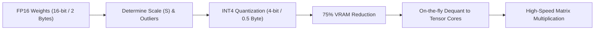

# Lượng Tử Hóa và Nén Mô Hình (Quantization & Model Compression)

> **Khái niệm chính thống**: *Encyclopedia of LLMs*, Chapter 11 (Section 11.1); Frantar et al. (2022) *"GPTQ"*; Lin et al. (2023) *"AWQ"*; Dettmers et al. (2022) *"LLM.int8()"*.
> **Miền kiến thức**: [[index|Inference Optimization & Systems Engineering]]
> **Tài liệu gốc liên quan**:
> - [Encyclopedia of LLMs and Foundation Models.pdf](../resources/genai/Encyclopedia%20of%20LLMs%20and%20Foundation%20Models.pdf) (Trang 101-105)
> - [AIO2025_Reading_ONNX_TensorRT.pdf](../resources/deep-learning/computer-vision/AIO2025_Reading_ONNX_TensorRT.pdf) (Trang 1-42)
> - [LLM Interview QnA.pdf](../resources/genai/LLM%20Interview%20QnA.pdf) (Trang 25-35)

---

## 1. Tóm tắt (Executive Summary)
**Lượng tử hóa và Nén Mô hình (Quantization & Compression)** là tập hợp các kỹ thuật tối ưu hóa phần mềm và phần cứng nhằm giảm thiểu dung lượng bộ nhớ (VRAM/RAM) và tăng tốc độ tính toán suy luận (Inference Throughput) của mô hình bằng cách chuyển đổi trọng số (weights) và ma trận kích hoạt (activations) từ định dạng số thực dấu phẩy động độ chính xác cao (FP32, FP16, BF16) sang các định dạng số nguyên có số bit thấp hơn (INT8, INT4, FP4). Đây là điều kiện tiên quyết để thương mại hóa LLM và triển khai mô hình lớn trên các thiết bị biên hoặc hạ tầng GPU có kinh phí giới hạn.

---

## 2. Định nghĩa chính thống & Cơ chế cốt lõi (Canonical Definition & Mechanism)

### 2.1 Bản chất toán học của Lượng tử hóa đều tuyến tính (Uniform Linear Quantization)
Phép biến đổi từ giá trị số thực $x \in [\alpha, \beta]$ sang giá trị số nguyên $q \in [q_{\min}, q_{\max}]$ được xác định bởi:
$$q = \text{clip}\left( \left\lfloor \frac{x}{S} \right\rceil + Z, \; q_{\min}, \; q_{\max} \right)$$
Ngược lại, phép giải lượng tử hóa (Dequantization) khôi phục giá trị xấp xỉ $\hat{x}$:
$$\hat{x} = S \cdot (q - Z)$$

Trong đó:
- $S$ là hệ số tỷ lệ co giãn (Scale factor): $S = \frac{\beta - \alpha}{q_{\max} - q_{\min}}$.
- $Z$ là điểm không (Zero-point) đối với lượng tử hóa bất đối xứng (Asymmetric); với lượng tử hóa đối xứng (Symmetric), $Z = 0$.

### 2.2 Các trường phái Lượng tử hóa tiên tiến
1. **PTQ (Post-Training Quantization)**: Lượng tử hóa trực tiếp mô hình đã huấn luyện xong mà không cần huấn luyện lại:
   - **GPTQ (Second-Order Error Compensation)**: Dựa trên ma trận nghịch đảo Hessian $H^{-1}$ theo thuật toán Optimal Brain Surgeon để bù trừ sai số lượng tử hóa của các trọng số liền kề. Tối ưu cho nén chỉ trọng số (Weight-only INT4).
   - **AWQ (Activation-aware Weight Quantization)**: Quan sát thấy không phải mọi trọng số đều quan trọng như nhau; chỉ có 1% trọng số tương ứng với các giá trị kích hoạt lớn (outlier activations) quyết định hiệu năng của mô hình. AWQ bảo vệ 1% trọng số quan trọng này bằng cách co giãn kênh (channel scaling) trước khi nén INT4, giữ nguyên chất lượng mô hình vượt trội so với GPTQ.
2. **GGUF (llama.cpp Ecosystem)**: Định dạng tệp nhị phân tối ưu cho việc chạy LLM trên CPU/Apple Silicon hoặc kết hợp CPU-GPU Offloading, hỗ trợ các chế độ lượng tử hóa hỗn hợp (k-quants: Q4_K_M, Q5_K_M).
3. **KV Cache Quantization**: Lượng tử hóa ma trận Key-Value trong quá trình sinh từ FP16 xuống INT8/FP8, giải phóng 50-75% bộ nhớ đệm ngữ cảnh mà không ảnh hưởng tới chất lượng logic.

---

## 3. So sánh & Mâu thuẫn / Sắc thái giữa các tài liệu

| Định dạng / Kỹ thuật | Kích thước mô hình 70B | Mức độ suy hao chất lượng (Perplexity) | Nền tảng phần cứng tối ưu | Use-case chủ đạo |
| :--- | :--- | :--- | :--- | :--- |
| **FP16 / BF16 (Gốc)** | ~140 GB | 0% (Ground Truth) | Cần cụm GPU lớn (2x A100 80GB). | Huấn luyện, đánh giá benchmark tiêu chuẩn. |
| **AWQ / GPTQ (INT4)** | ~35 - 40 GB | Rất thấp (< 0.1 perplexity increase). | GPU NVIDIA hiện đại (Ada Lovelace, Hopper, Ampere) qua vLLM / TensorRT-LLM. | Triển khai API Server chịu tải cao với throughput lớn. |
| **GGUF (Q4_K_M)** | ~40 GB | Thấp, chấp nhận được cho người dùng cuối. | CPU, Apple Silicon M-series, GPU tiêu dùng (RTX 3060/4090). | Ứng dụng chạy offline trên máy cá nhân, Local LLM Agent. |
| **W8A8 (Weight 8-bit, Activation 8-bit)** | ~70 GB | Gần như bằng 0. | NVIDIA Hopper FP8 Tensor Cores. | Đạt tốc độ tính toán FLOPs cao nhất nhờ tăng tốc phần cứng thực sự. |

---

## 4. Góc nhìn Thực chiến & Thiết kế Hệ thống cho AI Engineer

### 4.1 Memory-Bound vs Compute-Bound trong Inference LLM
- Giai đoạn **Prefill (Prompt Processing)**: Xử lý toàn bộ prompt đầu vào song song $\rightarrow$ Mang tính **Compute-Bound** (Nghẽn năng lực tính toán FLOPs của GPU).
- Giai đoạn **Decode (Token Generation)**: Sinh từng token một tuần tự $\rightarrow$ Mang tính **Memory-Bound** (Nghẽn băng thông đọc bộ nhớ HBM: mỗi token sinh ra phải đọc lại toàn bộ tham số mô hình qua bus bộ nhớ).
- **Ý nghĩa sống còn**: Lượng tử hóa 4-bit giúp giảm 4 lần dung lượng dữ liệu phải di chuyển qua bus bộ nhớ GPU cho mỗi token, do đó **tốc độ sinh token (Token/s) có thể tăng gần gấp đôi hoặc gấp ba** ngay cả khi GPU phải thực hiện thêm bước dequantization!

### 4.2 Câu hỏi phỏng vấn thực tế
- **Q**: *Tại sao lượng tử hóa cả Trọng số và Kích hoạt (W8A8) lại khó hơn nhiều so với việc chỉ lượng tử hóa Trọng số (W8A16 hoặc W4A16)?*
  - **A**: Trọng số là tĩnh (đã cố định sau huấn luyện) nên có thể phân tích phân phối ngoại lai trước để nén cẩn thận. Ngược lại, kích hoạt (activations) là động, phụ thuộc vào văn bản đầu vào của người dùng và thường xuất hiện các kênh ngoại lai (systematic outlier channels) có độ lớn gấp 100 lần bình thường. Nếu lượng tử hóa thô bạo các outlier này sang INT8, toàn bộ dải động sẽ bị co cụm làm phá hủy khả năng suy luận của mô hình.

---

## 5. Mạng lưới Liên kết Tri thức (Knowledge Graph & `wiki-links`)
- [[transformer-architecture]] — Nền tảng nơi các ma trận Q, K, V và FFN chịu sự nén lượng tử.
- [[large-language-models]] — Nhu cầu cấp thiết phải nén để phục vụ sản xuất.
- [[inference-optimization-tensorrt]] — Công cụ biên dịch tối ưu hóa nhân nén trên phần cứng NVIDIA.
- [[llm-fine-tuning]] — QLoRA áp dụng trực tiếp lượng tử hóa NF4 vào huấn luyện thích ứng.