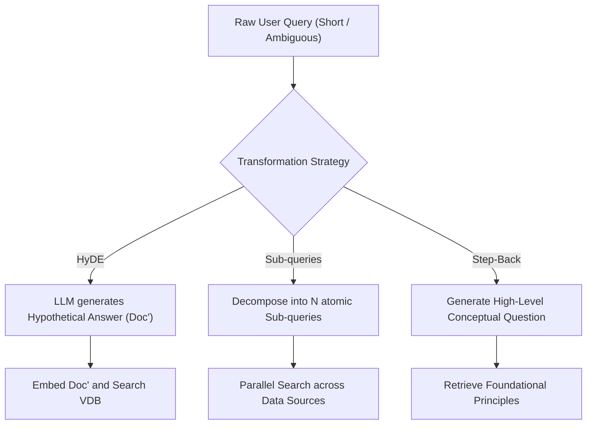

# Chuyển Đổi Truy Vấn (Query Transformation & Expansion)

> **Khái niệm chính thống**: *Encyclopedia of LLMs*, Section 13.4.1; Gao et al. (2023) *"Precise Zero-Shot Dense Retrieval without Relevance Labels" (HyDE)*; *english_GiaiThichThuatNguRAG.pdf*.
> **Miền kiến thức**: [[index|Pre-Retrieval Optimization]]
> **Tài liệu gốc liên quan**:
> - [english_GiaiThichThuatNguRAG.pdf](../resources/genai/english_GiaiThichThuatNguRAG.pdf) (Trang 5-9)
> - [Encyclopedia of LLMs and Foundation Models.pdf](../resources/genai/Encyclopedia%20of%20LLMs%20and%20Foundation%20Models.pdf) (Trang 124-126)
> - [AIO2026_[Reading]-RAG-System.pdf](../resources/genai/AIO2026_%5BReading%5D-RAG-System.pdf) (Trang 75-88)

---

## 1. Tóm tắt (Executive Summary)
**Chuyển đổi Truy vấn (Query Transformation)** là tập hợp các kỹ thuật tối ưu hóa trước truy xuất (Pre-Retrieval) nhằm viết lại, phân rã hoặc mở rộng câu hỏi ban đầu của người dùng thành một hoặc nhiều truy vấn tối ưu hơn cho bộ máy tìm kiếm. Trong thực tế, câu hỏi của người dùng thường ngắn ngủi, mơ hồ, sai chính tả hoặc chứa nhiều câu hỏi con lồng ghép. Query Transformation giúp thu hẹp khoảng cách biểu diễn ngữ nghĩa (Semantic Gap) giữa câu hỏi của người dùng và các tài liệu lưu trong kho dữ liệu thông qua các kỹ thuật đột phá như **HyDE (Hypothetical Document Embeddings)**, **Sub-Query Decomposition**, và **Step-Back Prompting**.

---

## 2. Định nghĩa chính thống & Các mô thức Chuyển đổi (Transformation Paradigms)

### 2.1 Chi tiết các kỹ thuật chuyển đổi chủ đạo
1. **HyDE (Hypothetical Document Embeddings - Gao et al., 2023)**:
   - *Vấn đề*: Câu hỏi ngắn ngủi ("Chính sách hoàn tiền?") và câu trả lời trong tài liệu ("Khách hàng được quyền gửi trả hàng trong 30 ngày...") nằm ở hai vùng không gian vector khác nhau.
   - *Cơ chế*: Dùng một LLM nhỏ sinh ra một "tài liệu giả định" (Hypothetical Document) trả lời câu hỏi đó (dù có thể chứa thông tin chưa chính xác). Sau đó lấy vector nhúng của tài liệu giả định này để đi tìm kiếm trong Vector DB. Do cấu trúc của tài liệu giả định tương đồng với tài liệu thật trong kho, độ trùng khớp vector tăng vọt.
2. **Sub-Query Decomposition (Phân rã Đa truy vấn)**:
   - Áp dụng khi câu hỏi phức tạp chứa nhiều vế so sánh (e.g., *"So sánh doanh thu của Apple và Microsoft quý 3 năm 2024?"*).
   - LLM tự động phân rã thành 2 câu truy vấn độc lập:
     - Sub-query 1: *"Doanh thu Apple quý 3 năm 2024"*
     - Sub-query 2: *"Doanh thu Microsoft quý 3 năm 2024"*
   - Hệ thống tìm kiếm song song cho từng truy vấn rồi gộp kết quả lại.
3. **Step-Back Prompting (Lùi một bước để nhìn tổng thể)**:
   - Đặt một câu hỏi trừu tượng hơn về mặt nguyên lý nền tảng để lấy về các tài liệu khái quát trước khi đi vào tiểu tiết cụ thể.
4. **Query Rewriting with Multi-Turn History**:
   - Trong hội thoại liên tục, khi người dùng hỏi *"Nó giá bao nhiêu?"*, LLM sẽ kết hợp lịch sử chat để viết lại thành: *"Giá bán của sản phẩm iPhone 15 Pro Max là bao nhiêu?"*.

---

## 3. So sánh & Mâu thuẫn / Sắc thái giữa các tài liệu

| Kỹ thuật | Độ trễ gia tăng (Latency Overhead) | Mức độ cải thiện Recall | Rủi ro tiềm ẩn |
| :--- | :--- | :--- | :--- |
| **Raw Query (Không chuyển đổi)** | 0 ms | Thấp nếu câu hỏi mơ hồ. | Bỏ sót các tài liệu có từ vựng không trùng khớp. |
| **HyDE** | Cao (+300ms đến 1s cho bước sinh văn bản giả định). | Rất cao cho các câu hỏi mở, câu hỏi khái niệm. | Nếu LLM sinh ra tài liệu giả định bị ảo giác đi chệch hướng hoàn toàn, vector search sẽ bị kéo theo hướng sai (Drift). |
| **Sub-Query Decomposition** | Trung bình (+200ms cho phân rã, tìm kiếm chạy song song). | Xuất sắc cho các bài toán phân tích phức tạp. | Bùng nổ số lượng chunk trả về, làm quá tải bước Reranking. |

---

## 4. Góc nhìn Thực chiến & Thiết kế Hệ thống cho AI Engineer

### 4.1 Routing thông minh: Không áp dụng HyDE bừa bãi
- **Quy tắc vàng**:
  - Không bao giờ chạy HyDE cho các truy vấn tra cứu sự thật đơn giản (Factoid Queries) hoặc tra cứu mã SKU, mã nhân viên (e.g., *"Mã số thuế của công ty X"*), vì LLM sẽ bịa ra một mã số giả làm lệch kết quả tìm kiếm.
  - Thiết kế một tầng **Query Classifier / Router** (dùng rule-based hoặc model cực nhỏ 0.5B):
    - Câu hỏi khái niệm/mở $\rightarrow$ Định tuyến sang HyDE.
    - Câu hỏi so sánh đa thực thể $\rightarrow$ Định tuyến sang Sub-Query Decomposition.
    - Câu hỏi mã định danh/từ khóa $\rightarrow$ Chuyển thẳng tới [[hybrid-search|Hybrid Search]].

### 4.2 Câu hỏi phỏng vấn thực tế
- **Q**: *Tại sao HyDE lại hiệu quả ngay cả khi câu trả lời giả định do LLM sinh ra có chứa thông tin sai sự thật (hallucination)?*
  - **A**: Vì mô hình embedding không kiểm tra tính đúng sai của sự thật, mà mã hóa **phong cách ngữ pháp, trường từ vựng và chủ đề liên quan (topical & stylistic structure)**. Một văn bản giả định về chủ đề "luật lao động" sẽ có phân phối từ vựng và cấu trúc ngữ nghĩa rất gần với văn bản luật lao động thật trong cơ sở dữ liệu, giúp vector search rơi đúng vào cụm láng giềng liên quan.

---

## 5. Mạng lưới Liên kết Tri thức (Knowledge Graph & `wiki-links`)
- [[rag-architecture]] — Tầng tiền xử lý truy vấn trong quy trình RAG.
- [[hybrid-search]] — Nơi tiếp nhận các câu truy vấn đã được chuyển đổi.
- [[vector-embeddings]] — Cơ chế đo khoảng cách mà HyDE tác động trực tiếp.
- [[prompt-engineering]] — Kỹ thuật thiết kế prompt để viết lại câu hỏi và phân rã truy vấn.