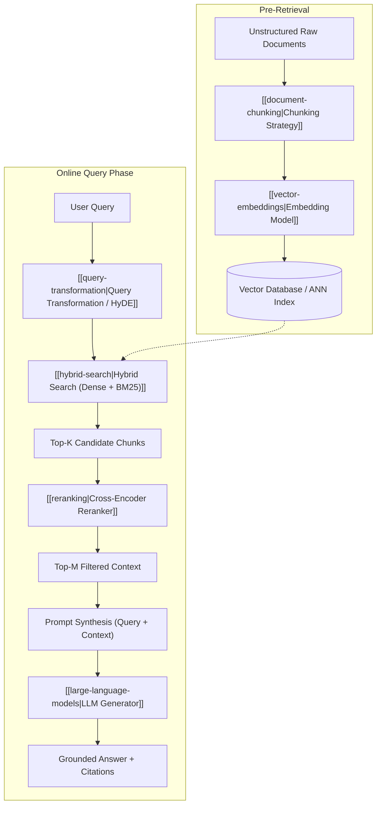

# Kiến Trúc RAG (Retrieval-Augmented Generation Architecture)

> **Khái niệm chính thống**: *Encyclopedia of LLMs*, Chapter 13 (Sections 13.1 - 13.6); Lewis et al. (2020) *"Retrieval-Augmented Generation for Knowledge-Intensive NLP Tasks"*; Gao et al. (2023) *"Retrieval-Augmented Generation for Large Language Models: A Survey"*.
> **Miền kiến thức**: [[index|Retrieval-Augmented Generation & Information Retrieval]]
> **Tài liệu gốc liên quan**:
> - [giao_trinh_rag.pdf](../resources/genai/giao_trinh_rag.pdf) (Trang 1-16)
> - [AIO2025_Tutorial_RAG.pdf](../resources/genai/AIO2025_Tutorial_RAG.pdf) (Trang 1-33)
> - [AIO2026_[Reading]-RAG-System.pdf](../resources/genai/AIO2026_%5BReading%5D-RAG-System.pdf) (Trang 1-113)
> - [Encyclopedia of LLMs and Foundation Models.pdf](../resources/genai/Encyclopedia%20of%20LLMs%20and%20Foundation%20Models.pdf) (Trang 121-128)
> - [english_GiaiThichThuatNguRAG.pdf](../resources/genai/english_GiaiThichThuatNguRAG.pdf) (Trang 1-16)

---

## 1. Tóm tắt (Executive Summary)
**Kiến trúc Tạo sinh Tăng cường Truy xuất (Retrieval-Augmented Generation - RAG)** là mô hình kiến trúc AI kết hợp năng lực truy xuất thông tin phi tham số (non-parametric retrieval) từ các kho cơ sở dữ liệu bên ngoài với năng lực suy luận và ngôn ngữ tham số (parametric language model) của LLM. Bằng cách neo câu trả lời vào các tài liệu thực tế được truy xuất theo thời gian thực tại thời điểm suy luận, RAG giải quyết triệt để 3 tử huyệt cố hữu của LLM: **ảo giác sự thật (hallucination)**, **kiến thức lỗi thời (knowledge cutoff)**, và **thiếu minh bạch nguồn gốc (lack of explainability / citations)**.

---

## 2. Định nghĩa chính thống & Sự tiến hóa Kiến trúc (Canonical Architecture Evolution)

### 2.1 Định nghĩa nền tảng (Lewis et al., 2020)
Trong mô hình RAG chính thống, xác suất sinh chuỗi câu trả lời $y = (y_1, ..., y_N)$ dựa trên câu hỏi $x$ được mô hình hóa biên qua tập tài liệu ẩn $z \in \mathcal{Z}$ được truy xuất:
$$P(y|x) = \sum_{z \in \text{Top-K}(\mathcal{Z})} P_\eta(z|x) \prod_{i=1}^N P_\theta(y_i | x, z, y_{<i})$$
Trong đó:
- $P_\eta(z|x)$ là **Mô-đun Truy xuất (Retriever)** tham số hóa bởi $\eta$ (ví dụ: Bi-Encoder BERT/DPR), tính xác suất tài liệu $z$ liên quan tới câu hỏi $x$.
- $P_\theta(y_i | x, z, y_{<i})$ là **Mô-đun Tạo sinh (Generator)** tham số hóa bởi $\theta$ (ví dụ: BART, LLaMA, GPT), sinh token dựa trên liên kết giữa câu hỏi, tài liệu ngữ cảnh $z$ và các token đã sinh.

### 2.2 4 Thế hệ Kiến trúc RAG
1. **Naive RAG (RAG Nguyên thủy)**: Luồng tuần tự thô sơ: `Chunking cố định -> Embedding -> Vector Search Cosine Top-K -> Bơm vào Prompt -> Sinh kết quả`. *Nhược điểm*: Rất dễ trích xuất sai ngữ cảnh (Low Precision), trôi dạt ngữ nghĩa và nuốt chửng thông tin rải rác.
2. **Advanced RAG (RAG Nâng cao)**: Bổ sung 2 tầng then chốt:
   - *Pre-retrieval*: [[query-transformation|Query Expansion, Sub-queries, HyDE]], tối ưu hóa chunking theo cấu trúc.
   - *Post-retrieval*: [[reranking|Cross-Encoder Reranking]], Context Compression, lọc nhiễu trước khi nạp vào LLM.
3. **Modular RAG (RAG Module hóa)**: Kiến trúc phân rã thành các dịch vụ độc lập có thể cắm-rút (Pluggable modules): Search module, Memory module, Routing module, Predict module.
4. **Agentic RAG (RAG Tác nhân)**: LLM hoạt động như một bộ não điều phối ([[agentic-ai-core|Agentic AI]]), tự quyết định khi nào cần tra cứu, tra cứu ở nguồn nào (Vector DB, SQL DB hay Web Search), tự đánh giá xem tài liệu lấy về đã đủ trả lời chưa, và thực hiện truy xuất lặp nhiều chặng (Multi-hop Reasoning).

---

## 3. So sánh & Mâu thuẫn / Sắc thái giữa các tài liệu

| Khía cạnh | Tài liệu giáo trình cơ bản (`giao_trinh_rag.pdf`) | Tài liệu chuyên sâu (`Encyclopedia of LLMs` & Production) | Phân tích của AI Engineer |
| :--- | :--- | :--- | :--- |
| **Công cụ tìm kiếm cốt lõi** | Coi Vector Database và Cosine Similarity là trái tim duy nhất của RAG. | Khẳng định Vector Search đơn lẻ thất bại thảm hại trong môi trường doanh nghiệp; bắt buộc phải là **Hybrid Search (Dense + BM25)** kết hợp **Reranker**. | Vector search giỏi hiểu ý nghĩa tổng quát (semantic) nhưng bất lực trước mã số, số hiệu, mã SKU hay tên riêng chính xác. Cần kết hợp từ khóa truyền thống. |
| **Giải quyết bài toán Context dài** | Khuyên dùng RAG cho mọi tình huống để tiết kiệm token và bộ nhớ. | Tranh luận với việc các mô hình mở rộng Context Window lên 1M - 2M tokens (Gemini 1.5, LLaMA 3.1): *"Context dài có giết chết RAG?"* | RAG không chết mà chuyển hóa: Context 1M token quá đắt đỏ và chậm cho hàng triệu query mỗi ngày; RAG đóng vai trò bộ lọc định tuyến (Routing Filter) để chọn ra 10k-50k token tinh túy nhất cho mô hình lớn. |
| **Trích dẫn nguồn (Attribution)** | Cho rằng có RAG là tự động loại bỏ 100% ảo giác và luôn trích dẫn đúng. | Chỉ ra nguy cơ **Attribution Hallucination**: LLM tạo ra câu trả lời dựa trên định kiến tiền huấn luyện (parametric bias) nhưng lại gắn tag trích dẫn giả mạo vào tài liệu đính kèm. | Phải có cơ chế kiểm tra chéo (Fact-Checking / Faithfulness Verification) bằng framework như Ragas hoặc Guardrails độc lập. |

---

## 4. Góc nhìn Thực chiến & Thiết kế Hệ thống cho AI Engineer

### 4.1 Quy tắc triển khai Production RAG (The Production Rules)
1. **Garbage In, Garbage Out**: 80% thành bại của RAG nằm ở chất lượng làm sạch dữ liệu trước khi chunking (loại bỏ header/footer lặp lại trong PDF, chuẩn hóa bảng biểu HTML/Markdown, tách bảng metadata).
2. **Kích thước Chunking**: Không bao giờ dùng một kích thước chunking cho toàn bộ tài nguyên. Hãy phối hợp kỹ thuật **Parent-Document Retrieval** (truy xuất chunk nhỏ 200 token để vector match chuẩn xác, nhưng nạp chunk cha 1.000 token vào context của LLM).
3. **Luôn sử dụng Reranker**: Thêm một Cross-Encoder nhỏ (như `bge-reranker-large` hoặc Cohere Rerank) tăng tỷ lệ Hit-Rate của hệ thống từ 60% lên trên 90%.

### 4.2 Câu hỏi phỏng vấn thực tế
- **Q**: *Khi nào hệ thống RAG nên trả về "Tôi không biết" thay vì cố gắng trả lời? Thiết kế cơ chế đó thế nào?*
  - **A**: Khi điểm số tương đồng sau bước Reranking của toàn bộ các chunk ứng viên đều thấp hơn một ngưỡng tin cậy xác định ($Score < \tau$), hoặc khi hàm đo Faithfulness phát hiện câu trả lời sinh ra không có căn cứ từ Context. Lúc này hệ thống phải kích hoạt kịch bản fallback rõ ràng để bảo toàn tính trung thực nghiệp vụ.

---

## 5. Mạng lưới Liên kết Tri thức (Knowledge Graph & `wiki-links`)
- [[document-chunking]] — Kỹ thuật phân tách tài liệu nguồn.
- [[vector-embeddings]] — Biểu diễn toán học của văn bản trong không gian vector.
- [[hybrid-search]] — Kết hợp truy xuất ngữ nghĩa và truy xuất từ khóa chính xác.
- [[reranking]] — Tầng lọc và xếp hạng lại tài liệu tối thượng.
- [[query-transformation]] — Tái cấu trúc câu hỏi người dùng trước khi truy xuất.
- [[graph-rag]] — Kết hợp đồ thị tri thức để giải quyết bài toán suy luận tổng thể toàn kho dữ liệu.
- [[llm-evaluation]] — Đánh giá RAG thông qua bộ chỉ số Ragas (Faithfulness, Context Relevance).