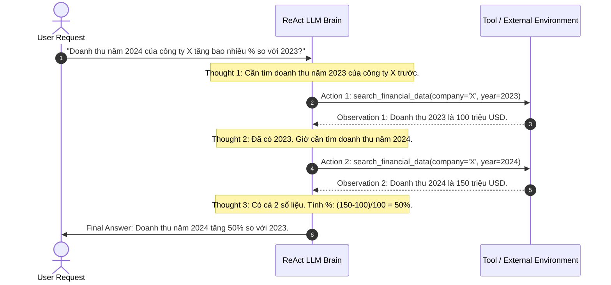

# Mô Thức ReAct (ReAct: Synergizing Reasoning and Acting)

> **Khái niệm chính thống**: Yao et al. (ICLR 2023) *"ReAct: Synergizing Reasoning and Acting in Language Models"*; *Master All 20 Agentic AI Design Patterns*, Pattern 16.
> **Miền kiến thức**: [[index|Agent Reasoning & Execution Patterns]]
> **Tài liệu gốc liên quan**:
> - [AIO2025_[Description]-AI-Agent-LLM-Tool-Calling.pdf](../resources/genai/AIO2025_%5BDescription%5D-AI-Agent-LLM-Tool-Calling.pdf) (Trang 15-30)
> - [Master All 20 Agentic AI Design Patterns.pdf](../resources/genai/Master%20All%2020%20Agentic%20AI%20Design%20Patterns.pdf) (Trang 6-10)
> - [giao_trinh_agentic.pdf](../resources/genai/giao_trinh_agentic.pdf) (Trang 8-14)

---

## 1. Tóm tắt (Executive Summary)
**Mô thức ReAct (Reasoning + Acting)** là mô thức kiến trúc nền tảng cho phép LLM phối hợp chặt chẽ giữa **Suy luận (Reasoning)** và **Hành động (Acting)** trong một vòng lặp liên tục. Thay vì chỉ suy luận đơn thuần (như Chain-of-Thought) dẫn đến ảo giác vì thiếu dữ liệu ngoài, hoặc chỉ hành động mù quáng (như Act-only tool calling) không có định hướng logic, ReAct đan xen các bước: sinh lập luận tư duy (**Thought**), quyết định gọi công cụ ngoại vi (**Action**), và đọc kết quả phản hồi từ môi trường (**Observation**). Chu trình này tiếp diễn cho đến khi bài toán được giải quyết trọn vẹn.

---

## 2. Định nghĩa chính thống & Vòng lặp Thuật toán (Algorithmic Loop)

### 2.1 Cấu trúc Không gian Trạng thái ReAct
Tại mỗi bước thời gian $t \in \{1, ..., T\}$:
1. **Thought Step ($c_t$)**: LLM tự độc thoại nội tâm (Internal Monologue) để phân tích tình hình hiện tại:
   $$c_t \sim P_\theta(\cdot \mid x, a_1, o_1, ..., a_{t-1}, o_{t-1})$$
2. **Action Step ($a_t$)**: Dựa trên suy luận $c_t$, mô hình quyết định gọi một công cụ từ tập action space $\mathcal{A}$ với tham số cụ thể:
   $$a_t \sim P_\theta(\cdot \mid x, a_1, o_1, ..., c_t)$$
3. **Observation Step ($o_t$)**: Môi trường thực thi $a_t$ (gọi API, truy vấn DB, search web) và trả về kết quả quan sát:
   $$o_t = \text{Environment}(a_t)$$

---

## 3. So sánh & Mâu thuẫn / Sắc thái giữa các tài liệu

| Phương pháp | Luồng tư duy | Khả năng tự sửa lỗi | Tỷ lệ Ảo giác |
| :--- | :--- | :--- | :--- |
| **Standard Prompting** | Không có bước trung gian. | 0% | Cực cao trên bài toán đa bước. |
| **Chain-of-Thought (CoT)** | Chuỗi suy luận liên tục kín (Internal only). | Thấp; nếu suy luận sai 1 bước ở giữa sẽ tiếp tục ảo giác cho đến cuối. | Trung bình; phụ thuộc hoàn toàn vào kiến thức tĩnh có trong trọng số. |
| **Act-Only (Tool Calling thuần)** | Gọi công cụ liên tục không có bước phân tích logic. | Kém; hành động theo kiểu thử sai mù quáng (brute-force). | Thấp về dữ liệu, nhưng lãng phí tài nguyên gọi API vô ích. |
| **ReAct (Synergy)** | Đan xen Thought $\rightarrow$ Action $\rightarrow$ Observation. | Xuất sắc; tự đọc kết quả Observation để điều chỉnh Thought của bước tiếp theo. | **Thấp nhất**; triệt tiêu ảo giác nhờ neo chặt vào dữ liệu môi trường thực tế. |

---

## 4. Góc nhìn Thực chiến & Thiết kế Hệ thống cho AI Engineer

### 4.1 Bẫy Vòng Lặp Vô Tận (Infinite Loop Traps) & Biện pháp khắc phục
Một vấn đề nan giải khi chạy ReAct trong production:
- *Tình huống*: Tool trả về kết quả rỗng hoặc báo lỗi `"Resource not found"`. Agent tiếp tục suy nghĩ và gọi lại chính xác tool đó với cùng tham số, lặp lại 20 lần cho đến khi cháy sạch quota token.
- **Giải pháp kỹ thuật**:
  1. **Strict Max Iterations**: Giới hạn cứng vòng lặp tối đa (thường đặt `max_turns = 5 - 10`).
  2. **Loop Detection Middleware**: Lưu hash của cặp `(Action, Action_Input)`. Nếu phát hiện action lặp lại 2 lần liên tiếp, tự động chèn cảnh báo hệ thống vào context: `"[SYSTEM]: Công cụ này đã thất bại với tham số trên. Bạn bắt buộc phải thử hướng giải quyết khác hoặc thừa nhận không thể tìm thấy"`.
  3. **Context Truncation**: Cắt ngắn các Observation quá dài (ví dụ HTML của trang web) để tránh tràn bộ nhớ đệm ngữ cảnh.

### 4.2 Câu hỏi phỏng vấn thực tế
- **Q**: *Tại sao bước "Thought" trong ReAct lại làm giảm đáng kể số lần gọi Tool thừa thãi so với mô hình Act-Only?*
  - **A**: Bước "Thought" hoạt động như một bộ đệm lập kế hoạch vi mô (Micro-Planner). Khi mô hình bắt buộc phải viết ra suy nghĩ logic trước khi sinh cú pháp gọi hàm, nó có cơ hội phân tích câu hỏi người dùng thành các điều kiện tiên quyết, từ đó chọn đúng công cụ có độ ưu tiên cao nhất thay vì gọi hú họa hàng loạt công cụ như phương pháp Act-Only.

---

## 5. Mạng lưới Liên kết Tri thức (Knowledge Graph & `wiki-links`)
- [[agentic-ai-core]] — Khung kiến trúc tổng thể nơi ReAct làm hạt nhân điều hành.
- [[tool-use-and-function-calling]] — Giao thức thực thi bước Action trong ReAct.
- [[reflection-and-self-correction]] — Nâng cấp ReAct với cơ chế tự phản biện sau khi hoàn tất chu trình.
- [[planning-and-decomposition]] — Phân cấp vĩ mô trước khi ReAct phân tích vi mô.