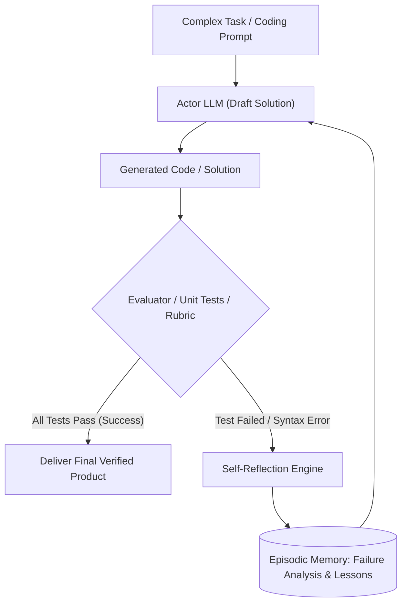

# Phản Biện và Tự Sửa Lỗi (Reflection & Self-Correction)

> **Khái niệm chính thống**: *Master All 20 Agentic AI Design Patterns*, Pattern 4; Shinn et al. (NeurIPS 2023) *"Reflexion: Language Agents with Verbal Reinforcement Learning"*; Madaan et al. (2023) *"Self-Refine"*.
> **Miền kiến thức**: [[index|Cognitive Self-Correction & Evaluator Patterns]]
> **Tài liệu gốc liên quan**:
> - [Master All 20 Agentic AI Design Patterns.pdf](../resources/genai/Master%20All%2020%20Agentic%20AI%20Design%20Patterns.pdf) (Trang 10-14)
> - [Agentic AI Design Patterns(2026 Edition).pdf](../resources/genai/Agentic%20AI%20Design%20Patterns%282026%20Edition%29.pdf) (Trang 12-16)
> - [A Vision for Auto Research with LLM Agents.pdf](../resources/genai/A%20Vision%20for%20Auto%20Research%20with%20LLM%20Agents.pdf) (Trang 4-10)

---

## 1. Tóm tắt (Executive Summary)
**Phản biện và Tự sửa lỗi (Reflection & Self-Correction)** là mẫu thiết kế tác nhân cho phép mô hình tự đánh giá, phê bình và hoàn thiện các kết quả do chính nó tạo ra trước khi xuất xưởng ra môi trường người dùng cuối. Thay vì chỉ dựa vào một lượt sinh duy nhất (Single-pass generation), Agent phân vai thành hai thực thể: **Tác nhân Thực thi (Actor / Generator)** và **Tác nhân Phê bình (Critic / Evaluator)**. Bằng cách lưu trữ các bài học tự phê bình vào bộ nhớ ngắn hạn hoặc dài hạn (**Reflexion Memory**), Agent đạt được sự cải thiện chất lượng vượt trội tương tự như học tăng cường nhưng hoàn toàn bằng ngôn ngữ tự nhiên (Verbal Reinforcement Learning).

---

## 2. Định nghĩa chính thống & Kiến trúc Reflexion (Shinn et al., 2023)

### 2.1 Ba thành phần cốt lõi của Reflexion
1. **Actor**: Sinh ra quỹ đạo hành động ban đầu dựa trên trạng thái hiện tại.
2. **Evaluator**: Đánh giá chất lượng của quỹ đạo (sử dụng unit test, compiler output, hoặc heuristic rubric của LLM).
3. **Self-Reflection Model**: Đọc log thất bại từ Evaluator và sinh ra bản đúc kết kinh nghiệm bằng lời: *"Tôi đã phạm sai lầm ở biến X vì quên ép kiểu dữ liệu. Lần sau tôi cần kiểm tra kiểu dữ liệu trước khi thực hiện phép cộng"*. Bản đúc kết này được chèn trực tiếp vào prompt của lượt lặp tiếp theo.

### 2.2 Thuật toán Self-Refine (Madaan et al., 2023)
Quy trình lặp 3 bước:
$$\text{Generate } y_0 \rightarrow \text{Feedback } f_0 \rightarrow \text{Refine } y_1 \rightarrow ... \rightarrow \text{Refine } y_k$$
Quá trình dừng lại khi:
- Điểm đánh giá của Evaluator vượt ngưỡng mục tiêu ($Score \ge \text{Threshold}$).
- Hoặc đạt số lần phản biện tối đa ($k \ge K_{\max}$).

---

## 3. So sánh & Mâu thuẫn / Sắc thái giữa các tài liệu

| Mô hình Phản biện | Nguồn tín hiệu phản hồi (Feedback Signal) | Độ tin cậy thực tế | Rủi ro sụp đổ chất lượng |
| :--- | :--- | :--- | :--- |
| **Self-Correction nội tại (1 Model tự chấm bài của chính mình)** | Hoàn toàn dựa vào prompt tự vấn: *"Hãy kiểm tra xem bài viết của bạn có lỗi gì không"*. | **Rất thấp**. Các nghiên cứu của DeepMind (2023-2024) chỉ ra rằng nếu một mô hình không đủ thông minh để làm đúng từ đầu, nó cũng không đủ thông minh để tự phát hiện ra lỗi sai của chính nó (Confirmation Bias). | Mô hình có xu hướng sửa từ đúng thành sai hoặc tự khen ngợi bản thân. |
| **External Environment Reflection (Code Interpreter, Test Cases)** | Bộ biên dịch mã nguồn (Python/Rust Compiler), kết quả chạy Unit Test thực tế, API response code (200 vs 500). | **Cực kỳ cao (Ground Truth)**. Không phụ thuộc vào cảm tính của LLM. | Không có; máy tính trả về lỗi rõ ràng để LLM đọc và sửa. |
| **Dual-Agent Actor-Critic (2 Model riêng biệt)** | Một mô hình Generator độc lập và một mô hình Evaluator độc lập với system prompt đối lập. | Cao, nếu Evaluator sử dụng mô hình có năng lực lý luận cao hơn (e.g., Generator là LLaMA-8B, Critic là Claude 3.5 Sonnet). | Cần kiểm soát chi phí token gấp đôi. |

---

## 4. Góc nhìn Thực chiến & Thiết kế Hệ thống cho AI Engineer

### 4.1 Quy tắc triển khai Reflection an toàn trong Production
- **Không bao giờ tin vào Self-Correction "nói suông"**:
  - Chỉ kích hoạt luồng Reflection khi có **Tín hiệu Khách quan (Objective Ground Truth)**: Unit tests, Linter errors, Pydantic validation failures, SQL syntax verification.
  - Thiết kế tiêu chí phản biện (Rubric) cực kỳ định lượng: *"Câu trả lời có vượt quá 500 từ không? Có chứa trích dẫn nguồn không? Có đúng định dạng JSON không?"*.
- **Chống thoái lui (Regression Prevention)**:
  - Nếu sau 3 lần sửa mà kết quả mới có điểm số thấp hơn bản nháp ban đầu, hệ thống phải tự động Rollback về bản nháp tốt nhất trong lịch sử.

### 4.2 Câu hỏi phỏng vấn thực tế
- **Q**: *Tại sao trong bài toán sinh mã nguồn (Code Generation), mô hình kết hợp Reflection với Compiler lại cho tỷ lệ Pass@1 cao hơn 40% so với sinh đơn lẻ?*
  - **A**: Trình biên dịch cung cấp phản hồi xác định (deterministic feedback) với thông báo lỗi cụ thể (dòng lỗi, tên biến undefined, lỗi type mismatch). Khi đưa log lỗi này vào context, LLM không phải mò mẫm phỏng đoán mà biến bài toán từ "sinh mã mới từ con số 0" thành bài toán "chẩn đoán và sửa lỗi cục bộ" (targeted debugging), vốn là tác vụ mà LLM thực hiện rất xuất sắc.

---

## 5. Mạng lưới Liên kết Tri thức (Knowledge Graph & `wiki-links`)
- [[agentic-ai-core]] — Nền tảng kiến trúc nơi Reflection hoàn thiện chu trình kiểm soát chất lượng.
- [[react-pattern]] — ReAct kiểm tra từng bước vi mô, Reflection đánh giá toàn cục vĩ mô.
- [[llm-evaluation]] — Cung cấp các chỉ số và rubric để Evaluator chấm điểm.
- [[human-in-the-loop]] — Điểm dừng leo thang khi Reflection thất bại sau nhiều lần thử.