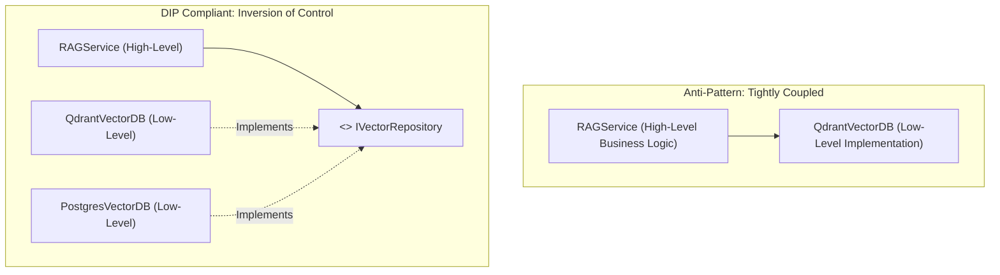

# 5 Nguyên Lý Thiết Kế SOLID (SOLID Principles in AI & Backend Engineering)

> **Khái niệm chính thống**: Robert C. Martin (Uncle Bob) *"Clean Architecture: A Craftsman's Guide to Software Structure and Design"*; *Questtion.txt*; *JavaOOP-Core.jpg*.
> **Miền kiến thức**: [[index|Clean Architecture & System Design]]
> **Tài liệu gốc liên quan**:
> - [Questtion.txt](../resources/software/Questtion.txt) (Trang 1: Chữ D trong SOLID và ví dụ thực tế)
> - [JavaOOP-Core.jpg](../resources/software/JavaOOP-Core.jpg) (Sơ đồ phỏng vấn OOP/SOLID)
> - [Backend Engineering (Phần 1) - LeThienHoa.pdf](../resources/software/Backend%20Engineering%20%28Ph%E1%BA%A7n%201%29%20-%20LeThienHoa.pdf) (Trang 30-55)

---

## 1. Tóm tắt (Executive Summary)
**5 Nguyên lý SOLID** là tập hợp các chỉ dẫn kiến trúc phần mềm cốt lõi do Robert C. Martin đúc kết nhằm xây dựng các hệ thống phần mềm dễ đọc, dễ mở rộng, dễ kiểm thử và có khả năng chống chọi trước sự thay đổi của yêu cầu kinh doanh:
- **S** — Single Responsibility Principle (Đơn trách nhiệm)
- **O** — Open/Closed Principle (Đóng để sửa, Mở để thêm)
- **L** — Liskov Substitution Principle (Thay thế Liskov)
- **I** — Interface Segregation Principle (Phân tách Giao diện)
- **D** — Dependency Inversion Principle (Đảo ngược Phụ thuộc)

---

## 2. Định nghĩa chính thống & Ví Dụ Thực Chiến (Production-Grade Code Examples)

*(Tuyệt đối không dùng ví dụ con chim/con chó — toàn bộ minh họa bằng kiến trúc AI / RAG / Payment Service thực tế theo yêu cầu)*:

### 2.1 S — Single Responsibility Principle (SRP)
> *"A class should have one, and only one, reason to change."* (Một lớp chỉ nên có một lý do duy nhất để thay đổi).

- **Vi phạm SRP**:
  Một class `RAGPipeline` vừa làm nhiệm vụ cào dữ liệu PDF, vừa gọi OpenAI embedding, vừa lưu vào Postgres, vừa sinh mã HTML hiển thị ra web. Khi thư viện PDF thay đổi, hoặc khi đổi DB, class này đều bị sửa đổi $\rightarrow$ Rất dễ sinh lỗi dây chuyền.
- **Tuân thủ SRP**:
  Tách thành 4 class độc lập:
  1. `PDFDocumentParser`: Chỉ chịu trách nhiệm bóc tách text từ file.
  2. `TextEmbedder`: Chỉ chịu trách nhiệm biến đổi text thành vector.
  3. `VectorRepository`: Chỉ chịu trách nhiệm đọc/ghi dữ liệu vào cơ sở dữ liệu.
  4. `RAGOrchestrator`: Chỉ chịu trách nhiệm điều phối luồng dữ liệu giữa các thành phần trên.

### 2.2 O — Open/Closed Principle (OCP)
> *"Software entities should be open for extension, but closed for modification."* (Mở để mở rộng, nhưng Đóng đối với việc sửa đổi mã nguồn sẵn có).

- **Vi phạm OCP**:
  Dùng câu lệnh `if/else` hoặc `switch/case` khổng lồ để tính phí mô hình:
  ```python
  def calculate_cost(model_name: str, tokens: int) -> float:
      if model_name == "gpt-4o": return tokens * 0.005
      elif model_name == "claude-3-5": return tokens * 0.003
      # Mỗi khi có model mới (Gemini, DeepSeek), ta buộc phải vào sửa code cũ!
  ```
- **Tuân thủ OCP**:
  Định nghĩa interface `CostStrategy` và tạo các class riêng biệt. Khi có model mới, chỉ cần tạo thêm class mới mà **không sửa một dòng code nào của hệ thống đang chạy**.

### 2.3 L — Liskov Substitution Principle (LSP)
> *"Subtypes must be substitutable for their base types without altering the correctness of the program."* (Lớp con phải có khả năng thay thế hoàn toàn cho lớp cha mà không làm thay đổi tính đúng đắn của chương trình).

- **Vi phạm LSP**:
  Lớp cha `ReadOnlyVectorStore` có phương thức `search()`. Kỹ sư tạo lớp con `WritableVectorStore` kế thừa từ lớp cha nhưng trong phương thức xóa `delete()` lại ném ra lỗi `NotSupportedException` vì kho không hỗ trợ xóa. Bất kỳ đoạn code nào gọi hàm trên lớp cha sẽ bị crash khi nhận đối tượng lớp con.
- **Tuân thủ LSP**:
  Đảm bảo lớp con không thắt chặt điều kiện tiên quyết (Preconditions) và không nới lỏng điều kiện sau (Postconditions) của lớp cha.

### 2.4 I — Interface Segregation Principle (ISP)
> *"Clients should not be forced to depend upon interfaces that they do not use."* (Không ép buộc client phải phụ thuộc vào các phương thức giao diện mà nó không hề dùng đến).

- **Vi phạm ISP**:
  Tạo một "God Interface" khổng lồ:
  ```java
  public interface AIModelOperations {
      void textGeneration();
      void imageGeneration();
      void speechToText();
      void vectorEmbedding();
  }
  ```
  Khi cài đặt một model chuyên về Text (`ClaudeClient`), ta vẫn bị ép phải override các hàm `imageGeneration()` và `speechToText()` với thân hàm ném lỗi `throw new UnsupportedOperationException()`.
- **Tuân thủ ISP**:
  Phân rã thành các interface hạt mịn (Fine-grained interfaces): `TextGeneratable`, `ImageGeneratable`, `Embeddable`. Một class chỉ `implements` đúng năng lực nó sở hữu.

### 2.5 D — Dependency Inversion Principle (DIP) — Trọng Tâm Phỏng Vấn (From Questtion.txt)
> *"1. High-level modules should not depend on low-level modules. Both should depend on abstractions.  
> 2. Abstractions should not depend on details. Details should depend on abstractions."*



- **Ví dụ Kỹ thuật Thực tế mà bạn đã làm (Trả lời TechLead)**:
  - *"Trong hệ thống RAG enterprise, module nghiệp vụ cấp cao `RAGChatService` của em không bao giờ trực tiếp `import QdrantClient` hay khởi tạo `qdrant = QdrantClient()`."*
  - *"Thay vào đó, em định nghĩa một Abstraction interface `IVectorRepository`. Module `RAGChatService` chỉ nhận `IVectorRepository` thông qua **Constructor Injection** (sử dụng FastAPI `Depends()` trong Python hoặc `@Autowired` trong Spring Boot)."*
  - *"Tầng hạ tầng cụ thể `QdrantVectorRepository` thực thi interface này. Nhờ đó, khi viết Unit Test, em dễ dàng mock một `FakeVectorRepository` trong RAM mà không cần bật server Qdrant thật; và khi công ty chuyển sang Milvus, em chỉ cần viết một adapter mới mà không phải chạm vào một dòng logic nghiệp vụ nào của `RAGChatService`."*

---

## 3. Mạng lưới Liên kết Tri thức (Knowledge Graph & `wiki-links`)
- [[oop-core-principles]] — Nền tảng hướng đối tượng mà SOLID xây dựng dựa trên đó.
- [[database-indexing-optimization]] — Phân tách tầng Repository và Service trong tối ưu hóa cơ sở dữ liệu.
- [[model-serving-api]] — Triển khai Dependency Injection trong FastAPI backend.