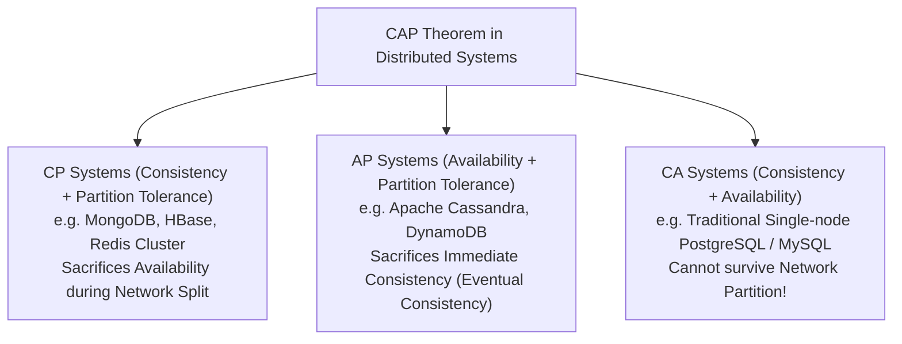

# Kiến Trúc Dữ Liệu SQL vs NoSQL (SQL, NoSQL, Columnar OLAP & Lakehouse)

> **Khái niệm chính thống**: *Fundamentals of Database Systems for Data Scientist* (TS. Lê Thiện Hòa, 2025); Brewer (2000) *"CAP Theorem"*; *Fundamentals of Database System.pdf*.
> **Miền kiến thức**: [[index|Data Systems Architecture & Big Data]]
> **Tài liệu gốc liên quan**:
> - [Fundamentals of Database System.pdf](../resources/software/Fundamentals%20of%20Database%20System.pdf) (Trang 1-25)
> - [Nền tảng Hệ thống Cơ sở dữ liệu cho Data Scientist – Bài giảng của Tiến sĩ Lê Thiện Hòa.pdf](../resources/data-sciense/N%E1%BB%81n%20t%E1%BA%A3ng%20H%E1%BB%87%20th%E1%BB%91ng%20C%C6%A1%20s%E1%BB%9F%20d%E1%BB%AF%20li%E1%BB%87u%20cho%20Data%20Scientist%20%E2%80%93%20B%C3%A0i%20gi%E1%BA%A3ng%20c%E1%BB%A7a%20Ti%E1%BA%BFn%20s%C4%A9%20L%C3%AA%20Thi%E1%BB%87n%20H%C3%B2a.pdf) (Trang 1-35)
> - [AIO2026_[Slide_v4]-Data-Pipeline-and-Orchestration.pdf](../resources/data-sciense/AIO2026_%5BSlide_v4%5D-Data-Pipeline-and-Orchestration.pdf) (Trang 1-67)

---

## 1. Tóm tắt (Executive Summary)
**Kiến trúc Dữ liệu Hiện đại (Modern Data Systems)** được phân hóa sâu sắc để phục vụ hai loại tải công việc (Workloads) hoàn toàn đối nghịch nhau: **OLTP (Online Transaction Processing)** — tối ưu hóa cho các giao dịch kinh doanh nhỏ lẻ, đọc/ghi tức thì trên từng dòng bản ghi; và **OLAP (Online Analytical Processing)** — tối ưu hóa cho các truy vấn phân tích tổng hợp (Aggregation), phân tích chuỗi thời gian trên hàng tỷ bản ghi. Để đáp ứng các nhu cầu này, kỹ sư dữ liệu và AI Engineer phải điều phối sự kết hợp giữa **Cơ sở dữ liệu Quan hệ dòng (Row-oriented SQL)**, **Hệ thống NoSQL phân tán (Document, Key-Value, Graph)**, **Cơ sở dữ liệu Cột phân tích (Columnar DB)**, và kiến trúc thế hệ mới **Data Lakehouse**.

---

## 2. So sánh Kiến trúc Chuyên sâu: Row-wise vs Column-wise Databases

```mermaid
flowchart TD
    subgraph Row-wise Storage (OLTP - PostgreSQL / MySQL)
        R1["Disk Block 1: [ID: 1, Name: Alice, Age: 25, Country: VN]"]
        R2["Disk Block 2: [ID: 2, Name: Bob,   Age: 30, Country: US]"]
    end
    
    subgraph Column-wise Storage (OLAP - ClickHouse / Parquet / Snowflake)
        C1["Disk Block A (Ages): [25, 30, 45, 22, 38, ...] -> Heavy Compression"]
        C2["Disk Block B (Countries): [VN, US, VN, UK, US, ...] -> Dictionary Encoded"]
    end
    
    QueryOLAP["SELECT AVG(Age) FROM Users;"] --> C1
    NoteOLAP["Column-wise only reads Disk Block A! (90% Disk I/O Saved)"]
```

### 2.1 Bản chất lưu trữ vật lý
- **Row-wise (Lưu trữ theo Dòng)**:
  - Toàn bộ các trường của một bản ghi được lưu nằm liền kề nhau trên cùng một khối đĩa (Disk Block).
  - *Lợi thế tuyệt đối*: Thao tác ghi một đơn hàng mới (`INSERT`) hoặc cập nhật thông tin một người dùng (`UPDATE`) diễn ra tức thì chỉ trong một lần ghi đĩa duy nhất. Phù hợp tuyệt đối cho **OLTP**.
- **Column-wise (Lưu trữ theo Cột)**:
  - Toàn bộ giá trị của cùng một cột trên toàn bộ hàng triệu bản ghi được lưu gom lại nằm liền kề nhau trên đĩa.
  - *Lợi thế tuyệt đối*: Khi cần tính `AVG(salary)` hay `SUM(revenue)`, hệ thống chỉ cần đọc đúng cột dữ liệu đó từ đĩa, **hoàn toàn bỏ qua các cột còn lại**, giảm 80-95% lưu lượng Disk I/O!
  - *Khả năng nén siêu việt*: Vì các phần tử trong cùng một cột có chung kiểu dữ liệu và giá trị thường lặp lại, các thuật toán nén (Run-Length Encoding, Dictionary Encoding) có thể nén dữ liệu giảm dung lượng tới 10 lần. Phù hợp tuyệt đối cho **OLAP**.

---

## 3. Hệ Thống Phân Tán và Định Lý CAP (Brewer's CAP Theorem)

Theo bài giảng của TS. Lê Thiện Hòa (*Fundamentals of Database Systems for Data Scientist*):
Trong một hệ thống dữ liệu phân tán qua mạng, khi xảy ra hiện tượng **Đứt gãy mạng (Network Partition - P)** — điều chắc chắn sẽ xảy ra trong thế giới thực — hệ thống **chỉ có thể chọn 1 trong 2 thuộc tính còn lại**:
1. **Consistency (Tính Nhất quán - CP)**:
   - Mọi nút mạng đều trả về cùng một dữ liệu mới nhất giống nhau tại cùng một thời điểm. Nếu một nút mạng bị cô lập không đồng bộ được, hệ thống từ chối phục vụ để bảo vệ tính toàn vẹn (Ví dụ: HBase, MongoDB, Google Spanner).
2. **Availability (Tính Khả dụng - AP)**:
   - Mọi yêu cầu gửi tới hệ thống đều nhận được phản hồi không bị lỗi, nhưng dữ liệu có thể chưa phải là phiên bản mới nhất (**Nhất quán sau cùng - Eventual Consistency** / Nguyên lý **BASE**). (Ví dụ: Apache Cassandra, Amazon DynamoDB, CouchDB).



---

## 4. Sự Tiến Hóa của Hạ Tầng Dữ Liệu Lớn (Evolution to Lakehouse)

1. **Database / Data Warehouse (DWH)**:
   - Dữ liệu có cấu trúc cao (Structured), tuân thủ Star Schema / Snowflake Schema. Dùng cho báo cáo tài chính và BI Dashboard kinh điển. *Hạn chế*: Đắt đỏ, không lưu được video/ảnh/text thô của AI.
2. **Data Lake (Hadoop HDFS / AWS S3)**:
   - Lưu trữ toàn bộ dữ liệu thô phi cấu trúc (Raw unstructured data: JSON, log, audio, image) với chi phí rẻ như cho. *Hạn chế*: Dễ biến thành "Bãi rác dữ liệu" (Data Swamp), thiếu giao dịch ACID, chất lượng dữ liệu kém.
3. **Data Lakehouse (Tiêu chuẩn hiện đại 2025-2026: Apache Iceberg, Delta Lake)**:
   - Dung hợp hoàn hảo: Đặt một tầng siêu dữ liệu (Metadata Layer) hỗ trợ giao dịch **ACID**, phân quyền bảo mật và time-travel query trực tiếp lên trên lớp lưu trữ tệp đối tượng rẻ tiền (S3/GCS) dưới định dạng cột mở **Parquet**.
   - Cung cấp trực tiếp dữ liệu sạch cho cả hai luồng: Dashboard BI và Huấn luyện Mô hình Machine Learning/LLM.

---

## 5. Mạng lưới Liên kết Tri thức (Knowledge Graph & `wiki-links`)
- [[database-indexing-optimization]] — Tối ưu hóa chỉ mục trong hệ quản trị cơ sở dữ liệu quan hệ.
- [[acid-and-transactions]] — So sánh đối chiếu giữa nguyên lý ACID của SQL và BASE của NoSQL.
- [[mlops-lifecycle]] — Dữ liệu từ Lakehouse là đầu vào nuôi sống các pipeline huấn luyện AI.