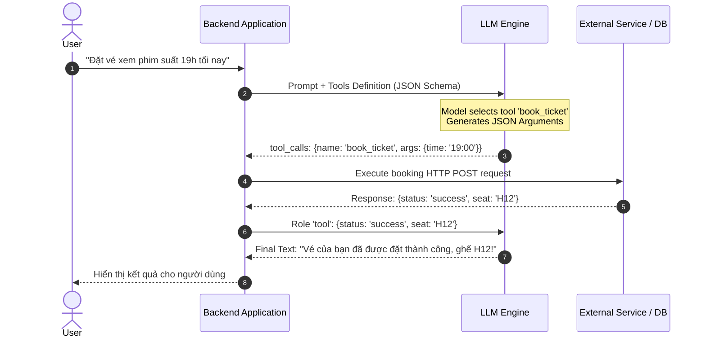

# Sử Dụng Công Cụ và Gọi Hàm (Tool Use & Function Calling)

> **Khái niệm chính thống**: *Encyclopedia of LLMs*, Section 14.3; Schick et al. (2023) *"Toolformer: Language Models Can Teach Themselves to Use Tools"*; Anthropic *"Model Context Protocol (MCP) Specification"* (2024-2025).
> **Miền kiến thức**: [[index|Tool Integration & Systems Interoperability]]
> **Tài liệu gốc liên quan**:
> - [AIO2025_[Description]-AI-Agent-LLM-Tool-Calling.pdf](../resources/genai/AIO2025_%5BDescription%5D-AI-Agent-LLM-Tool-Calling.pdf) (Trang 1-42)
> - [Master All 20 Agentic AI Design Patterns.pdf](../resources/genai/Master%20All%2020%20Agentic%20AI%20Design%20Patterns.pdf) (Trang 8-12)
> - [Encyclopedia of LLMs and Foundation Models.pdf](../resources/genai/Encyclopedia%20of%20LLMs%20and%20Foundation%20Models.pdf) (Trang 131-133)

---

## 1. Tóm tắt (Executive Summary)
**Sử dụng Công cụ và Gọi Hàm (Tool Use & Function Calling)** là năng lực của Mô hình Ngôn ngữ Lớn trong việc nhận biết khi nào cần bổ sung tài nguyên ngoài, tự động lựa chọn công cụ phù hợp từ một danh mục định sẵn, và sản sinh ra chuỗi tham số có cấu trúc chuẩn mực (JSON Schema) để hệ thống máy chủ thực thi. Đây là cầu nối sinh tử biến LLM từ một "bộ não bị nhốt trong lồng kính" thành một tác nhân có thể điều khiển máy tính: thực thi truy vấn SQL, gọi REST APIs, tính toán đại số chính xác, đọc ghi tệp tin và giao tiếp với thế giới thực.

---

## 2. Định nghĩa chính thống & Giao thức Hoạt động (Protocols & Mechanism)

### 2.1 Vòng đời của một Function Call
1. **Tool Definition**: Định nghĩa danh mục công cụ kèm tên hàm, mô tả ngữ nghĩa và schema tham số theo chuẩn **JSON Schema**:
   ```json
   {
     "name": "get_stock_price",
     "description": "Truy xuất giá cổ phiếu thời gian thực theo mã ticker",
     "parameters": {
       "type": "object",
       "properties": {
         "ticker": {"type": "string", "description": "Mã chứng khoán, ví dụ: AAPL"}
       },
       "required": ["ticker"]
     }
   }
   ```
2. **Model Decision**: Khi người dùng hỏi *"Giá cổ phiếu Apple hôm nay thế nào?"*, LLM nhận diện không thể trả lời bằng kiến thức tham số, liền ngắt chế độ sinh text thông thường và sinh ra một **Tool Call Object**:
   `{"name": "get_stock_price", "arguments": "{\"ticker\": \"AAPL\"}"}`
3. **Client Execution**: Server ứng dụng nhận lệnh, chạy hàm Python thực tế, lấy dữ liệu từ sàn chứng khoán.
4. **Context Injection**: Kết quả trả về (Tool Output) được đóng gói vào vai trò `role: "tool"` gửi ngược lại cho LLM để sinh câu trả lời tự nhiên cuối cùng cho người dùng.



### 2.2 Cuộc cách mạng Giao thức: Model Context Protocol (MCP)
Vào cuối 2024 - 2026, ngành công nghiệp chuẩn hóa giao thức **MCP (Model Context Protocol)** do Anthropic khởi xướng:
- Thay vì mỗi công ty viết một adapter tool riêng cho Slack, GitHub, Postgres: MCP đóng vai trò như **cổng USB-C cho AI**.
- Bất kỳ dịch vụ nào cung cấp MCP Server đều có thể cắm trực tiếp vào bất kỳ AI Agent / LLM nào hỗ trợ MCP Client một cách an toàn và tức thì.

---

## 3. So sánh & Mâu thuẫn / Sắc thái giữa các tài liệu

| Phương thức | Cơ chế bắt lỗi cú pháp | Tỷ lệ sinh JSON hợp lệ | Nguy cơ bảo mật |
| :--- | :--- | :--- | :--- |
| **Prompting chay (Text-based Tool Calling)** | Yêu cầu LLM tự in cú pháp ra text, dùng Regex bóc tách. | Kém (~70-80%). Dễ bị lỗi dấu ngoặc, thoát ký tự (unescaped quotes). | Cao; dễ bị parse sai tham số. |
| **Native Function Calling (OpenAI / Claude API)** | Can thiệp ở tầng Logit Bias và Constrained Decoding của Sampling Engine. | Rất cao (> 99.5%). Đảm bảo đầu ra luôn tuân thủ 100% JSON Schema. | Cần cơ chế phân quyền (Authorization) ở phía backend server. |
| **Model Context Protocol (MCP)** | Giao thức chuẩn hóa Client-Server phân tán (JSON-RPC 2.0 qua stdio / SSE). | Tuyệt đối; có tầng kiểm soát kiểu dữ liệu hai chiều. | Tách biệt ranh giới bảo mật: Server quy định quyền truy cập, Client không thể thực thi mã tùy tiện. |

---

## 4. Góc nhìn Thực chiến & Thiết kế Hệ thống cho AI Engineer

### 4.1 Bí kíp thiết kế Tool Descriptions chuẩn xác
Chất lượng chọn tool của LLM phụ thuộc hoàn toàn vào **phần mô tả (Tool Description)**:
- **Nguyên tắc "Mô tả cả điều công cụ KHÔNG LÀM"**: Nếu có 2 công cụ dễ gây nhầm lẫn (ví dụ: `search_orders` và `search_customers`), hãy ghi chú rõ trong description: *"Dùng để tìm kiếm đơn hàng. KHÔNG dùng công cụ này để tra cứu thông tin cá nhân khách hàng, hãy dùng search_customers"*.
- **Giới hạn số lượng Tool**: Không bao giờ nạp quá 20-30 tools vào context cùng một lúc. Khi danh mục tool quá lớn, hãy dùng kỹ thuật **Tool Retrieval**: Lưu các tool definition vào Vector DB và chỉ truy xuất Top 5 tools liên quan nhất tới query hiện tại nạp vào prompt.

### 4.2 Câu hỏi phỏng vấn thực tế
- **Q**: *Làm thế nào để phòng chống rủi ro khi Agent tự động gọi một công cụ phá hủy dữ liệu (Destructive Tool như DROP TABLE hay DELETE_FILE)?*
  - **A**: Áp dụng mô hình **Dual-Key Authorization & Sandboxing**:
    1. Gắn cờ thuộc tính `is_destructive: true` vào schema công cụ.
    2. Khi LLM phát lệnh gọi công cụ này, hệ sinh thái Agent bắt buộc phải dừng lại và kích hoạt cổng phê duyệt con người ([[human-in-the-loop|Human-in-the-Loop Gate]]).
    3. Mọi thao tác thực thi bắt buộc phải chạy trong môi trường Sandbox cô lập (như Docker container dùng một lần hoặc máy ảo microVM Firecracker) với quyền tài khoản hạn chế thấp nhất (Least Privilege Principle).

---

## 5. Mạng lưới Liên kết Tri thức (Knowledge Graph & `wiki-links`)
- [[agentic-ai-core]] — Khung tích hợp công cụ vào vòng lặp của tác nhân.
- [[react-pattern]] — Mô thức điều phối chu trình gọi công cụ và nhận quan sát.
- [[human-in-the-loop]] — Cơ chế kiểm soát an toàn cho các công cụ nhạy cảm.
- [[prompt-engineering]] — Kỹ thuật tối ưu hóa định nghĩa tool và schema.