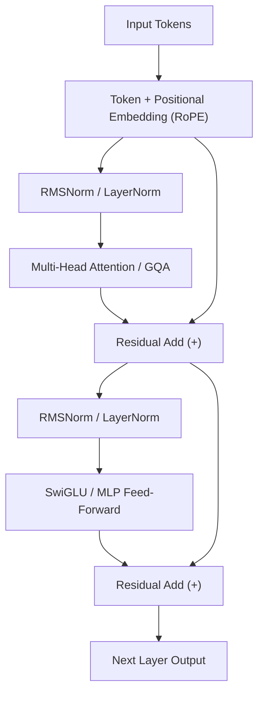

# Kiến trúc Transformer (Transformer Architecture)

> **Khái niệm chính thống**: *Encyclopedia of LLMs*, Chapter 2; Vaswani et al. (2017) *"Attention Is All You Need"*; *The Principles of Deep Learning Theory* (Roberts & Yaida, Cambridge), Section 0.2.
> **Miền kiến thức**: [[index|GenAI & Deep Learning Foundations]]
> **Tài liệu gốc liên quan**:
> - [Encyclopedia of LLMs and Foundation Models.pdf](../resources/genai/Encyclopedia%20of%20LLMs%20and%20Foundation%20Models.pdf) (Trang 7-14)
> - [Deep Learning_Computer Vision_NLP.pdf](../resources/deep-learning/Deep%20Learning_Computer%20Vision_NLP.pdf) (Trang 180-230)
> - [Vietnamese_Introduction-to-LLMs.pdf](../resources/genai/Vietnamese_Introduction-to-LLMs.pdf) (Trang 15-38)

---

## 1. Tóm tắt (Executive Summary)
**Kiến trúc Transformer** là kiến trúc mạng nơ-ron dựa hoàn toàn vào cơ chế tự chú ý (Self-Attention) để mô hình hóa các phụ thuộc xa giữa các phần tử trong chuỗi dữ liệu mà không cần sử dụng cơ chế tuần hoàn (RNN) hay tích chập (CNN). Với khả năng tính toán song song triệt để trên phần cứng GPU và cơ chế chú ý nhiều đầu (Multi-Head Attention), Transformer đã trở thành kiến trúc nền tảng tuyệt đối của toàn bộ kỷ nguyên Generative AI, xử lý ngôn ngữ tự nhiên, thị giác máy tính và các mô hình đa phương thức.

---

## 2. Định nghĩa chính thống & Cơ chế cốt lõi (Canonical Definition & Mechanism)

### 2.1 Cơ chế Tự chú ý Scaled Dot-Product Attention
Cho ma trận đầu vào biểu diễn câu hỏi (Query - $Q$), chìa khóa (Key - $K$), và giá trị (Value - $V$) với số chiều $d_k$:
$$\text{Attention}(Q, K, V) = \text{softmax}\left(\frac{QK^T}{\sqrt{d_k}} + M\right)V$$

Trong đó:
- $QK^T$ tính toán ma trận tương đồng điểm tích vô hướng giữa mọi cặp token trong chuỗi.
- $\sqrt{d_k}$ là hệ số co giãn (scale factor), ngăn hiện tượng điểm số quá lớn làm gradient của hàm softmax bị triệt tiêu (vanishing gradient).
- $M$ là ma trận mặt nạ chú ý (Causal Attention Mask), với $M_{ij} = -\infty$ khi $j > i$ trong các mô hình autoregressive decoder để ngăn token tương lai rò rỉ vào quá khứ.

### 2.2 Multi-Head Attention (MHA) và các biến thể hiện đại
MHA chiếu song song $Q, K, V$ vào $h$ không gian con khác nhau:
$$\text{MHA}(Q, K, V) = \text{Concat}(\text{head}_1, ..., \text{head}_h)W^O$$
$$\text{head}_i = \text{Attention}(QW_i^Q, KW_i^K, VW_i^V)$$

Trong các kiến trúc mới (LLaMA 2/3, Mistral, Gemma):
1. **Multi-Query Attention (MQA)**: Dùng chung 1 đầu $K$ và $V$ cho tất cả các đầu $Q$, giảm dung lượng bộ nhớ [[large-language-models|KV Cache]] đến $h$ lần.
2. **Grouped-Query Attention (GQA)**: Cân bằng tối ưu giữa MHA và MQA; phân $h$ đầu $Q$ thành $g$ nhóm, mỗi nhóm chia sẻ một cặp đầu $K, V$.
3. **Rotary Position Embedding (RoPE)**: Mã hóa vị trí tương đối thông qua phép quay ma trận trong không gian phức, giúp mô hình suy luận vượt ra ngoài độ dài ngữ cảnh ban đầu (context extrapolation).
4. **RMSNorm & SwiGLU**: Thay thế LayerNorm chuẩn bằng RMSNorm (loại bỏ bước tính kỳ vọng trung bình để tăng tốc) và thay ReLU bằng kích hoạt SwiGLU.

---

## 3. So sánh & Mâu thuẫn / Sắc thái giữa các tài liệu

| Thành phần | Sách lý thuyết kinh điển (*Vaswani 2017*) | Triển khai thực tế sản xuất (2024-2026) | Ghi chú sắc thái kiến trúc |
| :--- | :--- | :--- | :--- |
| **Vị trí LayerNorm** | **Post-LN**: LayerNorm được đặt sau khối Attention và FFN (sau phép cộng residual). | **Pre-LN / Pre-RMSNorm**: Đặt trước Attention và FFN. | Post-LN gây bất ổn định nghiêm trọng khi mạng sâu, đòi hỏi warm-up lr rất khắt khe. Pre-LN giải quyết triệt để gradient vanishing, cho phép train mô hình hàng trăm layer. |
| **Mã hóa vị trí** | **Sinusoidal Positional Encoding** tuyệt đối cộng trực tiếp vào word embeddings. | **RoPE (Rotary)** hoặc **ALiBi** tích hợp trực tiếp vào tích vô hướng $Q \cdot K^T$. | Mã hóa tuyệt đối không mở rộng được khi context vượt quá lúc train; RoPE cho phép mở rộng context từ 4k lên 128k+ qua kỹ thuật YaRN hoặc NTK-aware scaling. |
| **Cấu trúc Attention** | Chuẩn MHA (Multi-Head Attention) với số đầu $Q, K, V$ bằng nhau. | Chuyển dịch toàn diện sang **GQA (Grouped-Query Attention)**. | Trong inference, bộ nhớ GPU bị nghẽn bởi việc đọc/ghi KV Cache chứ không phải năng lực tính toán FLOPs. GQA là bắt buộc cho production serving. |

---

## 4. Góc nhìn Thực chiến & Thiết kế Hệ thống cho AI Engineer

### 4.1 Chi phí Bộ nhớ và Tối ưu hóa Inference
Độ phức tạp tính toán và bộ nhớ cơ bản của Attention là $\mathcal{O}(L^2)$ theo độ dài chuỗi $L$.
Khi sinh token autoregressive, kỹ thuật **KV Caching** lưu lại ma trận $K$ và $V$ của các token trước đó trong VRAM:
$$\text{VRAM}_{\text{KV Cache}} = 2 \times n_{\text{layers}} \times n_{\text{heads\_kv}} \times d_{\text{head}} \times L \times \text{precision (bytes)}$$
*Ví dụ*: Với LLaMA-3-70B ở batch size 16, context 8k token, KV Cache có thể ngốn hàng chục GB VRAM nếu không áp dụng GQA và FP8 quantization.

### 4.2 Các công nghệ tăng tốc phần cứng thiết yếu
- **FlashAttention-1/2/3**: Tối ưu hóa việc tính toán Attention ở cấp độ phần cứng bằng cách chia nhỏ ma trận vào SRAM của GPU, tránh việc ghi dữ liệu trung gian ra HBM chậm chạp, biến tốc độ inference tăng gấp 2-4 lần mà không suy hao độ chính xác toán học.
- **PagedAttention (vLLM)**: Quản lý bộ nhớ KV Cache theo phân trang ảo (Virtual Memory Paging), triệt tiêu hiện tượng phân mảnh bộ nhớ VRAM.

### 4.3 Câu hỏi phỏng vấn thực tế
- **Q**: *Tại sao phép nhân ma trận Attention cần chia cho $\sqrt{d_k}$? Nếu bỏ đi thì điều gì sẽ xảy ra?*
  - **A**: Khi $d_k$ lớn, tích vô hướng $q \cdot k = \sum_{i=1}^{d_k} q_i k_i$ có phương sai xấp xỉ bằng $d_k$ (nếu các thành phần độc lập chuẩn tắc). Giá trị tích vô hướng quá lớn sẽ đẩy hàm softmax vào vùng bão hòa cực trị (gradient tiến về 0), khiến quá trình huấn luyện bằng lan truyền ngược bị nghẽn hoàn toàn.

---

## 5. Mạng lưới Liên kết Tri thức (Knowledge Graph & `wiki-links`)
- [[large-language-models]] — Hệ thống nền tảng xây dựng từ Transformer.
- [[vision-transformers]] — Ứng dụng Transformer trong thị giác máy tính.
- [[quantization-and-compression]] — Tối ưu hóa trọng số ma trận Transformer và KV Cache.
- [[inference-optimization-tensorrt]] — Biên dịch tối ưu hóa nhân tính toán Transformer trên GPU NVIDIA.