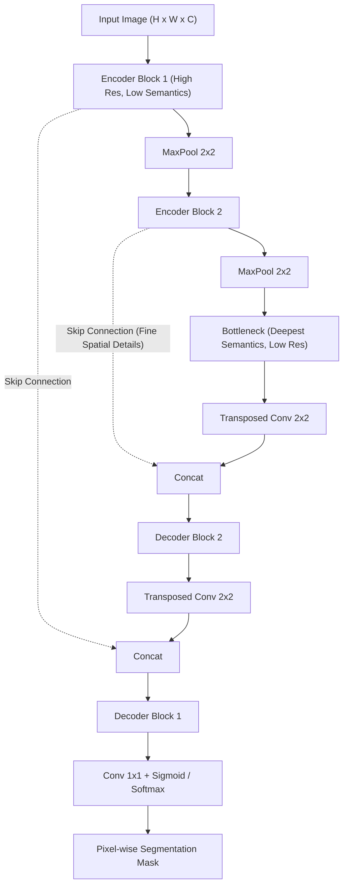

# Kiến Trúc U-Net và Phân Đoạn Ảnh (U-Net Architecture & Image Segmentation)

> **Khái niệm chính thống**: Ronneberger et al. (MICCAI 2015) *"U-Net: Convolutional Networks for Biomedical Image Segmentation"*; *Deep Learning for Computer Vision*, Chapter 6.
> **Miền kiến thức**: [[index|Computer Vision & Semantic Segmentation]]
> **Tài liệu gốc liên quan**:
> - [AIO2025_Reading-UNet.pdf](../resources/deep-learning/computer-vision/AIO2025_Reading-UNet.pdf) (Trang 1-45)
> - [Classification - CNN.pdf](../resources/deep-learning/computer-vision/Classification%20-%20CNN.pdf) (Trang 50-73)
> - [Deep Learning_Computer Vision_NLP.pdf](../resources/deep-learning/Deep%20Learning_Computer%20Vision_NLP.pdf) (Trang 120-150)

---

## 1. Tóm tắt (Executive Summary)
**Kiến trúc U-Net** là mô hình mạng nơ-ron tích chập dạng Bộ mã hóa - Bộ giải mã đối xứng (**Encoder-Decoder**) được thiết kế chuyên biệt cho bài toán **Phân đoạn ngữ nghĩa (Semantic Segmentation)** và xử lý ảnh y sinh. Đặc trưng đột phá của U-Net là các **kết nối tắt xuyên tầng (Long Skip Connections)** nối trực tiếp các bản đồ đặc trưng có độ phân giải cao ở nhánh co (Contracting / Encoder path) sang các tầng giải mã tương ứng ở nhánh mở rộng (Expansive / Decoder path). Cơ chế này cho phép mô hình vừa nắm bắt ngữ cảnh ngữ nghĩa trừu tượng cấp cao, vừa tái tạo chính xác từng đường viền và ranh giới không gian chi tiết đến từng điểm ảnh (Pixel-level localization).

---

## 2. Định nghĩa chính thống & Sơ đồ Cấu trúc Chữ U (Architecture & Loss Functions)

### 2.1 Cấu trúc hai nhánh đối xứng
1. **Nhánh Co (Contracting / Encoder Path)**:
   - Cấu trúc gồm các khối lặp lại: `Conv 3x3 -> ReLU -> Conv 3x3 -> ReLU -> MaxPooling 2x2`.
   - Giảm dần kích thước không gian ($H, W$) để tăng trường thụ cảm và tăng số lượng kênh đặc trưng (Channels) để học thông tin "Vật thể đó là gì?" (**What**).
2. **Nhánh Mở rộng (Expansive / Decoder Path)**:
   - Sử dụng phép tích chập chuyển vị (Transposed Convolution / Up-Convolution 2x2) để tăng gấp đôi kích thước không gian.
   - **Skip Connection Concatenation**: Ghép nối (concatenate) bản đồ đặc trưng từ Encoder sang Decoder theo trục kênh:
     $$X_{\text{decoder\_input}} = \text{Concat}(X_{\text{up-sampled}}, \; X_{\text{encoder\_skip}})$$
   - Khôi phục chính xác thông tin "Vật thể đó nằm ở đâu?" (**Where**).

### 2.2 Hàm mất mát chuyên biệt: Dice Loss & Focal Loss
Trong bài toán phân đoạn ảnh, số lượng điểm ảnh hậu cảnh (background) thường áp đảo hoàn toàn số điểm ảnh vùng tổn thương/vật thể (Class Imbalance nghiêm trọng). Hàm Cross-Entropy truyền thống bị tê liệt.
- **Sørensen–Dice Coefficient**:
  $$\text{Dice} = \frac{2 |X \cap Y|}{|X| + |Y|} = \frac{2 \sum_i p_i y_i}{\sum_i p_i + \sum_i y_i + \epsilon}$$
- **Soft Dice Loss (Khả vi để lan truyền ngược)**:
  $$\mathcal{L}_{\text{Dice}} = 1 - \frac{2 \sum_{i=1}^N p_i g_i + \epsilon}{\sum_{i=1}^N p_i^2 + \sum_{i=1}^N g_i^2 + \epsilon}$$
- Trong thực tế, kỹ sư thường kết hợp **Combo Loss**: $\mathcal{L} = \alpha \mathcal{L}_{\text{BCE}} + \beta \mathcal{L}_{\text{Dice}}$.

---

## 3. So sánh & Mâu thuẫn / Sắc thái giữa các tài liệu

| Thành phần | U-Net nguyên thủy (2015) | Các biến thể hiện đại (U-Net++, nnU-Net, TransUNet) | Ghi chú kiến trúc |
| :--- | :--- | :--- | :--- |
| **Phép kết nối Skip** | Nối thẳng thô sơ (Direct Concatenation). Vì tích chập không có padding nên phải cắt xén (crop) biên ảnh. | Dùng **Same Padding** và bổ sung các nút mạng lồng nhau (Dense Nested Skip Pathways) trong U-Net++ để thu hẹp khoảng cách ngữ nghĩa giữa Encoder và Decoder. | U-Net++ giải quyết hiện tượng lệch tầng ngữ nghĩa giữa biểu diễn mức thấp và mức cao. |
| **Up-sampling Method** | Transposed Convolution (Tích chập chuyển vị). | Chuyển dịch sang **Bilinear Interpolation + Conv 3x3**. | Transposed Conv thường gây ra hiện tượng mắt lưới bàn cờ (Checkerboard Artifacts) trên ảnh đầu ra; phép nội suy tuyến tính triệt tiêu hoàn toàn lỗi này. |
| **Ứng dụng ngoài y tế** | Chỉ nhắc tới phân đoạn tế bào y sinh. | Trở thành xương sống (Backbone) trong các mô hình **Diffusion sinh ảnh (Stable Diffusion)** để dự đoán nhiễu (Noise Predictor). | U-Net là kiến trúc khử nhiễu hoàn hảo nhất vì bảo toàn được kích thước ảnh đầu vào và đầu ra tương đương. |

---

## 4. Góc nhìn Thực chiến & Thiết kế Hệ thống cho AI Engineer

### 4.1 Quy tắc đánh giá: IoU vs Dice Coefficient
- **IoU (Intersection over Union / Jaccard Index)**:
  $$\text{IoU} = \frac{|A \cap B|}{|A \cup B|} = \frac{\text{Dice}}{2 - \text{Dice}}$$
- Điểm IoU luôn khắt khe hơn Dice score (IoU $\le$ Dice). Trong các cuộc thi Kaggle hoặc nghiệm thu dự án y tế, hãy làm rõ khách hàng yêu cầu nghiệm thu theo chuẩn IoU hay Dice để tránh hiểu lầm chỉ số.

### 4.2 Câu hỏi phỏng vấn thực tế
- **Q**: *Tại sao Skip Connection trong U-Net lại dùng phép Concatenate (ghép kênh), trong khi Skip Connection của ResNet lại dùng phép Addition (cộng phần tử)?*
  - **A**:
    - Trong **ResNet**, mục tiêu là giải quyết vấn đề suy thoái gradient trong mạng sâu phân loại; phép cộng $F(x) + x$ giữ nguyên số chiều kênh, cho phép gradient truyền ngược thẳng về mà không làm tăng kích thước tham số.
    - Trong **U-Net**, mục tiêu là định vị điểm ảnh (localization); thông tin từ Encoder là chi tiết không gian thô sơ (edges, corners), còn Decoder là thông tin ngữ nghĩa trừu tượng. Phép Concatenate ghép 2 luồng này vào các kênh độc lập, cho phép các tầng tích chập phía sau tự do học cách kết hợp cả hai loại thông tin mà không làm ép buộc hay phá hủy phân phối giá trị của nhau.

---

## 5. Mạng lưới Liên kết Tri thức (Knowledge Graph & `wiki-links`)
- [[convolutional-neural-networks]] — Nền tảng xây dựng nên các khối Encoder/Decoder của U-Net.
- [[object-detection-yolo]] — So sánh giữa bài toán phân đoạn (Pixel-level) và phát hiện vật thể (Box-level).
- [[vision-transformers]] — TransUNet tích hợp Transformer vào nút cổ chai Bottleneck của U-Net.