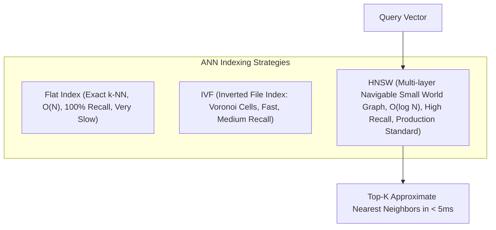

# Vector Nhúng và Tìm Kiếm Tương Đồng (Vector Embeddings & Similarity Search)

> **Khái niệm chính thống**: *Encyclopedia of LLMs*, Section 13.2 - 13.3; *Mathematics for Machine Learning*, Chapter 3 (Analytic Geometry & Inner Products); Malkov & Yashunin (2018) *"Efficient and robust approximate nearest neighbor search using Hierarchical Navigable Small World graphs" (HNSW)*.
> **Miền kiến thức**: [[index|Vector Embeddings & ANN Search]]
> **Tài liệu gốc liên quan**:
> - [giao_trinh_rag.pdf](../resources/genai/giao_trinh_rag.pdf) (Trang 8-12)
> - [Mathematics-for-Machine-Learning.pdf](../resources/machine-learning/Mathematics-for-Machine-Learning.pdf) (Trang 70-95)
> - [AIO2026_[Reading]-RAG-System.pdf](../resources/genai/AIO2026_%5BReading%5D-RAG-System.pdf) (Trang 40-60)

---

## 1. Tóm tắt (Executive Summary)
**Vector Nhúng (Vector Embeddings)** là phép ánh xạ từ các thực thể ngữ nghĩa phức tạp (từ ngữ, câu văn, hình ảnh, âm thanh) vào các vector số thực trong không gian đa chiều liên tục $\mathbb{R}^d$ ($d$ thường từ 384 đến 3072 chiều) sao cho khoảng cách hình học hoặc góc giữa các vector phản ánh chính xác mức độ tương đồng ngữ nghĩa. Để tìm kiếm siêu tốc trong kho hàng triệu đến hàng tỷ vector nhúng, các giải thuật **Tìm kiếm Láng giềng Gần đúng (Approximate Nearest Neighbors - ANN)** như **HNSW** và **IVF-Flat** được sử dụng để đánh đổi một sai số nhỏ không đáng kể lấy tốc độ truy xuất nhanh gấp hàng ngàn lần so với tìm kiếm vét cạn ($k$-NN).

---

## 2. Định nghĩa chính thống & Độ đo Hình học (Geometric Measures & Algorithms)

### 2.1 Các độ đo khoảng cách tương đồng
Cho hai vector nhúng $u, v \in \mathbb{R}^d$:
1. **Cosine Similarity**: Đo góc giữa hai vector, không phụ thuộc vào độ dài (magnitude):
   $$\text{Cosine}(u, v) = \frac{\langle u, v \rangle}{\|u\|_2 \|v\|_2} = \frac{\sum_{i=1}^d u_i v_i}{\sqrt{\sum_{i=1}^d u_i^2} \sqrt{\sum_{i=1}^d v_i^2}}$$
2. **Dot Product (Tích vô hướng)**: Khi các vector đã được chuẩn hóa độ dài đơn vị ($\|u\|_2 = \|v\|_2 = 1$), Dot Product tương đương tuyệt đối với Cosine Similarity nhưng có tốc độ tính toán nhanh hơn nhiều vì bỏ qua bước chia căn bậc hai:
   $$\text{DotProduct}(u, v) = u^T v = \sum_{i=1}^d u_i v_i$$
3. **Euclidean Distance ($L_2$ Distance)**: Khoảng cách hình học Euclid:
   $$d_{L_2}(u, v) = \sqrt{\sum_{i=1}^d (u_i - v_i)^2}$$

### 2.2 Thuật toán HNSW (Hierarchical Navigable Small World)
HNSW là thuật toán ANN đồ thị phân tầng thống trị toàn bộ các Vector Database hiện đại (Milvus, Qdrant, Pinecone, pgvector):
- Xây dựng một đồ thị gồm nhiều tầng (layers) tương tự như cấu trúc dữ liệu **Skip-List**:
  - Tầng trên cùng có ít điểm nút, các cạnh liên kết rất dài, dùng để "nhảy cóc" nhanh qua các vùng không gian lớn.
  - Tầng dưới cùng chứa toàn bộ dữ liệu với các liên kết cục bộ dày đặc.
- Khi truy vấn, thuật toán thực hiện tìm kiếm tham lam (greedy search) từ tầng cao nhất, khi chạm cực tiểu cục bộ thì nhảy xuống tầng dưới tiếp tục tìm kiếm cho đến khi tới tầng đáy.
- Độ phức tạp tìm kiếm: $\mathcal{O}(\log N)$, nhanh gấp hàng vạn lần tìm kiếm tuyến tính $\mathcal{O}(N)$.

---

## 3. So sánh & Mâu thuẫn / Sắc thái giữa các tài liệu

| Thuật ngữ / Đặc tính | Sparse Embeddings (BM25 / SPLADE) | Dense Embeddings (OpenAI, BGE, Cohere) | Phối hợp trong AI Engineering |
| :--- | :--- | :--- | :--- |
| **Bản chất biểu diễn** | Vector số chiều cực lớn ($V \approx 30.000 - 100.000$) nhưng phần lớn là số 0. Mỗi chiều gắn liền với một từ vựng xác định. | Vector số chiều cố định ($d \in [768, 1536]$), toàn bộ các phần tử đều là số thực liên tục. | Dense embeddings nắm bắt ngữ cảnh, từ đồng nghĩa và ý niệm trừu tượng. Sparse embeddings nắm bắt mã định danh, số liệu và từ khóa hiếm. |
| **Không gian lưu trữ** | Tối ưu qua Inverted Index; rất nhẹ bộ nhớ RAM. | Đòi hỏi RAM/VRAM lớn để lưu ma trận vector phục vụ ANN search. | Kết hợp cả hai trong mô hình [[hybrid-search|Hybrid Search]] để đạt Recall tối đa. |
| **Hiện tượng sụp đổ chiều (Dimensionality Collapse)** | Không bị ảnh hưởng. | Các vector nhúng có xu hướng co cụm vào một nón hẹp (narrow cone) trong không gian, làm giảm hiệu quả phân biệt khoảng cách. | Áp dụng chuẩn hóa độ dài (Normalization) hoặc kỹ thuật Matryoshka Embeddings. |

---

## 4. Góc nhìn Thực chiến & Thiết kế Hệ thống cho AI Engineer

### 4.1 Matryoshka Representation Learning (MRL)
Các mô hình embedding thế hệ mới (như `text-embedding-3-small/large` của OpenAI, `nomic-embed-text`) được huấn luyện bằng MRL:
- Cho phép cắt ngắn vector từ 1536 chiều xuống còn 512 hoặc 256 chiều mà vẫn giữ được 95-98% độ chính xác truy xuất.
- **Lợi ích kinh tế sống còn**: Giảm 3-6 lần chi phí lưu trữ RAM trong Vector DB và tăng tốc độ tính toán dot-product tương ứng.

### 4.2 Câu hỏi phỏng vấn thực tế
- **Q**: *Khi nào nên dùng Cosine Similarity, và khi nào nên dùng Dot Product hoặc Euclidean Distance trong Vector DB?*
  - **A**: Nếu embedding model xuất ra các vector đã được chuẩn hóa độ dài ($L_2$ normalized, $\|v\| = 1$), thì thứ tự xếp hạng của Cosine Similarity, Dot Product và Euclidean Distance là **hoàn toàn giống nhau** về mặt toán học. Trong trường hợp đó, **bắt buộc chọn Dot Product** vì nó chỉ bao gồm các phép nhân-cộng ma trận không có phép chia căn, cho phép CPU/GPU tận dụng tập lệnh SIMD/Tensor Cores chạy nhanh nhất.

---

## 5. Mạng lưới Liên kết Tri thức (Knowledge Graph & `wiki-links`)
- [[document-chunking]] — Đơn vị văn bản đầu vào để sinh vector embedding.
- [[hybrid-search]] — Kết hợp Dense Vector với Sparse Inverted Index.
- [[reranking]] — Tinh chỉnh thứ tự sau khi ANN search trả về Top-K ứng viên.
- [[principal-component-analysis]] — Phương pháp toán học giảm số chiều vector cổ điển.